# Codebase reference

A complete technical reference to the browser open-world game in this repository: every source
file, every exported class, function, constant and type, the important internal algorithms, how
the pieces connect, and why each design decision was made. It is written so that a reader can be
tested on the code: numbers, names, call orders and rules here match the source exactly.

- **Companions:** `CLAUDE.md` (the rules for working on the code) and `DEVELOPER_GUIDE.md` (a shorter how-and-why guide with history). This document is the exhaustive reference.
- **Scope:** `src/` (61 TypeScript files, ~19,000 lines, 261 top-level exports), plus `scripts/`, `tests/`, the build and the deploy.
- **Freshness:** written against commit `83ba79b` and later on `main`. When the code changes, update the matching subsection.

## Contents

1. [How to read this, and a glossary](#1-how-to-read-this-and-a-glossary)
2. [The big picture](#2-the-big-picture)
3. [World generation: seeds, layout, the street network and the suburbs](#3-world-generation-seeds-layout-the-street-network-and-the-suburbs)
4. [The world at runtime: terrain, roads in 3D, streaming, rendering](#4-the-world-at-runtime-terrain-roads-in-3d-streaming-rendering)
5. [The player, vehicles, input and cameras](#5-the-player-vehicles-input-and-cameras)
6. [Life in the city: traffic, pedestrians and police](#6-life-in-the-city-traffic-pedestrians-and-police)
7. [Game systems and sound](#7-game-systems-and-sound)
8. [The interface and the main loop](#8-the-interface-and-the-main-loop)
9. [Build, deploy, scripts and tests](#9-build-deploy-scripts-and-tests)
10. [Story mode](#10-story-mode)
11. [Cross-cutting topics](#11-cross-cutting-topics)
12. [Appendix: self-test](#12-appendix-self-test)

---

## 1. How to read this, and a glossary

**Layout.** Sections 3–9 follow the code's dependency order: world data first, then what's built
on it, then the player, NPCs, game systems, UI and the main loop that wires everything together.
Each file gets a subsection with the same parts:
- **Purpose**;
- **Depends on / Used by**;
- **Key constants** (a table);
- **Types** (field tables);
- **API**: every export, with its contract, side effects and callers;
- **Internals**: the algorithms;
- **Decisions**: what was chosen, why, and what was rejected.

Each section ends with a short self-test, and §12 collects more questions across sections.

**Conventions used in the text.**
- **Units** are SI unless stated: metres, seconds, kilograms, radians. **Y is up.** The world spans
  x, z ∈ [−2028, 2028] m.
- **Yaw:** a vehicle with yaw θ faces (cos θ, −sin θ) in the x–z plane. Models face +X. The camera yaw convention is different: a camera yaw θ looks along (−sin θ, −cos θ). §5 explains both.
- **Timing:** "per step" means once per fixed physics step (1/60 s). "Per frame" means once per rendered frame (variable).
- **Code:** `file.ts:Name` points at a symbol; `file.ts:L120` at a line (approximate).

### Glossary

| Term | Meaning |
|---|---|
| **Fixed step** | Physics and game logic advance in exact 1/60 s steps (`PHYSICS_STEP`), however fast frames render. See §2.3. |
| **Accumulator / alpha** | Real elapsed time is poured into an accumulator and drained in fixed steps; the leftover fraction `alpha = accumulator / step` is used to interpolate positions between the last two steps when rendering. |
| **SimEntity** | Anything simulated per step: `fixedUpdate(dt)`, `afterStep()`, `render(alpha, frameDt)` (`sim/entity.ts`, §5). |
| **Player mode** | One of OnFoot, Driving, Flying, Boating. Exactly one is active; each owns its controls and camera (`player/state.ts`, §5). |
| **Kinematic body** | A Rapier body moved by code to a target pose each step (traffic, police). It pushes dynamic bodies but isn't pushed back. |
| **Dynamic body** | A Rapier body moved by forces (the player's car, helicopter, boat). |
| **Cell** | A 78 m square of the 52×52 world grid (`PITCH`). Each has a zone: downtown, suburb, village, beachtown, farm, forest, beach or lake (§3). |
| **Block** | A downtown cell's building lot: 64 m including 4 m sidewalks (§3). |
| **Chunk** | A 312 m square (4×4 cells) streamed in and out around the player: 13×13 of them (§4). |
| **Far / near tier** | A chunk's two levels of detail. Far: terrain, roads, buildings and their colliders, loaded within 850 m. Near: trees, lamps and parked cars, within 400 m. Each has a larger unload distance (hysteresis). |
| **Instance pool** | A shared fixed-capacity `InstancedMesh` that chunks borrow slots from, so each kind of object is one draw call (§4). |
| **Street network** | The graph of every road: nodes (junctions, ends) and edges (polylines with a road class). `layout.streets.net` (§3). |
| **Road class** | downtown, arterial, collector, local, rural. Each has a width, lanes, sidewalk, speed and rank (`ROAD_SPECS`, §3). |
| **Kerb distance** | Distance from a point to the nearest road edge (negative on the road). |
| **smoothHeight / heightAt / surfaceAt** | The three height functions: the smooth "road level" layer; the terrain surface (dipped under roads); where a person stands (sidewalk top on a block). See §4. |
| **Draping** | Building road and pavement meshes vertex by vertex at the hill height under each vertex, instead of level slabs (§4). |
| **IDM** | Intelligent Driver Model: the car-following rule traffic uses (§6). |
| **MOBIL** | The lane-change rule traffic uses (§6). |
| **Pure pursuit** | The steering rule police cars use: aim at a point a set distance ahead on the path (§6). |
| **A\*** | The shortest-path search behind directions and police routes (§7). |
| **Heat / stars** | The wanted level: crimes add heat, and stars are its whole part (0–5) (§7). |
| **Busted** | Arrested by the police: fined and moved to a police station (§6, §7, §8). |
| **Hooks** | Small objects of callbacks passed into a system so it can ask the game for things (player position, damage the player…) without importing `main.ts`. The main decoupling pattern here (§2.4). |
| **Input block** | A counter in `Input`: while above 0, gameplay sees no input (menus, fades) (§5, §11.4). |
| **Story mode** | The campaign in `src/story/`: characters with a gold ★ offer missions made of steps; dialogue scenes, phone messages and world props follow your choices (§10). |
| **Deterministic** | The same seed (1337) always produces the same world; each cell has its own random stream (§3, §11.2). |

---

## 2. The big picture

The game is a single-page web app. `index.html` loads `src/main.ts`, which builds everything
and runs one loop. There is no server: the world is generated from a seed in the browser,
physics runs in WebAssembly (Rapier), rendering uses WebGL 2 (three.js), sound is synthesised
with Web Audio, and progress is saved in `localStorage`.

### 2.1 Modules and how they depend on each other

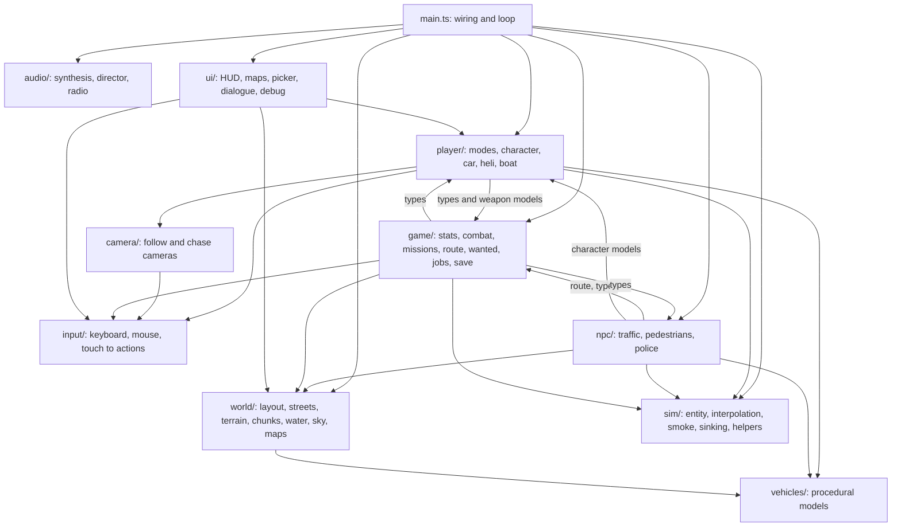

This graph is computed from the actual `import` statements, counted by folder.
- **`main.ts` is the only place everything meets.** It creates every object and connects them through hooks.
- **`world/` sits at the bottom.** It imports nothing above it except the parked-car models (`vehicles/`), `sim/smoke` and one input type.
- **The `player` ↔ `game` cycle is types only**, plus `game/weaponModels`: `player/onFoot.ts` imports the `PlayerStats` and `Combat` types and `buildWeaponModel`. `game/` imports player types the other way. TypeScript erases type-only imports, so nothing runs in a loop at load time.
- **`npc/police.ts` uses `game/route.ts`'s `Router`** for pursuit routes. That's the same A* the player's directions use.

### 2.2 Startup, in order

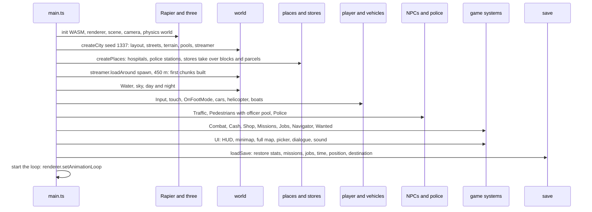

Two rules shape this order:
- **Places run before any chunk is built.** Hospitals, police stations and stores replace the buildings of their blocks or parcels, and chunks read those buildings when they're built.
- **Hook closures may refer to objects created later.** For example, the pedestrians' "an officer arrested you" hook calls `busted()`, which is defined after the police. That's safe because the closures only run once the loop starts, after every `const` exists. §8.1 lists every step.

### 2.3 One frame, and the fixed step inside it

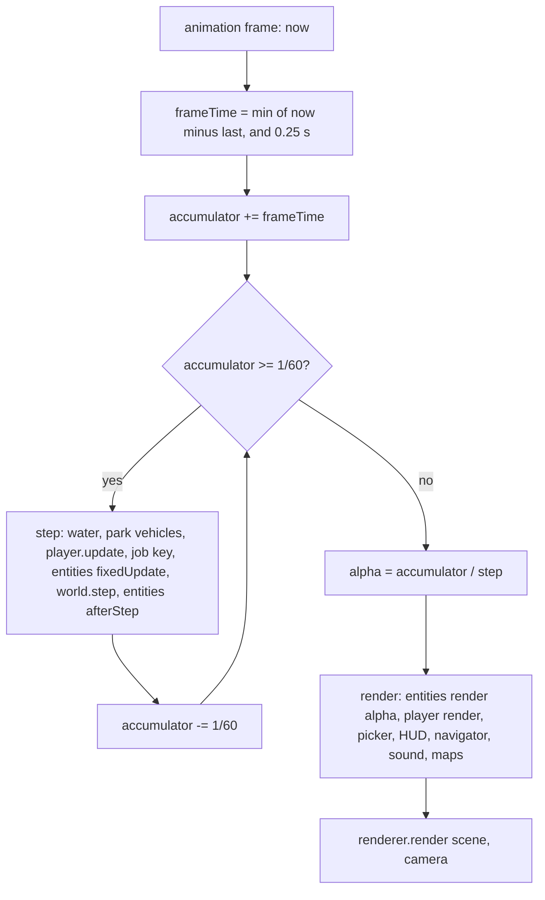

**Why a fixed step.**
- Physics is only stable and reproducible with a constant `dt`: suspension springs, the helicopter's hover controller and the boat's buoyancy would all behave differently at 30 and 144 fps.
- Tests run `game.simulate(seconds)`, which calls the same `step()` directly, so they don't depend on the (very slow) headless frame rate.
- **The 0.25 s cap (`MAX_FRAME_TIME`)** stops a "spiral of death" after a long pause, such as a background tab or a debugger. At most 15 steps run in one frame, and the game just slows down.
- **Interpolation by `alpha`** keeps motion smooth when the render rate and the step rate don't match. Meshes are drawn between the last two physics poses.

### 2.4 How systems talk: hooks, not imports

- **Systems don't reach for each other.** Each system is constructed with the things it needs: the physics world, the scene, layout data, and a *hooks* object of callbacks.
  - Pedestrians ask `hooks.player()` where the player is, and call `hooks.hitPlayer(damage)`.
  - Police call `hooks.busted()`.
  - Jobs call `hooks.vehicle()`.
- **Why:** each file stays testable and replaceable, there are no import cycles at run time, and `main.ts` is the single place where "who affects whom" is decided.
- **Downside:** `main.ts` is long (~800 lines). §8.1 walks through it.

### 2.5 The architecture rules, and why each exists

| Rule (CLAUDE.md) | Why |
|---|---|
| Fixed 60 Hz step with an accumulator; never step physics with a variable dt | Stable, frame-rate-independent physics; reproducible tests (§2.3). |
| Exactly one player mode; each owns its controller and camera | Entering a vehicle just switches mode. Nothing else needs "if driving…" special cases, so input, camera and HUD follow the mode. |
| Input is abstract (actions, not keys) | Keyboard, mouse and touch all feed the same actions. Rebinding lives in one table (`input/actions.ts`). |
| SI units, Y up | One convention across physics, rendering and gameplay numbers. |
| Physics owns transforms | Meshes copy from bodies each frame, so what you see is what collides. Moving a mesh directly would desync them. |
| Repeated objects go in instance pools; chunks only near the player | One draw call per object type, and memory bounded by the loaded area rather than the 4 km world. Phones are the target. |
| Heights from `surfaceAt` / `smoothHeight`, never a fixed curb height | Every town is hilly. A fixed height floats or buries things. |
| Roads are a graph | Curvy suburbs and country roads can't be described by grid maths. One graph serves rendering, traffic, routing and maps. |
| Deterministic generation, one random stream per cell | The same world every visit, and chunks can be built in any order. |

The cross-cutting consequences (heights, determinism, budgets, input blocking, disposal) are
gathered in §11.

---

## 3. World generation: seeds, layout, the street network and the suburbs

This area turns one integer seed into the *data* of the whole ~4 × 4 km world: which kind of land every 78 m cell is (its **zone**), the downtown blocks and their towers, every road in the world as one graph, and the suburbs' houses, lots and commercial or civic **parcels** (strip malls, gas stations, schools and so on). It is pure data: there is no three.js and no Rapier anywhere in these five files. Meshes and colliders are built later, chunk by chunk, by `world/chunks.ts` from what is generated here (§ on chunks). The CLAUDE.md rule "world *data* is generated for everything at startup and must stay cheap" is what this area implements.

The pipeline runs once, at startup, in `world/city.ts → createCity()`:

1. `generateCity(seed)` (`layout.ts`) gives every one of the 52 × 52 cells a zone, computes how far every cell is from a town, and generates the 100 downtown blocks (towers, roof clutter, street trees, lamps). `layout.streets` is still `null` at this point.
2. `new Terrain(layout)` (`terrain.ts`, another section) builds the height function. It needs the zones, but not the roads.
3. `buildStreets(layout, (x, z) => terrain.smoothHeight(x, z))` (`layout.ts`) calls `generateStreets()` (`suburbs.ts`). That lays out the arterials and country roads on a ~470 m "super-grid" (the country ones follow the smooth terrain), downtown's inner grid, the three villages, and every suburban **superblock** (the land between four arterials): commercial corners, civic frontage, then a subdivision grown by **walkers**, then houses on lots. All roads are drawn as polylines into a `NetworkBuilder` (`streets.ts`), which at the end finds every crossing and T-junction, splits the polylines into edges between nodes, prunes some country links, removes stubs and decides which junctions get traffic lights or stop signs. The result, a `StreetWorld` (graph + raster + parcels + houses + driveways + trees), is stored in `layout.streets`.
4. Countryside features (forest trees, farmsteads, hedgerow trees) are *not* generated at startup: `ruralFeatures()` (`layout.ts`) is called by `chunks.ts` per cell when its chunk is built, from the cell's own random stream.

Everything is deterministic. `rng.ts` gives a seeded PRNG (**mulberry32**) and `hashSeed(seed, x, z)`, which mixes a seed with two integers into an independent seed. Each downtown block, each countryside cell, each village and each superblock gets its own stream from `hashSeed`, so the content of one does not depend on how many random numbers another used. The seed in the game is `CITY_SEED = 1337` (`main.ts`).

**Diagram (a): data pipeline, from the seed to the consumers.**

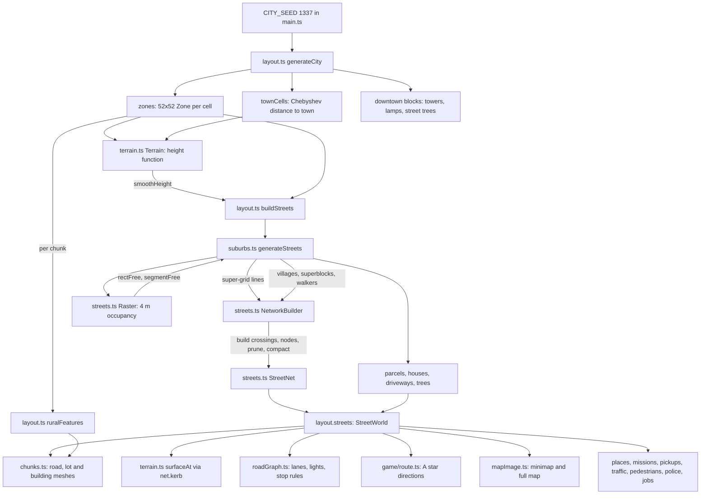

Measured numbers for seed 1337 (generation run once in Node 22 on the unmodified sources; they are what the code produces, not constants): 568 suburb cells, 12 village, 24 beachtown, 100 downtown, 876 farm, 781 forest, 31 lake, 312 beach. The street network has **849 nodes and 988 edges**: 222 downtown edges (17.1 km), 81 arterial (16.4 km), 192 collector (13.5 km), 415 local (28.7 km), 78 rural (32.6 km). Junction control: 360 `none`, 318 `stop`, 171 `lights`; 288 cul-de-sac bulbs; 318 dead-end nodes (degree 1), so 30 dead ends have no bulb. The suburbs hold 2137 houses (and as many driveways), 2065 house trees and 114 parcels (48 beach-town shops, 19 village shops, 20 gas stations, 13 strip malls, 6 churches, 4 schools, 3 big-box stores, 1 park). Every node is reachable from every other. `generateStreets` took ~440 ms in Node (DEVELOPER_GUIDE.md quotes ~200 ms in the browser).

---

### 3.1 `src/world/rng.ts`

**Purpose.** Seeded pseudo-random numbers: "same seed → same sequence → same city". A 32-bit PRNG (pseudo-random number generator: a function producing a repeatable sequence of numbers that look random), a seed mixer that gives each cell/chunk its own stream, and a small `Rng` class with the handful of helpers the generators need. Written by hand because the project forbids new dependencies.

**Depends on:** nothing. · **Used by:** `layout.ts` (`Rng`, `hashSeed`), `suburbs.ts` (`Rng`, `hashSeed`), `chunks.ts` (`Rng`, `hashSeed`), `textures.ts` (`Rng`), `game/pickups.ts` (`Rng`, `hashSeed`), `game/jobs.ts`, `npc/traffic.ts`, `npc/pedestrians.ts`, `npc/police.ts`, `ui/dialogue.ts`, `main.ts` (`Rng`). `mulberry32` is only used inside this file.

**Key constants.**

| Name | Value | Meaning / why |
|---|---|---|
| mulberry32 increment | `0x6d2b79f5` | Weyl-sequence step added to the state on every call |
| `hashSeed` x multiplier | `0x27d4eb2d` | spreads x over the 32 bits before mixing |
| `hashSeed` z multiplier | `0x165667b1` | spreads z (different constant so (x, z) ≠ (z, x)) |
| `hashSeed` finaliser | `0x85ebca6b`, `0xc2b2ae35`, shifts 15/13/16 | the MurmurHash3 `fmix32` avalanche: every input bit affects every output bit |
| divisor | `4294967296` (2^32) | maps an unsigned 32-bit int to [0, 1) |

**API.**

#### `mulberry32(seed: number): () => number`
- Returns a generator function; each call returns a float uniform in **[0, 1)**. The state `a` starts at `seed >>> 0` (forced to unsigned 32-bit).
- Algorithm (per call): `a = (a + 0x6d2b79f5) >>> 0; t = a; t = imul(t ^ (t >>> 15), t | 1); t ^= t + imul(t ^ (t >>> 7), t | 61); return ((t ^ (t >>> 14)) >>> 0) / 2^32`. `Math.imul` is a true 32-bit integer multiply (a plain `*` on doubles would lose the low bits).
- Side effects: only its own closure state. Called by: `Rng`'s constructor.
- Notes: chosen as "tiny, fast 32-bit PRNG with good statistical quality for games"; period 2^32.

#### `hashSeed(seed: number, x: number, z: number): number`
- Mixes a seed with two integer coordinates into a new **unsigned 32-bit** seed: `h = seed ^ imul(x, 0x27d4eb2d) ^ imul(z, 0x165667b1)`, then `h = imul(h ^ (h>>>15), 0x85ebca6b)`, `h = imul(h ^ (h>>>13), 0xc2b2ae35)`, return `(h ^ (h>>>16)) >>> 0`.
- Pure. Non-integer x/z are truncated by `Math.imul` (it converts to int32), which is why callers round (`Math.round(v.x)` for villages).
- Called by: `generateBlock` (per downtown cell), `ruralFeatures` (per countryside cell, with offsets +1000/+2000), `parkingSpots` (991, 17), `generateStreets` (901, 77 for the super-grid; 5, 5 for pruning; per village; per superblock), `chunks.ts`, `game/pickups.ts`.
- Why: "so each chunk gets its own independent random stream. A chunk's content then doesn't depend on generation order, which is what lets chunks be streamed in any order later."

#### `class Rng`
`constructor(seed: number)` stores `mulberry32(seed)` in a private `next`.

| Method | Returns | Contract |
|---|---|---|
| `float()` | number | uniform in [0, 1) |
| `range(min, max)` | number | `min + (max − min)·float()`, in [min, max) |
| `int(min, maxInclusive)` | number | `floor(range(min, maxInclusive + 1))`: an integer in [min, maxInclusive], both ends inclusive |
| `chance(p)` | boolean | `float() < p` (p ≤ 0 never, p ≥ 1 always) |
| `pick<T>(items)` | T | `items[floor(float()·length)]`; an empty array gives `undefined` |

Every method consumes exactly one number from the stream. That matters for determinism: an extra or skipped call (for example behind a short-circuit `&&`) shifts every later number in that stream.

**Decisions.**
- Hand-written PRNG → no dependencies allowed → rejected: a seeded-random npm package.
- Per-cell streams via `hashSeed` → content of a cell independent of generation order (needed for streaming and lazy `ruralFeatures`) → rejected: one global stream (any change anywhere would reshuffle the whole world, and lazily generated chunks would depend on load order).

---

### 3.2 `src/world/noise.ts`

**Purpose.** "Hand-written noise and easing helpers shared by the terrain and the road warp" (the road warp was removed in commit `a2ee3d1`; the helpers are now used by the terrain, chunks and suburbs). Value noise and fractal Brownian motion (fBm: several layers of noise at rising frequency and falling strength, summed).

**Depends on:** nothing. · **Used by:** `terrain.ts` (`fbm`, `hash2`, `lerp`, `smoothstep`, `valueNoise`), `chunks.ts` (`smoothstep`), `suburbs.ts` (`smoothstep`). (Other files that use a `smoothstep`/`lerp` define their own.)

**Key constants.**

| Name | Value | Meaning / why |
|---|---|---|
| `hash2` multipliers | `374761393`, `668265263`, `982451653`, `1274126177` | large odd constants for an integer hash |
| fBm lacunarity | `2.03` | each octave's frequency factor; slightly off 2 so octave lattices don't line up |
| fBm gain | `0.5` | each octave half the amplitude of the previous |
| octave seed step | `17` | octave `o` uses `seed + o·17` so octaves are uncorrelated |

**API.**

#### `smoothstep(a: number, b: number, x: number): number`
- `t = clamp((x − a)/(b − a), 0, 1)`, returns `t²(3 − 2t)`. 0 below a, 1 above b, smooth (zero slope) at both ends. `a === b` gives a division by zero (NaN/±Infinity clamped: x > a → 1, x < a → 0, x = a → NaN); callers never do that.

#### `lerp(a: number, b: number, t: number): number`
- `a + (b − a)·t`, no clamping.

#### `hash2(ix: number, iz: number, seed: number): number`
- Integer hash → [0, 1): `h = imul(ix, 374761393) + imul(iz, 668265263) + imul(seed, 982451653)`, `h = imul(h ^ (h >>> 13), 1274126177)`, returns `((h ^ (h >>> 16)) >>> 0) / 2^32`.

#### `valueNoise(x: number, z: number, seed: number): number`
- Smooth value noise in [0, 1]: random values at integer lattice points (from `hash2`), blended bilinearly with the smoothstep fade `u = f²(3 − 2f)` on each axis (`f` = fractional part). Feature size is 1 unit; callers scale coordinates.

#### `fbm(x: number, z: number, octaves: number, seed: number): number`
- Sum of `octaves` value-noise layers: amplitude starts at 0.5 and halves, coordinates multiply by 2.03 each octave, octave `o` uses `seed + o·17`. Divides by the sum of amplitudes so the result stays ≈ [0, 1]. `octaves = 0` returns `0/0 = NaN` (never called that way).

**Decisions.**
- Value noise rather than Perlin/simplex → "a few lines of maths are all the world generation needs", no dependency → rejected: a noise library.

---

### 3.3 `src/world/layout.ts`

**Purpose.** "The world layout as plain data: no three.js, no physics." It defines the world grid (52 × 52 cells, 78 m apart), the zone of each cell, the downtown blocks with their buildings, fixed places (villages, lake, spawn, helipad, the parked-car row), countryside features per cell, and the `buildStreets()` entry point that stores the street network in the layout. Every number about the downtown grid (road width, sidewalk, lot) lives here.

**Depends on:** `rng.ts` (`Rng`, `hashSeed`), `suburbs.ts` (`generateStreets`, type `StreetWorld`). · **Used by:** `city.ts` (`generateCity`, `buildStreets`, `helipadPosition`, `spawnPoint`), `terrain.ts` (grid constants, `cellCenter`, `cellOf`, `isTown`, `lakeRadius`, `lawnLift`, `lineCoord`, `COAST_LINE`, `townCells`), `chunks.ts` (grid constants, `lawnLift`, `lineCoord`, `ruralFeatures`, types), `facadeMaterial.ts` (`PARAPET`, `STYLE_METRICS`), `mapImage.ts`, `water.ts` (`LAKE`, `lakeRadius`), `suburbs.ts` (`isTownZone`, types `Building`, `Tree`, `Zone`), `main.ts` (`LAKE`, `helipadPosition`, `parkingSpots`), `game/places.ts`, `game/missions.ts`, `game/pickups.ts`, `game/shop.ts`, `game/jobs.ts`, `npc/traffic.ts`, `npc/pedestrians.ts`, `ui/fullMap.ts` (`WORLD_HALF`).

**Coordinates.** North is −Z. Grid line `k` (a downtown road centre line) is at `lineCoord(k) = (k − 26)·78`, so line 26 runs through the origin. Cell `c` spans lines `c … c+1`; its centre is `cellCenter(c) = (c − 25.5)·78`. Downtown cell plan, in metres:

```text
|<- ROAD 14 ->|<------------- BLOCK_SIZE 64 ------------->|
              | SIDEWALK 4 |<------- LOT 56 ------->| SIDEWALK 4 |
PITCH = BLOCK_SIZE + ROAD_WIDTH = 78
```

**Key constants.**

| Name | Value | Meaning / why |
|---|---|---|
| `CELLS` | 52 | cells per side |
| `ROAD_WIDTH` | 14 m | downtown roads: 4 lanes × 3.5 m (two each way) |
| `SIDEWALK` | 4 m | downtown sidewalk on each side of a block |
| `LOT` | 56 m | buildable lot inside a block |
| `BLOCK_SIZE` | 64 m | `LOT + 2·SIDEWALK` |
| `PITCH` | 78 m | `BLOCK_SIZE + ROAD_WIDTH`, distance between block centres = cell size |
| `CURB_HEIGHT` | 0.15 m | slab / lawn lift; "low enough for the character controller to auto-step" |
| `WORLD_HALF` | 2035 m | `(CELLS·PITCH + ROAD_WIDTH)/2`, half the world's size |
| `COAST_LINE` | 46 | grid line of the coastal road (z = 1560 m); cells with `bz ≥ 46` are beach/sea |
| `STYLE_GLASS` / `STYLE_BRICK` / `STYLE_CONCRETE` / `STYLE_HOUSE` | 0 / 1 / 2 / 3 | facade styles (curtain-wall tower, punched windows, ribbon windows, house/barn) |
| `STYLE_METRICS` | `[{5.0, 3.8}, {4.5, 3.2}, {4.5, 3.5}, {0.0, 3.0}]` | `{groundFloor, floor}` heights in m per style, shared with the facade shader |
| `PARAPET` | 1.0 m | wall above the top floor hiding the roof |
| `MID` | 26 | `CELLS/2`, downtown's centre cell index |
| `VILLAGES` | Eastfield (i 46, k 22), Westbrook (6, 30), Pinecrest (42, 6) | grid nodes with i, k ≡ 2 (mod 4); world points (1560, −312), (−1560, 312), (1248, −1560) |
| `LAKE` | `{x: −560, z: −1250, rx: 300, rz: 200}` | ellipse in the northern hills |
| `DOWNTOWN_FIRST` / `DOWNTOWN_LAST` | 21 / 31 | downtown's grid spans these lines (x, z from −390 to +390 m) |
| `DOWNTOWN_HALF` | 390 m | `(31 − 21)·78/2` |
| `HELIPAD_CLEAR_RADIUS` | 14 m | trees stay this far from the helipad centre (clear of the 5 m rotor) |

**Types.**

`Zone` = `'downtown' | 'suburb' | 'village' | 'beachtown' | 'farm' | 'forest' | 'beach' | 'lake'`.

`Building`

| Field | Type | Meaning |
|---|---|---|
| `x`, `z` | number | footprint centre |
| `y` | number | base height: `CURB_HEIGHT` on a downtown slab; 0 for suburban houses/parcels (chunks put them on the ground); ground − 0.3 for farm buildings |
| `width` | number | along X (before yaw) |
| `depth` | number | along Z (before yaw) |
| `yaw?` | number | turn about Y in rad; width runs along `(cos yaw, −sin yaw)`. Grid-aligned buildings omit it |
| `height` | number | walls, excluding any pitched roof |
| `style` | number | one of the `STYLE_*` |
| `color` | [r, g, b] | linear RGB wall colour |
| `seed` | number | 0–999, varies window details per building |
| `roof?` | `{height, color}` | pitched roof: ridge height and colour (houses, barns, churches) |
| `kind?` | `'hospital'` | special buildings get a sign (set by `game/places.ts`) |

`RoofProp`: `kind: 'ac' | 'tank'`; `building: Building` (the one it sits on, because its roof height changes when the block is on a slope); `x`, `y` (base height, = building height − PARAPET), `z`; `size: [x, y, z]`.

`Tree`: `x`, `y` (ground height at the trunk; `CURB_HEIGHT` downtown, 0 for suburb trees, real ground for rural trees), `z`, `scale`, `hue` (0..1 foliage variation).

`Lamp`: `x`, `z`, `yaw` (rad; the arm points along local +X toward the road).

`Block`

| Field | Type | Meaning |
|---|---|---|
| `bx`, `bz` | number | cell indices |
| `cx`, `cz` | number | centre in world metres |
| `zone` | Zone | always `'downtown'` today |
| `park` | boolean | a park instead of towers |
| `lawn` | boolean | grass over the lot (parks) |
| `helipad` | boolean | the helipad park next to the spawn |
| `buildings`, `roofProps`, `trees`, `lamps` | arrays | contents |

`CityLayout`

| Field | Type | Meaning |
|---|---|---|
| `seed` | number | the world seed |
| `townCells` | Uint8Array | Chebyshev distance in cells from each cell to the nearest town cell (0 in town, capped at 255) |
| `zones` | Zone[] | zone of every cell, index `bz·CELLS + bx` |
| `blocks` | Block[] | downtown blocks |
| `blockAt(bx, bz)` | Block \| null | block at a cell, null outside downtown or outside the grid |
| `streets` | StreetWorld | every road plus houses and parcels; `null` (cast) until `buildStreets()` runs |

`ParkedCarType` = `'sedan' | 'taxi' | 'van'`. `ParkingSpot`: `x`, `z`, `yaw` (rad; 0 = car facing +X), `type`, `colorIndex` (into the car paint palette).

`RuralFeatures`: `buildings: Building[]`, `trees: Tree[]`.

**API.**

#### `isTownZone(zone: Zone): boolean`
- True for `'suburb'`, `'village'`, `'beachtown'`: towns *outside* downtown (houses on lots, curbed streets). Used by `suburbs.ts` everywhere a "town" check is needed, and by `lawnLift`. (Moved here from `suburbs.ts` in the audit commit `ffd288c` so there is one definition.)

#### `isTown(zone: Zone): boolean`
- True for downtown, suburb, village, beachtown (a `Set` lookup). Differs from `isTownZone` by including downtown. Used by `townCellDistance` and `terrain.ts`.

#### `lawnLift(zone: Zone): number`
- `CURB_HEIGHT` (0.15 m) in town zones (`isTownZone`), else 0: how far lawns and sidewalks sit above the road. "The chunk meshes and Terrain.surfaceAt (where people stand) must agree on it", hence one shared function. Used by `terrain.ts` and `chunks.ts`.

#### `cellCenter(c: number): number` · `lineCoord(k: number): number` · `cellOf(x: number): number`
- `cellCenter(c) = (c − 25.5)·78`; `lineCoord(k) = (k − 26)·78`; `cellOf(x) = floor(x/78 + 26)`. `cellOf` may return an index outside 0…51.

#### `lakeRadius(x: number, z: number): number`
- Normalised ellipse radius `hypot((x − LAKE.x)/LAKE.rx, (z − LAKE.z)/LAKE.rz)`: < 1 inside the lake, 1 on its edge. Used for the lake zone, the street generator's `water()` test (< 1.12), `terrain.ts` and `water.ts`.

#### `generateCity(seed: number): CityLayout`
- Computes `zones` (for bz 0…51, bx 0…51, `zoneOf`), `townCells` (`townCellDistance`), and a `Block` for every downtown cell (`generateBlock`). Returns the layout with `streets` set to `null as unknown as StreetWorld`.
- Called once at startup by `city.ts createCity()`. Cheap (≈16 ms together with the terrain constructor in Node).

**Zone rules** (private `zoneOf(seed, bx, bz)`, evaluated at the cell centre `(x, z)`, first match wins):

| # | Test | Zone |
|---|---|---|
| 1 | `bz ≥ COAST_LINE` (46) | `beach` |
| 2 | `lakeRadius(x, z) < 1` | `lake` |
| 3 | `max(|x|, |z|) < 400` | `downtown` (cells 21…30 on both axes: 100 cells) |
| 4 | `bz === 45 && |x| < 900` | `beachtown` (cells 14…37: 24 cells) |
| 5 | within 120 m of a village point | `village` (the 4 cells round each village node) |
| 6 | `hypot(x, z > 0 ? 0.75z : z) + jitter < 1050`, jitter = `(hash01(seed, 7bx+1, 13bz+5) − 0.5)·160` (±80 m) | `suburb` (a rough ring, stretched south toward the beach by the 0.75 factor) |
| 7 | `z + 120·sin(x/500) < −700` | `forest` (north, with a wavy edge) |
| 8 | otherwise | `farm` |

`hash01(seed, a, b) = hashSeed(seed, a, b)/2^32` is a private helper.

#### `zoneAtPoint(layout: Pick<CityLayout, 'zones'>, x: number, z: number): Zone`
- Zone of the cell under a world point, with the cell index clamped to 0…51 (so points outside the world get the nearest edge cell's zone). Used by `buildStreets` (as `zoneAt` for the generator).

#### `buildStreets(layout: CityLayout, height: (x, z) => number): StreetWorld`
- Calls `generateStreets` with these inputs and stores the result in `layout.streets` (and returns it):
  - `seed: layout.seed`; `zoneAt: zoneAtPoint(layout, …)`; `height` (the terrain's smooth height, which country roads follow);
  - `water(x, z) = lakeRadius(x, z) < 1.12 || z > coastZ + 20` (lake with a 12 % margin, or more than 20 m south of the coastal road);
  - `half: WORLD_HALF` (2035), `downtownHalf: DOWNTOWN_HALF` (390), `downtownLines`: the 11 coordinates `lineCoord(21…31)` = −390, −312, …, 390;
  - `coastZ = lineCoord(COAST_LINE)` = 1560; `villages`: name + `lineCoord` world points.
- Called once by `city.ts` right after the `Terrain` is created: "country roads follow the land, so they need it", and the terrain then dips under the roads.

#### `generateBlock(seed: number, bx: number, bz: number, zone: Zone): Block`
- A downtown block from its own stream `new Rng(hashSeed(seed, bx, bz))`. Steps, in RNG order:
  1. `addStreetFurniture(block, rng, 0.85)`: on each of the 4 sides, slots at `t = −24, −13, −2, 9, 20` m along the side (start `−32 + 8`, step 11, skipping 8 m at the corners so crossings stay clear), each jittered ±1 m. Slot `i % 3 === 1` (t = −13 and 20) is a lamp at 0.5 m from the kerb, yaw `atan2(−nz, nx)` (arm over the road); the others are trees at 1.4 m from the kerb with probability 0.85, scale 0.8–1.2. So 8 lamps and up to 12 trees per block.
  2. "Downtown-ness" `downtown = 1 − min(1, hypot(cx, cz)/450)`: 1 at the centre, 0 at 450 m.
  3. `park = helipad || (downtown < 0.85 && chance(0.1))`. A park gets `lawn = true` and 18–30 trees uniformly over the lot (3 m from its edge, scale 0.9–1.6), skipping those within `HELIPAD_CLEAR_RADIUS` of the centre on the helipad block; then returns.
  4. Otherwise the lot is split into parcels: along X 1 part if `downtown > 0.6 && chance(0.35)` else `int(2, 3)` parts; along Z 1 part if `downtown > 0.6 && chance(0.35)` else 2 (`splitSpan`: weights in [0.8, 1.2] normalised to sum to 56 m, so the smallest part is ≥ 2/3 of an even share, ≥ 14 m for 3 parts).
  5. Each parcel gets a tower (`addTowerBuilding`): `tall = downtown²`; style glass if `float() < 0.15 + 0.7·tall`, else brick with 55 %, else concrete; floors `int(min, max(min, round(5 + 40·tall)))` with min 6 for glass, 2 otherwise; `height = groundFloor + floors·floor + PARAPET` ("snapped to whole floors so windows line up with the roof"); inset `1 + range(0, 2.5)` m on every side; skipped if width or depth < 8 m; `y = CURB_HEIGHT`; `wallColor` per style (glass: dark bronze / steel grey / near-black mullions ±15 %; brick: red, orange, brown brick, sand or pale grey stucco ±10 %; concrete: three greys ±10 %); `seed = int(0, 999)`.
  6. Roof clutter (`addRoofClutter`): `int(1, min(6, floor(w·d/120) + 1))` AC units (1.5–3 × 1–1.8 × 1.5–3 m, at least 2 m from the roof edge) at `y = height − PARAPET`; brick buildings get a water tank with probability 0.5 (radius 1.2–1.8 m, 3–4 m tall, within the middle half of the roof).
- The `zone` parameter is stored but only downtown is ever passed (the suburban branches were removed in `ffd288c`; suburbs come from `suburbs.ts` now).

#### `helipadPosition(layout: CityLayout): { x: number; z: number }`
- Centre of block `(MID + 1, MID + 2)` = (27, 28): world (117, 195). Ground level is the top of the block slab. Used by `city.ts` and `main.ts` (to place the helicopter).

#### `spawnPoint(layout: CityLayout): { x: number; z: number }`
- The south-west sidewalk corner of block `(MID, MID + 2)`: `(cx − 32 + 2, cz + 32 − 2)` = (9, 225). Chosen "two blocks out from the centre, looking down the street toward −Z at the downtown skyline (the very centre is a deep street canyon in permanent shade)". Used by `city.ts`.

#### `parkingSpots(layout: CityLayout): ParkingSpot[]`
- Five parked cars in the east (outer, kerb-side) lane of the north–south road just west of the spawn block: road centre `cx − PITCH/2` (= 0, line 26), lane `x = 0 + 7 − 1.75 = 5.25`, `z = cz + 22 − 8.5i` for i = 0…4 (217 … 183), `yaw = π/2` (facing −Z, the direction traffic drives on the east side). Types: i = 2 taxi, i = 4 van, others sedan; `colorIndex = int(0, 8)` from `Rng(hashSeed(seed, 991, 17))`. Used by `main.ts` at startup.

#### `ruralFeatures(seed, bx, bz, zone, ground, clear): RuralFeatures`
- Farmsteads and trees for one countryside cell, generated lazily (called by `chunks.ts` when the cell's chunk is built). `ground(x, z)` gives terrain height; `clear(x, z, margin)` says whether a spot is free of roads and water. Returns empty lists unless the zone is `farm` or `forest`. Stream: `Rng(hashSeed(seed, bx + 1000, bz + 2000))` (offset so it never equals a downtown block's stream for the same cell).
- **Forest:** a jittered grid, step 9.5 m (8 × 8 = 64 slots per cell), each filled with probability 0.62, jittered ±3.5 m, kept only if `clear(x, z, 10)`; scale 0.8–1.5; `y = ground(x, z)`.
- **Farm:** with probability 0.2 a farmstead near the centre (±12 m), if `clear(fx, fz, 30)`: a red barn `16–20 × 10–12 m`, walls 6.4 m, dark roof 4.5 m, and a farmhouse 20 m east (±6 m in z) `10 × 8 m`, walls 6.4 m, roof 3 m, both `STYLE_HOUSE`. Each is placed at `y = min(ground at the 4 corners) − 0.3` with its height increased by 0.3 so it is sunk into slopes rather than floating. Then 2–7 hedgerow trees anywhere in the cell (`clear(x, z, 10)`), scale 0.9–1.4.
- Why per chunk: "That keeps startup fast, since there are tens of thousands of forest trees" (DEVELOPER_GUIDE §4.1).

**Internals.** `townCellDistance(zones)`: a multi-source breadth-first search from every `isTown` cell over the 8 neighbours, giving Chebyshev distance in cells (255 = unreached). Used by `terrain.ts` to blend town and country hills. Small helpers: `forEachParcel`, `splitSpan`, `addTowerBuilding`, `addRoofClutter`, `wallColor`, `addStreetFurniture`, `addParkTrees`, `isHelipadBlock` (`bx === 27 && bz === 28`), `hash01`.

**Decisions.**
- Layout is plain data → can be generated for the whole 4 km at startup and queried anywhere (map, missions, route) while meshes stream → rejected: generating world content inside chunk building (except rural features, which are local and numerous).
- Downtown stays a grid of 78 m cells → kept from the original 8 × 8 city, and its blocks are raised slabs with their own sidewalks (`ROAD_SPECS.downtown.sidewalk = 0`).
- Zones decided per cell by simple geometric rules with a ±80 m hash jitter on the suburb edge → deterministic, cheap, ragged-looking edge.
- `CURB_HEIGHT` is 0.15 m → the character controller auto-steps it; CLAUDE.md forbids using it as a fixed ground height (use `terrain.surfaceAt`).

---

### 3.4 `src/world/streets.ts`

**Purpose.** The street network: a graph of every road in the world in world coordinates. "Downtown is a grid, but everything else (suburban arterials, winding subdivision streets, cul-de-sacs, country roads) has arbitrary shapes, so roads are stored as a general graph": **nodes** are junctions, dead ends and cul-de-sac bulbs with their junction control; **edges** are roads between two nodes, each a polyline (points every 5–8 m, 26 m on downtown's straight lines) with a road class. Generators don't build the graph directly; they draw polylines into a `NetworkBuilder` and say where a street joins another, and the builder works out the junctions. Two helpers are shared by generation and gameplay: `SegmentIndex` (spatial hash of segments) and `Raster` (4 m occupancy grid).

**Depends on:** nothing. · **Used by:** `suburbs.ts` (everything), `chunks.ts` (`ROAD_SPECS`, `StreetNet`, `StreetEdge`), `roadGraph.ts` (`ROAD_SPECS`, `StreetNet`, `StreetEdge`, `StreetNode`), `mapImage.ts` (`ROAD_SPECS`), `game/route.ts`, `game/missions.ts`, `game/pickups.ts`, `game/jobs.ts`, `npc/traffic.ts`, `npc/pedestrians.ts`, `npc/police.ts`; `terrain.ts` uses `net.kerb`/`net.kerbDistance` through `layout.streets`.

**Key constants.**

| Name | Value | Meaning / why |
|---|---|---|
| `BUCKET` | 32 m | cell size of the segment spatial hash (and of the cul-de-sac buckets) |
| SegmentIndex key | `(bx + 2048)·4096 + (bz + 2048)` | packs a bucket into one number; valid for ±2048 buckets (±65 km) |
| `CELL_FREE` | 0 | free land |
| `CELL_ROAD` | 1 | road surface, sidewalks and a margin round them |
| `CELL_PARCEL` | 2 | commercial / civic parcel |
| `CELL_HOUSE` | 3 | a house and its yard |
| `CELL_BLOCKED` | 4 | water, downtown, out of bounds |
| `Raster.res` | 4 m | raster cell size |
| `MERGE` (in `build`) | 1.5 m | node positions closer than this are one node |
| stub length | 18 m | dead-end edges up to this long (without a bulb) are removed |
| prune chance | 0.35 | probability a rural edge is considered for pruning |
| kerb search cap | 40 m | `kerb()` never scans segments further than `min(cap, 40)` |

**Road classes: `ROAD_SPECS`** (`RoadClass` = `'downtown' | 'arterial' | 'collector' | 'local' | 'rural'`; `RoadSpec` fields: `width` kerb to kerb in m, `lanes` each way, `sidewalk` width each side in m (0 = none), `speed` limit in m/s, `rank` importance: at a junction the smaller roads give way).

| Class | `width` | `lanes` | `sidewalk` | `speed` | `rank` | Where / note |
|---|---|---|---|---|---|---|
| `downtown` | 14 m | 2 | 0 | 12.5 m/s (45 km/h) | 4 | downtown grid; "blocks have their own sidewalks" (4 m on the slab) |
| `arterial` | 14 m | 2 | 2 m | 17 m/s (~61 km/h) | 4 | suburbs' four-lane main roads on the super-grid |
| `collector` | 10 m | 1 | 1.8 m | 12 m/s (~43 km/h) | 3 | the road through a subdivision; village main streets |
| `local` | 8 m | 1 | 1.6 m | 10 m/s (36 km/h) | 2 | residential streets, loops, cul-de-sacs |
| `rural` | 8 m | 1 | 0 | 19 m/s (~68 km/h) | 3 | country roads and village connectors |

Who reads which field: `width` → `halfWidth`, `kerb`, chunks (road meshes), raster corridors in `suburbs.ts`; `lanes` → `roadGraph.ts`/`traffic.ts` (lane changes on 2-lane roads); `sidewalk` → `kerb()` and so `terrain.surfaceAt`, chunks, pedestrians, pickups, missions, map; `speed` → `route.ts` edge cost (`length / speed` when driving) and `roadGraph.ts` lane speeds; `rank` → `compact()` (lights), `roadGraph.mustStop`, chunks (where to paint stop lines).

**Types.**

`JunctionControl` = `'lights' | 'stop' | 'none'`.

`StreetNode`

| Field | Type | Meaning |
|---|---|---|
| `id` | number | index in `net.nodes` |
| `x`, `z` | number | position |
| `edges` | number[] | ids of edges meeting here (degree = length) |
| `control` | JunctionControl | `none` for degree < 3; `lights` or `stop` otherwise (see Junction control) |
| `bulb` | number | radius of a cul-de-sac turning circle in m (0 if none; suburbs use 11) |

`StreetEdge`

| Field | Type | Meaning |
|---|---|---|
| `id` | number | index in `net.edges` |
| `a`, `b` | number | end node ids; `pts` runs from a to b |
| `cls` | RoadClass | road class |
| `pts` | Float32Array | x, z pairs from node a to node b; ends snapped exactly onto the nodes |
| `cum` | Float32Array | distance along the edge at each point (`cum[0] = 0`) |
| `length` | number | total length (= last `cum`) |

`NearestRoad`: `edge` (edge id, or **line id** when the query is on a `NetworkBuilder`'s index: the field holds the index's "owner"), `seg` (segment index: point seg → seg+1), `t` (fraction along it, 0…1), `x`, `z` (nearest point), `dist` (distance to it).

**Diagram (b): the classes.**

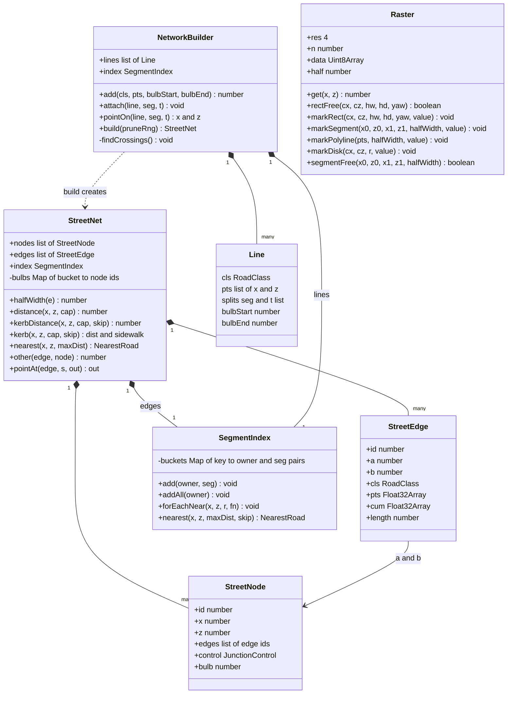

**API.**

#### `class SegmentIndex`
A spatial hash: buckets on a 32 m grid, each holding flat `(owner, seg)` pairs. An *owner* is anything with a polyline (an edge of a `StreetNet`, or a line of a `NetworkBuilder`); the constructor takes `polyline: (owner) => ArrayLike<number>` to fetch its points.

- `add(owner, seg)`: inserts segment `seg` (points seg → seg+1) into every bucket its axis-aligned bounding box touches.
- `addAll(owner)`: adds all `length/2 − 1` segments of the owner.
- `forEachNear(x, z, r, fn)`: calls `fn(owner, seg)` for every entry in the buckets overlapping the square `[x−r, x+r] × [z−r, z+r]`. **May call the same segment more than once** (a long segment sits in several buckets) and includes segments further than r; callers measure the distance themselves.
- `nearest(x, z, maxDist, skip?)`: the closest point on any segment strictly within `maxDist` (point-to-segment projection with `t` clamped to [0, 1]), skipping entries where `skip(owner, seg)` is true. Returns `null` if nothing is closer than `maxDist`. Cost grows with `maxDist²/32²` buckets.

#### Occupancy raster: `class Raster`
A 4 m grid of bytes over the square `[−half, half]²`. `constructor(half)`: `n = ceil(2·half/4)` (1018 for `half = 2035`, so 1,036,324 cells, ~1 MB). Cell `(i, k)` covers `x ∈ [i·4 − half, (i+1)·4 − half)`, same for z; index `k·n + i`.

What it is for: generators need to ask "would this lot, building or street overlap a road or another lot?" thousands of times. Testing polygons against polygons would be slow and fiddly; painting everything into a coarse grid and checking cells is cheap and simple, and 4 m is fine enough for lots and streets. Values have a priority order (FREE 0 < ROAD 1 < PARCEL 2 < HOUSE 3 < BLOCKED 4): **marking only ever raises a cell** (`if (data[i] < value) data[i] = value`), so a road corridor never "unblocks" water and a house is never downgraded to road. Measured at seed 1337 after generation: FREE 551,627 cells, ROAD 97,242, PARCEL 29,382, HOUSE 66,371, BLOCKED 291,702. The raster is returned in `StreetWorld.raster` but no code outside `suburbs.ts` reads it after generation.

- `get(x, z)`: the cell value; **outside the grid returns `CELL_BLOCKED`**.
- private `forRect(cx, cz, hw, hd, yaw, fn)`: visits every cell whose *centre* lies inside the rotated rectangle with centre (cx, cz), half-width `hw` along `u = (cos yaw, −sin yaw)` and half-depth `hd` along `v = (sin yaw, cos yaw)`. It loops over the rectangle's axis-aligned bounding box (`ex = |ux|·hw + |uz|·hd`, `ez = |uz|·hw + |ux|·hd`), projects each cell centre onto u and v (`a = x·ux + z·uz`, `b = x·(−uz) + z·ux`) and keeps it if `|a| ≤ hw` and `|b| ≤ hd`. If the rectangle reaches outside the world it first calls `fn(−1)`. If `fn` returns `false` it stops and returns false.
- `rectFree(cx, cz, hw, hd, yaw)`: true if every covered cell is `CELL_FREE` (and the rectangle is fully inside the world).
- `markRect(cx, cz, hw, hd, yaw, value)`: raises every covered cell to `value`.
- `markSegment(x0, z0, x1, z1, halfWidth, value)`: marks a rectangle along the segment, half-length `len/2 + halfWidth·0.5` (overlaps the joints between consecutive segments), half-width `halfWidth`, `yaw = atan2(−(z1 − z0), x1 − x0)`. No-op for a segment shorter than 1e-6 m.
- `markPolyline(pts, halfWidth, value)`: `markSegment` for each consecutive pair.
- `markDisk(cx, cz, r, value)`: cells whose centres are within r (used for cul-de-sac bulbs).
- `segmentFree(x0, z0, x1, z1, halfWidth)`: samples along the segment every ≤ 4 m (`steps = max(1, ceil(len/4))`, both ends included) and across it at offsets from `−halfWidth` to `+halfWidth` in steps of `max(4, halfWidth)` (for halfWidth 2: −2 and 2; for 6: −6, 0, 6). True only if every sample's `get()` is `CELL_FREE`. It is a sampled test: thin features between samples can slip through.

#### `smoothCurve(ctrl: number[], step: number): number[]`
- Resamples a control polyline (x, z pairs) into a uniform **Catmull-Rom** spline (a cubic curve through every control point with a continuous tangent) with about `step` m between points: each span gets `k = max(1, round(spanLength/step))` points. End tangents are extrapolated with phantom points `2·P0 − P1` and `2·Pn−1 − Pn−2`. Fewer than 3 control points → `resample`. Formula per coordinate, for `t ∈ (0, 1]`:

```text
p(t) = 0.5 · ( 2·p1 + (−p0 + p2)·t + (2·p0 − 5·p1 + 4·p2 − p3)·t² + (−p0 + 3·p1 − 3·p2 + p3)·t³ )
```
- The output passes exactly through every control point, so a street whose last control point is a point on another street ends exactly there (what makes T-junctions line up).

#### `resample(pts: number[], step: number): number[]`
- Straight-line resampling: each segment split into `max(1, round(len/step))` equal parts; keeps both end points and every original vertex.

#### `polylineLength(pts: ArrayLike<number>): number`
- Sum of segment lengths.

#### `class StreetNet`
`constructor(nodes, edges)`: stores them (readonly), builds `index` (a `SegmentIndex` over every edge) and the private `bulbs` map (nodes with `bulb > 0` bucketed by `floor(x/32)·4096 + floor(z/32)`). Built only by `NetworkBuilder.build()` → `compact()`.

- `nodes: StreetNode[]`, `edges: StreetEdge[]`, `index: SegmentIndex` (readonly fields).
- `halfWidth(e)`: `ROAD_SPECS[e.cls].width / 2`.
- `distance(x, z, cap = 200)`: distance to the nearest road **centre line**, or `cap` if none within `cap`.
- `kerbDistance(x, z, cap = 200, skip = −1)`: `kerb(...).dist`.
- `kerb(x, z, cap = 200, skip = −1): { dist, sidewalk }`: signed distance to the nearest **kerb** (edge of the asphalt): negative on the road, 0 on the kerb line, positive outside, capped at `cap`. It checks (1) cul-de-sac circles in the 3 × 3 buckets round the point: `hypot(x − n.x, z − n.z) − n.bulb`, sidewalk from the class of the node's first edge; (2) every segment within `min(cap, 40)` m: `distance to centre line − width/2`, skipping edge `skip` (so "a road's own sidewalk asks about the *other* roads"). `sidewalk` is that nearest road's sidewalk width (0 if none / nothing found). Used by `terrain.surfaceAt` (on the road → road height; within the sidewalk → +`CURB_HEIGHT`; beyond → lawn lift), chunks, pickups, missions, pedestrians. The 40 m cap came from the audit (`ffd288c`, "chunk build hitches (40 m road search)").
- `nearest(x, z, maxDist = 200)`: `index.nearest` (nearest point on any road centre line, or null).
- `other(edge, node)`: the other end node (`edge.a === node ? edge.b : edge.a`).
- `pointAt(edge, s, out)`: point and unit tangent at distance `s` from node a, written into `out` (`x`, `z`, `tx`, `tz`) and returned (no allocation; callers reuse `out`). `s` is clamped to [0, length]. Binary search on `cum` for the segment with `cum[lo] ≤ s < cum[hi]`, linear interpolation inside it; the tangent is that segment's direction (piecewise constant, not smoothed). Zero-length segments are guarded with `|| 1`.

#### `class NetworkBuilder`
Collects road polylines ("lines") and turns them into a `StreetNet`.

- `lines: Line[]` (private type `Line`: `cls`, `pts: number[]`, `splits: {seg, t}[]` where nodes must be, `bulbStart`, `bulbEnd` radii).
- `index: SegmentIndex` over the lines **as they are added**, so generators can ask "how far is the nearest existing street?" while growing new ones.
- `add(cls, pts, bulbStart = 0, bulbEnd = 0): number`: appends a line, indexes all its segments, returns its id.
- `attach(line, seg, t)`: "make sure there is a junction at a point on line `line` (something joins it there)": records a split. The joining street itself ends (or starts) at that exact point.
- `pointOn(line, seg, t): [x, z]`: point on a line at segment `seg`, fraction `t`.
- `build(pruneRng?): StreetNet`: the whole conversion, in this order:
  1. `findCrossings()` (private): for every segment of every line `li`, queries the index round the segment's midpoint (radius half its length + 1 m) for segments of lines `lj > li` (each pair of lines once; a line is never tested against itself, so a self-crossing makes no junction). Solves `a + (b − a)·t = c + (d − c)·u`; parallel segments (`|den| < 1e-9`) are skipped; a hit needs `t, u ∈ [0, 1]`. If both hits are at line *ends* (t or u within 1e-3 of the first or last point) it's an end-to-end join, not a crossing (the node merge handles it). Otherwise a split is added to **both** lines. Because a segment can be in several buckets the same crossing may be recorded twice; the duplicate collapses later (same node, zero-length edge skipped).
  2. Nodes are created with `nodeAt(x, z, bulb)`, which merges any point within **1.5 m** of an existing node (a 1.5 m hash grid with key `gx·100003 + gz`, 3 × 3 neighbourhood search) and keeps the larger bulb. "Attachments land on the line exactly, but rounding and smoothing can leave them a little off."
  3. For each line: splits with `t ≥ 1 − 1e-4` are moved to the start of the next segment; sorted by (seg, t). The vertex list is the original points (first and last flagged as nodes) plus inserted split points (a split at `t ≤ 1e-4` flags the existing vertex instead). The line is cut at every node vertex into runs; each run of length ≥ 0.5 m whose ends are different nodes becomes an edge. Duplicate edges are dropped by the key `min(a,b),max(a,b),round(length)` (two lines drawn over each other give one road). The edge's first and last points are snapped onto the (possibly merged) node positions, then `cum` and `length` are computed. Finally a line's `bulbStart`/`bulbEnd` is written onto the node at its first/last point.
  4. `compact(nodes, edges, pruneRng)` (below).

**Internals.**

`pruneCountry(nodes, edges, alive, rng)`: "Break up the regular pattern of country roads: drop about a third of the links between two junctions, keeping only drops that leave every road reachable." For each edge in order: only `rural` edges draw a number (`rng.float() > 0.35` → keep); the edge is a candidate only if both end nodes still have ≥ 3 alive edges; it is dropped tentatively and restored if a depth-first search from the first alive edge no longer reaches every alive edge. Cost O(E·(V + E)) but only for a few dozen candidates. The RNG is `Rng(hashSeed(seed, 5, 5))` from `generateStreets`.

`compact(nodes, edges, pruneRng?)`:
1. Prune country links (if an RNG is given; `generateStreets` always gives one).
2. Remove stubs, repeating until nothing changes: any alive edge **≤ 18 m** long with an end of alive degree 1 and no bulb at that end ("tiny dead-end stubs left where a line ran a metre past a crossing"). Cul-de-sacs survive because they have a bulb.
3. Renumber: keep only alive edges and the nodes they reference (isolated nodes vanish); ids become array indices again.
4. **Junction control**, for each node:

```text
degree < 3                                              → 'none'
any edge is 'downtown'                                  → 'lights'
top two ranks ≥ 4  AND  at least 2 edges are 'arterial' → 'lights'
otherwise                                               → 'stop'
```
   The comment says "Lights where two big roads cross (or anywhere downtown); stop signs on the smaller roads elsewhere." Note what the rule really does: where a street joins an arterial mid-line, the arterial is split into **two** arterial edges at that node, so the node has two rank-4 arterial edges and gets **lights** too. At seed 1337, of the 171 signalised nodes 120 involve a downtown edge, 15 have ≥ 3 arterial edges (arterial × arterial crossings), and 36 are streets joining an arterial. A `stop` node does not say *who* stops: `roadGraph.mustStop` decides (the lower-ranked roads stop; if all roads share the top rank at a ≥ 3-way junction and that rank is < 3, it's an all-way stop), and chunks paint stop lines only on lower-ranked approaches. Degree-2 nodes (where a road changes class, e.g. arterial → rural, or a connector meets a main-street end) stay `none` and traffic drives straight through them.

**Decisions.**
- **A graph instead of a grid** → American suburbs need branching, looping, dead-end and curving streets at any angle, which no deformed grid can make → rejected: the earlier "road warp" (commit `fbf08cd`, `world/warp.ts`, removed in `a2ee3d1`), which pushed the grid sideways with smooth noise (~2 m downtown, ~7 m suburbs, ~25 m country) and "read as regular waves, not real streets" (DEVELOPER_GUIDE §4.1b).
- **Generators draw polylines; the builder finds junctions** → generators stay simple (no graph bookkeeping while growing streets) and every crossing is found by one robust pass → rejected: generators inserting nodes and splitting edges themselves.
- **One network for everything, downtown included** → traffic, routing, the map, chunks and pedestrians all use one API (`net.distance`, `net.kerb`, `net.nearest`, `net.pointAt`), which CLAUDE.md requires instead of grid maths.
- **Spatial hash with 32 m buckets** → distance queries touch few segments; fine enough for 5–8 m segments, coarse enough for 40–200 m queries.
- **Occupancy raster at 4 m** → cheap overlap tests for thousands of lots; priority-max marking keeps it consistent → rejected: exact polygon intersection.
- **Node merge 1.5 m, stub removal ≤ 18 m** → absorb smoothing/rounding error at joins and the short tails left past crossings.
- **Prune ~35 % of eligible rural links, only if connectivity holds** → breaks the visible super-grid pattern in the countryside without stranding any road.
- **Cul-de-sac radius on the node** (`bulb`) → kerb distance, chunk meshes, map and U-turns (`roadGraph`) all read one number.

---

### 3.5 `src/world/suburbs.ts`

**Purpose.** Generates every road and lot outside downtown "the way American sprawl is laid out": arterials on a rough half-mile super-grid that continue as wandering country roads outside town; superblocks between arterials filled with subdivisions (2–4 entrances, a curving collector, local streets that wind, loop back or end in cul-de-sacs, houses facing the local streets and backing onto the arterials); strip malls, gas stations and big-box stores at arterial corners; schools, churches, parks along the arterials; a row of shops on the coastal road; villages with a main street and side streets joined to the country roads. Streets are grown by **walkers**: "a point that steps forward a few metres at a time, turning a little each step (a random walk on the turn rate, so curves are smooth and irregular, never periodic)".

**Depends on:** `rng.ts` (`Rng`, `hashSeed`), `noise.ts` (`smoothstep`), `streets.ts` (`NetworkBuilder`, `Raster`, `ROAD_SPECS`, `CELL_*`, `resample`, `smoothCurve`, types), `layout.ts` (`isTownZone`, types `Building`, `Tree`, `Zone`). · **Used by:** `layout.ts` (`generateStreets`, `StreetWorld`), `chunks.ts` (`Parcel`, `Rect`), `mapImage.ts` (`Rect`), `game/places.ts` (`Parcel`, `ParcelKind`: stores become places).

**Key constants.**

| Name | Value | Meaning / why |
|---|---|---|
| `SPACING` | 470 m | super-grid spacing ("half-mile", scaled to the world) |
| `EDGE` | 1800 m | super-grid lines run out to ±1800 m |
| `BULB` | 11 m | cul-de-sac radius |
| `FRONT` | 14 m | parcels on an arterial start this far from its centre line (clear of its marked corridor) |
| `WALLS` | 9 RGB colours | house wall colours |
| `ROOFS` | 5 RGB colours | house roof colours |
| `SHOP_COLORS` | 4 RGB colours | strip-mall walls |
| `PASTELS` | 5 RGB colours | beach-town and village shops |
| `STYLE_HOUSE/BRICK/CONCRETE` | 3 / 1 / 2 | local copies of the layout's style ids |
| raster blocked square | `downtownHalf + 12` = 402 m | downtown is off limits |
| raster world limit | `EDGE + 60` = 1860 m | beyond it everything is blocked |
| lateral table step | 8 m | `SuperLine.lateral` sample spacing |
| super-line control spacing | `(end − start)/max(2, round((end − start)/170))` ≈ 168–172 m | control points of arterials (the code comment says ~200 m; the code divides by 170) |
| town / country drift | ±20 m / up to ±115 m | sideways push of super-line control points |

**Types.**

`Rect`: `x`, `z` (centre), `yaw` (local +Z points away from the street, i.e. the depth goes into the lot), `w` (along the street), `d` (deep).

`ParcelKind` = `'stripmall' | 'gas' | 'bigbox' | 'school' | 'park' | 'church' | 'shop' | 'village'`.

`Parcel` (extends `Rect`)

| Field | Type | Meaning |
|---|---|---|
| `kind` | ParcelKind | what it is |
| `buildings` | Building[] | its buildings (y = 0, yaw = parcel yaw) |
| `paved` | Rect[] | asphalt: parking lots, forecourts, entrance driveways |
| `stalls` | Rect[] | parking areas to paint stall lines on (inside `paved`) |
| `grass` | Rect[] | lawns |
| `fields` | Rect[] | sports fields |
| `ponds` | `{x, z, rx, rz, yaw}[]` | elliptical ponds (parks) |
| `trees` | Tree[] | trees |
| `canopy` | Rect \| null | gas-station canopy (flat roof on posts) |
| `steeple` | `{x, z, size, height}` \| null | church steeple |

`StreetWorld`: `net: StreetNet`, `raster: Raster`, `parcels: Parcel[]`, `houses: Building[]`, `driveways: Rect[]`, `trees: Tree[]` (house and street trees).

`StreetInputs`: `seed`; `zoneAt(x, z)`; `height(x, z)` (smooth terrain, roads follow it); `water(x, z)` (lake or sea, with a margin); `half` (world half size); `downtownHalf` and `downtownLines` (downtown is the square |x|, |z| ≤ downtownHalf, a grid with these lines); `coastZ`; `villages: {name, x, z}[]`.

**API.**

#### `generateStreets(inp: StreetInputs): StreetWorld`
The only exported function. Order of work (the order matters: everything shares one builder and one raster, and later steps avoid what earlier ones marked):

0. `rng = Rng(hashSeed(seed, 901, 77))` (super-grid), `builder = new NetworkBuilder()`, `raster = new Raster(half)`. Every raster cell whose centre is water, inside the 402 m downtown square, or beyond 1860 m (Chebyshev) is set to `CELL_BLOCKED`.
1. **Super-grid lines.** `dh = downtownHalf` (390). For `v = 390, 860, 1330, 1800`: N–S lines at `x = ±v`; E–W lines at `z = −v`, and at `z = +v` only if `v < coastZ − 100` (1460), plus the coastal line at `z = coastZ` (1560). So 8 N–S lines (x = ±390, ±860, ±1330, ±1800) and 8 E–W lines (z = −1800, −1330, −860, −390, 390, 860, 1330, 1560). The innermost lines are downtown's edge lines continued outward. N–S lines run from `zMin − 1` to `coastZ + 1`; E–W lines from `xs[0] − 1` to `xs[last] + 1`. Each is built with `superLine` (the coastal one with `coastLine`) and added with `addLine`.
2. **Downtown's inner grid**: for each of the 11 downtown line coordinates except ±390 (within 1 m), one N–S and one E–W `'downtown'` line from −391 to 391, resampled every 26 m. (The edges ±390 are the super-grid lines, classed `downtown` inside the square by `addLine`.)
3. **Villages**: `village(...)` for each, with `Rng(hashSeed(seed, round(v.x), round(v.z)))`.
4. **Superblocks**: for each pair of adjacent N–S lines (i) and E–W lines (j) (7 × 7 = 49 cells of the super-grid), skip the one whose centre is downtown; sample a 6 × 6 grid of points over the base rectangle and count those in a town zone; need **≥ 5 of 36**. Then `superblock(...)` with `Rng(hashSeed(seed, i·31 + 7, j·17 + 3))`.
5. `net = builder.build(Rng(hashSeed(seed, 5, 5)))` and return `{ net, raster, parcels, houses, driveways, trees }`.

Called once by `layout.buildStreets`.

**Internals: the super-grid.**

`SuperLine` (private): `dir: 'ns' | 'ew'`, `base` (nominal x for N–S, z for E–W), `start`, `lateral: Float32Array` (the line's actual sideways position every 8 m of "along" from `start`), `pts` (the world polyline). `across(l, along)` linearly interpolates `lateral` (index clamped), answering "where is this line at this along-coordinate?" in O(1). Superblocks use it to find their wavy edges and corners.

`superLine(inp, rng, dir, base, start, end)`: `n = max(2, round((end − start)/170))` control points evenly spaced, the interior ones jittered ±35 m along the line. At each, `dd` = distance outside downtown's square, `calm = smoothstep(0, 150, dd)` (no drift on downtown's edges, fading in over 150 m), `country` = zone is neither town nor downtown, `amp = (country ? 115 : 20)·calm`. If `amp > 0.5`:
- in the country (after the first point): try the 7 offsets `o = (c/3)·amp`, c = −3…3, and take the cheapest
  ```text
  cost = |height(candidate) − prevH|·2 + |o − prevOff|·0.08 + random(0, 22)
  ```
  (little climb from the previous point, little swerve, some randomness), so country roads follow valleys and contours;
- in town (or the first point): `off = random(−amp, amp)`.

The control points go through `smoothCurve(ctrl, 8)`, and the lateral table is filled by walking the polyline.

`coastLine(z0, start, end)`: a straight line at `z0` resampled every 8 m, constant lateral table. "The coastal road: nearly straight, just above the beach."

`addLine(inp, builder, raster, pts)`: classifies every point: water → `null` (the road is cut); inside the `downtownHalf + 2` square → `'downtown'`; else `'arterial'` if the point or any of 4 points 40 m away (N, S, E, W) is in a town zone ("the coastal road edges the beach town"), else `'rural'`. Then a majority vote over ±10 points (±80 m) among non-null, non-downtown points (ties → arterial) "so a road doesn't flicker between arterial and country road at a ragged suburb edge". Consecutive equal classes form runs; consecutive runs share their boundary point (a run that ends at water also includes the first water point). A run is added (and its corridor marked `CELL_ROAD` with half-width `width/2 + sidewalk + 4`: 13 m arterial, 11 m downtown, 8 m rural) only if it has ≥ 2 points and spans more than 60 m (`(end − start)·8 > 60`): "Drop short scraps beside the lake."

**Internals: walkers.**

`WalkOpts` (private): `cls`, `step` (m per step), `turnSd` (random change of turn rate per step, rad), `maxTurn` (max turn per step, rad), `minLen`, `maxLen`, `spacing` (keep this far from other streets except where joining), `region(x, z)` (allowed area), `join` (may end by joining a street ahead, making a loop), `curl?` (steady turn per step for a loop street). `Walk`: `{line, pts}`.

`walk(builder, raster, rng, x, z, heading, opts, parent)`: grows one street from (x, z), heading `heading` (direction `(cos h, sin h)`), starting on `parent` (line, seg, t) or nowhere. Returns the added line or `null` if shorter than `minLen` (then nothing is added, but RNG numbers were used). Per step, while `len < maxLen`:
1. **Join ahead** (if `join` and `len > 45`): nearest street within 32 m of the point 16 m ahead, ignoring the parent while `len < 120`. Accepted if it is > 3 m away, roughly ahead (`cos(angle) > 0.4`), and the raster is free along the connecting segment (from 2 m out to 9 m short of the target, half-width 2 m). Then the target point is the last control point, the joined line is remembered, and the walk ends.
2. **Turn rate**: `rate = clamp(rate·0.8 + gauss·turnSd, ±maxTurn)`: a damped random walk on the turn rate, so curves "tighten and relax, never a regular wave". For a loop street (`curl`) after 45 m: `rate = curl + gauss·turnSd·0.3` (a steady curl, not clamped).
3. **Step**: try heading changes `extra ∈ [0, +0.22, −0.22, +0.45, −0.45, +0.7, −0.7]` rad in that order; the new point `step` m ahead must be in `region`; after the first 16 m it must also have a free raster corridor (`segmentFree` from 2 m ahead, half-width `width/2 + 1`) and not be `tooClose`. The first that passes is taken; if it needed an `extra`, `rate *= 0.3`.
   - `tooClose(px, pz, near)`: any builder line within `spacing` (the parent is ignored while `near < spacing + 10`), or any of the walker's own earlier control points (all but the last `ceil(1.2·spacing/step) + 1`) within `0.9·spacing` (stops it doubling back onto itself).
   - The first 16 m skip the raster test because "its own corridor is still marked": the parent road's corridor.
4. **Boxed in** (no step possible): if `join` and `len > 60`, look for any street within 62 m (parent ignored while `len < 140`); if > 6 m away, not behind (`cos > −0.1`), corridor free, and with probability 0.75, add a midpoint control point (for a gentle turn, "so the join isn't a kink") and the target point, and join. Either way the walk ends.

Afterwards: if it didn't join, it's a dead end. It gets a **cul-de-sac bulb** of `BULB` (11 m) if none of 8 points at radius `11 + sidewalk + 2` round the end is `CELL_BLOCKED` (only *blocked*, not road or house); otherwise it's a plain dead end. The control points become `smoothCurve(ctrl, 5)`; `builder.add(cls, pts, 0, bulb)`; `attach` on the parent and on the joined line (so both get a T-junction node); the corridor is marked `CELL_ROAD` with half-width `width/2 + sidewalk + 1` (6.6 m local, 7.8 m collector) and the bulb disk with radius `bulb + sidewalk + 1`.

`gauss(rng)`: `(u1 + u2 + u3 − 1.5)·2`, a sum of three uniforms: mean 0, standard deviation 1 (variance 3·(1/12)·4 = 1), close enough to normal.

`along(pts, s)`: point, unit tangent and **right-hand normal** `(nx, nz) = (−tz, tx)` at distance `s` along a polyline (heading +X, the right is +Z, i.e. south). Past the end it returns the last segment's end; empty input returns the first point with tangent +X.

`locate(builder, x, z, line?)`: the builder line point nearest (x, z) within 6 m, as `{line, seg, t}`, or null. With `line` given it only considers that line (the skip function drops every other owner); no caller passes it. Callers instead check `at.line === expected`.

**Diagram (c): how a superblock is grown** (`superblock()`).

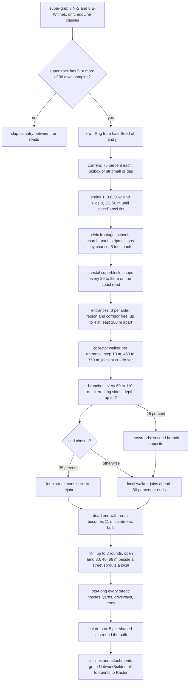

`superblock(inp, builder, raster, out, rng, sb)` with `sb = {west, east, north, south}` super-lines. Helpers:
- `inside(x, z, margin)`: strictly between the drifted west/east lines and north/south lines, with a margin.
- `town(x, z)`: `isTownZone(zoneAt) && !water`. `region` = `inside(…, 12) && town` (streets and houses); `parcelRegion` = `inside(…, 6) && town` ("parcels front onto the arterials, so their corners may come closer to them").
- `coastal`: the south line is the coastal road (`|south.base − coastZ| < 1`).
- `corner(ns, ew)`: the crossing point of two drifted lines, by 4 rounds of fixed-point iteration (`x = across(ns, z); z = across(ew, x)`), which converges because the lines are nearly perpendicular.

Steps, in RNG order:

1. **Commercial corners.** For the NW, NE, SW, SE corners (skipping the southern ones of a coastal superblock), with probability 0.75: the corner must be town 60 m diagonally inward. `r = float()`: **big-box** if none yet in this superblock and `r < 0.14`, **strip mall** if `r < 0.62`, else **gas station**. Sizes (w × d): big-box 200 × 150, strip mall 110–160 × 70–85, gas 55 × 45. The parcel fronts onto the E–W arterial with probability 0.6, else the N–S one. Its inward normal comes from the frontage line's slope measured ±6 m round the middle of the parcel's frontage ("the road may bend over that length"); its tangent points away from the corner. Placement tries scale ∈ {1, 0.8, 0.62} × slide ∈ {0, 25, 50} m: centre `= corner + u·(FRONT + slide + w'/2) + n·(FRONT + d'/2)` with `w' = w·scale`, `d' = max(40, d·scale)`; a big-box at scale < 1 is placed as a strip mall instead. The first `placeParcel` that succeeds wins. (The `bigbox` flag is set when chosen, even if it ends up as a strip mall or not placed.)
2. **Civic frontage.** The "sides" are the north (inward +1), west (+1), east (−1) and, unless coastal, south (−1) lines; `sideOf(line, from, to, inward)(f)` gives the point at fraction `f` along the side, with the inward unit normal from the line's slope over ±4 m. Kinds are added with probabilities school 0.3, church 0.35, park 0.4, strip mall 0.45 ("strip malls also line the arterials between the corners"), gas 0.25. Sizes: school 170 × 125, church 70 × 65, strip mall 100–140 × 65–80, gas 55 × 45, park 90–130 × 80–110. Up to 5 tries each: random side, `f ∈ [0.25, 0.75]`, centre `FRONT + d/2` inward.
3. **Beach town** (coastal superblock only): from 30 m east of the SW corner to 30 m west of the SE corner, every 26–32 m, where the point 20 m north of the coast road is `beachtown`: a `'shop'` parcel 24 × 20 m centred 24 m north of the road (`FRONT + 10`), facing south (normal (0, −1) points into the parcel, i.e. north), region = town only.
4. **The subdivision.** Candidate entrances at `f ∈ {0.28, 0.5, 0.72}` ± 0.08 on each side, kept if the point 36 m inward is in `region` and the raster is free from 20 m to 50 m inward (half-width 6 m, so not through a parcel just placed). Shuffled (Fisher–Yates with the stream), then up to 4 chosen at least 180 m apart. (The header says "two to four entrances"; the code allows fewer if fewer qualify.) Each is snapped onto the arterial line with `locate` (within 6 m) and queued as a **collector** at depth 0 heading inward.
   The queue is processed first-in-first-out, at most 200 walks (`guard`). Walk options:

   | | collector | local | local loop (`curl`) |
   |---|---|---|---|
   | `step` | 18 m | 15 m | 12 m |
   | `turnSd` | 0.07 | 0.1 | 0.1 |
   | `maxTurn` | 0.16 | 0.22 | 0.34 |
   | `minLen` | 120 m | 45 m | 45 m |
   | `maxLen` | 450–750 m | 110–280 m | 420 m |
   | `spacing` | 58 m | 52 m | 52 m |
   | `join` | always | 80 % | always |

   After each successful walk with `depth < 2`, branches: starting 45–80 m along, every 60–110 m, until 35 m from the end; on a local parent each slot is used only with probability 0.55. The slot must locate back onto the same line. A branch is a local street heading along the normal on alternating sides, ±0.3 rad, with `curl = −side·(0.24–0.3)` with probability 0.35 (it curls back toward the side it came from and rejoins), and with probability 0.25 a second branch straight across ("a crossroads", no curl). Collectors are depth 0, their branches depth 1, branches of branches depth 2 (which branch no further).
5. **Infill**: "wherever open land is left beside a street, sprout another local street, so the subdivision covers the superblock the way real ones do." Up to 3 rounds (stops early when a round grows nothing). For every street so far, every 26–36 m from 25 m to 20 m before its end, on each side: if the points 30, 48 and 66 m out are all in `region` and `CELL_FREE`, and the point locates back onto that street, walk a local street (loop with probability 0.3: step 12, maxTurn 0.34, maxLen 420, curl `−side·(0.24–0.3)`; else step 15, maxTurn 0.22, maxLen 90–240; turnSd 0.1, minLen 40, spacing 50, `join` with probability 0.75), heading out ±0.35 rad.
6. `lotsAlong` for every collector and local street of the superblock (not the arterials: houses never face them, and the arterials' raster corridor plus the 12 m region margin keep houses off them, so back yards face the arterial).

`lotsAlong(rng, raster, out, pts, cls, bulbEnd, region)`: walks the street from 10 m to 10 m before its end in frontages of 19–25 m; at the middle of each frontage, on both sides, `tryHouse` with the kerb at `width/2`:
- house width `min(frontage − 5, 10–15)`, depth 9–12.5 m, setback 5.5–8.5 m; centre at `kerb + sidewalk + setback + d/2` from the centre line;
- rejected unless the centre and a point `d/2 + 6` m behind it are in `region` and the raster is free for the house plus 2 m all round;
- marks the yard (from the sidewalk to 7 m behind the house, `frontage − 1` wide) and the house plus 1 m as `CELL_HOUSE`;
- `house()`: 1 or 2 floors (0.55 for 2), `height = floors·3 + 0.4`, `STYLE_HOUSE`, wall from `WALLS`, roof 2.2–3.4 m from `ROOFS`, `yaw = atan2(nx, nz)` so its local +Z (back) points away from the street and its front faces the street at whatever angle the street runs;
- a 3.4 m wide driveway on a random side (`±(w/2 − 1.8)` along the street), from the kerb, `sidewalk + setback + 1` long;
- a back-yard tree with probability 0.65 (3.5 m behind the house, scale 0.8–1.25) and a front-lawn street tree with probability 0.3 (1.6 m inside the sidewalk, on the other side from the driveway, scale 0.7–1.0).

With a bulb: five pie-shaped lots round the turning circle at angles −1.75, −0.9, 0, 0.9, 1.75 rad from the street's end direction, each on the circle (radius 11 m), facing its centre, kerb 0, frontage 20 m.

**Internals: parcels.** `placeParcel(rng, raster, out, kind, x, z, nx, nz, w, d, region): Parcel | null`: a rectangle facing a road, centre (x, z), `(nx, nz)` pointing from the road into it, `w` along the road, `d` deep; `yaw = atan2(nx, nz)`, local axes u (along) and v (into). Rejected unless the centre and at least 3 of 4 corners are in `region` ("suburb edges are ragged") and the raster is free over the whole rectangle; then marks it plus 3 m as `CELL_PARCEL`. Local coordinates (a along, b into, `front = −d/2` is the road edge). `entrances(gap)` adds two 9 m wide driveways at `a = ±gap` reaching from the arterial's kerb to the parcel front (`reach = FRONT − 7 + 0.5 = 7.5` m). Contents by kind:

| Kind | Buildings | Paved / stalls / other |
|---|---|---|
| `stripmall` | one row at the back: `(w − 10) × 20 m`, 5.5–7 m tall, brick or concrete (50/50), `SHOP_COLORS` | lot `w × (d − 26)` in front with stalls `(w − 8) × (lotD − 12)`; trees every 24 m along the front; entrances at ±w/3 |
| `bigbox` | `120 × 78 m`, 10 m, concrete, centred 42 m in from the back | lot `w × (d − 86)` with stalls; loading yard 36 × 76 m beside the store; entrances at ±w/3 |
| `gas` | kiosk 16 × 10 m, 4.2 m, concrete | whole parcel paved; canopy 26 × 14 m at 17 m from the front; entrances at ±(w/2 − 8) |
| `school` | L of two 8 m brick wings (64 × 22 and 22 × 40), colour (0.66, 0.42, 0.3) | car park 64 × 18 (stalls 60 × 14) with a driveway; grass over the right half and a sports field up to 72 × 100 m; trees every 14 m along the left edge |
| `church` | 18 × 30 m, 7 m, brick (white-ish or red), pitched roof 5 m | steeple 5 m square, 22 m tall in front of it; lot 26 × (d − 14) on the right with stalls and a 9.5 m driveway; grass strip on the left; 2 trees |
| `park` | none | all grass; an elliptical pond (radius `min(w, d)·0.14–0.2`, rx = 1.5·r, random tilt ±0.5 rad); `round(w·d/260)` random trees, none near the pond |
| `shop`, `village` | one building `(w − 2) × 14 m` at the front, 1–3 floors (`floors·3.2 + 1.5` m), brick, `PASTELS` | none |

**Internals: villages.** `village(inp, builder, raster, out, rng, v)`: region = within 230 m of the village point and not water. A **collector** main street through the centre at a random angle in [0, π): 11 control points 40 m apart (k = −5…5) with a lateral bend that random-walks ±6 m per point, `smoothCurve(…, 6)`, corridor marked `CELL_ROAD` (half-width 7.8 m). Both ends are joined to the network by `connect`. `'village'` shop parcels 20 × 18 m on both sides every 20–26 m within ±90 m of the middle (16.3 m from the centre line). Three side-street attempts: local walkers from random points (20–80 % along), heading out ±0.3 rad (step 15, turnSd 0.1, maxTurn 0.22, minLen 45, maxLen 90–180, spacing 50, join always). Then `lotsAlong` for the main street and the side streets.

`connect(inp, builder, raster, rng, x, z, heading, from)`: a country road from a village street end to "the nearest existing road ahead": the target is the nearest road point (other than line `from`) within 700 m of the point 200 m ahead. Up to 60 steps of 25 m (≤ 1.5 km), stopping within 30 m of the target. Each step steers toward the target (turn clamped to ±0.35 rad), choosing among offsets −0.25, 0, +0.25 rad the one with least `|Δheight|·3 + |offset|·6 + random(0, 3)`, skipping water (if all are water it takes the unadjusted heading). It finishes exactly on the nearest road point within 80 m of where it stopped (else nothing is added), is smoothed (`smoothCurve(…, 8)`), added as `'rural'`, attached to the road it reached (T-junction), and its corridor is marked (half-width 8 m). It starts exactly at the main street's end point, so the node merge joins them (a degree-2 node).

Small helpers: `polyLen`, `shuffle` (Fisher–Yates with `rng.int`), `yawFacing(nx, nz) = atan2(nx, nz)`.

**Decisions.**
- **Super-grid arterials (~470 m)** → American suburbs sit on a half-mile (≈ 800 m) grid of arterials; scaled down to fit a 4 km world → rejected: arterials grown freely (they would not line up with downtown's edges or each other).
- **Arterials drift ±20 m in town, up to ±115 m in the country choosing the gentlest climb** → nearly straight town arterials, country roads that follow valleys and contours.
- **Class smoothing over ±80 m** → no flickering between arterial and rural at a ragged suburb edge.
- **Walkers instead of templates or noise-warped grids** → a random walk on the *turn rate* gives curves that tighten and relax and never repeat; local rules (stop before crossing, keep spacing, join ahead, curl, cul-de-sac when boxed in) reproduce how real subdivisions branch, loop and dead-end → rejected: the "road warp" grid (regular waves), and fixed loop/cul-de-sac templates (repetitive).
- **Raster checks during growth** → streets, lots and parcels never overlap each other or water, without polygon geometry.
- **Commercial first, then civic, then the subdivision, then houses** → the big parcels claim the arterial frontage and corners; streets grow round them; houses fill what's left (matching how sprawl looks: shops on the corners, houses behind).
- **Houses only along collectors and locals** → they "back onto the arterials, never face them".
- **Per-superblock and per-village streams** → changing one superblock's generation does not reshuffle the others' random numbers (but they still share the builder and raster, so geometry can interact).
- **Villages before superblocks** → villages' connector roads need the super-grid in the builder index to aim at; superblocks then avoid what the villages marked.

---

### 3.6 Cross-cutting: determinism and order of generation

- **Seeds in use** (all derived from `layout.seed`, 1337 in the game):

| Stream | Seed | Owner |
|---|---|---|
| downtown block (bx, bz) | `hashSeed(seed, bx, bz)` | `generateBlock` |
| countryside cell | `hashSeed(seed, bx + 1000, bz + 2000)` | `ruralFeatures` (lazy, per chunk) |
| suburb ring jitter | `hashSeed(seed, 7bx + 1, 13bz + 5)` (as a [0, 1) hash, not a stream) | `zoneOf` |
| parked cars | `hashSeed(seed, 991, 17)` | `parkingSpots` |
| super-grid lines | `hashSeed(seed, 901, 77)` | `generateStreets` |
| village | `hashSeed(seed, round(v.x), round(v.z))` | `village` |
| superblock (i, j) | `hashSeed(seed, 31i + 7, 17j + 3)` | `superblock` |
| country pruning | `hashSeed(seed, 5, 5)` | `pruneCountry` |

- **Two kinds of determinism.** Downtown blocks and countryside cells are *order-independent*: each reads only its own stream and the fixed geometry, so they can be generated in any order (rural features are generated whenever a chunk streams in). The street network is generated *eagerly, in one fixed order* (super-grid → downtown grid → villages → superblocks i, j → build) because all of it shares one `NetworkBuilder` and one `Raster`; its determinism comes from that fixed order plus the fixed streams. Chunks then pick their roads, houses and parcels by owner position, so every piece is built once whatever order chunks load in.
- **Why the network is global, not per chunk**: roads cross chunk boundaries, and traffic, routing (`route.ts` A*), police and the map need the whole graph at once. It costs a few hundred ms once at startup.
- **No `Math.random`** anywhere in these files; float maths is the same in every browser, and the check `tests/world.test.cjs` ("same seed, same world") hashes building positions, house positions and edge lengths, reloads the page and compares.
- **Fragility**: inside one stream, every draw shifts all later draws. Adding one `rng.chance()` early in `superblock()` changes that whole superblock (and, through the shared raster and builder, possibly its neighbours' geometry), but not other superblocks' random numbers.

### 3.z Self-test

1. What does `Rng.int(2, 3)` return, and how many PRNG numbers does it consume? → An integer 2 or 3 (both inclusive, `floor(range(2, 4))`); one number. → §3.1
2. Why does `ruralFeatures` seed its stream with `hashSeed(seed, bx + 1000, bz + 2000)` and run per chunk rather than at startup? → An independent per-cell stream (different from a block's `hashSeed(seed, bx, bz)`) makes the result independent of chunk load order; lazy generation keeps startup fast given tens of thousands of forest trees. → §3.3, §3.6
3. What zone does a cell whose centre is at the lake centre (−560, −1250) get, and which rule wins if a cell were both `bz ≥ 46` and inside the lake? → `lake` (`lakeRadius` = 0 < 1, tested second); `beach`, because rule 1 (`bz ≥ 46`) is tested first. → §3.3
4. What are `width`, `lanes`, `sidewalk`, `speed` and `rank` of a `collector`? → 10 m, 1 lane each way, 1.8 m, 12 m/s (~43 km/h), rank 3. → §3.4
5. A local street joins an arterial halfway along it. What junction control does the new node get, and why? → `lights`: the arterial is split into two arterial edges at the node, so the top two ranks are 4 and two edges are arterial. → §3.4 (Junction control)
6. What does `StreetNet.kerb(x, z)` return on the middle of an 8 m local road, and how far does it search? → `dist` ≈ −4 (negative on the road: distance to centre line 0 minus half-width 4) and `sidewalk` 1.6; segments within `min(cap, 40)` m and bulbs in the 3 × 3 surrounding 32 m buckets. → §3.4
7. What does `Raster.get()` return outside the world, and can `markRect(..., CELL_ROAD)` clear a `CELL_HOUSE` cell? → `CELL_BLOCKED` (4); no, marking only raises values. → §3.4
8. When does a walker's dead end become a cul-de-sac? → When it didn't join another street, is at least `minLen` long, and none of 8 points at radius `11 + sidewalk + 2` m round its end is `CELL_BLOCKED`; then the line gets `bulbEnd = 11` and 5 pie-shaped lots are tried round it. → §3.5
9. In what order does `generateStreets` work, and why do villages come before superblocks? → Raster blocking, super-grid lines, downtown inner lines, villages, superblocks, `builder.build`. Villages' connector roads aim at roads already in the builder index (the super-grid), and superblocks then avoid what villages marked. → §3.5
10. Why is the street network a general graph rather than downtown's grid bent by noise? → The earlier noise "road warp" read as regular waves, and subdivisions need branching, looping and dead-end streets at any angle that no deformed grid can make. → §3.4 Decisions

---

## 4. The world at runtime: terrain, roads in 3D, streaming, rendering

Section 3 described the world as *data*: `layout.ts` decides zones, blocks and buildings, and `streets.ts` / `suburbs.ts` lay out the street network, houses and parcels, all at startup and all cheap. This section is about turning that data into something you can see and stand on, and only near the player. Eleven files take part:

- **Shape of the land.** `terrain.ts` is one deterministic height function for the whole world, in layers (smooth hills, detail bumps, a dip under every road, the lake bowl, the beach), plus the ground colour at any point. It has no three.js in it. Everything else that needs a height or a colour samples it: the chunk meshes, the colliders, the distant terrain, the water shader's depth maths, the maps, the NPCs.
- **Streaming.** `chunks.ts` (`WorldStreamer`) cuts the world into 13 × 13 chunks of 312 m and builds meshes and Rapier colliders for chunks near the player in two tiers: **far** (terrain, roads, buildings) and **near** (trees, lamps, parked cars). All repeated objects go into shared `InstancePool`s (`instancePool.ts`), so each object type is one draw call however much is loaded. `city.ts` creates the materials, the pools and the streamer, plus a coarse whole-world terrain that fills in beyond the loaded chunks.
- **Rendering.** `facadeMaterial.ts` draws every building's windows in a shader. `textures.ts` paints the tiling textures on a canvas. `water.ts` is one wave surface for the sea and the lake, with the same wave formula in TypeScript for swimmers and boats. `sky.ts` is the sky dome, sun/moon light, fog and environment light; `dayNight.ts` advances the clock and pushes the time of day to everything that changes with it.
- **Other views of the same data.** `roadGraph.ts` turns street edges into drivable lanes and turns for traffic; `mapImage.ts` paints the world into a canvas for the minimap and full map, and draws map symbols and routes.

The main data flow at startup is: `createCity()` → `generateCity(seed)` (layout) → `new Terrain(layout)` → `buildStreets(layout, smoothHeight)` (roads follow the smooth hills) → materials and pools → `new WorldStreamer(...)` (hands every road segment, node, house, parcel and tree to the chunk that owns it) → coarse grid + distant terrain. `main.ts` then calls `streamer.loadAround(spawn, 450)` so the ground exists before the first frame. Each frame, `city.update(focus)` streams chunks within a 4 ms budget, `DayNight.render()` pushes the time to the sky and the materials, `sky.update()` moves the dome and shadow box, and `water.render()` moves the water grid and switches underwater fog.

The single most important idea in this area is **which height function to use** (diagram (c) below): roads, junctions, sidewalks, parked cars and block slabs all sit on `smoothHeight`; the visible terrain and its heightfield collider use `heightAt`, which dips 0.6 m under every road so it can never poke through; people and pickups stand on `surfaceAt`. Getting this wrong was the source of the "invisible road steps" bug (§4.3, "Road-bump fixes").

### Diagram (a): chunk lifecycle

Each chunk is in one of three states. Distances are from the player's focus point to the nearest point of the chunk's square (0 when inside it). Loading is queued and budgeted; unloading happens at once.

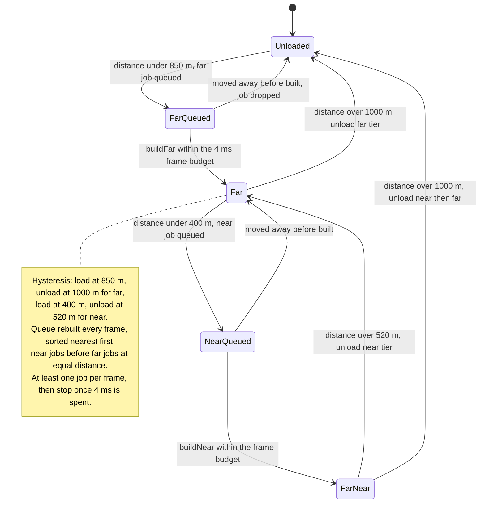

### Diagram (b): what a far chunk and a near chunk build

```mermaid
flowchart TD
    F0["buildFar chunk"] --> T1["buildTerrain: 53 x 53 samples of heightAt every 6 m"]
    T1 --> T2["terrain mesh with colorAt vertex colours"]
    T1 --> T3["Rapier heightfield collider, same samples"]
    F0 --> R1["buildRoads: owned segments"]
    R1 --> R2["asphalt ribbon, corners draped on smoothHeight"]
    R1 --> R3["sidewalk with curb face, unless blocked"]
    R1 --> R4["grass verge sloping to lawn level"]
    R1 --> R5["markings, stop lines, zebras"]
    R1 --> R6["owned nodes: junction discs, dead-end caps, cul-de-sac disc with rings skipping the mouth"]
    F0 --> L1["buildLots: driveways, paved lots with curb-cut ramp, stall and field lines, ponds"]
    F0 --> B1["downtown blocks: draped slab, curb walls, lawn, block trimesh collider"]
    F0 --> B2["buildings: footing on smoothHeight, instance pools for boxes and roofs, cuboid colliders"]
    F0 --> RU["ruralFeatures per cell: farm buildings and forest trees, kept in chunk.rural"]
    R2 --> S["solid builder"]
    R3 --> S
    R4 --> S
    R6 --> S
    L1 --> S
    S --> C1["one trimesh collider for all paved surfaces"]
    N0["buildNear chunk"] --> N1["block roof props, block trees and lamps"]
    N0 --> N2["street, garden and park trees on surfaceAt"]
    N0 --> N3["gas station canopies and pumps, parked cars in a third of stalls"]
    N0 --> N4["lamps along arterials and collectors with light pools"]
    N0 --> N5["forest trees from chunk.rural, no slot means no collider"]
```

### Diagram (c): the height functions and who uses which

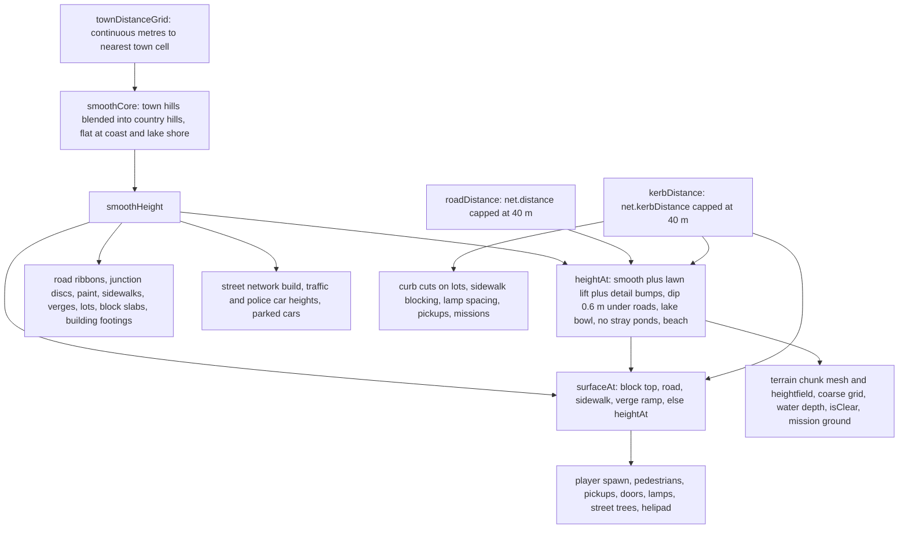

### Diagram (d): road graph pieces

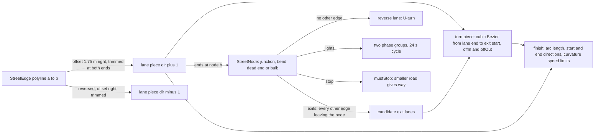

---

### 4.1 `src/world/terrain.ts`

**Purpose.** The shape and colour of the land. One class, `Terrain`, answers "how high is the ground here?" in several flavours (smooth road level, true ground, where a person stands), "how far is the nearest road / kerb / town?", "which zone is this?", "can a tree or farm go here?" and "what colour is the ground?". It is pure maths over the layout (no three.js), so the chunk builder, the coarse distant terrain, the maps, the water and the NPCs all agree. Height is built in layers: **smooth** hills (roads and blocks sit on these), **detail** bumps faded out near roads and towns, the **dip** under roads, the **lake** bowl, a **no-stray-ponds** clamp, and the **beach**.

**Depends on:** `layout.ts` (`BLOCK_SIZE`, `CELLS`, `COAST_LINE`, `CURB_HEIGHT`, `PITCH`, `ROAD_WIDTH`, `cellCenter`, `cellOf`, `isTown`, `lakeRadius`, `lawnLift`, `lineCoord`, types `Block`, `CityLayout`, `Zone`; also `layout.townCells`, `layout.zones`, `layout.blockAt`, `layout.streets.net`), `noise.ts` (`fbm`, `hash2`, `lerp`, `smoothstep`, `valueNoise`). · **Used by:** `world/city.ts`, `world/chunks.ts`, `world/water.ts` (`COAST_Z`, `WATER_Y`), `world/mapImage.ts`, `main.ts`, `npc/traffic.ts`, `npc/police.ts`, `game/missions.ts` (`WATER_Y` etc.), and indirectly `layout.buildStreets` (given `smoothHeight` as a callback).

Note on `smoothstep`: the `noise.ts` version is `smoothstep(a, b, x)` (edges first), `t = clamp((x − a)/(b − a), 0, 1)`, result `t²(3 − 2t)`. It works with `a > b` too (a falling ramp), which `forestWeight` and the lake bed use.

**Key constants.**

| Name | Value | Meaning / why |
|---|---|---|
| `WATER_Y` (exported) | −0.5 m | Shared water level of the sea and the lake. The water mesh, swimming, sinking and the "no stray ponds" clamp all use it. |
| `COAST_Z` (exported) | `lineCoord(COAST_LINE) + ROAD_WIDTH/2` = (46 − 26)·78 + 7 = **1567 m** | Southern edge of the coastal road; the beach starts here (z grows southward). |
| `VERGE` (exported) | 4.5 m | Width beyond a road's edge covered by its sidewalk and grass verge. The ground dip under roads fades back in over this width, and the verge mesh reaches `VERGE + 0.4`. |
| `TOWN_HILLS` | 34 m | Height range of town hills in suburbs and villages (so 3–37 m with the 3 m floor). |
| `TOWN_HILLS_DOWNTOWN` | 22 m | Gentler range downtown (3–25 m) so tower blocks stay walkable. |
| (inline) 40 m | road search cap | `roadDistance`, `kerbDistance` and `surfaceAt`'s `net.kerb` all cap at 40 m. See Decisions. |
| (inline) 8 cells / 1000 m | `townDistanceGrid` cut-off | Beyond 8 cells (624 m) every blend has finished, so "far" = 1000 is returned. |
| (inline) 0.6 m | road dip | Ground under a road sits 0.6 m below road level. |

**Types.**

`Rgb` = `[number, number, number]`: a linear RGB colour, components 0…1.

`BlockPlane`: a block slab's best-fit plane (only used for the helipad decal's tilt now).

| Field | Type | Meaning |
|---|---|---|
| `h` | number | Height (m) at the block centre: mean of the four corner heights. |
| `gx` | number | Slope along X (m per m). |
| `gz` | number | Slope along Z (m per m). |

**API.** All methods are on `class Terrain`, constructed once in `createCity` with `new Terrain(layout)`. The constructor stores `layout.seed` and `layout.townCells` (a `Uint8Array` with, per cell, the Chebyshev distance in cells to the nearest town cell, computed in `layout.ts`).

#### `zoneAt(x, z): Zone`
- The zone (`'downtown' | 'suburb' | 'village' | 'beachtown' | 'farm' | 'forest' | 'beach' | 'lake'`) of the cell containing (x, z). Cell indices are clamped to 0…51, so points beyond the world edge return the edge cell's zone.
- Called by: chunks (lawn lift for verges, lots, parcels), `colorAt`, `farTerrain`, the map picture, `main.ts`.

#### `townDistance(x, z): number`
- Metres from the point to the nearest town cell (`downtown`, `suburb`, `village`, `beachtown`); **0 inside a town cell**; **1000** when the nearest town is more than 8 cells away. Just calls `townDistanceGrid`.
- Called by: `isClear`, `farTerrain` (towns drawn grey from afar when it returns 0).

#### `roadDistance(x, z): number`
- Metres to the **centre line** of the nearest road, via `layout.streets.net.distance(x, z, 40)`; **capped at 40**. Returns 40 if `layout.streets` is not built yet (during `buildStreets`, the terrain exists before the streets do).
- Called by: `heightAt` (detail mask), `colorAt` (farm fields), `isClear`. Per height sample, so it is hot.

#### `kerbDistance(x, z): number`
- Metres to the nearest road's **edge** (negative on the road), counting cul-de-sac circles; via `net.kerbDistance(x, z, 40)`; capped at 40; 40 if no streets yet.
- Called by: `heightAt` (the dip under roads).

#### `smoothHeight(x, z): number`
- The big smooth hills at a point (see `smoothCore`). **Road level**: every road, junction, sidewalk, verge, driveway, parking lot, block slab and building footing is draped on this, and so are traffic and police cars and parked cars.
- Called by: `buildStreets` (once per road point), chunks (thousands of times per chunk), `npc/traffic.ts`, `npc/police.ts`, `main.ts` (parked cars, a ground check).

#### `blockSurface(b: Block): BlockPlane`
- Least-squares plane through the smooth height at the slab's four corners (`r = BLOCK_SIZE/2 = 32 m`): `h = (h00 + h10 + h01 + h11)/4`, `gx = (h10 + h11 − h00 − h01)/(4r)`, `gz = (h01 + h11 − h00 − h10)/(4r)`. Cached per block in a private `Map<Block, BlockPlane>`.
- Called by: `city.ts` only, to tilt the helipad decal to the block's slope. (Slabs themselves are now draped, not planar; see Decisions.)

#### `blockHeight(_b: Block, x, z): number`
- Road-level height under a block at (x, z). Ignores the block and returns `smoothHeight(x, z)`; the slab top is `CURB_HEIGHT` (0.15 m) above. Kept as a separate name so callers say what they mean.
- Called by: `surfaceAt`, chunk block slabs, block trees and lamps.

#### `blockUnder(x, z): Block | null`
- The downtown block whose 64 × 64 m slab covers (x, z): `layout.blockAt(cellOf(x), cellOf(z))`, then null if |x − cx| or |z − cz| exceeds 32 m (i.e. the point is on the road between blocks).
- Called by: `surfaceAt`, chunk sidewalk blocking (no road sidewalk on top of a block slab), `city.ts` (helipad).

#### `surfaceAt(x, z): number`
"Where you'd stand." In order:
1. On a downtown block slab: `blockHeight + CURB_HEIGHT` (slab top).
2. No streets built yet: `heightAt`.
3. `k = net.kerb(x, z, 40)` → `{ dist, sidewalk }` of the nearest road.
   - `k.dist < 0` (on the road): `smoothHeight`.
   - `k.dist < k.sidewalk` (on that road's sidewalk): `smoothHeight + CURB_HEIGHT`.
   - `k.dist < VERGE` (on the verge): `smoothHeight + lerp(inner, lawnLift(zone), t)` with `inner = CURB_HEIGHT` if the road has a sidewalk else 0, and `t = (k.dist − k.sidewalk)/(VERGE + 0.4 − k.sidewalk)`. This matches the verge ribbon in `chunks.ts`, which runs from the sidewalk edge to `hw + VERGE + 0.4`.
4. Otherwise: `heightAt`.
- Called by: `main.ts` (spawn, helicopter start, teleports, pedestrians and pickups via its `surface` callback), `npc/traffic.ts` (traffic-light poles), chunks (street trees, lamps, light pools), `city.ts` (spawn at `surfaceAt + 1.0`, helipad at `+0.05`).

#### `heightAt(x, z): number`
The true ground height (the visible terrain and its heightfield collider). Steps, with `townDist = townDistanceGrid(x, z)` and `smooth = smoothCore(x, z, townDist)`:
1. `h = smooth + lawnLift(zone)` (0.15 m in suburb / village / beachtown, else 0): lawns in town sit level with sidewalks.
2. **Detail bumps**: `mask = smoothstep(9, 32, roadDistance) · smoothstep(15, 60, townDist) · (1 − smoothstep(1300, 1450, z))`; if `mask > 0`, `h += (fbm(x/110, z/110, 3, seed+2) − 0.5) · 2 · (2.5 + 5·forest) · mask`. So bumps are ±2.5 m in the open, ±7.5 m in the forest, gone within 9 m of a road centre line, inside towns and near the coast.
3. **Dip under roads**: `kerb = kerbDistance(x, z)`; if `kerb < VERGE`, `h = lerp(smooth − 0.6, h, smoothstep(−1.5, VERGE, kerb))`. On the road and up to 1.5 m in from its edge the ground is exactly 0.6 m below road level; it rises back to normal at the outer edge of the verge. Reason (code comment): the road mesh, sidewalks and verges cover the transition, "so the ground never pokes through on a 6 m mesh".
4. **Lake**: `lr = lakeRadius(x, z)` (1 on the ellipse edge). If `lr < 1.3`: `bed = WATER_Y − 0.8 − 6·max(0, 1 − lr)` (−1.3 m at the edge, −7.3 m at the centre) and `h = lerp(h, bed, smoothstep(1.3, 0.85, lr))`.
5. **No stray ponds**: if `lr > 1.3` and `z < COAST_Z`, `h = max(h, WATER_Y + 0.35)` (−0.15 m). The water plane covers the whole map, so any dip below `WATER_Y` would show water.
6. **Beach**: `d = z − COAST_Z`; if `d > 0`: `shore = 70 + 25·sin(x/260) + 10·sin(x/93 + 2)` (the wandering waterline, 35–105 m from the road); `sand = 0.25 − 0.75·(d/shore)` while `d < shore` (from 0.25 m down to `WATER_Y`), else `WATER_Y − 0.045·(d − shore)` (4.5 % slope into the sea); `h = max(sand, −16)`. The beach **replaces** all earlier layers.
- Called by: chunk terrain (2809 samples per chunk), `ruralFeatures` (via callback), `sampleCoarse` (whole world, every 32 m), `Water` (`groundHeight` = depth), `main.ts` (ambience wetness, the mission `ground` hook).

#### `isClear(x, z, margin): boolean`
- True if `roadDistance > margin` **and** `townDistance > margin·0.5` **and** `heightAt > WATER_Y + 0.4` **and** `z < COAST_Z − 5`. Where trees and farmsteads may go.
- Because `roadDistance` is capped at 40, a `margin ≥ 40` would always fail; callers in `layout.ruralFeatures` use 10 and 30.
- Called by: `ruralFeatures` via the callback passed from `buildFar`.

#### `colorAt(x, z, h, slope): Rgb`
Linear RGB ground colour at a point of height `h`; `slope = 1 − normal.y` (0 flat).
- **Under water** (`h < WATER_Y − 0.05`): sand fading to dark mud, `t = min(1, (WATER_Y − h)/2.5)`, colour lerps (0.3, 0.26, 0.17) → (0.06, 0.09, 0.08).
- **Sand** (`z > COAST_Z − 1`, or `lr < 1.35` and `h < WATER_Y + 0.8`): (0.46, 0.37, 0.22) → wet (0.3, 0.24, 0.14) by `wet = 1 − smoothstep(WATER_Y + 0.05, WATER_Y + 0.5, h)`, times noise `0.92 + 0.16·valueNoise(x/3, z/3, 7)`.
- Otherwise meadow grass from `n1 = fbm(x/60, z/60, 2, seed+9)`: r 0.1–0.22, g 0.2–0.22, b 0.05–0.08; darkened toward the forest floor (0.06, 0.12, 0.04) by `forest·0.8`.
- Town zones (`suburb`, `village`, `beachtown`): mown lawn, greener and more even, times `0.85 + 0.15·valueNoise(x/9, z/9, 13)`.
- `farm` zones more than `ROAD_WIDTH/2 + 2 = 9 m` from a road centre: a patchwork of fields in cells of 58 × 42 m (`fx = floor((x+1000)/58)`, `fz = floor((z+1000)/42)`), each picking one of five crop colours with `hash2(fx, fz, seed+11)`; faint crop rows `0.9 + 0.1·sin(2.2·(x or z))`; blended in by `(1 − forest)·smoothstep(40, 80, townDist)`.
- **Rock** on slopes: blend to (0.24, 0.23, 0.21) by `smoothstep(0.25, 0.5, slope)`.
- Called by: chunk terrain vertices, verge ribbons/rings (with slope 0), `farTerrain`, the map picture.

**Internals.**
- `lawnLift(x, z)` (private): `lawnLift(zoneAt(x, z))` from `layout.ts`. The chunk meshes use the same layout function, so the mesh and `surfaceAt` agree.
- `townDistanceGrid(x, z)` (private): reads `cells = townCells[clamped cell]`. If `cells > 8` return 1000. Otherwise scan a square of `r = min(13, ceil(cells·√2) + 1)` cells around the point and, for each town cell, take the distance from the point to that cell's 78 m square (`dx = max(0, |x − cellCenter| − PITCH/2)`, same for z, `hypot(dx, dz)`); return the minimum. The √2 widening is needed because a cell k rings away (Chebyshev) can be nearer than one k − 1 rings away along a diagonal. Worst case (cells = 8) scans 27 × 27 = 729 cells.
- `forestWeight(x, z)` (private): `smoothstep(−450, −950, z + 120·sin(x/500))`: 0 in the south, 1 in the northern forest hills, with a wavy boundary.
- `smoothCore(x, z, townDist)` (private), all in metres:

```text
forest = forestWeight(x, z)
rural  = (14 + 37·forest) · max(0, fbm(x/750, z/750, 3, seed+1)·1.6 − 0.3)
edge   = max(|x|, −z)                       // east, west and north edges (south is the sea)
rural += smoothstep(1900, 2250, edge) · 70 · (0.6 + 0.4·fbm(x/300, z/300, 2, seed+3))
outer  = smoothstep(250, 700, hypot(x, z))  // 0 downtown, 1 in the outer towns
town   = 3 + (22 + 12·outer) · fbm(x/520 + 3.1, z/520 − 1.7, 3, seed+5)
a = lerp(town, max(rural, 3·(1 − smoothstep(300, 600, townDist))), smoothstep(40, 300, townDist))
a *= 1 − smoothstep(1250, 1480, z)          // the coast is flat
a *= smoothstep(1.0, 2.6, lakeRadius(x, z)) // so is the lake shore
```
  `fbm(x, z, octaves, seed)` is the stacked value noise from `noise.ts` (roughly 0…1). The `max(rural, 3·…)` term keeps the ground at 3 m or more for the first 300–600 m outside towns, so the town-to-country blend never pulls a valley floor down toward the water.
- `planes` (private `Map<Block, BlockPlane>`): cache for `blockSurface`.

**Decisions.**
- **Roads ride the smooth layer** → rolling streets and country roads instead of flattened valleys. Measured (DEVELOPER_GUIDE §4.2): town streets peak at ~15 % grade with under 1 % of length over 10 %; early versions hit 56 % near the lake until the shore flattening (`smoothstep(1.0, 2.6, lakeRadius)`) was widened.
- **The terrain dips 0.6 m under roads** instead of the road being cut into the terrain → the road mesh and its collider are separate draped surfaces that are always on top; the terrain heightfield (6 m spacing) can never poke through between its samples. Alternative rejected: matching the terrain exactly to the road (impossible at 6 m resolution on curves).
- **`townDistanceGrid` must be continuous** (bug fixed in commit `1dab725`): it used to give up beyond 5 cells and return "far", so `smoothHeight` jumped ~2 m at some cell boundaries, a cliff in the terrain and a step under any road crossing it. Now it searches up to 8 cells with the √2 widening; beyond 8 cells (624 m) every blend (`smoothstep(40, 300)`, `smoothstep(300, 600)`) has finished, so returning 1000 changes nothing.
- **`roadDistance` capped at 40 m** (commit `ffd288c`, was 200 m) → every caller only asks "closer than ≤ 32 m?" (`heightAt`'s mask tops out at 32, `colorAt` asks > 9, `isClear` margins are 10 and 30), and the spatial-hash search cost grows with the square of the cap: at 200 m it scanned 169 buckets per height sample, costing 80–200 ms per chunk built (visible hitches). `kerbDistance` and `surfaceAt` use the same 40 m cap.
- **No stray ponds clamp** → one water plane spans the whole world (simpler than per-lake meshes), so the land must stay above it everywhere except the lake and the sea.
- **Downtown blocks are draped, not planar** → see §4.3. `blockSurface` survives only for the helipad tilt.
- **Lawn lift in town zones** (0.15 m = `CURB_HEIGHT`) → lawns level with sidewalks, as in real suburbs; must match the chunk meshes, so both call `layout.lawnLift`.

---

### 4.2 `src/world/roadGraph.ts`

**Purpose.** Drivable lanes and turns for traffic on top of the street network (`streets.ts`). Traffic drives on the right. A car's route is a chain of **pieces**, each a 2-D polyline in world space: a **lane** runs along one edge in one direction, `LANE_OFFSET` right of the centre line, trimmed back from the junctions at both ends; a **turn** is a cubic Bézier through a junction from the end of one lane to the start of the next (straight, left, right, or a U-turn round a cul-de-sac or at a dead end). Pieces are built on demand and **cached**, so two cars on the same piece hold the same object and "is that car on my lane?" is an identity check. Each piece stores a curvature speed limit every few metres. The file also owns traffic-light phases and stop-sign priority.

**Depends on:** `streets.ts` (`ROAD_SPECS`, types `StreetEdge`, `StreetNet`, `StreetNode`; uses `net.nodes`, `net.edges`, `net.halfWidth`, node `control`, `bulb`, `edges`; edge `a`, `b`, `pts`, `cls`). · **Used by:** `npc/traffic.ts` only (it creates the single `RoadGraph` in its constructor and uses lanes, turns, exits, approaches, lights, stop rules, `pieceAt`, `LANE_SPACING`, `LANE_OFFSET`). Police drive their own A* routes on the street network, not on pieces.

**Key constants.**

| Name | Value | Meaning / why |
|---|---|---|
| `LANE_OFFSET` (exported) | 1.75 m | Centre line → inner lane centre (half of a 3.5 m lane). |
| `LANE_SPACING` (exported) | 3.5 m | Outer lane's offset from the inner one on two-lanes-each-way roads (arterial, downtown). On one-lane roads `−LANE_SPACING` is the oncoming lane, used for overtaking. |
| `A_LAT` | 3.0 m/s² | Comfortable sideways acceleration (≈ 0.3 g) for the curvature speed limit. |
| `CYCLE` | 24 s | Traffic-light cycle. |
| lane `limitStep` | 6 m (then adjusted) | Speed-limit sample spacing on lanes. |
| turn `limitStep` | 1.5 m (then adjusted) | Finer on turns, which are short and curved. |
| Bézier samples `N` | 14 (15 points) | Turn polyline resolution. |
| node offset per junction | 3.7 s | Light phase offset per node id (staggered "green wave"). |
| min curve limit | 2.2 m/s | Floor of the curvature speed limit. |

**Types.**

`Piece`:

| Field | Type | Meaning |
|---|---|---|
| `kind` | `'lane' \| 'turn'` | Lane along an edge, or a turn through a junction. |
| `pts` | `Float32Array` | x, z pairs along the piece. |
| `cum` | `Float32Array` | Distance along the piece at each point (m). |
| `length` | number | Total length (m), at least 0.1. |
| `edge` | number | Lane: its edge. Turn: the edge it leads onto. |
| `dir` | `1 \| -1` | +1 travels a → b, −1 travels b → a (turn: of the lane it leads onto). |
| `node` | number | Lane: the junction at its end. Turn: the junction it crosses. |
| `from`, `to` | `Piece \| null` | Turns: the lane it comes from and the lane it leads to. Null on lanes. |
| `offIn`, `offOut` | number | Turns: lateral offsets (m, + = right) of the joined lanes, relative to their inner lanes. 0 on lanes. |
| `lanes` | number | Lanes each way (turns: on the road it leads onto), from `ROAD_SPECS[cls].lanes`. |
| `rural` | boolean | One lane each way out of town (`cls === 'rural'`): overtaking through the oncoming lane allowed. |
| `speed` | number | Speed limit (m/s) from `ROAD_SPECS`; turns take `min(from.speed, to.speed)`. |
| `rank` | number | Road importance (smaller roads give way); turns take `from.rank`. |
| `limits` | `Float32Array` | Curvature speed limit (m/s) every `limitStep` m. |
| `limitStep` | number | Spacing of `limits` (m). |
| `startDir`, `endDir` | `[number, number]` | Unit travel direction at the start and end. |

`TurnKind` = `'right' | 'left' | 'straight' | 'uturn'`.

`Light` = `'green' | 'yellow' | 'red'`.

**API.**

#### `turnKind(a: [number, number], b: [number, number]): TurnKind`
- Classifies the turn from heading `a` to heading `b` (unit vectors in x, z). `angle = atan2(a.x·b.z − a.z·b.x, a·b)`. `|angle| < 0.6 rad` (~34°) → `'straight'`; `|angle| > 2.5 rad` (~143°) → `'uturn'`; otherwise positive → `'right'` (the right of +X is +Z), negative → `'left'`.
- Called by: `RoadGraph.turn` (U-turn control points) and `npc/traffic.ts` (route choice, indicators).

#### `class RoadGraph`
- `constructor(readonly net: StreetNet)`: for every node with `control === 'lights'`, computes each attached edge's direction angle where it leaves the node (`axisAt`) and groups approaches into two phases: `d = |axis − axis₀| mod π`, folded into [0, π/2]; `d < π/4` → group 0 (roughly along the first road's axis), else group 1. Stored in a private `Map` keyed `"edge,node"`.
- `get nodes(): StreetNode[]`: `net.nodes`.

#### `hasLights(node: number): boolean`
- `net.nodes[node].control === 'lights'`.

#### `mustStop(lane: Piece): boolean`
- False unless the lane's end node has `control === 'stop'`. Then, with `max` = the highest `ROAD_SPECS[cls].rank` among the node's edges and `count` = how many edges have it: returns `lane.rank < max || (count === edges.length && edges.length >= 3 && lane.rank < 3)`. So the smaller road gives way; and where three or more roads of equal rank meet it is an all-way stop, but only for ranks below 3 (local streets, rank 2). Equal collectors/rural roads (rank 3) do not stop.
- Note: the painted stop lines in `chunks.ts` only mark the smaller-road case, not the all-way case.

#### `lightState(lane: Piece, time: number): Light`
- `lightPhase(phaseGroup(lane.edge, lane.node) ?? 0, node.id, time)`.

#### `lane(edgeId: number, dir: 1 | -1): Piece`
- Cached under key `l<edge>,<dir>`. Builds the centre line in travel order, offsets each point right by `LANE_OFFSET` using the local tangent (central difference of neighbours; right of travel is `(−tz, tx)`), then trims `trim(startNode)` metres off the start and `trim(endNode)` off the end (`trimPolyline`), and runs `finish`. Fields: `node = endNode`, `lanes`, `speed`, `rank` from `ROAD_SPECS[e.cls]`, `rural = e.cls === 'rural'`, `limitStep = 6`.
- The doc comment says "null if the edge is too short", but it never returns null: `trimPolyline` always keeps at least a 1 m stub.

#### `reverse(lane: Piece): Piece`
- The same edge's lane in the other direction.

#### `exits(lane: Piece): Piece[]`
- Every lane leaving the lane's end node along any **other** edge (direction chosen so it starts at that node). If there are none (a dead end or cul-de-sac), returns `[reverse(lane)]`: the only U-turns are there.

#### `approaches(lane: Piece): Piece[]`
- Every lane on another edge that **arrives** at the same node (used for junction yielding).

#### `turn(from: Piece, to: Piece, offIn = 0, offOut = 0): Piece`
- Cached under `t<from.edge>,<from.dir>,<to.edge>,<to.dir>,<offIn>,<offOut>`.
- `p0` = end of `from`, shifted `offIn` to the right of its end direction; `p2` = start of `to`, shifted `offOut` right of its start direction. Control points `c1 = p0 + endDir·k`, `c2 = p2 − startDir·k` lie along the lanes' own directions, so the heading is continuous. `k = max(4, node.bulb·1.3, 5)` for a U-turn (loops out round the cul-de-sac circle), else `k = max(1.5, gap·0.45)` with `gap = |p2 − p0|`.
- Sampled at 15 points: `B(t) = (1−t)³p0 + 3(1−t)²t·c1 + 3(1−t)t²·c2 + t³p2`.
- `edge`/`dir` = `to`'s, `node = from.node`, `lanes`/`rural` from `to`, `speed = min(from.speed, to.speed)`, `rank = from.rank`, `limitStep = 1.5`.

#### `pieceAt(p: Piece, s: number, out): out`
- Point and unit direction at arc length `s`, clamped to [0, length]. Binary search on `cum` for the segment, linear interpolation inside it; `tx, tz` is that segment's direction. Writes into and returns `out: { x, z, tx, tz }` (no allocation).
- Called by: traffic every physics step for every car (placement two points 1.5 m ahead/behind), and `finish`.

#### `lightPhase(group: number, node: number, time: number): Light`
- `t = ((time + node·3.7) mod 24 + 24) mod 24`. Group 0: green for 0 ≤ t < 9, yellow 9–11.5, else red. Group 1: green 12–21, yellow 21–23.5, else red. The half-second gaps (11.5–12 and 23.5–24) are all-red so the junction clears.
- Called by: `lightState`, and `npc/traffic.ts` for the drawn signal heads.

**Internals.**
- `axisAt(e, node)`: atan2 angle of the first (or reversed last) segment where the edge leaves `node`.
- `trim(nodeId)`: how far back from a node lanes stop: `bulb·0.8` at a cul-de-sac; `hw + 1.2` (largest half-width + 1.2 m, the same as the junction disc radius in `chunks.ts`) where three or more edges meet; 3 m at a plain dead end; 2 m at a bend or class change (a short join).
- `finish(p)`: fills `cum`, `length = max(0.1, last cum)`, `startDir` (points 0→1) and `endDir` (n−2→n−1). Then `steps = max(1, ceil(length/limitStep))`, `limitStep = length/steps` (evenly spaced), and for each sample s the curvature through the points at s − step, s, s + step: `κ = 2·|AB × BC| / (|AB|·|BC|·|AC|)` (the circle through three points), `limit = max(2.2, √(A_LAT / max(κ, 10⁻⁶)))`. Samples beyond the ends continue straight along the end directions, so the ends aren't mistaken for sharp corners.
- `trimPolyline(pts, a, b)`: cuts `a` m from the start and `b` from the end by arc length. If `a + b > len − 1` (very short edge) it keeps the metre around the proportional split point `m = a/(a+b)·len`.

**Decisions.**
- **Pieces cached and shared** → identity comparisons for "same lane" and no per-car geometry; alternative (per-car paths) costs memory and makes leader searches expensive.
- **Curvature speed limit precomputed** (`v = √(a_lat/κ)`) → cars brake for curves with a lookup instead of geometry each step.
- **Turns as cubic Béziers with tangent control points** → continuous heading at any junction angle, which the free-form suburban network needs (no fixed 90° turns).
- **U-turns only where there's no other exit** → cul-de-sacs see the odd car turning, not traffic doing U-turns mid-junction.
- **Two light phase groups by axis** → works for any junction geometry (T, skewed crossings) without per-junction setup; per-node 3.7 s offset staggers lights.

---

### 4.3 `src/world/chunks.ts`

**Purpose.** World streaming: `WorldStreamer` builds and removes meshes, colliders and instance-pool slots for 312 m chunks around the player, in two tiers. The **far** tier (within ~850 m) has the terrain mesh and heightfield collider; every road surface, sidewalk, curb, verge, junction and cul-de-sac with **one trimesh collider for everything paved**; markings; driveways and parking lots; downtown block slabs; and all buildings with colliders. That is enough to see the skyline and to drive anywhere. The **near** tier (within ~400 m) adds the small stuff: street, garden and forest trees, lamps with light pools, rooftop clutter, gas-station canopies and pumps, and parked cars. Each chunk builds the road segments whose **midpoints** fall inside it, and the nodes, houses, driveways, parcels and trees whose **centres** do, so every piece is built exactly once whatever order chunks load in.

**Depends on:** `layout.ts` (`BLOCK_SIZE`, `CELLS`, `CURB_HEIGHT`, `LOT`, `PITCH`, `lawnLift`, `lineCoord`, `ruralFeatures`, types `Block`, `Building`, `CityLayout`, `Tree`; `layout.blockAt`, `layout.zones`, `layout.seed`, `layout.streets`), `streets.ts` (`ROAD_SPECS`, `StreetEdge`, `StreetNet`: `kerbDistance`, `halfWidth`, `pointAt`, edges/nodes, `e.cum`, `e.length`), `rng.ts` (`hashSeed`, `Rng`), `vehicles/carModel.ts` (`CAR_DIMENSIONS`, `PAINT_COLORS`), `suburbs.ts` (types `Parcel`, `Rect`), `instancePool.ts` (type), `terrain.ts` (`VERGE`, `Terrain`), `noise.ts` (`smoothstep`), three.js, Rapier. · **Used by:** `world/city.ts` (creates the streamer; uses `CHUNKS`, `CHUNK_SIZE`, `LAMP_HEAD_OUT`, `WorldPools`), `main.ts` via `city.streamer.loadAround` and `city.isLoaded` (`loadedCount` has no caller in `src/`; it is available to tests and the console through `window.game.city.streamer`).

**Key constants.**

| Name | Value | Meaning / why |
|---|---|---|
| `CHUNK_CELLS` (exported) | 4 | Grid cells per chunk side. |
| `CHUNK_SIZE` (exported) | 4 · 78 = **312 m** | Chunk side. |
| `CHUNKS` (exported) | 52 / 4 = **13** | Chunks per world side (169 total). Chunk (0, 0) starts at `lineCoord(0)` = −2028 m. |
| `STREAM_DISTANCES` (exported) | far 850 / 1000 m, near 400 / 520 m (load / unload) | The defaults (graphics quality High). Far tier: fog ends at 1100 m, so loaded detail reaches nearly to the fog wall. The streamer keeps its own copy, `dist`, which `setDistances` replaces (Medium 650/780 + 300/400, Low 480/600 + 220/300; §7.15). Type `StreamDistances`. |
| `TERRAIN_STEP` | 6 m | Terrain sample spacing; mesh and heightfield share it. |
| `TERRAIN_SEGMENTS` | 52 | 312 / 6; so 53 × 53 = 2809 height samples per chunk. |
| `ROAD_Y` | 0.02 m | Asphalt ribbons above road level. |
| `PAINT_Y` | 0.035 m | Markings above road level (above asphalt and discs). |
| `JUNCTION_Y` | 0.025 m | Junction discs: above ribbons (covers their ends), below paint. |
| `BLOCK_GRID` | 8 | Downtown slab top drawn as 8 × 8 quads (8 m each). |
| `LAMP_HEAD_OUT` (exported) | 1.8 m | Pole → luminaire; `city.ts` uses it for the lamp-head geometry, `buildNear` for the light pool position. |
| `WHITE`, `YELLOW`, `PLAIN`, `CONCRETE`, `POND` | RGB triples | Vertex colours for paint, plain (texture only), curb faces, ponds. |
| `update` budget | `budgetMs = 4` | Per-frame build budget (ms). |

**Types.**

`WorldPools` (exported): one `InstancePool` per object kind; created in `city.ts` (capacities in §4.5).

| Field | Type | Meaning |
|---|---|---|
| `buildings` | InstancePool | Unit boxes with the facade shader (all buildings, houses, steeples, farm buildings). |
| `roofs` | InstancePool | Pitched-roof prisms. |
| `acs` | InstancePool | Generic grey boxes: rooftop AC units, also gas-station canopies, posts and pumps. |
| `tanks` | InstancePool | Rooftop water tanks (cylinders). |
| `trunks`, `canopies` | InstancePool | Street/garden/park/block trees. |
| `forest` | InstancePool | Countryside trees (one merged pine geometry). |
| `lamps`, `lampHeads`, `lightPools` | InstancePool | Lamp pole + arm, glowing luminaire, additive ground glow. |
| `parkedBodies`, `parkedGlass`, `parkedTyres` | InstancePool | Parked sedans in parking lots. |

`ChunkMaterials` (exported):

| Field | Type | Meaning |
|---|---|---|
| `terrain` | THREE.Material | Terrain mesh and grass verges (vertex colours × grain). |
| `road` | THREE.Material | Asphalt ribbons, junction discs, paved lots. |
| `paint` | THREE.Material | Markings, stall and field lines, ponds (vertex colours). |
| `pavement` | THREE.Material | Sidewalks, curbs, driveways, block slabs. |
| `lawn` | THREE.Material | Downtown block lawns (grass texture). |

Private: `TierContents { meshes, colliders, slots: [pool, slot][] }` (everything one tier created, so it can all be removed); `Chunk { cx, cz, far, near, rural }` (`rural` = countryside buildings and trees generated with the far tier and reused by the near one); `Owned { segs (edge, segment pairs), nodes, houses, driveways, parcels, trees }`; `Job { chunk, tier }`; `Builders { asphalt, paint, pavement, verge, lawn, solid }` (`solid` = everything walkable/drivable, only for the collider).

**API.**

#### `new WorldStreamer(scene, world, layout, terrain, pools, materials)`
- Creates 169 empty chunks and `Owned` lists. Creates `loadedMask` (`Uint8Array(169)`) and `loadedTexture` (a 13 × 13 `THREE.DataTexture`, `RedFormat`, `UnsignedByteType`).
- **Hands the street world out**: for every edge segment, the owner is the chunk containing the segment's midpoint; nodes, houses, driveways, parcels and street trees by their (x, z); parcel trees too. Anything outside the 13 × 13 grid is dropped (`ownerOf` returns null).
- Called once by `createCity`.

#### `readonly loadedMask: Uint8Array` / `readonly loadedTexture: THREE.DataTexture`
- 255 where a chunk's far tier (terrain collider) is loaded, 0 otherwise. The texture wraps the same bytes; `needsUpdate` is set on every change. Read by the distant-terrain shader in `city.ts` to discard pixels where detailed terrain exists.

#### `isLoaded(x, z): boolean`
- True if the chunk containing (x, z) has its far tier (so there is a ground collider). False outside the grid.
- Called by: `main.ts` `parkVehicles()` every physics step, via `city.isLoaded`: every car, the helicopter and every boat not being driven has its body disabled while its chunk is unloaded, so it can't fall through missing ground.

#### `get loadedCount(): { far, near, queued }`
- Counts of chunks with each tier, and the current queue length. No caller in `src/`; useful from tests or the console (`game.city.streamer.loadedCount`).

#### `update(focus: THREE.Vector3, budgetMs = 4): void`
- Every frame (via `city.update`). For each chunk, `d` = distance from focus to the chunk's rectangle (numbers at the High defaults):
  1. near loaded and `d > 520` (`nearUnload`) → unload near;
  2. far loaded and `d > 1000` (`farUnload`) → unload near (if any) then far;
  3. far not loaded and `d < 850` (`farLoad`) → queue a far job; else far loaded, near not, and `d < 400` (`nearLoad`) → queue a near job.
- Sorts jobs by distance, near tier first at equal distance ("what's around the player matters most"), replaces the queue, then builds jobs from the front until more than `budgetMs` has passed (the check is after each build, so **at least one job runs per frame**). Then flushes every pool (uploads changed matrices/colours once).
- Unloading is immediate and unbudgeted (it is cheap). The queue is rebuilt from scratch every frame, so a job for a chunk that moved out of range simply disappears.

#### `setDistances(d: StreamDistances): void` / `get distances`
- Graphics quality (§7.15) sets the load / unload distances. Nothing is rebuilt at once: chunks now out of range unload on the next `update`, and the queue only takes chunks within the new distances.

#### `loadAround(focus: THREE.Vector3, radius: number): void`
- Builds, right now and without a budget, every chunk within `radius`: the far tier if `d < 850`, then the near tier if `d < 400` (in the same pass, since the far tier now exists). Flushes the pools.
- Called by `main.ts` with radius 450 at startup (spawn), after respawning at a hospital, after being busted (police station) and when a saved game restores the player's position.

**Internals — far tier (`buildFar`).** In order:
1. `buildTerrain`: samples `heightAt` on a 53 × 53 grid every 6 m from the chunk's corner. A `PlaneGeometry(312, 312, 52, 52)` rotated flat has its vertices in the same row order (−Z→+Z, −X→+X), so the Y values are copied straight in; UVs are world-space (`/8`, one grain tile per 8 m); normals computed; vertex colours from `colorAt(x, z, h, 1 − normal.y)`. Mesh positioned at the chunk centre, `receiveShadow`. **Collider**: `RAPIER.ColliderDesc.heightfield(52, 52, hf, {x: 312, y: 1, z: 312})` at the chunk centre; Rapier wants a column-major matrix with rows along Z and columns along X, so `hf[ix·53 + iz] = heights[iz·53 + ix]`.
2. Six `GeometryBuilder`s; `buildRoads(own, g)`; `buildLots(own, g)`.
3. **Downtown blocks** in the chunk's 4 × 4 cells: `buildBlockSurface`, and each block building placed with `footing(bl, 0)`: `y = low + CURB_HEIGHT − 0.05`, `height = bl.height + (high − low) + 0.05`.
4. **Steeples**: for parcels with a `steeple`, a square tower `Building` (style 1 brick, seed 3) with a 7 m dark pyramid-ish roof (the roof prism).
5. **Suburban houses, parcel buildings and steeples** with `footing(bl, CURB_HEIGHT)`: `y = low − 0.25`, `height = bl.height + (high − low) + 0.25` (sunk 25 cm so no gap shows on the lawn).
6. **Countryside**: for each cell, `ruralFeatures(seed, bx, bz, zone, heightAt, isClear)` → farm buildings and trees; stored in `c.rural`; buildings added to the list.
7. One mesh per non-empty builder: asphalt (road material, UV 10 m), paint (10 m), pavement (8 m), verge (**terrain** material, 8 m), lawn (6 m); `receiveShadow`. `solid` becomes one **trimesh collider** (`g.solid.raw()`).
8. Every building: a slot in `buildings` (position, scale = width/height/depth, yaw, colour, and `aStyle.xy = (style, seed)`), and a **cuboid collider** rotated by yaw (quaternion `(0, sin(yaw/2), 0, cos(yaw/2))`). If it has a `roof`: a `roofs` slot placed on top, stretched `longer side + 0.8` × `roof.height` × `shorter side + 0.8` (0.4 m eaves), rotated so the ridge (the prism's X axis) runs along the longer side.
9. `c.far = t`; mask = 255.

**Internals — roads (`buildRoads`).** For each owned segment `s` of edge `e` (points `i0 = s`, `i1 = s + 1`), with `hw = spec.width/2` and `H = roadLevel = smoothHeight`:
- `ribbon(target, a, b, y0, y1, color)`: a quad between offsets `a` and `b` m right of the centre line, using the **mitred normals** of `geoOf(e)` at both ends, with **every corner draped**: `H(corner) + y`. Asphalt and solid: `−hw…hw` at `ROAD_Y`.
- For each side (±1): `blocked(o)` = any of three points (the offset line's two ends and middle) lies within 0.5 m of **another** road's surface (`net.kerbDistance(x, z, 10, e.id) < 0.5`) or on a downtown block (`blockUnder`). Then:
  - **Sidewalk** if `spec.sidewalk > 0` and not blocked at `hw + 0.05`, `hw + sw/2` or `hw + sw`: a curb face (`wallY`) along the road edge from `H + CURB_HEIGHT` down `CURB_HEIGHT + 0.05`, facing the road; a pavement ribbon and a solid ribbon from `hw` to `hw + sw` at `CURB_HEIGHT`.
  - **Verge** if not blocked at `v0 + 0.5` or `hw + VERGE` (`v0 = hw + sw`, or `hw` with no sidewalk): a ribbon from `v0` to `hw + VERGE + 0.4`, rising from `up` (curb height, or 0 with no sidewalk) to the lawn lift of the zone 4.5 m out; coloured by `colorAt` 3 m outside the road; into the verge mesh and the solid collider.
  - `markings(e, s, g.paint)`.
- **Nodes** owned by the chunk (with at least one edge), draped through `lifted(dy) = (x, z) => H(x, z) + dy`:
  - **Cul-de-sac bulb**: an asphalt disc (and solid disc) of radius `bulb` at `JUNCTION_Y`; a sidewalk ring `bulb … bulb + sw` at `CURB_HEIGHT` with an inward curb face (drop `CURB_HEIGHT + 0.05`), a solid ring, then a verge ring `bulb + sw … bulb + VERGE + 0.5` (stays at curb height) in the verge mesh and the solid. All rings **skip pieces over the street's mouth**: `open(x, z)` = within `halfWidth + 0.5` of the bulb's street centre line (`edgeDistance`).
  - **Other nodes**: a disc of radius `hw + 1.2` (largest half-width + 1.2 m) at junctions of 3+ edges, else radius `hw` (bends and dead-end caps), in asphalt and solid.

**Internals — markings (`markings`).** Paint for one segment, placed at `roadLevel + PAINT_Y` per vertex, using the interpolated mitred normal. `strip(off, width, a, b, color, lo, hi)` paints a strip centred `off` m right of centre between arc lengths a…b, clipped to the segment and to [lo, hi]. Lines stop short of junction discs: `lo = rA + (5 downtown | 1.2)`, `hi = length − (rB + same)`, where `junctionRadius` = bulb, or `hw + 1.2` at 3+ edges, else 0 (plain bends: lines run on through).
- `downtown`, `arterial`: double yellow centre (±0.17 m, 0.12 m wide) and white lane dashes at ±3.5 m (3 m on, 9 m period).
- `collector`: dashed yellow centre (3 m / 8 m, 0.13 m).
- `rural`: dashed yellow centre (4 m / 10 m, 0.14 m) and solid white edge lines 0.35 m inside each edge.
- `local`: no lines.
- At each end node with 3+ edges: a **stop line** (0.45 m long, `hw − 0.4` wide, over the right-hand half: offsets 0…hw arriving at b, −hw…0 arriving at a) if the node has lights, or a stop sign and this road's rank is below the node's maximum. Placed `r + 0.8` m from the node, or `r + 4.6` downtown, behind a **zebra crossing** (downtown only, at every 3+ junction): stripes 0.55 m wide every 1.1 m from `−hw + 0.9` to `hw − 0.9`, 3.2 m long, starting `r + 0.6` from the node.

**Internals — lots (`buildLots`).** `rect(targets, r, y, color, step = 8)` covers a rotated rectangle (`u = (cos yaw, −sin yaw)` along width, `v = (sin yaw, cos yaw)` along depth) with a grid of quads at most `step` m; each vertex at `smoothHeight + (lawnLift + y)·ramp + 0.01` where **`ramp = smoothstep(−0.2, 1.5, net.kerbDistance(x, z, 10))`** (the curb cut). Driveways: pavement + solid, `y = 0.02`, concrete, 6 m grid. Parcel `paved` rects: asphalt + solid, `y = 0.03`. Parcel `stalls` → `stallLines`; `fields` → `fieldLines`; `ponds` → a 24-sided flat ellipse fan in the paint mesh at `smoothHeight(centre) + lawnLift + 0.05`, dark blue (not in the collider).
- `stallLines(r)`: double rows of 5.5 × 2.7 m stalls repeating every 18 m of depth (5.5 + 5.5 + 7 m aisle); lines 0.12 m wide at `lawnLift + 0.06`.
- `fieldLines(r)`: boundary inset 2 m, halfway line, 8 m centre circle (16 segments); lines 0.3 m wide at `lawnLift + 0.04`.

**Internals — other far helpers.**
- `geoOf(e)` (cached per edge in `edgeGeo`): per point, the **mitred normal** = normalised sum of the neighbouring segment normals (right of travel `(−dz, dx)`), stretched by `1/max(0.6, m·n_next)` so the ribbon keeps its width round a bend (capped for sharp bends at 1/0.6 ≈ 1.67×); and `h[i] = smoothHeight` at the point (used for verge colour).
- `edgeDistance(edgeId, x, z)`: point-to-polyline distance for one edge (cul-de-sac mouths).
- `junctionRadius(nodeId)`: see markings.
- `footing(bl, lift)`: lowest and highest `smoothHeight + lift` over 9 points (4 corners, 4 edge midpoints, centre) of the rotated footprint. "The hills are smooth, so this catches the extremes."
- `buildBlockSurface(block, g, collider)`: slab top `top(x, z) = blockHeight + CURB_HEIGHT` drawn as 8 × 8 draped pavement quads; curb faces on all four sides, 8 pieces each, from `top` down `CURB_HEIGHT + 0.5` (well below the road, so no gap ever shows); if `block.lawn`, a 7 × 7 grid of 8 m lawn quads over the 56 m lot at `top + 0.02`; a **trimesh collider** of the same 9 × 9 top vertices (128 triangles).

**Internals — near tier (`buildNear`).**
- `tree(tr, y)`: trunk and canopy slots (yaw `hue·2π`, uniform scale), canopy colour HSL `(0.22 + 0.09·hue, 0.45, 0.16 + 0.08·hue)`, and a cylinder collider (half-height `1.4·scale`, radius `0.2·scale`) centred `1.4·scale` up.
- `lamp(x, z, yaw, y)`: `lamps` and `lampHeads` slots at the pole; a `lightPools` slot on the ground under the luminaire (`LAMP_HEAD_OUT` along the arm's +X after yaw: `(cos yaw, −sin yaw)`) at `surfaceAt + 0.06`; a cylinder collider (half-height 3.5 m, radius 0.12 m).
- Downtown blocks: roof props (`ac` → `acs`, else `tanks`) at `footing(prop.building, 0).high + CURB_HEIGHT + prop.y`, i.e. on the adjusted roof; block trees and lamps at `top − 0.05`.
- Street/garden/park trees: `surfaceAt − 0.05`.
- Parcels: **gas-station canopy** (all in the `acs` box pool): a 0.7 m slab at `y + 4.6`, four 0.4 × 4.6 × 0.4 m posts inset 1.5 m from the corners (cuboid colliders), four pumps 0.9 × 1.7 × 0.6 m at −6, −2, 2, 6 m along the canopy (rotated cuboid colliders). **Parked cars**: a seeded `Rng(hashSeed(seed, round(x), round(z)))` per parcel, each stall filled with probability 0.35, nose-in (row 0 faces +v toward the shops, row 1 faces −v), yaw jitter ±0.04 rad, at `smoothHeight + lawnLift + 0.03`, random `PAINT_COLORS`.
- **Lamps** along owned `arterial` (every 40 m) and `collector` (every 55 m) segments, skipping the first and last 15 m of an edge, alternating sides by `round(d/period) mod 2`, `width/2 + 0.5` m from the centre line, skipped if within 1 m of another road's surface; yaw `atan2(nz, −nx)` points the arm back over the road; height `surfaceAt − 0.05`.
- **Forest trees** from `c.rural.trees`: `forest` slot at `tr.y − 0.2`, Y scale `scale·(0.9 + 0.3·hue)`, colour HSL `(0.25 + 0.08·hue, 0.55, 0.06 + 0.05·hue)`, cylinder collider (half-height `2·scale`, radius `0.25·scale`). **If `take(forest)` returns −1 the tree is skipped entirely, collider included.**
- `parkedCar(take, collider, x, y, z, yaw, color)`: body (coloured), glass, four tyres at `(±wheelBase/2, ±track/2)` rotated into world (`x' = x + wx·cos + wz·sin`, `z' = z − wx·sin + wz·cos`) at `y + wheelRadius`, and one cuboid collider (`CAR_DIMENSIONS.sedan.boxHalf` at `boxCenter`).

**Internals — `unload(c, tier)`.** Removes each mesh from the scene and disposes its **geometry** (materials are shared and live for the whole game), removes each collider (`world.removeCollider(col, false)`, no wake-up), releases every pool slot, sets the tier to null; for the far tier clears the mask byte. `c.rural` is kept (regenerated on the next `buildFar` anyway).

**Internals — geometry helpers (module-private).**
- `disc(b, x, z, y, r, color)`: a 20-segment fan out to `r/2` (degenerate quads with two centre points) plus a 24-piece `ring` from `r/2` to `r`, every vertex at `y(x, z)`, "so it bends with the hill instead of being one flat plate".
- `ring(b, x, z, y, r0, r1, color, curb, drop, skip?)`: 24 draped pieces; with `curb`, a vertical face `drop` deep at `r0` facing inward; with `skip`, a piece is left out if any of five test points (its middle and four corners) satisfies `skip`.
- `class GeometryBuilder`: accumulates positions, colours and indices.
  - `empty` (getter): no vertices yet.
  - `quadY(x0, y0, z0, …, x3, y3, z3, color)`: a quad with explicit corner heights; flips the winding so it always faces up (`(z1 − z0)(x2 − x0) − (x1 − x0)(z2 − z0) > 0` means up).
  - `quad(x0, z0, …, height, lift, color)`: corners at `height(x, z) + lift`.
  - `wall(...)` / `wallY(x0, z0, t0, x1, z1, t1, drop, nx, nz, color)`: a vertical face from the top edge down `drop`, wound to face `(nx, nz)`.
  - `raw()`: `{ vertices: Float32Array, indices: Uint32Array }` for a trimesh collider.
  - `build(uvSize = 10)`: a `BufferGeometry` with positions, colours, **world-space UVs** `(x/uvSize, (z − y)/uvSize)` (mixing y into v textures the vertical curb faces too; textures never stretch), indices and normals.

**Road-bump fixes (commit `1dab725`).** Cars hit **invisible steps up to 0.86 m** and took crash damage. Four causes, four fixes, and one in `terrain.ts`:

| Cause | Fix (where) |
|---|---|
| Ribbons were level across their width at the centre line's height; on a cross-slope the hillside collider poked up through the uphill edge (the road material's `polygonOffset` hid it visually). | Every ribbon corner takes `smoothHeight` at its own position (`ribbon` in `buildRoads`): roads are banked with the hillside, exactly on top of the terrain dip, which follows the same layer. |
| Junction discs and cul-de-sac circles were flat plates, standing proud of the road on their downhill side. | `disc` = fan + ring with every vertex draped; rings likewise. |
| Cul-de-sac sidewalk rings ran across the street's mouth (a 15 cm curb across the road). | `ring(..., skip)` with `open()` leaves out pieces over the street (`edgeDistance < halfWidth + 0.5`). |
| Driveways had no curb cut: their raised edge met curving streets as a lip. | `ramp = smoothstep(−0.2, 1.5, kerbDistance)` in `buildLots`: from road level at the kerb up to lawn level 1.5 m in. |
| `townDistanceGrid` jumped at cell boundaries, so `smoothHeight` jumped ~2 m. | Continuous search up to 8 cells (§4.1). |

Also: sidewalks and verges are not built where they'd cross another road (`blocked`), so no sidewalk juts into a junction as a curb. **Measured** with a downward ray scan of the static colliders along every road: worst step 0.86 m → 0.15 m (a real downtown block curb); terrain above the road surface 256 times → 0.

**Decisions.**
- **Two tiers with hysteresis** → buildings and roads visible far away (skyline, drive anywhere) while thousands of small objects exist only nearby; the gap between load and unload distances (150 m far, 120 m near) stops rebuild thrash when walking back and forth over a boundary.
- **Per-frame budget, nearest first** → no long hitches; the player's surroundings come first. Startup instead builds 450 m synchronously (~1.2 s total startup).
- **Ownership by midpoint/centre** → each segment, node and house is built exactly once, in whichever chunk loads, independent of order (and of determinism: all content comes from seeded data).
- **One trimesh collider per chunk for all paved surfaces, using exactly the visible vertices** → what you see is what you drive on; no gaps between pieces. The terrain heightfield (dipped 0.6 m) stays below it.
- **Downtown slabs draped, not planar.** The first attempt tilted each block as one plane (`blockSurface`); hills curve within 64 m, so curbs ranged from −0.6 to +0.9 m on 6.6 % of block edges. Draping keeps the curb at exactly 0.15 m all round.
- **Buildings stand upright on slopes**: base at the footprint's lowest point, walls taller by the drop; the uphill side is set into the hill. Nothing floats; roofs are level. Roof props use the adjusted roof height (each prop remembers its building).
- **Forest trees: no slot, no collider** (commit `ffd288c`). The `forest` pool used to be 9000; the dense northern forest could load more trees than that, and every overflow tree still got its collider — invisible trees you crashed into. Now `buildNear` skips the tree entirely when the pool is full, and the pool is 12000 (up to ~10.4k forest trees loaded at once). Other pools still create colliders without a slot (`place` silently ignores −1), so this rule is only guaranteed for the forest; the other capacities are sized not to overflow.
- **World-space UVs** → textures tile at a fixed metre size whatever the quad shape.

---

### 4.4 `src/world/instancePool.ts`

**Purpose.** One `THREE.InstancedMesh` with a fixed number of slots that streamed chunks borrow and give back. Every kind of repeated object (buildings, roofs, trees, lamps, parked-car parts…) is one pool, so it is **one draw call however much of the world is loaded**. The pool hands out the **lowest free slot** first and draws only up to the **highest slot in use**, so a mostly empty pool costs almost nothing; free slots below the top hold a zero-scale matrix (invisible).

**Depends on:** three.js. · **Used by:** `world/city.ts` (creates 13 pools), `world/chunks.ts` (alloc/place/release/flush).

**Key constants.**

| Name | Value | Meaning / why |
|---|---|---|
| `HIDDEN` | `Matrix4().makeScale(0, 0, 0)` | Matrix of a free slot: degenerate, draws nothing. |
| `_pos`, `_quat`, `_scale`, `_mat`, `UP` | scratch objects | Reused by `place` (no per-call allocation). |

**API.** `class InstancePool`

#### `constructor(geometry, material, readonly capacity: number, color = false)`
- Creates the `InstancedMesh` with `capacity` instances, `frustumCulled = false` (instances are spread over the whole loaded area, so per-mesh culling never helps), `count = 0`. Sets every slot to `HIDDEN` and pushes slots onto `free` from `capacity − 1` down to 0 (so `free` is sorted high → low and `pop()` gives the lowest). With `color`, initialises every instance colour to white (creates `instanceColor`). Collects any `InstancedBufferAttribute`s on the geometry (e.g. the facade `aStyle`) so they are re-uploaded with the matrices.

#### `readonly mesh: THREE.InstancedMesh`
- Added to the scene by `city.ts`.

#### `get used(): number`
- `capacity − free.length`.

#### `alloc(): number`
- Pops the lowest free slot, marks it in use and raises `top` (one past the highest slot in use) if needed. Returns **−1 if the pool is full** ("the object is then simply not shown"). Does not mark anything dirty (the slot is still hidden until `place`).

#### `release(slot: number): void`
- Ignores −1. Sets the slot to `HIDDEN`, clears its in-use flag, inserts it into `free` keeping the high → low order (binary search, then `splice`), lowers `top` past any trailing free slots, marks matrices dirty.

#### `place(i, x, y, z, sx = 1, sy = 1, sz = 1, yaw = 0): void`
- Ignores −1. Composes position, rotation about Y by `yaw` and per-axis scale into slot `i`'s matrix; marks matrices dirty.

#### `setMatrix(i: number, m: THREE.Matrix4): void`
- Ignores −1; sets the matrix directly; dirty.

#### `setColor(i: number, c: THREE.Color): void`
- Ignores −1; sets the instance colour; marks colours dirty. (Only meaningful for pools created with `color = true`.)

#### `flush(): void`
- Once per frame (via `WorldStreamer.update`/`loadAround`): `mesh.count = top` (draw only up to the highest used slot); if matrices changed, flags `instanceMatrix` and every extra instanced attribute for upload; if colours changed, flags `instanceColor`. Clears the dirty flags.

**Internals.** `free: number[]` (sorted high → low), `inUse: Uint8Array`, `top`, `dirtyMatrix`, `dirtyColor`, `attributes`.

**Decisions.**
- **Lowest free slot + draw up to top** (DEVELOPER_GUIDE §4.3): the first version drew every slot (hidden ones at zero scale), about 5 M triangles. Drawing only up to the top slot halved that; lower-poly tree canopies then brought it to ~1.7 M including the shadow pass. Keeping used slots packed low is what makes `count = top` effective.
- **Fixed capacity** → no reallocation of GPU buffers while streaming; overflow is a visible (missing objects) but safe failure.
- **Batching uploads in `flush`** → one buffer upload per pool per frame, whatever was placed.

---
### 4.5 `src/world/city.ts`

**Purpose.** Assembles the runtime world. `createCity()` generates the layout and the terrain, builds the street network on the smooth hills, creates every shared material and the 13 instance pools, creates the `WorldStreamer`, samples a coarse whole-world height grid and builds the **distant terrain** from it, adds the helipad decal and the invisible world-edge walls, and returns a small `City` facade that the rest of the game uses (`terrain`, `layout`, `streamer`, `spawn`, `coarse`, `setNight`, `update`, `isLoaded`).

**Depends on:** `layout.ts` (`WORLD_HALF`, `buildStreets`, `generateCity`, `helipadPosition`, `spawnPoint`, `CityLayout`), `facadeMaterial.ts` (`createFacadeMaterial`), `textures.ts` (`asphaltTexture`, `glowTexture`, `grainTexture`, `grassTexture`, `helipadTexture`, `sidewalkTexture`), `terrain.ts` (`Terrain`), `instancePool.ts` (`InstancePool`), `chunks.ts` (`CHUNKS`, `CHUNK_SIZE`, `LAMP_HEAD_OUT`, `WorldStreamer`, `WorldPools`), `vehicles/carModel.ts` (`CAR_DIMENSIONS`, `carGeometry`, `carMaterials`, `paintMaterial`, `wheelGeometry`), three.js (`mergeGeometries`), Rapier. · **Used by:** `main.ts` (`createCity`), `world/dayNight.ts` (type `City`, `setNight`), `world/mapImage.ts` (type `CoarseGrid`).

**Key constants.**

| Name | Value | Meaning / why |
|---|---|---|
| `FAR_HALF` | 2600 m | Half-size of the distant terrain: past the world's edge (`WORLD_HALF` ≈ 2035 m) so the horizon isn't empty. |
| `FAR_STEP` | 32 m | Coarse grid spacing. `n = round(5200/32) + 1 = 164` samples per side. |
| `BUILDINGS` (local) | 6000 | Building pool capacity (also the size of the `aStyle` attribute). |
| Pool capacities | see table below | |
| World walls | at `WORLD_HALF − 15` ≈ 2020 m | Invisible cuboids, half-extents 1 × 300 × 2020 m, just inside the rim hills and out at sea. |

Pools created (`pool(geometry, material, capacity, color)` creates and adds each mesh to the scene):

| Pool | Geometry | Material | Capacity | Per-instance colour | Shadows |
|---|---|---|---|---|---|
| `buildings` | unit box, base at y = 0, with `aStyle` (vec4) | facade shader | 6000 | yes | cast + receive |
| `roofs` | `roofPrism()` | standard, flat-shaded | 5000 | yes | cast + receive |
| `acs` | unit box | grey metal | 2500 | no | cast |
| `tanks` | cylinder r 0.5, h 1 | brown | 400 | no | cast |
| `trunks` | cylinder 0.12/0.2 × 2.8 m | brown | 5000 | no | cast |
| `canopies` | 4 merged icosahedra (~140 triangles) | flat-shaded | 5000 | yes | cast + receive |
| `forest` | `forestTree()` (~40 triangles) | vertex colours, flat | **12000** | yes | receive only |
| `lamps` | pole 7 m + 1.9 m arm, merged | dark metal | 2000 | no | cast |
| `lampHeads` | box 0.7 × 0.14 × 0.3 at (1.8, 6.85, 0) | emissive 0xffd9a0, intensity 0 by day | 2000 | no | — |
| `lightPools` | 10 × 10 m flat plane | additive glow, opacity 0 by day | 2000 | no | — (hidden by day) |
| `parkedBodies` | sedan body | car paint (white × instance colour) | 900 | yes | cast |
| `parkedGlass` | sedan glass | car glass | 900 | no | — |
| `parkedTyres` | tyre | car tyre | 3600 | no | — |

**Types.**

`City` (exported):

| Field | Type | Meaning |
|---|---|---|
| `layout` | `CityLayout` | The world data. |
| `terrain` | `Terrain` | Height/colour functions. |
| `streamer` | `WorldStreamer` | Chunk streaming. |
| `spawn` | `THREE.Vector3` | Player start (capsule centre): `surfaceAt(spawnPoint) + 1.0`. |
| `coarse` | `CoarseGrid` | Whole-world coarse heights. |
| `setNight(night)` | method | 0 by day … 1 at night: lamp heads glow (`emissiveIntensity = night·4`), light pools fade in (`opacity = night·0.55`, visible only when `night > 0.01`). |
| `update(focus)` | method | `streamer.update(focus)` (4 ms budget). Every frame. |
| `isLoaded(x, z)` | method | `streamer.isLoaded(x, z)`. |

`CoarseGrid` (exported):

| Field | Type | Meaning |
|---|---|---|
| `step` | number | Sample spacing (32 m). |
| `half` | number | Half-size (2600 m); the grid is centred on the origin. |
| `n` | number | Samples per side (164). |
| `heights` | `Float32Array` | `heightAt` values row by row, −Z to +Z, −X to +X. |

**API.**

#### `createCity(scene: THREE.Scene, world: RAPIER.World, seed: number): City`
Called once by `main.ts`. In order:
1. `generateCity(seed)`, `new Terrain(layout)`, then `buildStreets(layout, smoothHeight)`: "the roads follow the smooth hills, and the terrain then dips under them", so the network is built between the two (and `Terrain` copes with `layout.streets` not existing yet).
2. Shared chunk materials: **terrain** (`vertexColors`, grain map, roughness 1); **road** (asphalt map, roughness 0.92, `polygonOffset` factor/units −1); **paint** (vertex colours, roughness 0.7, `polygonOffset` −2, so paint always wins over asphalt); **pavement** (sidewalk map, roughness 0.9, no offset: it is 15 cm up); **lawn** (grass map, roughness 1, `polygonOffset` −1).
3. The 13 pools (table above).
4. `new WorldStreamer(scene, world, layout, terrain, pools, materials)`.
5. `sampleCoarse(terrain)` and `scene.add(farTerrain(coarse, terrain, streamer))`.
6. **Helipad decal**: an 18 × 18 m plane with the helipad texture (transparent, `polygonOffset` −4), tilted to the block's plane normal `(−gx, 1, −gz)` from `blockSurface`, at `surfaceAt + 0.05`. The block slab under it is the collider.
7. **World walls**: four static cuboid colliders.
8. Returns the `City` object.

**Internals.**
- `roofPrism()`: unit prism, square base [−0.5, 0.5]² at y = 0, ridge along X at y = 1, two sloped quads plus two gable triangles at ±X.
- `forestTree()`: trunk (cylinder 0.15/0.25 × 2.2 m, brown vertex colour) + two cones (r 2.3 × 4.2 m at 3.6 m, r 1.7 × 3.4 m at 5.6 m, white vertex colour so the instance colour tints them), made non-indexed, UVs dropped, merged.
- `sampleCoarse(terrain)`: `heightAt` every 32 m from −2600 m: 164² ≈ 26.9k samples at startup.
- `farTerrain(coarse, terrain, streamer)`: a `PlaneGeometry(5200, 5200, 163, 163)` with Y = `heights − 0.3` (sunk 30 cm so it never shows above the detailed terrain at a chunk seam), vertex colours from `colorAt`, darker (×0.55, 0.75, 0.55) over forest zones above 0 m ("forests read as a dark green canopy"), flat grey 0.22 where `townDistance === 0` (towns read as grey). The material's `onBeforeCompile` adds a world-XZ varying and a fragment test: compute the chunk index `(worldXZ − origin)/312` with `origin = −13·312/2 = −2028`; if inside the 13 × 13 grid and `texture2D(uLoaded, (floor(chunk) + 0.5)/13).r > 0.5`, **discard**. `receiveShadow = false`.
  - Small mismatch worth knowing: samples are taken every exactly 32 m (spanning 5216 m) while the plane's 163 segments span 5200 m (31.9 m apart), so distant-terrain vertices are up to ~16 m off their sample positions near the edges. Invisible at that distance, and the area inside loaded chunks is discarded anyway.

**Decisions.**
- **Build streets between `Terrain` and the meshes** → roads take their heights from `smoothHeight`, and the terrain's road dip depends on the finished network.
- **Distant terrain with a loaded-chunk mask** → one extra mesh shows hills and coast on the horizon and from the helicopter; the 13 × 13 mask texture makes coarse and detailed terrain never overlap (no z-fighting, no double terrain). Alternative (LOD per chunk) would cost many more meshes.
- **Light pools instead of real lights** → "soft additive discs (far cheaper than hundreds of real lights)", drawn with `polygonOffset` −6 so they show on the pavement.
- **Forest trees: cheap, no shadow casting** → thousands loaded at once.
- **Polygon offsets** (road −1, lawn −1, paint −2, helipad −4, light pools −6) → layered surfaces only a few centimetres apart never z-fight.
- **Invisible walls** just inside the rim hills → you can't walk or fly off the world.

---

### 4.6 `src/world/water.ts`

**Purpose.** The sea and the lake as **one** big water surface at `WATER_Y` that follows the player. Waves are a few long sine waves summed in **world space** in the vertex shader (so the grid can follow the player without the waves sliding about), with per-pixel ripples in the normal. The shader computes the water depth itself, without a texture: the sea bed uses the same formula as `terrain.ts`'s beach, the lake uses its ellipse. `waterSurface`-style queries (`Water.surfaceAt`) evaluate the **same wave formula in TypeScript**, so swimmers, boats and sinking cars bob with the waves you see. It also switches to murky fog when the camera is underwater.

**Depends on:** `layout.ts` (`LAKE` = centre (−560, −1250), radii 300 × 200 m; `lakeRadius`), `terrain.ts` (`COAST_Z`, `WATER_Y`), three.js. · **Used by:** `main.ts` only (`new Water(scene, heightAt)`, `water.step` every physics step, `water.render` every frame, `surfaceAt` for swimming, boats, sinking and exit spots, `depthAt` for deep-water checks and boat placement, `underwater` for the HUD tint). `seaDepth`, `lakeDepth`, `waveHeight` are exported but have no importer outside this file.

**Key constants.**

| Name | Value | Meaning / why |
|---|---|---|
| `SIZE` | 2000 m | Water grid side. |
| `SEGMENTS` | 200 | 10 m between vertices (~40k vertices); fine ripples are per pixel instead. |
| `SNAP` | 10 m | The grid moves in whole cells, so vertices don't swim over the waves. |
| `WAVES` | 3 waves (below) | Long swell toward the shore (−Z). |
| `SEA_AMPLITUDE` | 0.35 m | Sea wave scale, faded to 0 in the last 1.5 m of depth. |
| `LAKE_AMPLITUDE` | 0.06 m | Lake wave scale. |

| Wave | direction (dx, dz) | wavelength | speed factor | weight |
|---|---|---|---|---|
| 1 | (0.15, −1) | 34 m | 1.0 | 0.5 |
| 2 | (−0.45, −1) | 21 m | 1.25 | 0.3 |
| 3 | (0.6, −1) | 13 m | 1.6 | 0.2 |

**API.**

#### `seaDepth(x, z): number`
- Sea depth below `WATER_Y` at rest. `d = z − COAST_Z`; −1 if `d < 0` (north of the beach). Otherwise the beach height `h` from the same formula as `Terrain.heightAt` (shore line `70 + 25·sin(x/260) + 10·sin(x/93 + 2)`, sand from 0.25 m to `WATER_Y`, then 4.5 % down, floor −16 m) and returns `WATER_Y − max(h, −16)` (negative on dry sand).

#### `lakeDepth(x, z): number`
- `(1.05 − lakeRadius(x, z))·6`: an approximation from the ellipse (≈ 6.3 m at the centre, 0 just outside the edge, negative beyond).

#### `waveHeight(x, z, t): number`
- Height of the surface around `WATER_Y` at (x, z) and time t:

```text
sea  = z > COAST_Z − 60
amp  = sea ? 0.35 · clamp(seaDepth(x, z)/1.5, 0, 1) : 0.06
h    = Σ weight_i · sin( (x·dx_i + z·dz_i)/|d_i| · 2π/length_i − t · speed_i · 1.6 )
return h · amp
```
  The shader uses the identical sum. Note the amplitude's own slope is ignored in the normal.

#### `class Water`
- `constructor(scene, groundHeight)`: `groundHeight` is `terrain.heightAt` (passed by `main.ts`). Builds the plane (rotated flat), a `MeshStandardMaterial` (colour 0x0b3550, roughness 0.22, metalness 0, `transparent`, `envMapIntensity` 0.2) and patches its shaders with `onBeforeCompile` (see Internals). Mesh at `y = WATER_Y`, `receiveShadow`, `renderOrder = 1` (after the opaque world). Remembers the scene fog's `near`/`far` for restoring.
- `readonly mesh: THREE.Mesh`; `underwater: boolean` (set each `render`).

#### `isWater(x, z): boolean`
- `groundHeight(x, z) < WATER_Y − 0.05` (ground below −0.55 m).

#### `surfaceAt(x, z): number | null`
- `null` if not water; else `WATER_Y + waveHeight(x, z, time)`. **This is the `waterSurface()` the swimmers and boats use**: it uses the same time as the shader (`uTime` is set from `time` each render), so what you float on is what you see.

#### `depthAt(x, z): number`
- `max(0, WATER_Y − groundHeight(x, z))`: depth at rest, 0 on land.

#### `step(dt: number): void`
- `time += dt`. Called once per **physics** step (fixed 1/60 s) from `main.ts`, so waves are deterministic and swimmers and visuals stay in step.

#### `render(scene, camera, focus): void`
- Once per frame, after the sky: `uTime = time`; snaps the mesh's x/z to the nearest 10 m of the focus; `underwater = surfaceAt(camera) !== null && camera.y < surface − 0.05`. Underwater: fog colour 0x0d3b4f, near 0.5 m, far 28 m. Otherwise restores the saved near/far (the fog colour itself is re-set every frame by `sky.setTime`, which runs earlier in the frame via `DayNight.render`).

**Internals — shader patches.**
- **Common GLSL** (both stages): `seaDepth`, `lakeDepth`, `isSea(p)` (`p.y > COAST_Z − 60`), `waveAmp(p)` and `waves(p)` which returns `(height, dh/dx, dh/dz)` (sum of sines and their analytic gradients, times the amplitude). Wave vectors and speeds are baked in as literals.
- **Vertex**: at `beginnormal_vertex`, world position `wp0`, `wv = waves(wp0.xz)`, normal `normalize(−dh/dx, 1, −dh/dz)`; at `begin_vertex`, `transformed.y += height`, `vWorld = wp0 + (0, height, 0)`.
- **Fragment colour** (after `color_fragment`): `depth = max(seaDepth, lakeDepth)`; `if (depth < −1.0) discard;` (meant for "far inland: always under the terrain anyway" — note that `seaDepth` returns exactly −1 on land, so `depth ≥ −1` everywhere and this discard never actually fires; inland water is hidden by the terrain, which `heightAt` keeps at least 0.35 m above the water level). Colour = mix(shallow turquoise (0.03, 0.26, 0.27), deep (0.005, 0.04, 0.09), `smoothstep(0, 6, depth)`); alpha = mix(0.55, 0.97, `smoothstep(0, 2.5, depth)`). **Foam**: on the sea, `smoothstep(0.55, 0.05, depth + 0.8·crest + 0.12·ripple)` (a wobbly line where waves wash onto the sand; `crest = vWorld.y − WATER_Y`, `ripple` = product of two moving sines); plus crest foam `smoothstep(0.75, 0.95, crest/amp)·step(1.5, depth)·0.6` on big sea waves; mixed toward (0.85, 0.9, 0.9) with alpha 0.95.
- **Fragment normal** (after `normal_fragment_maps`): small ripples from two moving cosines, amplitude 0.06, faded out between 25 and 110 m from the camera (`near = 1 − smoothstep(25, 110, |viewPos|)`) because far away they'd only flicker (moiré).
- **Fragment lighting** (after `lights_fragment_end`): `indirectSpecular *= (0.35, 0.55, 0.8)`: tints the sky reflection blue.

**Decisions.**
- **One water plane for sea and lake** → one draw call and one wave formula; requires the "no stray ponds" clamp in `terrain.ts`.
- **Waves in world space, grid snapped to 10 m** → the grid follows the player without the waves sliding or vertices swimming.
- **Depth computed analytically in the shader** → no depth texture to build or stream; the sea formula is literally the terrain's beach formula.
- **Same formula in TypeScript** → floating objects match the visuals exactly.
- **Waves fade in the last 1.5 m of sea depth** → they meet the sand gently instead of clipping into the beach.
- **Blue-tinted, weak reflections** (`envMapIntensity` 0.2 + the indirect-specular tint) → the game's near-white gradient sky, mirrored at low angles, made the sea look white.
- **Time advanced per physics step** → deterministic for tests (`game.simulate`).

---

### 4.7 `src/world/sky.ts`

**Purpose.** The sky and the light: three.js `Sky` (physically based Rayleigh + Mie scattering) with a sun that moves through the day; **one directional light** that is the sun by day and the moon by night, with shadows; a hemisphere fill light; a baked **gradient environment map** for reflections and soft sky light; fog; and a night background. `setTime(hours)` positions everything for a time of day and returns how light or dark it is; `update()` keeps the dome and the shadow box on the player.

**Depends on:** three.js, `three/addons/objects/Sky.js`. · **Used by:** `main.ts` (`createSky`, `sky.update` every frame), `world/dayNight.ts` (types `Lighting`, `SkyRig`; calls `setTime`).

Note on `THREE.MathUtils.smoothstep(x, min, max)`: the value comes first here, unlike `noise.ts`.

**Key constants.**

| Name | Value | Meaning / why |
|---|---|---|
| `NOON_ELEVATION` | 58° | Sun height at noon. |
| `NOON_AZIMUTH` | 125° | Sun bearing at noon (around the vertical axis). |
| `SUN_INTENSITY` | 3.2 | Directional light intensity at full sun. |
| `MOON_INTENSITY` | 0.45 | Same light at night (moon). |
| `HEMI_DAY` / `HEMI_NIGHT` | 1.5 / 0.45 | Hemisphere fill intensity. |
| `ENV_INTENSITY` | 3.0 | `scene.environmentIntensity` by day ("tuned to match the brightness of the earlier sky-baked lighting"). |
| `SUN_DISTANCE` | 200 m | Light position offset from its target. |
| Sky dome scale | 2200 | Inside the camera far plane (2500 m). |
| Fog | colour 0xb9c6d2, 180–1100 m | Haze that hides where streamed detail ends (far tier loads to ~850 m). |
| Background | 0x0d1320 | Deep navy behind the dome, shows at night. |
| Shadow | 2048² map, camera ±70 m, near 1, far 500, bias −0.0005, normalBias 0.05 | Sharp shadows near the player only. |
| Sky uniforms | turbidity 4, rayleigh 1.2, mieCoefficient 0.004, mieDirectionalG 0.8 | Scattering look. |
| Colours | fog day 0xb9c6d2 / dusk 0xc9a58c / night 0x0d1320; hemi day 0xc4d8ee / night 0x30406a (ground 0x5a5048); sun noon 0xfff1dc / low 0xff9a52; moon 0x9fb4e8 | |
| Env gradient | zenith (0.18, 0.32, 0.6), horizon (0.62, 0.68, 0.74), ground (0.2, 0.19, 0.17) | All ≤ 1. |

**Types.**

`Lighting` (exported):

| Field | Type | Meaning |
|---|---|---|
| `daylight` | number | 0 at night … 1 in full daylight. |
| `night` | number | 0 by day … 1 when street lights and windows should be fully on. |

`SkyRig` (exported):

| Field | Type | Meaning |
|---|---|---|
| `sun` | `THREE.DirectionalLight` | The sun/moon light. |
| `setTime(hours)` | `(hours: number) => Lighting` | Set the time of day (0–24 h). |
| `update(camera, focus)` | method | Keep the dome on the camera and the shadow box on `focus`. |

**API.**

#### `createSky(renderer: THREE.WebGLRenderer, scene: THREE.Scene): SkyRig`
- Called once by `main.ts`. Computes the noon direction from spherical coordinates (polar angle 90° − 58°, azimuth 125°), the horizontal east–west line `(noon.z, 0, −noon.x)` normalised, and the rotation axis `noon × eastWest`. Adds the `Sky` (scaled 2200), bakes the environment (`scene.environment`, intensity 3.0), sets `scene.fog` and `scene.background`, adds the directional light (+ target) with shadow settings and the hemisphere light.

#### `setTime(hours): Lighting`
- Hour angle `h = ((hours − 12)/12)·π` (0 at noon, ±π at midnight); `sunDirection = noon` rotated about `axis` by `h`. Because the sun's daily circle passes through noon and both ends of the east–west line, it **rises at 06:00, sets at 18:00**, and is as far below the horizon at midnight as above it at noon.
- With `y = sunDirection.y` (sine of the elevation):
  - `daylight = smoothstep(y, −0.08, 0.2)`, `night = 1 − smoothstep(y, −0.12, 0.06)`, `low = 1 − smoothstep(y, 0.02, 0.35)` (orange near the horizon).
  - If `y > −0.05`: light from the sun direction, intensity `3.2·smoothstep(y, −0.05, 0.12)`, colour noon → low by `low`. Else: light from the opposite direction (the moon), intensity `0.45·smoothstep(−y, 0.05, 0.3)`, moon colour. Both fade to zero around the switch, so there is no visible jump.
  - `environmentIntensity = 3.0·lerp(0.06, 1, daylight)`; hemisphere intensity `lerp(0.45, 1.5, daylight)` and colour night → day; fog colour night → day by `daylight`, then toward dusk by `0.6·low·daylight`.
  - `sky.visible = daylight > 0.04` (the scattering shader goes pitch black without a sun, so at night the navy background shows instead); background = night fog colour.
- Returns `{ daylight, night }`. Called by `DayNight.apply()` every frame.

#### `setQuality({ shadows, shadowMapSize, fogFar }): void`
- Graphics quality (§7.15): `sun.castShadow`, the shadow map size (the old map is disposed and set to null so three.js makes one of the new size), and `fog.far`. `main.ts` also sets `renderer.shadowMap.enabled` and `water.fogFar` (the water restores the above-water fog every frame, so it keeps its own copy).

#### `update(camera, focus): void`
- Every frame (`main.ts`, after entities render): sky dome to the camera position; the light target to the focus **snapped to whole shadow-map texels** (`texel = 140/2048 ≈ 0.068 m`) to reduce shimmering shadow edges; light position = target + `lightDirection·200`.

**Internals.**
- `bakeGradientEnvironment(renderer)`: renders a back-faced sphere with a zenith/horizon/ground gradient shader (`mix(horizon, zenith, y^0.6)` above, `mix(horizon, ground, (−y)^0.4)` below) through `PMREMGenerator.fromScene`, then disposes the generator, geometry and material.
- `configureSky(sky, sunDirection)`: sets the scattering uniforms.

**Decisions.**
- **Environment map from a plain gradient, not the `Sky`** (commit `cd61d5c`): the Sky's sun disc is ~19 000× too bright for the half-float textures phone GPUs use; it overflowed to infinity and turned every upward-facing surface black. The gradient at intensity 3.0 looks almost the same and is safe everywhere.
- **One directional light for sun and moon** → one shadow map, cheap; cross-faded at the horizon.
- **Shadow box ±70 m following the player, texel-snapped** → crisp shadows nearby at a fixed cost.
- **Hide the dome at night** → the scattering shader is black without a sun; a navy background matching the night fog looks right.
- **Fog 180–1100 m** → hides the end of streamed detail and the far terrain's coarseness.

---

### 4.8 `src/world/dayNight.ts`

**Purpose.** The day/night cycle. Time advances with the **physics clock** (deterministic and testable); each rendered frame the current time is pushed to everything that changes with it: sun/moon and sky (`sky.setTime`), street lamps (`city.setNight`), lit windows (`facadeNight`), and vehicle lights (`carMaterials`).

**Depends on:** `input/actions.ts` (`Input`, `isDown('timeSkip')`), `sim/entity.ts` (`SimEntity`), `city.ts` (`City`), `sky.ts` (`Lighting`, `SkyRig`), `facadeMaterial.ts` (`facadeNight`), `vehicles/carModel.ts` (`carMaterials`). · **Used by:** `main.ts` (created after the sky and city, pushed into `entities`; `lighting.night` feeds vehicle lights, police, dialogue; `hours` saved/loaded; `clock` shown on the minimap).

**Key constants.**

| Name | Value | Meaning / why |
|---|---|---|
| `DAY_LENGTH` | 720 s (12 min) | Real seconds per 24 h day: 1 game hour = 30 s, i.e. 2 game minutes per real second. |
| `START_HOUR` | 10 | A new game starts at 10:00. |
| `FAST_FORWARD` | 40 | Rate while T (`timeSkip`) is held: 80 game minutes per real second. |

**API.** `class DayNight implements SimEntity`

#### `constructor(sky: SkyRig, city: City, input: Input)`
- Calls `apply()` once so lighting is right before the first frame.

#### `hours: number`
- Current time, 0 ≤ hours < 24, starts at 10. Public: `main.ts` restores it from the save (`((saved % 24) + 24) % 24`).

#### `lighting: Lighting`
- Last result of `sky.setTime` (starts `{ daylight: 1, night: 0 }`).

#### `fixedUpdate(dt): void`
- Per physics step: `hours = (hours + dt·24/720·rate) mod 24`, `rate = 40` while `timeSkip` is held, else 1.

#### `afterStep(): void`
- Nothing.

#### `render(): void`
- Per frame: `apply()`.

#### `get clock(): string`
- `"HH:MM"`, zero-padded, minutes floored.

**Internals.** `apply()`: `lighting = sky.setTime(hours)`; with `n = lighting.night`: `city.setNight(n)`; `facadeNight.value = n`; `carMaterials.headlight.emissiveIntensity = 0.6 + 3n`; `taillight = 0.4 + 2n`; `sign = 0.4 + 1.5n`.

**Decisions.**
- **Clock on physics time, lighting on render** → deterministic time for tests and saves; lighting is only updated once per frame.
- **One `night` scalar fan-out** → every light-dependent thing (windows, lamps, car lights, vehicle headlights via `VehicleLight`, police and dialogue in `main.ts`) reads the same value, so they switch together.

---

### 4.9 `src/world/mapImage.ts`

**Purpose.** The world drawn as a picture for the minimap and the full-screen map. `createWorldMap` paints the **whole world once** at 0.5 px/m (~2100 px square): land colours and water from the coarse height grid, then roads, town blocks and buildings. Drawing 4 km at 1 px/m would take ~70 MB of canvas memory, too much for phones, so when zoomed in the maps also call `drawDetail` to draw sharp **vector** roads, blocks and buildings for the area on screen on top of the picture. The file also has the shared map symbols (`drawMarker`) and route drawing (`drawRoute`).

**Depends on:** `layout.ts` (`BLOCK_SIZE`, `CELLS`, `LOT`, `WORLD_HALF`, `cellOf`, `CityLayout`), `streets.ts` (`ROAD_SPECS`), `suburbs.ts` (type `Rect`), `terrain.ts` (`WATER_Y`, `Terrain`), `city.ts` (type `CoarseGrid`); DOM canvas. · **Used by:** `main.ts` (`createWorldMap`), `ui/minimap.ts` and `ui/fullMap.ts` (`drawMarker`, `drawRoute`, `MarkerKind`, `WorldMap`, `MAP_COLORS`, `ROUTE_COLOR`).

**Key constants.**

| Name | Value | Meaning / why |
|---|---|---|
| `PX_PER_M` (exported) | 0.5 | Picture resolution. |
| `MAP_HALF` (exported) | `WORLD_HALF + 60` ≈ 2095 m | World metres from the picture's centre to its edge; canvas side `ceil(2·2095·0.5)` = 2095 px. |
| `MAP_COLORS` (exported) | road `#4a4d52`, sidewalk `#b9b7b0`, lawn `#6f9150`, water `#2f6f9a` | Shared map palette. |
| `ROUTE_COLOR` (exported) | `#e83cf0` | Magenta route line and waypoint pennant. |
| road reach | `radius + 400` m | Edges are drawn if their **first point** is within this box (long edges may start far off-screen). |
| parcel reach | `radius + 250` m | Same for parcels, driveways and houses. |

**Types.**

`WorldMap` (exported):

| Field | Type | Meaning |
|---|---|---|
| `canvas` | `HTMLCanvasElement` | The whole-world picture. |
| `half` | number | `MAP_HALF`. |
| `drawDetail(ctx, x, z, radius)` | method | Draw vector roads, blocks and buildings within `radius` m of (x, z). The caller must have set `ctx`'s transform to world units. |

`MarkerKind` (exported) = `'car' | 'heli' | 'boat' | 'traffic' | 'shop' | 'giver' | 'objective' | 'hospital' | 'waypoint' | 'police' | 'cop'`.

**API.**

#### `createWorldMap(layout, terrain, coarse): WorldMap`
- Called once at startup by `main.ts`.
- Step 1: a small `n × n` canvas (n = 164) with one pixel per coarse sample: water (`h < WATER_Y`) as blue lighter in the shallows (`t = min(1, (WATER_Y − h)/8)`); land from `colorAt(x, z, h, 0)`, forest darker green (×0.7, 0.9, 0.7), and gentle hill shading `× (1 + min(0.5, max(0, h)/120))`. Colours converted from linear with gamma 1/2.2 (`toByte`). Then the main canvas transform is set to world metres (`setTransform(0.5, 0, 0, 0.5, size/2, size/2)`) and the small canvas is drawn smoothly scaled over `[−half − step/2, half + step/2]`.
- Step 2: `drawRoads` and `drawBlocks` with radius `Infinity` (everything).
- Returns `{ canvas, half: MAP_HALF, drawDetail }`.

#### `drawMarker(ctx, kind: MarkerKind, x, z, px): void`
- A symbol at (x, z) in world units; `px` = one screen pixel in world units, so symbols keep their on-screen size at any zoom. Sizes below are radii/sizes in screen px.
  - `objective`: red disc r 5.5 (`#ff3b5c`) with a 1.5 px white outline.
  - `giver`: yellow disc r 6 with a "!".
  - `hospital`: white disc r 6.5 with a red cross (8 × 2.8 px bars).
  - `police`: navy shield (`#1a3a7a`) with white outline and a white ★.
  - `cop`: white disc r 4.5 with an inner disc r 3.2 flashing red/blue every 250 ms (`performance.now()`).
  - `traffic`: light grey 4.4 px square.
  - `shop`: yellow disc r 6 with "$".
  - `car`: blue (`#3d8cff`) 7 px square.
  - `waypoint`: a 16 px white pole with a magenta pennant and a white dot at the spot.
  - `boat`: teal disc r 5.5 with "B". `heli`: yellow disc r 6 with "H".
- Called by: `ui/minimap.ts`, `ui/fullMap.ts` every frame they draw.

#### `drawRoute(ctx, pts: number[], offroad: number, px: number, width = 4): void`
- Draws a route (x, z pairs in world units). Fewer than 2 points → nothing. `n = pts.length/2`; the on-road part ends at point `roadEnd = min(n − 1, max(0, offroad − 1))` (`offroad` from `game/route.ts` = the number of on-road points, the off-road leg from the last road point to the clicked spot follows).
  - If `roadEnd > 0`: path 0…roadEnd stroked twice: a white outline (`rgba(255,255,255,0.85)`, `width + 2.5` px) and the magenta line (`width` px).
  - If `roadEnd < n − 1`: the rest dashed (6 px on, 5 px off), magenta, `0.7·width` px.
  - Round caps and joins; `save()`/`restore()` around it.
- Called by: `ui/fullMap.ts` (width 4) and `ui/minimap.ts` (width 3 × device pixel ratio).

**Internals.**
- `cellRange(c, radius)`: cell index range covering `c ± radius` with one cell margin, clamped; `[0, CELLS]` when radius is infinite.
- `inRange(px, pz, x, z, r)`: square (Chebyshev) test.
- `fillRect(ctx, r: Rect)`: a rectangle rotated by `−yaw` about its centre.
- `drawRoads`: two passes, **sidewalks first** (a pale band `width + 2·sidewalk` wide, only for classes with a sidewalk), then the roads (`width` wide), stroking each edge's polyline with round caps/joins; cul-de-sac bulbs filled as circles (`bulb + 1.6` m in the sidewalk pass, `bulb` in the road pass).
- `drawBlocks`: downtown blocks in range as a sidewalk square (64 m), lawn square (56 m) if any, helipad disc r 9 m (`#6a6c70`), buildings as axis-aligned grey rectangles shaded by height (`max(70, 150 − 0.6·height)`). Then suburban parcels within reach: grass (lawn colour), sports fields `#5f9a48`, paved areas (road colour), ponds (water ellipses), buildings `#77756f`, gas-station canopy `#e8e4dc`; driveways (sidewalk colour); houses in their roof colour (or wall colour) brightened ×1.6.
- `toByte(linear)`: `round(255·clamp(linear)^(1/2.2))`.

**Decisions.**
- **Raster picture + vector detail on zoom** → ~17 MB picture instead of ~70 MB at 1 px/m; still sharp when zoomed.
- **Coarse grid reused** from `city.ts` → no second whole-world height sampling.
- **Symbols sized in screen pixels** (`px`) → readable at any zoom; one shared function so the minimap and full map match.
- **Dashed off-road leg** → shows where the route leaves the street network (to the clicked spot).

---

### 4.10 `src/world/facadeMaterial.ts`

**Purpose.** Procedural building facades. Every building is the same unit box, stretched per instance in the `buildings` pool, so all buildings render in one draw call. A texture would stretch with the box, so the **fragment shader draws windows from the fragment's position in metres on the facade**: `u` = horizontal metres along the face (centred), `h` = metres above the base. From (u, h) it finds the column and floor and decides whether the pixel is a window, a shopfront, a shop sign, wall, parapet or roof. Glass gets low roughness and some metalness so it reflects the sky environment map, "which is most of what makes the buildings read as real". It is injected into three.js's `MeshStandardMaterial` with `onBeforeCompile`, so lighting, shadows and fog still work.

**Depends on:** `layout.ts` (`PARAPET` = 1.0 m, `STYLE_METRICS`), three.js. · **Used by:** `world/city.ts` (`createFacadeMaterial` for the buildings pool), `world/dayNight.ts` (`facadeNight`).

**Key constants.**

| Name | Value | Meaning / why |
|---|---|---|
| `facadeNight` (exported) | `{ value: 0 }` | Shared uniform object (`uNight`): 0 by day … 1 at night; set by `DayNight.apply()`. Being the same object as the shader uniform, setting `.value` updates the GPU uniform with no further call. |
| Per style (from `STYLE_METRICS`) | glass: ground floor 5.0 m, floor 3.8 m, column 1.5 m; brick: 4.5 / 3.2 / 3.0; concrete: 4.5 / 3.5 / 2.0; house: 0 / 3.0 / 3.2 | Column widths are in the shader. |
| Window rectangles (fractions of a cell, xMin, yMin, xMax, yMax) | glass (0.05, 0.22, 0.95, 0.97); brick (0.27, 0.28, 0.73, 0.8); concrete (−0.1, 0.36, 1.1, 0.82) = continuous ribbon; house (0.3, 0.32, 0.7, 0.8) | |
| Corner margin | 0.6 m each side | Solid wall at each edge of a face (`usable = max(faceW − 1.2, 1)`). |
| Top band | `PARAPET` (1.0 m), or 0.4 m for houses | Wall above the top floor. |

**Per-instance inputs:** `instanceColor` → wall colour; `aStyle.x` → style (0 glass, 1 brick, 2 concrete, 3 house/barn); `aStyle.y` → seed (curtains, lit windows, sign colours). `aStyle` is a vec4 `InstancedBufferAttribute` (z, w unused) set by `chunks.ts` with `setXY(slot, style, seed)`.

**API.**

#### `createFacadeMaterial(): THREE.MeshStandardMaterial`
- Roughness 0.85, metalness 0. `onBeforeCompile`: binds `uNight = facadeNight`; vertex shader gets `aStyle` and varyings `vBoxPos`, `vBoxNormal`, `vSize`, `vStyle`; fragment shader replaces `color_fragment` with the facade logic and then patches roughness (`mix(roughness, 0.06, facadeGlass)`), metalness (`mix(metalness, facadeGlassMetal, facadeGlass)`) and emissive (`+= facadeEmissive`).
- Called once by `createCity`.

**Internals — vertex.** `vSize = (|instanceMatrix col 0|, |col 1|, |col 2|)`: the instance's scale, i.e. the building's width, height and depth in metres; `vBoxPos = position·vSize` (metres in the box's own frame, base at y = 0); `vBoxNormal = normal` (box-local). The comment says instance matrices have no rotation; buildings do now have a yaw, but column lengths are still the scales and the position/normal are box-local, so the maths is unaffected.

**Internals — fragment** (`FRAGMENT_COLOR`):
- `band(a, lo, hi)`: 1 inside [lo, hi], with edges anti-aliased by `fwidth(a)·0.75`, so distant windows blur into an average instead of shimmering (moiré). `hash13(p)`: a cheap 3-D hash → 0…1.
- **Roof** (`n.y > 0.5`): dark gravel `(0.16, 0.16, 0.17)` varied per 2 m patch.
- **Walls**: `u` = box z on ±X faces, else box x; `faceW` the face width; `faceKey = 3n.x + 7n.z` distinguishes faces. Columns: `nCols = max(1, floor(usable/colW))`, `uc = (u + usable/2)/(usable/nCols)`, `colId = floor(uc)`, `fx = fract(uc)`.
  - **Ground floor** (`h < groundH`, shops; houses have `groundH = 0` so none): darker stone base, shop windows (`band(fx, 0.06, 0.94)·band(h/groundH, 0.04, 0.7)`) with a dim warm interior and thin mullions (3 panes); emissive `(1, 0.75, 0.45)·(0.08 + 0.28·uNight)·(0.4 + rnd)` — shops glow faintly by day and properly at night; a muted coloured **sign band** (fy 0.8–0.9) on faces where `hash ≥ 0.45`.
  - **Upper floors** (`h < topH`): `floorId`, `fy`; wall varied ±4 % per floor. Glass style: dark blue-green glass and an opaque spandrel band (fy 0–0.22) at each slab line, lighter wall. Others: mostly dark glass, 20 % warm curtains (`rnd > 0.8`); brick adds a stone surround and sill. **Houses**: a front door (dark brown, fx 0.28–0.72, fy 0–0.85) in the middle column of the ground floor on faces where `hash > 0.45`. **Lit windows at night**: about half (`step(0.5, litRnd)`), warm (1, 0.72, 0.4) or 25 % cool (0.75, 0.85, 1.0), intensity `uNight·(0.12 + 0.22·fract(7·litRnd))`. Glass metalness 0.6 (curtain wall) or 0.3.
  - **Parapet**: wall with a lighter coping stone in the top 0.25 m.
  - Ambient-occlusion-ish darkening at street level: `× mix(0.7, 1, clamp(h/3, 0, 1))`.

**Decisions.**
- **Shader windows instead of textures** → one unit box for all buildings (one draw call, any size) with crisp windows at real metre spacing; a texture would smear when stretched.
- **`onBeforeCompile` on a standard material** rather than a custom `ShaderMaterial` → keeps PBR lighting, shadows, fog and the environment map for free.
- **Derivative anti-aliasing (`band`)** → no moiré on distant towers.
- **Night via one shared uniform object** → no per-frame material updates beyond setting a number.

---

### 4.11 `src/world/textures.ts`

**Purpose.** Small tileable textures painted on a 2-D canvas at startup, so the game needs no image downloads. Each tiles seamlessly (specks are drawn wrapped at ±512 px), with `RepeatWrapping`, sRGB colour space and anisotropy 8.

**Depends on:** three.js, `rng.ts` (`Rng`: `float`, `range`, `pick`). · **Used by:** `world/city.ts` only.

**Key constants.** `SIZE = 512` px per texture (glow: 128 px). Each tile uses a fixed `Rng` seed, so textures are identical every run.

**API.** All return `THREE.CanvasTexture`; all called once by `createCity`.

#### `asphaltTexture()`
- `#3a3b3d` base, 18 faint dark patches, 9000 aggregate specks (≤ 2.2 px). Seed 1. Road material, tiled every 10 m (world UVs).

#### `sidewalkTexture()`
- 4 × 4 concrete slabs with ±10 brightness variation, 5000 specks, 3 px joints `#7d7b76`. Seed 2. Pavement material, one tile per 8 m (so slabs are 2 m).

#### `grassTexture()`
- `#4f6e32` base with 14 000 blade-like specks in five greens. Seed 3. Lawn material, one tile per 6 m.

#### `helipadTexture()`
- Not tiling: concrete disc, white ring (18 px), white "H" (uprights 40 × 230 px, 150 px apart); transparent outside the disc. For the 18 m helipad decal.

#### `glowTexture()`
- 128 px radial gradient, white centre → 0.55 alpha at 40 % → transparent. For the additive light pools under lamps.

#### `grainTexture()`
- Near-white with 40 faint dark blotches and 14 000 light-grey specks. Seed 9. **Multiplied over the terrain's vertex colours** (and grass verges): breaks up large flat areas of colour without tinting them (sand stays sand, grass stays grass). One tile per 8 m.

**Internals.** `makeTexture(paint, seed)`: canvas + `Rng(seed)` + `CanvasTexture` with repeat wrapping, sRGB, anisotropy 8. `speckle(ctx, rng, count, colors, maxR)`: random squares of size 0.5…maxR px, each drawn 9 times offset by ±SIZE so the tile stays seamless.

**Decisions.**
- **Canvas-painted textures** → no downloads, no licensing, tiny bundle; deterministic via seeded RNG.
- **Neutral grain over vertex colours** → one texture serves every terrain colour.

---

### 4.z Self-test

1. **Which height function does a road ribbon's corner use, and why not the centre line's height?** → `smoothHeight` at the corner's own position. A ribbon level across at the centre-line height let the hillside collider poke through its uphill edge (an invisible bump of up to 0.86 m with the other causes). → §4.3 "Road-bump fixes", §4.1.
2. **What does `Terrain.surfaceAt(x, z)` return on a suburban sidewalk, and on a downtown block?** → Sidewalk (kerb distance < that road's sidewalk width): `smoothHeight + CURB_HEIGHT` (0.15 m). Downtown block: `blockHeight + CURB_HEIGHT` = `smoothHeight + 0.15`. → §4.1.
3. **Why is `roadDistance` capped at 40 m?** → Every caller only asks "closer than ≤ 32 m?", and search cost grows with the cap squared: 200 m scanned 169 buckets per sample and cost 80–200 ms per chunk build. → §4.1 Decisions.
4. **At what distances does a chunk's far tier load and unload, and how much building happens per frame?** → Load under 850 m, unload over 1000 m (near: 400 / 520 m). Jobs sorted nearest first, near before far at equal distance; built until 4 ms is exceeded, at least one per frame. Unloading is immediate. → §4.3, diagram (a).
5. **What happens when the forest pool is full?** → `alloc()` returns −1 and `buildNear` skips the tree entirely, including its collider (previously overflow trees were invisible but solid). The pool holds 12000 (up to ~10.4k loaded). → §4.3 Decisions, §4.5.
6. **How does `InstancePool` keep draw cost low when mostly empty?** → It always hands out the lowest free slot (free list sorted high → low, `pop()`), and `flush()` sets `mesh.count = top` (one past the highest used slot); free slots below hold a zero-scale matrix. → §4.4.
7. **How do swimmers float on the same waves that are drawn?** → `Water.surfaceAt` = `WATER_Y + waveHeight(x, z, time)`, the same three-sine sum as the vertex shader, with `time` advanced per physics step and copied to `uTime` each render. Returns null where `heightAt ≥ −0.55`. → §4.6.
8. **What makes the sun rise at 06:00, and what does `setTime` return?** → The sun rotates about `noon × eastWest` by hour angle `((hours − 12)/12)·π`, so at 06:00 and 18:00 it is on the horizontal east–west line. Returns `{ daylight: smoothstep(y, −0.08, 0.2), night: 1 − smoothstep(y, −0.12, 0.06) }` with y the sine of the elevation. → §4.7.
9. **When does a lane stop at a stop-sign junction?** → `mustStop`: node control `'stop'` and either its rank is below the junction's highest rank, or three or more equal-rank roads meet and the rank is below 3 (all-way stop for local streets). → §4.2.
10. **How does the distant terrain avoid overlapping loaded chunks?** → Its fragment shader looks up the chunk under each pixel in the streamer's 13 × 13 `loadedTexture` and discards it where the far tier is loaded (mask 255); it is also sunk 0.3 m. → §4.5.

---

## 5. The player, vehicles, input and cameras

This area is everything the person at the keyboard (or touchscreen) directly controls: the abstract input layer (`src/input/`), the player state machine and its four modes (`src/player/state.ts`, `onFoot.ts`, `car.ts`, `heli.ts`, `boat.ts`), the animated people (`character.ts`, `characterLibrary.ts`), the two camera rigs (`src/camera/`), the procedural vehicle models (`src/vehicles/`) and a toolbox of small simulation helpers shared by every vehicle (`src/sim/`). It sits between `main.ts` (which owns the game loop, the Rapier `World` and the wiring between systems) and the gameplay systems in `src/game/` (stats, combat, missions), which the modes call into (for example `stats.damage()` on a crash).

**Data flow, per physics step (60 Hz).** `main.ts` runs `step()`: `water.step` → `parkVehicles()` (disables bodies of parked vehicles whose chunk is not loaded) → `player.update(dt)` (the *active* `PlayerMode` reads `Input` and either moves the on-foot capsule or writes control fields such as `car.throttle` / `heli.stickForward` / `boat.steerInput`) → `input.consumePressed('job')` → every `SimEntity.fixedUpdate(dt)` (each `Car`, the `Helicopter`, each `Boat` turns those control fields into Rapier forces, impulses and the vehicle-controller update) → `world.step()` → every `SimEntity.afterStep()` (each vehicle's `BodyInterpolator.capture()` records the new pose; its `ImpactMeter.after()` measures the jolt). **Per rendered frame** the loop computes `alpha = accumulator / PHYSICS_STEP`, calls `entity.render(alpha, frameTime)` for every entity (meshes are put at the pose blended between the last two physics poses) and then `player.render(alpha, frameTime)` — *after* the entities so that vehicle cameras follow meshes that have already been placed. `PHYSICS_STEP = 1/60 s` and `MAX_FRAME_TIME = 0.25 s` live in `main.ts`; frame time is clamped to `[0, 0.25]` s so a background tab can't cause a "spiral of death" (many catch-up steps making the next frame slower still).

**The rules this area enforces.** (1) *Fixed timestep*: all physics, including the on-foot character controller, runs in `update(dt)` / `fixedUpdate(dt)` with `dt = 1/60`; only cameras, animation and smoke use the variable `frameDt`. (2) *Physics owns transforms*: a mesh that has a body is only ever positioned by `BodyInterpolator.apply()` (vehicles) or by lerping `prev`/`curr` (on-foot capsule); teleports go through the body (`placeBody`, `placeAt`). (3) *Exactly one mode*: `PlayerStateMachine.setMode()` calls `exit()` on the old mode, clears unconsumed presses, calls `enter()` on the new one, then notifies listeners (the touch layer swaps its buttons). Nothing else in the game asks "is the player driving?" except a few `mode.name` comparisons in `main.ts`/missions for sound, routing and mission rules. (4) *Abstract input*: modes ask `Input` about `Action`s (`moveAxis()`, `isDown('run')`, `consumePressed('interact')`); key codes appear only in `input/actions.ts`.

**Coordinate conventions.** Y is up, SI units. *People* face **−Z** at yaw 0 and yaw grows counter-clockwise seen from above (`facing = atan2(−dir.x, −dir.z)`). *Vehicles* (and their models) use body space **+X forward, +Y up, +Z right**, because Rapier's ray-cast vehicle controller is set up with forward axis X (implicitly: the controller's "axle" is Z) and the code keeps the helicopter and boats consistent. `headingOf()` turns a vehicle body into a yaw where 0 = +X. Camera yaw uses the people convention: camera yaw 0 = camera on +Z of the pivot looking toward −Z.

### Diagram (a): the player state machine

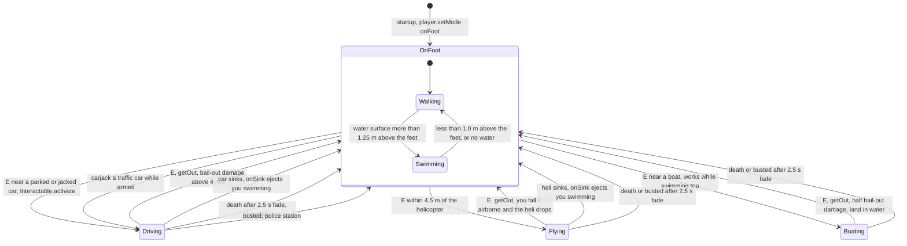

Every arrow is a call to `PlayerStateMachine.setMode(next)`. Arrows into `OnFoot` from a vehicle are made by `main.ts`: `getOut()` (the `onExit` callback each vehicle mode receives), `onSink()` (the `onSink` callback of `Car`/`Helicopter`), the `stats.onDeath` handler and `busted()`. All of them first call `onFoot.placeAt(spot, heading, heading)` and then `player.setMode(onFoot)`. Death and busted while already on foot call `setMode(onFoot)` too, which is a no-op (`next === current`), so only `placeAt` moves you. Walking ↔ Swimming is not a mode change: it is the `swimming` flag inside `OnFootMode`.

### Diagram (b): modes, entities and their helpers

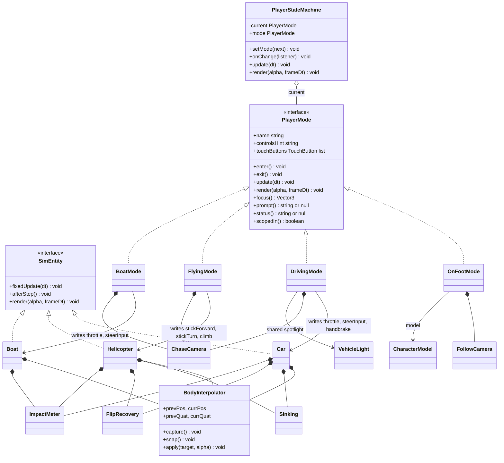

Each `Car`, the `Helicopter` and each `Boat` carries a back-pointer `mode` (`DrivingMode` / `FlyingMode` / `BoatMode`), set by `main.ts` right after construction; `player.setMode(car.mode!)` is how you get in. Exactly one `VehicleLight` exists and is handed to every vehicle mode.

### Diagram (c): input flow

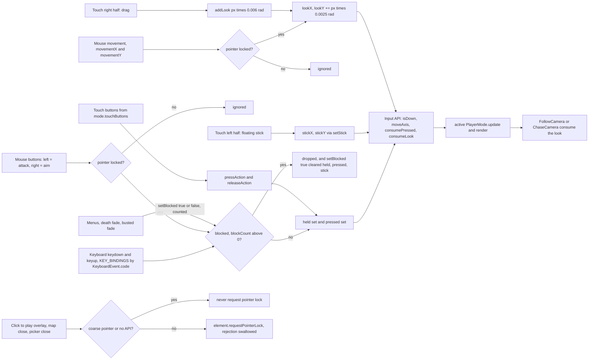

### Diagram (d1): helicopter force model (one physics step)

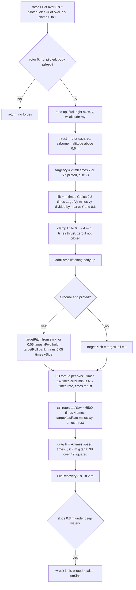

### Diagram (d2): car ray-cast vehicle model (one physics step)

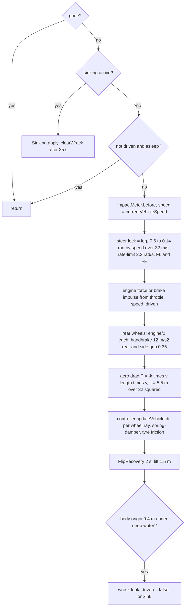

---

### 5.1 `src/sim/entity.ts`

**Purpose.** Defines the contract every simulated thing implements (`SimEntity`) and the helper that makes motion smooth at any frame rate (`BodyInterpolator`). This is the heart of "fixed timestep + render interpolation".

**Depends on:** `three` (Vector3, Quaternion, Object3D), `@dimforge/rapier3d-compat` (type `RigidBody`) · **Used by:** `player/car.ts`, `player/heli.ts`, `player/boat.ts` (both); `sim/vehicleBody.ts` (type `BodyInterpolator`); `main.ts`, `game/stats.ts`, `game/pickups.ts`, `game/missions.ts`, `game/wanted.ts`, `world/dayNight.ts`, `npc/traffic.ts`, `npc/pedestrians.ts`, `npc/police.ts` (type `SimEntity`).

**Key constants.** None.

**Types.**

`interface SimEntity`

| Field | Type | Meaning |
|---|---|---|
| `fixedUpdate` | `(dt: number) => void` | Apply controls/forces for the coming step. Called once per physics step, **before** `world.step()`. `dt` is always `1/60`. |
| `afterStep` | `() => void` | Record the post-step physics state (for interpolation, impact measurement). Called once per step, **after** `world.step()`. |
| `render` | `(alpha: number, frameDt: number) => void` | Once per rendered frame: put meshes at the pose interpolated between the last two physics states by `alpha ∈ [0, 1)`; `frameDt` is the real frame time (s, clamped ≤ 0.25). |

**API.**

#### `class BodyInterpolator`
Fields (all `readonly`, public): `prevPos`, `currPos` (`THREE.Vector3`), `prevQuat`, `currQuat` (`THREE.Quaternion`).

#### `constructor(body: RAPIER.RigidBody)`
- Captures the body's current pose and copies it into `prev*` too, so the first frame doesn't interpolate from the origin.

#### `capture(): void`
- Shifts `curr → prev`, then reads `body.translation()` / `body.rotation()` into `curr*`.
- Called by: each vehicle's `afterStep()` — once per physics step, after `world.step()`.

#### `snap(): void`
- `capture()` then copy `curr → prev`, i.e. forget the previous pose. Used after a teleport (`placeBody`), so the mesh does not visibly slide across the jump for one frame.

#### `apply(target: THREE.Object3D, alpha: number): void`
- `target.position = lerp(prevPos, currPos, alpha)`, `target.quaternion = slerp(prevQuat, currQuat, alpha)`.
- Called by each vehicle's `render(alpha)`, once per frame.

**Internals: why interpolation.** With 60 Hz physics and, say, a 144 Hz display, several frames fall between two physics states; drawing the latest state would make motion stutter (some frames show the same pose twice). The renderer therefore draws the state `alpha` of the way from the previous step to the current one, where `alpha = accumulator / PHYSICS_STEP` is the leftover real time not yet simulated, as a fraction of a step. This shows motion one step (≤ 16.7 ms) late, which is invisible, in exchange for perfectly smooth motion.

```text
render pose = prev + alpha · (curr − prev)        (position, linear)
render rot  = slerp(prevQuat, currQuat, alpha)     (rotation, spherical)
alpha       = accumulator / (1/60)  ∈ [0, 1)
```

**Decisions.**
- Interpolate (draw slightly in the past) rather than extrapolate (predict ahead) → interpolation never shows a pose that physics won't reach (no overshoot into walls) → extrapolation rejected.
- `SimEntity` is a tiny structural interface rather than a base class → anything (stats, the day/night clock, jobs via an inline object in `main.ts`) can join the step loop.

---

### 5.2 `src/sim/vehicleBody.ts`

**Purpose.** Small helpers every drivable vehicle needs — heading, teleport, flip recovery, crash measurement — "kept in one place so a fix to one is a fix to all". They were extracted from duplicated code in `car.ts`, `heli.ts` and `boat.ts` in the audit commit `ffd288c` ("shared helpers for vehicle poses, flips, impacts").

**Depends on:** `three`; Rapier type `RigidBody`; type `BodyInterpolator` from `entity.ts` · **Used by:** `player/car.ts` (`FlipRecovery`, `ImpactMeter`, `placeBody`), `player/heli.ts` (same three), `player/boat.ts` (`ImpactMeter` only).

**Key constants.** Module scratch objects `UP = (0,1,0)`, `tmpQ`, `tmpV` (reused to avoid per-step allocations; therefore none of these functions is re-entrant, which is fine in single-threaded JS).

**API.**

#### `headingOf(body: RAPIER.RigidBody): number`
- Heading (rad) of a body whose model faces +X: rotates `(1,0,0)` by the body's rotation and returns `atan2(−fwd.z, fwd.x)`. 0 = facing +X, growing counter-clockwise seen from above (rotating +X about +Y by θ gives `(cos θ, 0, −sin θ)`, hence the minus).
- Pitch and roll are ignored (only the horizontal projection matters). If the forward axis is exactly vertical the result is `atan2(0, 0) = 0`.
- Called by: `FlipRecovery.update` (to keep the heading when righting a vehicle).

#### `placeBody(body, interp, x, y, z, yaw): void`
- Teleport: `setTranslation({x,y,z})`, `setRotation(yaw about +Y)` (level, so pitch/roll are dropped), zero linear and angular velocity, `resetForces`, then `interp.snap()`.
- Side effects: wakes the body (every setter is called with `wakeUp = true`).
- Called by: `FlipRecovery.update`; `Car.clearWreck()` (back to its parking spot, `y + 0.15`); `Helicopter.backToHelipad()` (`y + 0.05`).

#### `class FlipRecovery`
`constructor(delay: number, lift: number)` — `delay` seconds on its roof/side, then lift by `lift` metres. Car: `new FlipRecovery(2, 1.5)`; helicopter: `new FlipRecovery(3, 2)`. Boats have none.

#### `FlipRecovery.update(body, interp, dt, speed): void`
- Computes the body's up vector's Y component `upY` (= cos of the tilt from vertical). If `upY < 0.3` (tilted more than ≈ 72.5°) **and** `speed < 2` m/s, the private `timer` grows by `dt`; otherwise it resets to 0.
- When `timer ≥ delay`: reset timer and `placeBody(body, interp, t.x, t.y + lift, t.z, headingOf(body))` — upright, same heading, dropped from `lift` m.
- Called every physics step from `Car.fixedUpdate` (with `|forward speed|` from the vehicle controller) and `Helicopter.fixedUpdate` (with the full 3-D speed).

#### `class ImpactMeter`
Measures crashes as the largest sudden velocity change in one physics step.

| Method | Contract |
|---|---|
| `before(body)` | Store `linvel()` at the start of a step (from `fixedUpdate`). |
| `after(body)` | After `world.step()`: `impact = max(impact, length(v_now − v_before))`, then store `v_now` as the next "before". |
| `take(): number` | Return the max since the last call and reset it to 0. |

```text
Δv = sqrt((vx − bx)² + (vy − by)² + (vz − bz)²)    (m/s, over one 1/60 s step)
```
Normal driving changes velocity by well under 1 m/s per step (even a 9 m/s² brake is 0.15 m/s per step); a wall hit at speed is many m/s in a single step. Because `after()` also stores the new velocity as "before", the measurement stays correct when `fixedUpdate` skips `before()` (a sleeping parked car still gets `afterStep()`).
- Called by: `Car`/`Helicopter`/`Boat` (`before` in `fixedUpdate`, `after` in `afterStep`); `take()` via their `takeImpact()`, read once per step by the active vehicle mode, which converts it to damage. Each mode's `enter()` calls `takeImpact()` once to discard jolts from before you got in.

**Decisions.**
- Crash damage from Δv per step instead of Rapier contact events → simple, works for every collider type, and matches what a body feels (acceleration) → contact-force events rejected (more plumbing).
- Flip recovery only when nearly still → you can still roll a car mid-crash; it is only "fixed" once it has come to rest upside down.

---

### 5.3 `src/sim/pose.ts`

**Purpose.** The rotation of a road vehicle that is *not* physics-driven (NPC traffic, police cars): turned `yaw` about the vertical, then pitched nose-up about its own sideways axis so it lies along the road slope.

**Depends on:** `three` · **Used by:** `npc/traffic.ts`, `npc/police.ts`.

**API.**

#### `yawPitchQuaternion(yaw: number, pitch: number, out: THREE.Quaternion): THREE.Quaternion`
- `out = R_Y(yaw) · R_Z(pitch)` (right-multiplied, so the pitch is about the car's **local** Z axis — its sideways axis, since cars face +X). Positive `pitch` raises the nose. Returns `out` (no allocation; uses a module-level scratch `pitchQuat`).
- Called per car per frame / step by traffic and police when composing instance matrices.

**Decisions.** Shared helper added in `ffd288c` so traffic and police compute the same pose; roll is deliberately ignored (roads are not banked).

---

### 5.4 `src/sim/exit.ts`

**Purpose.** Find where to put the player when they get out of a vehicle: the first candidate spot around the vehicle where the player's capsule fits.

**Depends on:** `three`; Rapier `World.intersectionsWithShape` · **Used by:** `Car.findExitPoint`, `Helicopter.findExitPoint`, `Boat.findExitPoint`.

**API.**

#### `findFreeSpot(world, shape, standHeight, vehicle, position, rotation, localCandidates, roofHeight): THREE.Vector3`
- For each `local` in `localCandidates` (vehicle frame), in order: `p = rotation · local + position`, then **override** `p.y = position.y + standHeight + 0.05` (capsule centre 5 cm above the vehicle's ground-level origin, so the tilt of the vehicle does not change the height). Run `world.intersectionsWithShape(p, identity rotation, shape, callback, …, filterExcludeRigidBody = vehicle)`; the callback sets `blocked` and returns `false` to stop at the first hit.
- Returns the first unblocked `p` (capsule **centre**, world space).
- If every candidate is blocked: returns `position + (0, roofHeight + standHeight, 0)` — standing on the roof (this fallback is not tested for overlap).
- Inputs: `shape` is the player's capsule (`onFoot.shape`), `standHeight` is `STAND_HEIGHT = 0.9` m (centre to feet), `position`/`rotation` are the vehicle's latest physics pose (`interp.currPos/currQuat`).
- Side effects: none (a pure query).
- Called by: `main.ts` `getOut()` via `vehicle.findExitPoint()`, on the step the player presses E. At that moment the player's own capsule collider is still disabled (it is re-enabled by `OnFootMode.enter()` afterwards), so it cannot block its own exit.

Candidate lists (vehicle frame, +X forward, +Z right):

| Vehicle | Candidates in order | Roof fallback |
|---|---|---|
| Car | `(0,0,−side)` driver (left), `(0,0,+side)` passenger, `(−L/2−0.8, 0, 0)` behind, `(L/2+0.8, 0, 0)` in front; `side = width/2 + 0.7` | 2.1 m van, 1.5 m sedan/taxi |
| Helicopter | `(0.3,0,−2.2)` pilot door (left), `(0.3,0,2.2)`, `(3.3,0,0)` | 2.1 m |
| Boat | `(0,0,∓(beam/2+0.8))`, `(−L/2−1,0,0)`, `(L/2+1,0,0)` | `height + 0.2` |

**Decisions.** Driver side first (left-hand drive: the driver sits on −Z) → stepping out where you'd expect. The vehicle body is excluded from the test so its own colliders don't block every spot.

---

### 5.5 `src/sim/sinking.ts`

**Purpose.** Cars driven into deep water and a helicopter that comes down on the lake/sea are wrecked and sink. Shared by `Car` and `Helicopter` (boats do not use it).

**Depends on:** `three`, Rapier types · **Used by:** `player/car.ts`, `player/heli.ts`; `main.ts` sets `sinking.water = deepWater` and reads `sinking.active` (to hide "drive"/"fly" interactables).

**Key constants.**

| Name | Value | Meaning / why |
|---|---|---|
| `SINK_TIME` | 25 s | From going under until the wreck is cleared (`done`). |
| `SINK_DAMPING` | 2.5 1/s | Linear damping while sinking (heavy water drag). |
| `SINK_ANGULAR_DAMPING` | 2 | Angular damping while sinking. |
| `BUOYANCY` | 0.7 | Fraction of the weight the water holds up. |
| `GRAVITY` | 9.81 m/s² | Same as the Rapier world. |
| `WRECK_MATERIAL` | `MeshStandardMaterial(0x1d1c1a, roughness 1)` | Shared dark, waterlogged look. |

**API.** `class Sinking`

| Member | Meaning |
|---|---|
| `time: number` | Seconds since the vehicle went under, or −1 if it hasn't. |
| `water: ((x, z) => number \| null) \| null` | Water surface height where the water is deep enough to sink a vehicle, else null. Set by `main.ts` to `deepWater = depthAt(x,z) > 1.0 ? surfaceAt(x,z) : null`. |
| `get active` | `time >= 0`. |
| `get done` | `time >= SINK_TIME`. |

#### `check(position: RAPIER.Vector, submerged: number): boolean`
- Returns `false` if already sinking or `water` is unset. Otherwise looks up `surface = water(x, z)`; returns `false` if `surface === null` (not deep water) or `position.y > surface − submerged`. Else sets `time = 0` and returns `true` (only on that one step).
- `position` is the body origin = the vehicle's ground level (car floor reference / helicopter skids). Car passes `submerged = 0.4` m, helicopter `0.3` m.

#### `apply(body: RAPIER.RigidBody, dt: number): void`
- `time += dt`; set damping to 2.5 / 2; `resetForces`; if the body origin is below the surface, `addForce(0, 0.7·m·g, 0)`. Called *instead of* the vehicle's own forces while `active`.

```text
net down force = m·g − 0.7·m·g = 0.3·m·g
Rapier linear damping c: dv/dt ≈ −c·v  →  terminal speed v = 0.3·g / c = 0.3·9.81 / 2.5 ≈ 1.18 m/s
```
So the wreck settles at about 1 m/s: "a slow sink rather than a drop".

#### `wreck(object: THREE.Object3D): void`
- Traverses `object`, remembers each mesh's material in a private `Map` (once per mesh) and swaps in `WRECK_MATERIAL`.

#### `restore(body, linearDamping, angularDamping): void`
- Puts every saved material back, clears the map, `time = −1`, restores the body's normal damping (car 0.05 / 0.4, helicopter 0.05 / 1.5).

**Decisions.** Fake buoyancy (a constant 70 % lift) instead of a volume calculation → cheap and gives a believable slow sink. The wreck's own materials are saved and restored (not cloned) → no leaks; the wreck material is shared.

---

### 5.6 `src/sim/smoke.ts`

**Purpose.** Smoke puffs from damaged/wrecked cars and splashes when a vehicle sinks. All puffs are one `THREE.Points` object → one draw call. Purely visual, advanced in render time.

**Depends on:** `three` · **Used by:** `main.ts` (creates it, `smoke.update(frameTime)` each frame, splash puffs in `onSink`), `npc/traffic.ts`, `npc/police.ts` (`emit`).

**Key constants.** `MAX_PUFFS = 400` (ring buffer size), `LIFE = 2.2` s.

**API.** `class Smoke`

#### `constructor(scene: THREE.Scene)`
- Allocates typed arrays (positions, sizes, alphas, shades, velocities, ages filled with `LIFE` = all dead, base sizes), a `BufferGeometry` with attributes `position`, `aSize`, `aAlpha`, `aShade`, and a transparent `ShaderMaterial` (`depthWrite: false`, uniform `uScale = innerHeight/2`, updated on window resize). `frustumCulled = false` (the bounding sphere would be stale).

#### `emit(position: THREE.Vector3, darkness: number, size: number): void`
- Writes one puff into the next ring slot (overwriting the oldest when full): velocity `x,z ∈ [−0.3, 0.3)`, `y ∈ [1.2, 2.0)` m/s (`Math.random`, not seeded — it's cosmetic), `age = 0`, base size `size` m, shade `darkness` (0 light grey … 1 black).

#### `update(dt: number): void`
- For each live puff: `age += dt`, `t = age/LIFE`, move by `velocity·dt`, `size = base·(1 + 2.5·t)`, `alpha = 0.55·(1 − t)·min(1, 8·t)` (fade in over the first 1/8 of life, then out). Dead puffs get alpha 0. Marks all four attributes `needsUpdate`.

**Internals (shaders).**
```text
gl_PointSize = aSize · uScale · projectionMatrix[1][1] / max(−mv.z, 0.1)
```
`projectionMatrix[1][1] = 1/tan(fov/2)` and `uScale = viewport height / 2`, so this is the exact on-screen pixel size of an object `aSize` metres wide at view depth `−mv.z`. The fragment shader draws a soft disc: `a = vAlpha·(1 − smoothstep(0.15, 0.5, d))` with `d` the distance from the point centre, discards `a < 0.01`, colour `mix(0.62 grey, 0.06 grey, vShade)`.

**Decisions.** One Points object + ring buffer → constant memory, one draw call; render-time rather than physics-time → smoke never affects simulation.

---

### 5.7 `src/sim/vehicleLight.ts`

**Purpose.** One `THREE.SpotLight` shared by whichever vehicle the player is in (car/boat headlights, helicopter searchlight).

**Depends on:** `three` · **Used by:** `main.ts` (creates one, `night = () => dayNight.lighting.night`), `DrivingMode`, `FlyingMode`, `BoatMode`.

**API.** `class VehicleLight`

#### `constructor(scene, night: () => number)`
- `new SpotLight(0xfff2dd, intensity 0, distance 90 m, angle 0.5 rad, penumbra 0.55, decay 1.6)`; adds it and its target to the scene once.

#### `aim(from: THREE.Vector3, to: THREE.Vector3, strength: number): void`
- Moves the light to `from`, its target to `to`, `intensity = strength · night()` (so it is off by day). Strength: car 900, boat 900, helicopter 6000. Called every frame by the active vehicle mode's `render()`.

#### `off(): void`
- `intensity = 0`. Called by every vehicle mode's `exit()`.

**Decisions.** Created once and only moved/dimmed → adding or removing lights makes three.js recompile every material's shader (a visible hitch); a fixed light count avoids it.

---

### 5.8 `src/input/actions.ts`

**Purpose.** The abstract input layer. It turns keyboard, mouse and (through `touch.ts`) touch events into named `Action`s, a 2-D movement axis and an accumulated look delta. All key bindings live in this file and nowhere else.

**Depends on:** browser DOM only · **Used by:** almost everything interactive: `main.ts`, all modes in `player/`, both cameras, `game/combat.ts`, `game/shop.ts`, `game/missions.ts`, `world/dayNight.ts` (T fast-forward), `ui/hud.ts`, `ui/fullMap.ts`, `ui/characterPicker.ts`, `ui/dialogue.ts`, `ui/debug.ts`, `input/touch.ts`.

**Key constants.**

| Name | Value | Meaning / why |
|---|---|---|
| `KEY_BINDINGS` | table below | `KeyboardEvent.code` → actions. `code` is the *physical* key position, so WASD stays put on AZERTY or Hebrew layouts. |
| `MOUSE_SENSITIVITY` | 0.0025 rad/px | Camera rotation per pixel of mouse movement. |
| `STICK_RUN_THRESHOLD` | 0.85 | Touch stick deflection (0–1) beyond which `isDown('run')` is true. |
| `MOUSE_BUTTONS` (in constructor) | `{0: 'attack', 2: 'aim'}` | Left button attacks, right button aims (scope). |

Key bindings (`KEY_BINDINGS`):

| Code(s) | Actions | Who reads it |
|---|---|---|
| `KeyW`, `ArrowUp` | `moveForward` | `moveAxis()` → walk / throttle / cyclic forward |
| `KeyS`, `ArrowDown` | `moveBack` | `moveAxis()` |
| `KeyA`, `ArrowLeft` | `moveLeft` | `moveAxis()` → strafe / steer / yaw |
| `KeyD`, `ArrowRight` | `moveRight` | `moveAxis()` |
| `ShiftLeft`, `ShiftRight` | `run`, `descend` | on foot: run / swim fast; helicopter: descend |
| `Space` | `jump`, `handbrake`, `ascend` | on foot: jump / swim up; car: handbrake; helicopter: climb |
| `KeyE` | `interact` | use / get in / get out |
| `KeyF` | `attack` | combat |
| `KeyQ` | `nextWeapon` | cycle weapons |
| `Digit1..3` | `choice1..3` | dialogue choices |
| `KeyT` | `timeSkip` | day/night fast-forward (held) |
| `KeyP` | `characterMenu` | character picker |
| `KeyC`, `ControlLeft` | `dive` | swim down |
| `KeyM` | `toggleMap` | full map |
| `KeyJ` | `job` | side job (read by `main.ts` each step) |
| `KeyN` | `mute` | sound |
| `KeyR` | `radio` | car/boat radio |
| `F3`, `Backquote` | `toggleDebug` | debug overlay |

`aimToggle` has no key: it exists for the touch SCOPE button (desktop holds right mouse = `aim`).

**Types.**

`type Action` = `'moveForward' | 'moveBack' | 'moveLeft' | 'moveRight' | 'run' | 'jump' | 'interact' | 'handbrake' | 'ascend' | 'descend' | 'attack' | 'aim' | 'aimToggle' | 'nextWeapon' | 'choice1' | 'choice2' | 'choice3' | 'characterMenu' | 'dive' | 'timeSkip' | 'toggleMap' | 'job' | 'mute' | 'radio' | 'toggleDebug'` (25 actions).

**API.** `class Input` — private state: `held: Set<Action>` (level-triggered: currently down), `pressed: Set<Action>` (edge-triggered: pressed since last consumed), `lookX/lookY` (accumulated radians), `locked` (pointer lock state), `blocked` + `blockCount`, `stickX/stickY` (touch stick, x right, y forward, length ≤ 1).

#### `constructor(element: HTMLElement)`
`element` is the renderer canvas (the pointer-lock target). Registers listeners:
- `window keydown`: if the code is bound **and** input is not blocked: `preventDefault()` (stops Space/arrows scrolling the page); for each bound action add to `pressed` unless `e.repeat` (auto-repeat doesn't re-press), and add to `held`. Unbound keys and blocked input return early (no `preventDefault`).
- `window keyup`: remove the bound actions from `held` (even while blocked).
- `window blur`: clear `held` and the stick — losing focus means the keyup is never seen; without this the player would run off forever.
- `document pointerlockchange`: `locked = document.pointerLockElement === element`.
- `document mousedown`: only if locked, the button is mapped and not blocked → add to `pressed` and `held`. `mouseup`: remove from `held`.
- `document contextmenu`: `preventDefault()` while locked (right-click aims instead of opening a menu).
- `document mousemove`: only while locked: `lookX += movementX·0.0025`, `lookY += movementY·0.0025`.

#### `get pointerLocked(): boolean` — current lock state (HUD hides "Click to play" when locked).

#### `requestPointerLock(): void`
- Returns without doing anything when `matchMedia('(pointer: coarse)')` matches (phones/tablets) or the element has no `requestPointerLock` (iPhone Safari). Otherwise calls it and, if it returns a Promise, swallows a rejection (some browsers reject when asked too soon after Esc).
- Called by: the HUD "Click to play" overlay click, `FullMap.close()`, `CharacterPicker.close()`.
- **Why never on touch:** Android Chrome grants pointer lock from a tap, after which every touch is delivered to the locked canvas instead of the on-screen joystick, leaving the player with no control. This was the bug "no control after closing the map" (fixed in `ae68e1f`): the map and picker request pointer lock as they close, to put desktop players straight back into mouse look.

#### `setBlocked(blocked: boolean): void`
- **Counted** blocks: `blockCount = max(0, blockCount ± 1)`; `blocked = blockCount > 0`. On `true` also clears `held`, `pressed` and the stick.
- While blocked: `isDown()` is false, `moveAxis()` is `(0,0)`, keydowns and mouse presses are dropped (not queued). `consumeLook()` and `consumePressed()` still work (nothing gets added though, except touch `pressAction`, which is not gated).
- Callers: `Shop` open/close, `FullMap` open/close, `CharacterPicker` open/close, the death fade (`stats.onDeath`, released after 2.5 s) and the busted fade (`busted()`).
- **Why counted:** before `ffd288c` it was a boolean, so closing the map under an open picker or shop unfroze the game beneath the menu ("menus unfreezing each other"). Each `true` now needs its own `false`.

#### `get isBlocked(): boolean`

#### `exitPointerLock(): void` — `document.exitPointerLock()` if locked (menus free the mouse to click).

#### `isDown(action: Action): boolean`
- `false` while blocked. For `'run'`, also `true` when `hypot(stickX, stickY) > 0.85`. Otherwise `held.has(action)`.

#### `moveAxis(): { x: number; y: number }`
- `(0,0)` while blocked. `x = right − left`, `y = forward − back` from held keys (each 0/1), plus the stick. If the length exceeds 1 it is normalised (diagonals aren't faster). Keyboard gives full-length directions; a half-pushed stick gives length ≈ 0.5 (analog speed).

#### `setStick(x, y)`, `addLook(dx, dy)`, `pressAction(action)`, `releaseAction(action)` — touch hooks
- `setStick` stores the analog stick. `addLook` adds radians (+x right, +y down — same convention as the mouse). `pressAction` adds to `pressed` only if the action wasn't already held (so a held button doesn't re-press), then to `held`. `releaseAction` removes from `held`.

#### `consumePressed(action: Action): boolean`
- `pressed.delete(action)`: true once per physical press; the caller consumes it. A press is never lost or doubled however many physics steps run in a frame (0, 1 or several).

#### `clearPressed(): void`
- Forget unconsumed presses. Called by `PlayerStateMachine.setMode()` on every mode change, so e.g. the Space press that meant "handbrake" doesn't become a jump the moment you step out.

#### `consumeLook(): { x: number; y: number }`
- Returns the accumulated look delta (rad, +x right, +y down) and zeroes it. Called once per frame by the active camera rig (and by the picker).

**Decisions.**
- Actions, not keys → one key can mean different things per mode (Space = jump / handbrake / climb) and touch feeds the same API; modes never know which device is used.
- Edge-triggered `pressed` consumed by the reader (not cleared per frame) → presses survive frames with zero physics steps (high refresh rates) and are not doubled when a frame runs two steps.
- Mouse buttons only while pointer-locked → clicking UI (menus, the minimap) doesn't fire a gun.

---

### 5.9 `src/input/touch.ts`

**Purpose.** On-screen controls for phones and tablets: a floating joystick on the left half, drag-to-look on the right half, and a column of buttons (bottom-right) defined by the current mode. It feeds the same `Input` as keyboard and mouse, so controllers never know touch is in use.

**Depends on:** `input/actions.ts` (`Input`, `Action`) · **Used by:** `main.ts` (`isTouchDevice()`, `new TouchControls(input)` only on touch devices; `player.onChange(mode => touchControls.setButtons(mode.touchButtons))`; `touchControls.update()` every frame; `touchControls.reset()` from the full map's and picker's open/close callbacks).

**Key constants.**

| Name | Value | Meaning / why |
|---|---|---|
| `STICK_RADIUS` | 60 px | Knob travel from the base centre. |
| `STICK_DEADZONE` | 0.12 | Fraction of the radius ignored, so a resting thumb doesn't drift. |
| `TOUCH_LOOK_SENSITIVITY` | 0.006 rad/px | Look rotation per pixel dragged (higher than the mouse's 0.0025 because fingers move fewer pixels). |
| `BASE_SIZE` | 120 px | `2·STICK_RADIUS`. |
| `KNOB_SIZE` | 56 px | |
| `BUTTON_SIZE` | 72 px | Thumb-sized round buttons. |
| `BUTTON_GAP` | 14 px | |
| `EDGE` | `'max(24px, env(safe-area-inset-left))'` | Keeps the idle stick clear of notches and rounded corners. |

**Types.** `interface TouchButtonSpec` (structurally the same as `TouchButton` in `state.ts`):

| Field | Type | Meaning |
|---|---|---|
| `label` | `string \| (() => string)` | Button text; a function for labels that change (e.g. JUMP/UP, ENTER/TALK). |
| `action` | `Action` | Pressed while the finger is down. |
| `visible?` | `() => boolean` | Shown only while true. |

**API.**

#### `isTouchDevice(): boolean`
- `matchMedia('(pointer: coarse)').matches` — true when the *primary* pointer is a finger. Touchscreen laptops report a fine primary pointer (trackpad/mouse) and keep mouse controls.

#### `class TouchControls`
#### `constructor(input: Input)`
- Builds a full-screen root `div` (`position:fixed; inset:0; z-index:10; touch-action:none` — the game handles every gesture, no browser scroll/zoom; no text selection or iOS callout), the stick base + knob, and the button column (`flex-direction: column-reverse` so the first button is at the bottom nearest the thumb; `flex-wrap: wrap-reverse` overflows into a second column to the left; `max-height: min(62vh, 260px)`). Shows the idle stick. Listens on the root for `pointerdown`, `pointermove`, `pointerup`, `pointercancel`, `lostpointercapture` (→ `onUp`) and blocks `contextmenu` (long-press menu on Android).

#### `setButtons(specs: TouchButtonSpec[]): void`
- Releases the action of every old button (`input.releaseAction`) and removes it; builds one 72 px round `div` per spec. Each button tracks its own `pointerId`: on `pointerdown` it `stopPropagation()` (so it doesn't also start a look drag), captures the pointer, highlights, `input.pressAction(spec.action)`; on `pointerup`/`pointercancel` of the same pointer it un-highlights and `releaseAction`. Ends with `update()`.
- Called on every mode change (via `player.onChange`).

#### `update(): void`
- Per frame: for each button set `display` to `flex`/`none` from `visible()` and refresh a function label, touching the DOM only when the value changed.

#### `reset(): void`
- Forget every finger (`stickPointer = lookPointer = null`, clear the `down` set), centre the stick (`setStick(0,0)`), show the idle stick. Called when a full-screen menu (full map, character picker) opens or closes — fingers lifted over the menu never reach this layer.

**Internals.**
- **Finger slots.** `stickPointer` and `lookPointer` each remember one `pointerId`; `down: Set<number>` lists fingers currently on the layer. `onDown`: `preventDefault`, `setPointerCapture`; **self-healing**: if a slot's finger is no longer in `down` (its release went elsewhere), free the slot; add this finger to `down`. Left half of the screen (`clientX < innerWidth/2`) → take the stick slot if free: the base appears where the thumb lands (floating joystick), then `updateStick`. Right half → take the look slot if free and remember the position. A finger landing on an occupied side is ignored.
- `onMove`: stick finger → `updateStick`; look finger → `input.addLook(dx·0.006, dy·0.006)` from the delta since the last move.
- `onUp` (also for `pointercancel` and `lostpointercapture`): remove from `down`; if it was the stick finger, free it, zero the stick and show the idle stick; if the look finger, free it.
- `updateStick(x, y)`: offset `(dx, dy)` from the origin, clamped to the 60 px radius (knob drawn there). Magnitude `mag = min(dist/60, 1)`. Below the dead zone → stick 0. Otherwise remap so movement starts smoothly just past the dead zone:

```text
scaled = (mag − 0.12) / (1 − 0.12)          ∈ (0, 1]
(nx, ny) = (dx, dy) / (mag · 60)            unit direction
stick = (nx · scaled, −ny · scaled)         screen y grows downward; up = forward
```
  Running needs `scaled > 0.85`, i.e. the thumb ≥ ~87 % of the radius from the origin.
- `placeBase(cx, cy, opacity)` positions the base; `showIdleStick()` puts a faded (opacity 0.5) stick in the bottom-left corner so players see where to put their thumb. Small helper `el(tag, styles)` creates a styled `div`.

**Decisions.**
- Pointer Events with per-`pointerId` slots → several fingers act at once (move with the left thumb while looking with the right).
- Self-healing slots + `lostpointercapture` + `reset()` → a slot can never stay "taken" by a finger that has gone (that was the second half of the `ae68e1f` touch fix).
- Buttons come from the mode (`touchButtons`) → each mode declares what it needs; `main.ts` appends JOB and RADIO buttons to vehicle modes.

---

### 5.10 `src/player/state.ts`

**Purpose.** The player state machine: exactly one `PlayerMode` (OnFoot, Driving, Flying, Boating) is active; each mode owns its controller and camera rig; the game loop only talks to `PlayerStateMachine`.

**Depends on:** types `Action`, `Input` from `input/actions.ts`; type `THREE.Vector3` · **Used by:** `main.ts` (`PlayerStateMachine`), `ui/hud.ts` (type `PlayerMode`: prompt, status, controls hint, `scopedIn`), every mode (implements `PlayerMode`, uses `TouchButton`).

**Types.**

`interface TouchButton`

| Field | Type | Meaning |
|---|---|---|
| `label` | `string \| (() => string)` | Text on the button; a function for changing labels (ENTER / TALK / SHOP…). |
| `action` | `Action` | Action pressed while held. |
| `visible?` | `() => boolean` | Shown only while true (e.g. the interact button only near something). |

`interface PlayerMode`

| Field | Type | Meaning |
|---|---|---|
| `name` | `readonly string` | `'OnFoot'`, `'Driving'`, `'Flying'`, `'Boating'`. `main.ts`/missions compare it for routing, sound and mission rules. |
| `enter()` | `void` | Become active (enable collider / mark vehicle driven, reset camera). |
| `exit()` | `void` | Stop being active (zero vehicle controls, turn the light off…). |
| `update(dt)` | `void` | Fixed-timestep update, once per physics step **before** `world.step()`. |
| `render(alpha, frameDt)` | `void` | Once per rendered frame after physics; `alpha ∈ [0,1)`; `frameDt` real frame time for camera smoothing. |
| `focus()` | `THREE.Vector3` | Where the player is (drives chunk streaming, shadows, NPC pools, sky, minimap, routing). |
| `prompt()` | `string \| null` | Contextual prompt (`"E — drive"`). |
| `status()` | `string \| null` | Readout such as speed / altitude. |
| `controlsHint` | `readonly string` | One-line keyboard summary. |
| `touchButtons` | `readonly TouchButton[]` | On-screen buttons besides the joystick and look area. |
| `scopedIn?()` | `boolean` | True while looking through a scope (HUD draws the scope overlay). Only `OnFootMode` implements it. |

**API.** `class PlayerStateMachine`

#### `constructor(input: Input)`

#### `get mode(): PlayerMode | null` — the active mode (null only before the first `setMode`).

#### `onChange(listener: (mode: PlayerMode) => void): void` — called after every successful switch (`main.ts` uses it to swap touch buttons).

#### `setMode(next: PlayerMode): void`
- If `next === current`: do nothing (no exit/enter, no listener call).
- Otherwise, in this order: `current?.exit()` → `current = next` → `input.clearPressed()` → `next.enter()` → each listener `(next)`.
- Called from: interactables' `activate()` (get in), carjacking, `getOut`, `onSink`, death, busted, startup.

#### `update(dt: number): void` — `current?.update(dt)`; once per physics step from `main.ts` `step()`.

#### `render(alpha: number, frameDt: number): void` — `current?.render(alpha, frameDt)`; once per frame after all entities.

**Decisions.**
- A mode per vehicle instance (every `Car` has its own `DrivingMode`) → entering is just `setMode(car.mode)`; nothing else special-cases the current mode.
- `clearPressed()` on every switch → no press leaks across modes.

---

### 5.11 `src/player/onFoot.ts`

**Purpose.** `OnFootMode`: walking, running, jumping, swimming, breath/drowning, fall damage, interacting (E), weapon switching and scoping, combat hand-off, holding a weapon model, the character model and the follow camera. Uses Rapier's **kinematic character controller**: the capsule is a kinematic *position-based* body; the game decides where it wants to go, the controller resolves that move against the world (slide along walls, step up ledges, snap down slopes), and the result is handed to the body with `setNextKinematicTranslation()`. Gravity is integrated by this code, not by Rapier.

**Depends on:** `three`; Rapier (`RigidBodyDesc.kinematicPositionBased`, `ColliderDesc.capsule`, `KinematicCharacterController`); `input/actions.ts`; `state.ts` (`PlayerMode`, `TouchButton`); `camera/followCamera.ts`; `character.ts` (type `CharacterModel`); `game/stats.ts` (`PlayerStats`: `damage`, `cycleWeapon`, `scoped`, `moveSpeedMultiplier`, `weapon`, `current`, `owned`); `game/combat.ts` (`Combat.update`); `game/weaponModels.ts` (`buildWeaponModel`) · **Used by:** `main.ts` (`OnFootMode`, `STAND_HEIGHT`, `Interactable`), `game/shop.ts` and `game/missions.ts` (type `Interactable`).

**Key constants.**

| Name | Value | Meaning / why |
|---|---|---|
| `CAPSULE_RADIUS` | 0.35 m | |
| `CAPSULE_HALF_HEIGHT` | 0.55 m | Cylinder half-length → total height `2·(0.55+0.35) = 1.8 m`. |
| `WALK_SPEED` | 2.0 m/s | A brisk city walk. |
| `RUN_SPEED` | 5.5 m/s | |
| `JUMP_HEIGHT` | 1.2 m | Apex of a standing jump. |
| `GRAVITY` | 20 m/s² | Higher than the real 9.81: games feel floaty at real gravity. Vehicles use the world's 9.81. |
| `GROUND_ACCEL` | 14 1/s | How fast horizontal velocity reaches its target on the ground. |
| `AIR_ACCEL` | 2.5 1/s | Reduced air control. |
| `TURN_SHARPNESS` | 12 1/s | How fast the body turns to face its movement. |
| `FALL_RESPAWN_Y` | −50 m | Below this, teleport back to the spawn (fell out of the world). |
| `JUMP_SPEED` | `√(2·20·1.2) = √48 ≈ 6.93 m/s` | Take-off speed reaching `JUMP_HEIGHT`: `v² = 2·g·h`. |
| `STAND_HEIGHT` (exported) | `0.55 + 0.35 = 0.9 m` | Capsule centre down to the feet. |
| `SAFE_FALL_SPEED` | 11 m/s | Landing slower than this is free. |
| `FALL_DAMAGE` | 7 health per m/s | Above the safe speed. |
| `SWIM_DEPTH` | 1.25 m | Water above the feet before you swim instead of wade. |
| `SWIM_FLOAT` | 0.25 m | Capsule centre floats this far below the surface (head above water). |
| `SWIM_SPEED` / `SWIM_FAST` | 1.6 / 2.6 m/s | Normal / with run held. |
| `DIVE_SPEED` | 1.6 m/s | Down with dive held, up with jump held. |
| `BREATH` | 12 s | Under water before drowning starts. |
| `DROWN_DAMAGE` | 10 health/s | Once out of breath. |
| `HEAD` | 0.7 m | Capsule centre up to the eyes (used for "head under water"). |

**Types.** `interface Interactable` — something usable with E (vehicle, person, shop, mission giver):

| Field | Type | Meaning |
|---|---|---|
| `label()` | `string` | Verb for the prompt: `"drive"`, `"fly"`, `"ride"`, `"drive boat"`, `"talk"`, `"shop"`… |
| `position()` | `THREE.Vector3` | Current position. |
| `radius` | `number` | Max horizontal distance (m). Car 3.2, helicopter 4.5, speedboat 4, jet ski 2.8, talk 2.4. |
| `available?()` | `boolean` | False hides it (sinking/gone vehicles, carjacking without a weapon, a chat already open). |
| `activate()` | `void` | Do it (e.g. `player.setMode(mode)`). |

**API.** `class OnFootMode implements PlayerMode`

Public fields: `name = 'OnFoot'`; `interactables: Interactable[]` (filled by `main.ts`, `shop`, `missions`); `combat: Combat | null` (set once pedestrians exist); `water: ((x,z) => number | null) | null` (set to `water.surfaceAt`); `swimming: boolean`; `breath: number` (s left, `BREATH` when full; `main.ts` sets it back to 12 on respawn).

#### `get controlsHint(): string`
- Swimming: `'WASD swim · Shift faster · Space up · C dive'`; otherwise `'WASD move · Shift run · Space jump · E use · Q weapon · F/click attack'`.

#### `touchButtons` (readonly)
| Label | Action | Visible when |
|---|---|---|
| `UP` (swimming) / `JUMP` | `jump` | always |
| `DIVE` | `dive` | swimming |
| `ATTACK` | `attack` | not swimming |
| `SCOPE` | `aimToggle` | weapon in hand has a scope |
| `WEAPON` | `nextWeapon` | more than one weapon owned |
| nearest interactable's label, upper-cased | `interact` | something in reach |

#### `constructor(world, scene, camera, input, spawn, model: CharacterModel | null, stats)`
- Creates the kinematic body at `spawn`, the capsule collider (half-height 0.55, radius 0.35), and the character controller:

| Setting | Value | Why |
|---|---|---|
| offset (skin width) | 0.01 m | Gap kept between capsule and world to avoid numerical sticking; invisible but robust. |
| up | (0,1,0) | |
| max slope climb | 45° | |
| min slope slide | 50° | Steeper than this you slide. |
| autostep | max height 0.4 m, min width 0.2 m, dynamic bodies excluded | Step up curbs/stairs if there is 0.2 m of floor on top. |
| snap to ground | 0.3 m | Keeps feet glued when walking down slopes/steps. |
| apply impulses to dynamic bodies | true | Walking into a parked car nudges it. |

- Creates a `FollowCamera` (ignoring the player's collider in its wall ray cast), a `visual` group, calls `setModel(model)` and adds it to the scene. `prev = curr = spawn`.

#### `enter(): void` — show the visual, enable the collider, reset (snap) the camera.

#### `exit(): void` — scoping off, `resetZoom()` the camera, hide the visual, **disable the collider** (the body is "inside the vehicle"), zero velocity and ground speed.

#### `scopedIn(): boolean` — current `scoping` flag.

#### `setModel(model: CharacterModel | null): void`
- Clears the visual group and the weapon holder. With a model: `model.root.position.y = −0.9` (model origin is at the feet; the group origin is the capsule centre) and add it. Without: add `createCapsuleMesh()` (orange capsule with a dark "visor" at the front, −Z). Called at construction and by the character picker.

#### `hurt(): void` — `model.play('hit')` (flinch). Called from `stats.onDamage` while on foot.
#### `knockDown(): void` — `model.knockDown()` (death). #### `standUp(): void` — `model.reset()` (respawn).

#### `get shape(): RAPIER.Shape` — the capsule shape, for `findFreeSpot`.

#### `placeAt(capsuleCentre: THREE.Vector3, facing: number, cameraYaw: number): void`
- Teleport: `curr = prev = capsuleCentre`, `body.setTranslation` (immediate, not "next kinematic"), set the visual `facing` and `cameraRig.yaw`. Does not zero `velocity` (exit() already did if you were in a vehicle) and does not snap the camera (the mode's `enter()` does; if you were already on foot the pivot catches up with smoothing 20 1/s).
- Called by `getOut`, `onSink`, death respawn, busted, save restore.

#### `update(dt: number): void` — one physics step. Order:
1. `nearest = findNearest()`.
2. Swim state with hysteresis: `surface = water(x,z)`, `feet = y − 0.9`. Start swimming when `surface − feet > 1.25`; stop when `surface === null` or `surface − feet < 1.0`.
3. `updateBreath(dt, surface)`.
4. If swimming → `swim(dt, surface)` and return.
5. `nextWeapon` press → `stats.cycleWeapon()`, scope toggle off. `aimToggle` press flips `scopeToggled`. `scoping = stats.scoped && (isDown('aim') || scopeToggled)`.
6. Combat: `combat.update(dt, chest = curr + (0,0.4,0), collider)`; if it returns an attack, face it (`facing = atan2(−f.x, −f.z)`) and play `'shoot'` (gun), `'punch'` (fists) or `'bat'`.
7. `interact` press with something in reach → `nearest.activate()` and **return** (no movement this step).
8. Horizontal: camera forward `fwd` (horizontal unit vector), `right = (−fwd.z, 0, fwd.x)`; `wish = (fwd·axis.y + right·axis.x) · speed`, `speed = (run && !scoping ? 5.5 : 2.0) · stats.moveSpeedMultiplier` (guns are heavier, a light grip is quicker, no running while scoped). Velocity approaches the wish exponentially (see below), with `k = 14` grounded or `2.5` airborne.
9. Vertical: on a `jump` press while grounded, `vy = 6.93`, `grounded = false`; then `vy −= 20·dt`.
10. `desired = velocity·dt`; remember `wasAirborne` and `fallSpeed = −vy`; `controller.computeColliderMovement(collider, desired)`; `moved = computedMovement()`, `grounded = computedGrounded()`.
11. Landing damage: if `wasAirborne && grounded && fallSpeed > 11` → `stats.damage((fallSpeed − 11)·7)`.
12. Grounded with `vy < 0` → `vy = 0`. Ceiling: if `desired.y > 0` and `moved.y < 0.5·desired.y` → `vy = 0`. Walls: `vx = moved.x/dt`, `vz = moved.z/dt` (drop the blocked part).
13. `prev = curr`, `curr += moved`, `groundSpeed = |moved.xz|/dt` (the speed actually achieved, which drives the animation — walking into a wall stops the legs).
14. If `curr.y < −50`: back to `spawn`, zero velocity, reset camera, return.
15. `body.setNextKinematicTranslation(curr)` (applied during the coming `world.step()`).
16. Facing: holding a gun (`!weapon.melee`) → turn toward the camera's forward (to aim); otherwise, if `|wish|² > 0.01`, toward the movement. Turn by the shortest wrapped angle, `facing += diff·(1 − e^(−12·dt))`.

#### `get underwater(): boolean` — head (`y + 0.7`) below the water surface. (No caller in `src/`; available through `window.game.onFoot`.)

#### `get breathFraction(): number | null` — `null` while breath is full (HUD hides the bar), else `breath/12`.

#### `render(alpha: number, frameDt: number): void`
- `renderPos = lerp(prev, curr, alpha)`; visual position = `renderPos`, `rotation.y = facing` (facing is visual only; the capsule never rotates).
- `model.setAim('none' if melee or swimming, else 'rifle' or 'pistol')`, `model.setSwimming(swimming, groundSpeed, frameDt)`, `model.update(groundSpeed, grounded || swimming, frameDt)`, `updateHeldWeapon()`; the weapon holder is hidden while swimming.
- Camera: pivot at the feet (`renderPos.y − 0.9`); `cameraRig.update(feet, frameDt, shoulder = melee ? 0 : 0.85, zoom = scoping ? 4 : 1)`; `visual.visible = !scoping` (the character would fill a 4× view).

#### `focus(): THREE.Vector3` — `curr` (the capsule centre; the live vector, not a copy).
#### `feet(out): THREE.Vector3` — `out = curr` with `y − 0.9`.
#### `get facingYaw(): number` — visual heading (0 = facing −Z); saved in the autosave.
#### `prompt(): string | null` — `` `E — ${nearest.label()}` `` or null. #### `status()` — always null.
#### `get debug(): { position, grounded }` — for tests (`tests/harness.cjs`).

**Internals.**

*Exponential approach (frame-rate independent smoothing).*
```text
v ← v + (v_target − v) · (1 − e^(−k·dt))
```
After time T the remaining error is `e^(−k·T)` regardless of how T is split into steps. On the ground, k = 14 1/s: 63 % of the way in 71 ms; in the air, k = 2.5 1/s (400 ms).

*Gravity and grounding.* Semi-implicit Euler: velocity first (`vy −= g·dt`), then position from the new velocity. While standing, `vy` is reset to 0 each step but one step of gravity (−0.33 m/s → 5.6 mm per step) is still requested next step; that downward probe is what keeps `computedGrounded()` true.

*Fall damage.* Landing speed after a drop `h` from rest: `v = √(2·g·h) = √(40·h)`.
```text
damage = max(0, √(40·h) − 11) · 7
h = 3 m → 10.95 m/s → 0       h = 5 m → 14.1 m/s → ≈ 22
h = 10 m → 20 m/s  → 63       fatal (100 health): √(40·h) = 25.3 → h ≈ 16 m
```
(The code comment says "5 m ~25 damage, ~15 m is fatal"; `DEVELOPER_GUIDE.md` §5.5 says a 24 m drop from a helicopter is fatal. The formula above is what the code does, from full health and from rest.) `fallSpeed` is the vertical speed *before* the move; only an airborne → grounded transition counts, so walking down slopes never hurts.

*Swimming (`swim(dt, surface)`).* Scope off. Horizontal as on land but `wish·(run ? 2.6 : 1.6)` and a sluggish `k = 4` 1/s. Vertical target velocity:
```text
floatY = surface − 0.25                                  (capsule centre when floating)
dive held:  vy_target = −1.6
jump held:  vy_target = +1.6 if y < floatY else 0
otherwise:  vy_target = clamp((floatY − y)·2.5, −2, 1.2) (buoyancy: a spring toward floatY)
vy ← vy + (vy_target − vy)·(1 − e^(−5·dt))
```
Jump and attack presses are consumed and discarded (no jumping or attacking in water); `interact` still works so you can climb into a boat from the water. The desired vertical move is clipped so the centre never rises above `floatY + 0.05` (no leaping out of the water). Then the character controller resolves the move as on land, `grounded = false`, `prev/curr/groundSpeed` are updated, `setNextKinematicTranslation`, and the body turns toward the swim direction with sharpness 6 1/s.

*Why the swim hysteresis matters.* Floating, the feet are at `surface − 0.25 − 0.9 = surface − 1.15`, i.e. 1.15 m of water over the feet — less than the 1.25 m start threshold but more than the 1.0 m stop threshold. Without the 0.25 m band, a floating swimmer would immediately "stop swimming".

*Breath (`updateBreath`).* Head under (`y + 0.7 < surface`): `breath = max(0, breath − dt)`; once at 0, a `drownTimer` accumulates and every full second deals `10` damage (one hurt flash per second, not per step). Head above water: `breath = min(12, breath + 4·dt)` (refills 4× as fast) and the timer resets.

*Interactables (`findNearest`).* Among `interactables` whose `available()` isn't false, the one with the smallest horizontal distance that is `< radius` and with `|Δy| < 3 m` (so a car on a bridge above doesn't count).

*Held weapon (`updateHeldWeapon`).* Needs `model.rightHand()` (bone `WristR`). Creates a holder group under the hand once, scaled by `1/handWorldScale.x` so weapons can be built in metres even though the rig is scaled to the person's height. When `stats.current` changes, swaps the model; each weapon's model is built once by `buildWeaponModel()` and cached in `weaponModels` (rebuilding on every switch leaked GPU geometries/materials — fixed in `ffd288c`). Fists → `null` model.

*Fallback mesh (`createCapsuleMesh`).* `CapsuleGeometry(0.35, 1.1)` orange (`0xff8a3d`) plus a 0.4×0.15×0.2 visor at `(0, 0.55, −0.28)` so you can see the facing.

**Decisions.**
- Kinematic character controller instead of a dynamic rigid-body capsule → precise, non-bouncy, non-tipping movement with step-up and slope snapping; dynamic capsule rejected.
- Own gravity of 20 m/s² → snappy jumps; vehicles keep realistic 9.81.
- Velocity reset to the achieved movement → no "pushing into walls" build-up.
- Swimming lives inside `OnFootMode` (same capsule and camera) rather than a fifth mode.
- Camera-relative movement and a separate visual facing → the capsule never rotates; only the model turns.

---

### 5.12 `src/player/character.ts`

**Purpose.** `CharacterModel`: an animated person (player, pedestrian, mission giver, job passenger). Purely visual — physics decides where they are; this class chooses and blends animation clips from the shared Quaternius library with a three.js `AnimationMixer`, in layers.

**Depends on:** `three` (`AnimationMixer`, `AnimationClip`, `AnimationAction`) · **Used by:** `player/characterLibrary.ts` (constructs it), `player/onFoot.ts`, `npc/pedestrians.ts`, `game/missions.ts`, `game/jobs.ts`, `ui/characterPicker.ts` (type).

**Key constants.**

| Name | Value | Meaning / why |
|---|---|---|
| `WALK_CLIP_SPEED` | 1.32 m/s | Ground speed the walk clip looks right at, for scale 1: measured as how fast a planted foot slides backward relative to the body during ground contact. |
| `RUN_CLIP_SPEED` | 3.02 m/s | Same for the run clip. |
| `RUN_PHASE_OFFSET` | 0.375 | The run clip has its left foot forward 0.375 of a cycle later than the walk clip; offsetting it makes both clips have the same foot forward at the same moment while blending. |
| `WALK_MAX` | 2.3 m/s | Pure walk up to here (played faster as needed). Normal walking (pedestrians 1.45–1.8, the player 2.0) never mixes in the run. |
| `JOG_MAX` | 3.4 m/s | Walk→run blend (a jog) between `WALK_MAX` and this; pure run above. |
| `CADENCE_EXPONENT` | 0.6 | Above the run clip's speed, cadence grows with speed^0.6 and the stride lengthens for the rest (like real runners) instead of frantic legs. |
| `SPEED_SMOOTHING` | 10 1/s | Smoothing of the ground speed driving the blend. |
| `AIM_FADE` | 8 1/s | Aim pose fade. |
| `GESTURE_FADE` | 5 1/s | Talk gesture fade. |
| `UPPER_BODY` | regex `^(Torso\|Chest\|Neck\|Head\|Shoulder\|UpperArm\|LowerArm\|Wrist\|Index\|Middle\|Ring\|Pinky\|Thumb)` | Bone names (the node part of a track name) belonging to the upper body. |
| `ONE_SHOTS` | table below | Clip(s) and in-game duration of each one-off action. |

| One-shot | Clip(s) | Duration (s) |
|---|---|---|
| `punch` | `Punch_Left`, `Punch_Right` (alternating) | 0.45 |
| `bat` | `Sword_Slash` | 0.65 |
| `shoot` | `Idle_Gun_Shoot` | 0.28 |
| `hit` | `HitRecieve`, `HitRecieve_2` (alternating) | 0.45 |
| `wave` | `Wave` | 1.6 |

Durations are retimed to gameplay (e.g. a punch lasts as long as its cooldown).

**Types.** `type Aim = 'none' | 'pistol' | 'rifle'`; `type OneShot = 'punch' | 'bat' | 'shoot' | 'hit' | 'wave'`.

**API.** `class CharacterModel`

#### `readonly root: THREE.Group` — put this in the scene; origin at the feet.

#### `constructor(scene: THREE.Object3D, clips: THREE.AnimationClip[], scale: number)`
- `scene` is the (cloned) skinned model. Scales it by `scale` (target height ÷ authored height), rotates it by π about Y (Quaternius models are authored facing +Z; the game's forward is −Z), adds it under `root`, creates the mixer, indexes clips by name.
- Creates actions, all playing with weight 0: `loco.idle/walk/run` as `[lower, upper]` pairs (idle at `timeScale 1`; walk and run at `timeScale 0` — their time is set by hand from the shared stride phase), `aims.pistol` = upper half of `Idle_Gun_Pointing`, `aims.rifle` = upper half of `Idle_Gun`, `talk` = upper half of `Interact`, `death` = full `Death` clip at `timeScale 0`. Throws `Missing animation "<name>"` if a clip is absent.

#### `rightHand(): THREE.Object3D | null` — the `WristR` bone (for weapons).
#### `setAim(aim: Aim): void` — hold a gun pose on the upper body; remembers the last non-`none` pose (`aimShown`) so it can fade out in the same pose.
#### `setTalking(talking: boolean): void` — loop the talk gesture on the upper body.

#### `play(kind: OneShot): void`
- Ignored while knocked down. Picks the clip (alternating via a shared `punchSide` counter for multi-clip one-shots — punch and hit share it), zeroes the weight of a one-shot already in progress, gets the action for that clip's **upper half** (`timeScale 0`, `play()`), and records `{action, t: 0, duration}`. The weight is set in `update()`.

#### `setSwimming(swimming: boolean, speed: number, dt: number): void`
- No swimming clip exists, so the whole model is tilted. Target blend: 1 when swimming and `speed > 0.3` m/s (stroke), 0.25 when treading water, 0 on land; `swimBlend` approaches it with sharpness 4 1/s.
- Below 0.001: snap to 0, remember `baseY = root.position.y` (where the owner put the feet, −0.9 for the player), stand straight and return.
- Otherwise `tilt = 1.3·swimBlend` rad (≈ 74.5° full swim, ≈ 18.6° treading):

```text
root.rotation.x = −tilt
root.position.y = baseY · cos(tilt)
root.position.z = −baseY · sin(tilt)
```
  This rotates the model about the point `|baseY|` above the feet (the capsule centre) instead of about the feet, so the swimmer stays centred on the capsule; the feet swing back toward +Z.

#### `knockDown(): void` — start the fall (`downTime = 0` if standing) and drop the current one-shot.
#### `get isDown(): boolean` — `downTime >= 0`.
#### `reset(): void` — stand up: `downTime = −1`, no one-shot, not talking, talk weight 0.

#### `update(groundSpeed: number, grounded: boolean, dt: number): void` — once per frame.
*Knocked down:* `downTime += dt`; every locomotion/aim/talk weight 0, death weight 1, `death.time = min(downTime·1.2, clipDuration − 0.01)` (plays at 1.2× and holds its last frame — lying flat); `mixer.update(dt)`; return.

*Locomotion weights* (with `s` the smoothed speed, `k` = model scale; clip speeds and band edges scale with `k` because a smaller person walks slower at the same cadence):

```text
s ← s + (groundSpeed − s)·(1 − e^(−10·dt))
vw = 1.32·k,  vr = 3.02·k
s < vw:             wWalk = s/vw,  wRun = 0                    (idle → walk)
vw ≤ s < 2.3·k:     wWalk = 1,     wRun = 0                    (pure walk)
s ≥ 2.3·k:          wRun = min(1, (s − 2.3k)/((3.4 − 2.3)·k)),  wWalk = 1 − wRun
wIdle = 1 − wWalk − wRun
cadence(s, c) = s/c            if s ≤ c
              = (s/c)^0.6      otherwise
walkRate = max(0.6, s/vw)                 (feet exactly planted when walking)
runRate  = max(0.7, cadence(s, vr))
```
*Shared stride phase:* if moving (`wWalk + wRun > 0`):
```text
cyclesPerSecond = (wWalk·walkRate/walkDur + wRun·runRate/runDur) / (wWalk + wRun)
phase ← (phase + cyclesPerSecond·dt·(grounded ? 1 : 0.2)) mod 1      (no jump clip: stride nearly frozen in the air)
walk.time = phase·walkDur,   run.time = ((phase + 0.375) mod 1)·runDur
```
*Upper-body overrides:*
```text
aimW  ← approaches (aim ≠ none ? 1 : 0) at 8 1/s
talkW ← approaches (talking ? 1 : 0) at 5 1/s
one-shot: t += dt
  shot = min(1, t/0.07) · min(1, max(0, (duration − t)/0.12))      (70 ms fade in, 120 ms fade out)
  action.time = min(1, t/duration)·(clipDuration − 0.01)            (retimed to `duration`)
  t ≥ duration → weight 0, one-shot ends, shot = 0
hold     = min(1, aimW + talkW)·(1 − shot)
aimPart  = aimW/(aimW + talkW)·hold        (0 if both weights are 0)
talkPart = hold − aimPart
upperLoco = 1 − shot − hold
lower half of idle/walk/run: weights wIdle, wWalk, wRun
upper half of idle/walk/run: weights wIdle·upperLoco, wWalk·upperLoco, wRun·upperLoco
pistol pose: aimPart if aimShown = pistol;  rifle pose: aimPart if aimShown = rifle;  talk: talkPart
```
Upper-body weights always sum to `upperLoco + hold + shot = 1`, so the blend never averages two poses by accident (or with the bind pose). Finally `mixer.update(dt)`.

**Internals.** `split(clip)` splits a clip into `[<name>_lower, <name>_upper]` by testing each track's node name against `UPPER_BODY`; cached in a `WeakMap` since clips are shared by every person. `clip(name)` looks up or throws.

**Decisions.**
- Lower/upper split → legs keep walking while the arms aim, punch or gesture.
- One hand-driven stride phase for walk and run (timeScale 0) → blending never tangles the legs; clip speeds measured from foot slide → feet stay planted.
- Blend by the speed actually moved, not the requested speed → walking into a wall stops the legs.
- History: in `334082c` the merged mesh node had been named `Body`, the root bone's name; three.js renamed the bone `Body_1`, so every hip track drove the mesh object (stiff walking, Death snapping upright). The asset build now names the mesh `CharacterMesh` (see DEVELOPER_GUIDE §8.5).
- Possible issue (from reading, not verified at runtime): `knockDown()` and `reset()` drop the current one-shot without zeroing its action's weight. A freshly created one-shot action starts at three.js's default weight 1, and `stats.damage()` fires the damage listeners (→ `hurt()` → `play('hit')`) *before* the death listeners (→ `knockDown()`); the first time a given hit clip is used on a killing blow, its upper-body pose may stay blended in.

---

### 5.13 `src/player/characterLibrary.ts`

**Purpose.** Loads the roster of people built by `scripts/build-quaternius.mjs` into `public/assets/characters/` (a `manifest.json`, one GLB per character, one shared `animations.glb`) and creates independent, recoloured, animated `CharacterModel`s from a `Look`. Every character shares one skeleton and one animation set; each character file is a single mesh whose vertex colours hold its original colours plus a per-vertex part index (`_part`) saying which piece it belongs to.

**Depends on:** `three`, `GLTFLoader`, `MeshoptDecoder`, `SkeletonUtils.clone`; `character.ts` · **Used by:** `main.ts` (`CharacterLibrary.load()`, `create()`, `preloadAll()`), `ui/characterPicker.ts` (palettes, `Look`), `npc/pedestrians.ts`, `game/missions.ts`, `game/jobs.ts` (`randomLook`, `create`).

**Key constants.**

| Name | Value | Meaning / why |
|---|---|---|
| `BASE` | `` `${import.meta.env.BASE_URL}assets/characters/` `` | Asset paths resolve through `BASE_URL` (GitHub Pages rule). |
| `SKIN_TONES` (exported) | `0xd6a888, 0xc69470, 0xae7a56, 0x8d5a3a, 0x6b4128, 0x47291a` | Light to dark, sRGB. The lightest kept a little deep: bright daylight washes pale skin out to white. |
| `HAIR_COLORS` (exported) | `0x1b1612` black, `0x3b2617` dark brown, `0x6a4527` brown, `0xc9a35d` blond, `0x8f3b1d` red, `0x9a9792` grey | |
| `OUTFIT_SHIFTS` (exported) | `0, 45, 110, 170, 230, 300` degrees | Hue rotation of the clothes (0 = as designed). |
| `HEIGHTS` | male `[1.7, 1.88]`, female `[1.58, 1.74]` m | Random height range. |
| `material` | one `MeshStandardMaterial({vertexColors: true, roughness 0.85, metalness 0})` | Shared by everyone: colours come from vertices. |

**Types.**

`type PartKind = 'skin' | 'hair' | 'cloth' | 'fixed'`.

`interface CharacterInfo`

| Field | Type | Meaning |
|---|---|---|
| `id` | `string` | |
| `name` | `string` | Shown in the picker. |
| `gender` | `'male' \| 'female'` | Picks the height range. |
| `file` | `string` | GLB file name under `BASE`. |
| `height` | `number` | Authored height incl. hair (m). |
| `parts` | `{ name, kind: PartKind, color: [r,g,b] }[]` | Indexed by the `_part` vertex attribute. |

`interface Manifest` (internal): `animations: string` (file), `clips: string[]`, `characters: CharacterInfo[]`.

`interface Look`

| Field | Type | Meaning |
|---|---|---|
| `id` | `string` | Character id. |
| `skin` | `number` | Index into `SKIN_TONES` (taken modulo the length). |
| `hair` | `number` | Index into `HAIR_COLORS`. |
| `outfit` | `number` | 0 = original colours; 1+ = a hue shift from `OUTFIT_SHIFTS`. |
| `height` | `number` | Standing height (m). |

**API.** `class CharacterLibrary`

#### `static async load(): Promise<CharacterLibrary>`
- Fetches `manifest.json`, loads the animations GLB, returns a library with `characters` and `clips`. Character meshes load on demand. (`main.ts` catches a failure and falls back to the plain capsule.)
#### `readonly characters: CharacterInfo[]`
#### `info(id: string): CharacterInfo` — by id; unknown ids fall back to the first character.
#### `preloadAll(): void` — start downloading every character in the background.
#### `randomLook(random: () => number, id?: string): Look`
- Character `id` or a random one; random skin; hair weighted toward dark: `r < 0.3` black, `< 0.58` dark brown, `< 0.72` brown, `< 0.81` blond, `< 0.88` red, else grey (≈ 30/28/14/9/7/12 %); random outfit; height uniform in the gender's range. `random` is supplied (seeded generators for deterministic NPC looks).
#### `async create(look: Look): Promise<CharacterModel>`
- Loads (cached promise per id) the character scene, clones it with `SkeletonUtils.clone` (its own skeleton, so it animates independently), and for each skinned mesh: `geometry = recoloured(...)`, shared `material`, cast/receive shadows, bounding sphere radius × 1.6 (bounds come from the bind pose and don't follow the animation; padding them lets off-screen people be culled safely). Returns `new CharacterModel(scene, clips, look.height / info.height)`.

**Internals: `recoloured(source, info, look)`.** A new `BufferGeometry` that **shares** every attribute and the index with the source and gets only its own `color` attribute (low memory per person). Per part:
- `skin` → the chosen tone, × 0.8 if the part name matches `/darker/i` (e.g. lips).
- `hair` → the chosen colour, × 0.75 for `/eyebrow|moustache/i`.
- `cloth` with a non-zero shift → HSL: `h = (h + shift/360) mod 1`, `s = min(s, 0.55)` (no neon clothes), `l` unchanged.
- `fixed` (eyes, metal, ties) and unshifted cloth → the original colour.
Each vertex takes the colour of its `_part` index (part 0 if the attribute is missing or out of range).

**Decisions.** One merged mesh + vertex colours + one material per person → one draw call per person (matters on phones with a dozen people on screen). Recolouring by part instead of textures → 15 models × 6 × 6 × 6 looks with no extra assets.

---

### 5.14 `src/player/car.ts`

**Purpose.** `Car` (a drivable car simulated with Rapier's `DynamicRayCastVehicleController`) and `DrivingMode` (the player-in-car mode: reads input, drives the car, runs the chase camera and headlights). Each wheel is a ray cast down from the chassis rather than a wheel body: where it hits, a spring-damper suspension force pushes the chassis up, and tyre friction impulses (engine, brakes, sideways grip) act at the contact point — the classic "raycast vehicle", cheap and very stable.

**Depends on:** `three`, Rapier; `input/actions.ts`; `state.ts`; `sim/entity.ts` (`BodyInterpolator`, `SimEntity`); `sim/exit.ts`; `sim/sinking.ts`; `sim/vehicleBody.ts` (`FlipRecovery`, `ImpactMeter`, `placeBody`); `camera/chaseCamera.ts`; `sim/vehicleLight.ts` (type); `game/stats.ts` (type); `vehicles/carModel.ts` (`CAR_DIMENSIONS`, `ambulanceLivery`, `buildCarBody`, `buildWheel`, `CarType`) · **Used by:** `main.ts` only (parked cars, hospital cars and ambulances, carjacked cars).

Chassis space: +X forward, +Y up, +Z right; left-hand drive (driver on −Z). Wheel indices `FL = 0, FR = 1, RL = 2, RR = 3`.

**Key constants.**

| Name | Value | Meaning / why |
|---|---|---|
| `SUSPENSION_REST` | 0.32 m | Spring rest length. |
| `SUSPENSION_TRAVEL` | 0.22 m | Max travel. |
| `CONNECTION_HEIGHT` | 0.6 m | Height above the chassis origin where the suspension is mounted. |
| `SUSPENSION_STIFFNESS` | 35 | Per unit of chassis mass (the controller multiplies by mass), so a sedan and a van feel alike. Static sag = `g/(4k) ≈ 9.81/140 ≈ 7 cm`. |
| `SUSPENSION_COMPRESSION` | 4.5 | Damping while compressing; ≈ 0.4 of critical (`2·√k ≈ 11.8`). |
| `SUSPENSION_RELAXATION` | 3.0 | Damping while extending. |
| `MAX_SUSPENSION_FORCE` | 60000 N | Per wheel. |
| `FRICTION_SLIP` | 1.6 | Tyre friction impulse cap = suspension force × this: like a friction coefficient. Grips well without rolling the car over. |
| `ENGINE_ACCEL` | 5.5 m/s² | Push at full throttle (force = this × mass). |
| `REVERSE_ACCEL` | 2.5 m/s² | |
| `REVERSE_TOP_SPEED` | 7 m/s | No reverse force beyond this. |
| `BRAKE_DECEL` | 9 m/s² | Full brake. |
| `HANDBRAKE_DECEL` | 12 m/s² | Rear wheels only. |
| `PARK_DECEL` | 6 m/s² | Holds a parked car still. |
| `COAST_DECEL` | 0.4 m/s² | Engine braking when you lift off. |
| `TOP_SPEED` | 32 m/s (≈ 115 km/h) | Aerodynamic drag balances the engine here. |
| `MAX_STEER` | 0.6 rad | Front-wheel lock at standstill. |
| `MIN_STEER` | 0.14 rad | Lock at top speed (stability). |
| `STEER_RATE` | 2.2 rad/s | How fast wheels turn toward the requested angle. |
| `FLIP_DELAY` | 2 s | Upside down and slow before being righted (lift 1.5 m). |
| `CRASH_THRESHOLD` | 4 m/s | Sudden Δv per step before it hurts. |
| `CRASH_DAMAGE` | 3.5 health per m/s | Above the threshold (70 km/h head-on into a wall ≈ (19.4 − 4)·3.5 ≈ 54). |

**Types.** `interface CarOptions`

| Field | Type | Meaning |
|---|---|---|
| `type` | `CarType` | `'sedan' \| 'taxi' \| 'van'`. |
| `color` | `number` | Paint (taxis are always yellow). |
| `position` | `THREE.Vector3` | Ground-level position (`terrain.smoothHeight`). |
| `yaw` | `number` | rad; 0 = facing +X. |
| `respawn?` | `boolean` | Put it back here after it's lost (sunk); otherwise gone for good (jacked cars). |
| `livery?` | `'ambulance'` | White van with ambulance markings and roof beacons. |

**API.** `class Car implements SimEntity`

Public fields: `type`, `body` (dynamic rigid body), `controller` (vehicle controller), `object` (the model group), `livery` (`'ambulance' | null`), `beacons` (`{red, blue}` materials of the light bar, flashed by `main.ts` during an ambulance job; null otherwise), `interp` (`BodyInterpolator`), `mode: DrivingMode | null` (set by `main.ts`), `sinking: Sinking`, `onSink: ((car) => void) | null`, `gone: boolean` (sunk/disposed and not coming back), and the driver inputs written each step by `DrivingMode`: `driven`, `throttle` (−1..1, forward axis), `steerInput` (−1..1, positive = right), `handbrake`.

#### `constructor(world, scene, options: CarOptions)`
- Dynamic body at `position + (0, 0.15, 0)` (slightly above the ground so the suspension settles), rotated `yaw`, linear damping 0.05, angular damping 0.4, **CCD on** (no tunnelling through lamp posts at speed).
- Main collider: cuboid `boxHalf` at `boxCenter`, friction 0.4, with **hand-set mass properties**: mass `d.mass`, centre of mass `(0, 0.38, 0)`, principal inertia of a box `I = (m/3)·(b² + c²)` per axis from the half-extents (equivalent to `m/12·(a² + b²)` with full sizes). Sedan: `Ix ≈ 392`, `Iy ≈ 2433`, `Iz ≈ 2154 kg·m²`.
- Sedan/taxi only: a massless cabin collider `cuboid(0.75, 0.22, hz − 0.12)` at `(−0.35, 1.2, 0)`.
- Vehicle controller with four wheels at `(±wheelBase/2, 0.6, ±track/2)`, direction `(0,−1,0)`, axle `(0,0,1)`, rest 0.32, radius `d.wheelRadius`; each wheel gets the stiffness/compression/relaxation/travel/max-force/friction-slip constants above.
- Visuals: `buildCarBody(type, color)` (its first child's material is this car's own paint, kept for `dispose`), the ambulance livery if asked, four `buildWheel(radius)` groups.

#### `dispose(world, scene): void`
- Removes the vehicle controller, the rigid body (and its colliders), the model; disposes the paint material; `gone = true`. Called by `main.ts` `removePlayerCar` when more than `MAX_JACKED = 4` carjacked cars exist.

#### `get speed(): number` — signed speed along the car's forward axis (`controller.currentVehicleSpeed()`), m/s.
#### `forward(out): THREE.Vector3` — world forward `(1,0,0)` rotated by `interp.currQuat` (latest physics pose).

#### `fixedUpdate(dt: number): void` — once per physics step (see diagram d2):
1. `gone` → return. Sinking → `sinking.apply(body, dt)`; when `done`, `clearWreck()`; return.
2. Not driven and asleep → return (a parked car at rest is skipped until bumped awake). **Driven and asleep → `body.wakeUp()`.** Rapier puts a body to sleep ~0.5 s after it comes to rest, and neither the vehicle controller's wheel impulses nor the drag `addForce(…, false)` wake it. Before this fix, a car you sat still in (getting in, a taxi fare boarding, a red light) steered (the wheel meshes show the steering angle) but never moved again. `gameplay.test.cjs` checks a taxi drives off after a fare boards, and a car and a boat after 3 s still.
3. `impacts.before(body)`; `speed`, `absSpeed`.
4. **Steering.** `lock = lerp(0.6, 0.14, min(1, |v|/32))`; `target = driven ? −steerInput·lock : 0` (a positive Rapier steering angle turns toward −Z = left, so right input maps to a negative angle); `steer += clamp(target − steer, ±2.2·dt)`; applied to FL and FR.
5. **Engine and brakes** (forces scale with mass so every car type feels the same):
```text
brakeImpulse(decel, wheels) = decel · mass · dt / wheels        (N·s per wheel per step)
not driven:            brake = brakeImpulse(|v| > 0.5 ? 9 : 6, 4)  (bailed out: full brake; stopped: park brake)
throttle > 0.05:       v < −0.5 ? brake = brakeImpulse(9·throttle, 4) : engine = 5.5·m·throttle
throttle < −0.05:      v > 0.5  ? brake = brakeImpulse(9·|throttle|, 4)
                       : v > −7 ? engine = 2.5·m·throttle (negative = reverse) : 0
|throttle| ≤ 0.05:     brake = brakeImpulse(0.4, 4)                (coasting)
rear wheels:  engineForce = engine/2 each                          (rear-wheel drive)
front brake = brake;  rear brake = handbrake && driven ? brakeImpulse(12, 2) : brake
rear side friction stiffness = handbrake && driven ? 0.35 : 1      (lets the rear slide: handbrake turns)
```
   Example, sedan (1300 kg): full engine 7150 N; full brake 48.75 N·s per wheel per step; handbrake 130 N·s per rear wheel.
6. **Aerodynamic drag** (replaces last step's forces: `resetForces` then `addForce`):
```text
F = −k · |v| · v,     k = ENGINE_ACCEL · m / TOP_SPEED²    (sedan k ≈ 6.98 kg/m)
```
   At 32 m/s drag equals full engine force, which is what limits the top speed.
7. `controller.updateVehicle(dt)` — Rapier casts the four rays and applies suspension, engine, brake and friction impulses.
8. `flip.update(body, interp, dt, absSpeed)`.
9. `sinking.check(body.translation(), 0.4)` → on the step it goes under: `sinking.wreck(object)`, `driven = false`, `onSink(this)` (main.ts ejects the driver).

#### `afterStep(): void` — `interp.capture()`, `impacts.after(body)`.
#### `takeImpact(): number` — biggest Δv (m/s) since the last call, then reset.
#### `render(alpha: number): void`
- `interp.apply(object, alpha)`. Each wheel: position `connection − (0, suspensionLength, 0)` (rest length if unknown), rotation `(0, steer for the front wheels, −wheelRotation)` in Euler order `YXZ` (spin about the axle Z; the controller's angle grows as the car rolls forward).

#### `findExitPoint(shape, standHeight): THREE.Vector3` — `findFreeSpot` with the candidates in §5.4.

**Internals.**
- *Suspension (computed by Rapier's controller, modelled on Bullet's `btRaycastVehicle`):* per wheel, with `x = rest − currentLength` (compression) and `ẋ` the suspension velocity:
```text
F_susp = clamp(m_chassis · (k·x − c·ẋ), 0, 60000 N)      c = 4.5 compressing, 3.0 extending
static sag per wheel: k·m·x = m·g/4  →  x = g/(4k) = 0.070 m
```
- *Tyre friction:* the impulse that can be applied sideways/forward at a wheel is capped by `F_susp · frictionSlip · dt` (`frictionSlip = 1.6`); a loaded wheel grips more. The handbrake lowers the rear wheels' side-friction stiffness to 0.35, so they slide.
- `clearWreck()`: no `origin` (jacked car) → `gone = true`, model hidden, body disabled. Otherwise `sinking.restore(body, 0.05, 0.4)` and `placeBody(origin + 0.15 m, yaw)`.
- Open question (not verified at runtime): Rapier expresses a collider's `setMassProperties` centre of mass in the *collider's* local frame, and this collider is translated to `boxCenter` (y 0.68 sedan, 1.12 van), so the effective centre of mass may sit at body y ≈ 1.06 / 1.50 m rather than 0.38 m "pulled down toward the floor pan" as the comment intends. Compare the helicopter, whose comment ("a little below the rotor mast") matches the collider-frame reading.

**API.** `class DrivingMode implements PlayerMode`

`name = 'Driving'`; `controlsHint = 'W gas · S brake/reverse · A/D steer · Space handbrake · E get out · J job (taxi, ambulance, van) · R radio'`; `touchButtons = [BRAKE → handbrake, EXIT → interact]` (+ `JOB`/`END JOB` → `job` when the car can do a job, and `RADIO` → `radio`, both appended by `main.ts`).

#### `constructor(car, input, camera, world, onExit: (car) => void, light: VehicleLight, stats)`
- `ChaseCamera` settings `{distance 7.5 m, pivotHeight 1.6 m, pitch 0.22 rad}`, ignoring the car's body in its wall ray.
#### `enter()` — `car.takeImpact()` (ignore earlier jolts), `driven = true`, `wakeUp()`, camera reset.
#### `exit()` — light off; `driven = false`, throttle/steer 0, handbrake false (the car then brakes itself to a stop).
#### `update()` — per step: `throttle = axis.y`, `steerInput = axis.x`, `handbrake = isDown('handbrake')`; `impact = car.takeImpact()`, if `> 4` → `stats.damage((impact − 4)·3.5)`; `interact` press → `onExit(car)` (`main.ts` `getOut`). Note on touch the throttle is analog (stick length).
#### `render(_alpha, frameDt)` — camera follows the already-interpolated `car.object` (car `render` ran first) and `car.forward()`; headlight from the bumper `(2.3, 0.7, 0)` toward `(25, −1.5, 0)` in car space, strength 900.
#### `focus()` — `car.interp.currPos`. `prompt()` — null. `status()` — `` `${round(|speed|·3.6)} km/h` ``.

**Decisions.**
- Raycast vehicle over wheel bodies with joints → cheap and very stable; joints rejected as jittery/expensive.
- Stiffness, damping, forces and brakes per unit mass → one tuning works for sedan (1300 kg) and van (2000 kg).
- Speed-dependent steering lock and rear-wheel drive → stable at speed, handbrake turns possible.
- Drag-limited top speed rather than a hard cap → smooth approach to top speed; also slows a car rolling downhill.
- Abandoned car brakes itself (full brake while rolling, park brake when stopped) → bailing out doesn't send a car careering on.
- "Get out any time" (`0ba00b2`, simplified in `ffd288c`: the former `canExit()` always returned true and was removed).

---

### 5.15 `src/player/heli.ts`

**Purpose.** `Helicopter` (one dynamic rigid body pushed by collective, cyclic and tail-rotor forces) and `FlyingMode`. On top of the "real" forces sits an arcade flight assist: the collective holds a target climb rate (0 = altitude hold), the cyclic aims at a target tilt (from the stick, or a drift-cancelling tilt when centred = position hold), so it hovers stably hands-off (Milestone 4's requirement). The assist only chooses the forces; motion comes from physics.

**Depends on:** `three`, Rapier; `input/actions.ts`; `state.ts`; `sim/sinking.ts`; `sim/vehicleBody.ts`; `sim/entity.ts`; `sim/exit.ts`; `camera/chaseCamera.ts`; `sim/vehicleLight.ts`; `game/stats.ts`; `vehicles/heliModel.ts` · **Used by:** `main.ts` (one helicopter on the helipad, yaw π/2 = nose toward −Z).

Body space: +X forward, +Y up, +Z right.

**Key constants.**

| Name | Value | Meaning / why |
|---|---|---|
| `MASS` | 1500 kg | |
| `G` | 9.81 m/s² | Matches the world gravity, so lift = m·G exactly cancels it. |
| `SPINUP_TIME` | 3 s | Rotor 0 → full after you get in. |
| `SPINDOWN_TIME` | 7 s | Full → 0 after you get out. |
| `CLIMB_RATE` | 7 m/s | Target climb with ascend (Space). |
| `DESCENT_RATE` | 5 m/s | Target descent with descend (Shift). |
| `CLIMB_GAIN` | 2.2 1/s | How hard the collective chases the target climb rate. |
| `MAX_LIFT` | 2.4 × weight | Rotor's max thrust. |
| `MAX_TILT` | 0.38 rad (≈ 22°) | Pitch from the stick; also the clamp of the hold tilt. |
| `MAX_BANK` | 0.32 rad (≈ 18°) | Roll clamp (auto-bank into turns). |
| `HOLD_GAIN` | 0.05 rad per m/s | Counter-tilt per m/s of drift with the stick centred. |
| `TILT_STIFFNESS` | 14 1/s² | Attitude spring (PD controller). |
| `TILT_DAMPING` | 6.5 1/s | ≈ 0.85 of critical (`2·√14 ≈ 7.5`). |
| `YAW_RATE` | 1.1 rad/s | Turn rate at full stick. |
| `YAW_GAIN` | 4 1/s | |
| `TOP_SPEED` | 42 m/s (≈ 150 km/h) | At full tilt; sets the drag coefficient. |
| `INERTIA` | `{x: 1400, y: 6500, z: 6000}` kg·m² | Roll, yaw, pitch. The long tail boom makes yaw and pitch heavier. |
| `ROTOR_SPIN` | 28 rad/s (≈ 270 rpm) | Visual only. |
| `CRASH_THRESHOLD` | 6.5 m/s | A normal landing at full descent rate (~5 m/s) is safe. |
| `CRASH_DAMAGE` | 4 health per m/s | |

**API.** `class Helicopter implements SimEntity`

Public fields: `body`, `interp`, `model: HeliModel`, `mode: FlyingMode | null`; pilot inputs `piloted`, `stickForward` (−1..1, W/S), `stickTurn` (−1..1, A/D, positive = right), `climb` (−1 Shift, 0, +1 Space); `rotor` (0 stopped … 1 flight rpm; lift ∝ rotor²); `altitude` (skids above whatever is below, m); `sinking`, `onSink`.

#### `constructor(world, scene, position, yaw)`
- Remembers the origin (helipad). Dynamic body at `position + (0, 0.05, 0)`, linear damping 0.05, angular damping 1.5, CCD on.
- Cabin collider `cuboid(1.9, 0.7, 0.9)` at `(0.2, 1.45, 0)` carrying **all** the mass: `setMassProperties(1500, com (0, 1.3, 0), INERTIA)`. Massless (density 0) colliders: tail boom `cuboid(2.6, 0.22, 0.22)` at `(−3.6, 1.8, 0)`, fin `cuboid(0.4, 0.6, 0.1)` at `(−6.05, 2.2, 0)`, two skids `cuboid(1.7, 0.06, 0.07)` at `(0.25, 0.06, ±0.95)` with friction 0.9.
- Model `buildHelicopter(0x1f3a5a)`.

#### `get landed(): boolean` — `altitude < 0.35 && |v| < 1.5`. (No caller in `src/` at present.)
#### `get groundSpeed(): number` — horizontal speed `hypot(vx, vz)`.
#### `forward(out)` — `(1,0,0)` by `interp.currQuat`.

#### `fixedUpdate(dt: number): void` (diagram d1)
1. Sinking → `rotor = 0`, `sinking.apply`, after 25 s `backToHelipad()`; return.
2. `rotor = clamp(rotor + (piloted ? dt/3 : −dt/7), 0, 1)`. If `rotor = 0`, not piloted and asleep → return.
3. Axes `up`, `fwd`, `right` from the rotation; `v`, `w`; `impacts.before`; `altitude = measureAltitude()`; `airborne = altitude > 0.6`; `thrust = rotor²`. `resetForces`, `resetTorques`.
4. **Collective:**
```text
targetVy = piloted ? climb·(climb > 0 ? 7 : 5) : −3
lift = m·(G + 2.2·(targetVy − vy)) / max(up.y, 0.6)
lift = clamp(lift, 0, 2.4·m·G) · rotor²
lift = 0 if not piloted                                (left in the air, it drops)
force = lift · up                                       (along the body's own up axis)
```
   Dividing by `up.y = cos(tilt)` keeps the *vertical* component equal to `m·(G + …)` when the helicopter tilts, so tilting to fly forward doesn't sink it; the floor 0.6 (tilt ≈ 53°) stops the division blowing up. With `vy` near `targetVy`, the vertical motion is first-order: `dvy/dt ≈ 2.2·(targetVy − vy)` (time constant ≈ 0.45 s). Take-off is possible once `2.4·rotor² > 1`, i.e. `rotor > 0.645`, ≈ 1.9 s after getting in (the prompt shows "Rotor spinning up… N%" until 100 %).
5. **Cyclic target attitude** (only `airborne && piloted`, else both 0 = level):
```text
fwdH, rightH = horizontal unit forward/right;  vFwd = v·fwdH,  vSide = v·rightH
targetPitch = |stickForward| > 0.05 ? −stickForward·0.38           (stick forward → nose down)
                                    : clamp(0.05·vFwd, ±0.38)       (position hold: lean against drift)
targetRoll  = clamp(stickTurn·0.32·min(1, |vFwd|/10) − 0.05·vSide, ±0.32)   (bank into turns at speed,
                                                                             always lean against side drift)
```
6. **Current attitude and PD torques.** `pitch = asin(fwd.y)` (nose above the horizon), `roll = asin(−right.y)` (a rotation θ about +X moves the right axis to `y = −sin θ`). Rates: `pitchRate = ω·right`, `rollRate = ω·fwd`.
```text
τ_pitch = I_z · (14·(targetPitch − pitch) − 6.5·pitchRate) · rotor²     about the body's right axis (+Z raises the nose)
τ_roll  = I_x · (14·(targetRoll − roll)  − 6.5·rollRate)  · rotor²      about the body's forward axis
```
   Multiplying by the inertia makes the angular acceleration `θ̈ = 14·e − 6.5·θ̇` — a damped spring with natural frequency `√14 ≈ 3.74 rad/s` and damping ratio `6.5/(2√14) ≈ 0.87` (plus the body's own angular damping 1.5), independent of the inertia figures.
7. **Tail rotor:**
```text
targetYawRate = piloted && airborne ? −stickTurn·1.1 : 0         (turning right = negative rotation about +Y)
τ_yaw = I_y · 4 · (targetYawRate − ω_y) · rotor²                 (added to torque.y, world vertical)
```
8. **Drag:**
```text
F = −k·|v|·v,   k = m·G·tan(0.38)/42² ≈ 3.31 kg/m
```
   At full tilt with altitude held, the horizontal part of the lift is `m·G·tan(tilt)`; k makes that equal the drag at 42 m/s, which therefore is the top speed.
9. `lift > 0` → `wakeUp()`. `flip.update(body, interp, dt, |v|)` (3 s, 2 m lift).
10. `sinking.check(translation, 0.3)` → wreck, `piloted = false`, `onSink`.

*Why it hovers hands-off:* collective target 0 m/s holds altitude; centred stick → target tilt `0.05·vFwd`/`−0.05·vSide` tilts the lift vector against any drift, so horizontal velocity decays to 0; the PD loop keeps the body at that tilt and the yaw loop holds heading (target yaw rate 0).

#### `afterStep()` — `interp.capture()`, `impacts.after()`. #### `takeImpact()` — max Δv, reset.
#### `render(alpha, frameDt)`
- `interp.apply(model.root)`. `rotorAngle += rotor·28·frameDt`, tail `+= rotor·112·frameDt` (wrapped to 2π); main rotor spins about −Y, tail about Z. Blur: `b = smoothstep(rotor, 0.45, 0.9)`; blade opacity `1 − 0.8·b`, blur-disc opacity `0.32·b`.
#### `findExitPoint(shape, standHeight)` — candidates in §5.4.

**Internals.** `measureAltitude()`: ray from `translation + (0, 0.5, 0)` straight down, max 500 m, solid, excluding the helicopter's own body; returns `toi − 0.5` (skids to ground/roof), or 500 when nothing is hit. `backToHelipad()`: `sinking.restore(body, 0.05, 1.5)` and `placeBody(origin + 0.05 m, yaw)`.

**API.** `class FlyingMode implements PlayerMode`
`name = 'Flying'`; `controlsHint = 'W/S tilt forward/back · A/D turn · Space climb · Shift descend · E get out'`; `touchButtons = [DOWN → descend, UP → ascend, EXIT → interact]`.
- `constructor(heli, input, camera, world, onExit, light, stats)` — `ChaseCamera {distance 15, pivotHeight 2.6, pitch 0.28}`.
- `enter()` — `takeImpact()`, `piloted = true`, `wakeUp()`, camera reset. `exit()` — light off, `piloted = false`, inputs 0.
- `update()` — `stickForward = axis.y`, `stickTurn = axis.x`, `climb = isDown('ascend') − isDown('descend')`; crash damage `(impact − 6.5)·4` above 6.5 m/s; `interact` → `onExit` (getting out in the air means jumping: you fall, and the helicopter falls too).
- `render()` — chase camera; searchlight from `(1.6, 0.4, 0)` in body space toward a point 18 m ahead horizontally and 30 m lower, strength 6000.
- `focus()` — `interp.currPos`. `prompt()` — `"Rotor spinning up… N%"` while `rotor < 1`, else null. `status()` — `` `${round(altitude)} m · ${round(groundSpeed·3.6)} km/h` ``.

**Decisions.**
- Real force structure (lift along the tilted rotor axis, attitude torques, tail torque) + an assist that only chooses forces → it behaves physically (collisions, falls, momentum) yet is easy to fly; a kinematic "arcade" heli rejected.
- Lift ∝ rpm² with a spin-up → can't take off instantly; abandoning it mid-air removes the collective so it drops (the attitude hold still keeps it roughly level while the rotor winds down).
- Torques scaled by the inertia → gains are in 1/s² terms and stay valid if the inertia figures change.

---

### 5.16 `src/player/boat.ts`

**Purpose.** `Boat` (speedboat or jet ski: one dynamic body floating on the actual wave surface) and `BoatMode`. Two of each wait off the beach and on the lake.

**Depends on:** `three`, Rapier; `input/actions.ts`; `state.ts`; `sim/entity.ts`; `sim/exit.ts`; `camera/chaseCamera.ts`; `sim/vehicleBody.ts` (`ImpactMeter` only); `sim/vehicleLight.ts`; `game/stats.ts`; `vehicles/boatModel.ts` · **Used by:** `main.ts`.

Body space: +X forward (bow), +Y up, +Z right; origin at the bottom of the keel.

**Key constants.**

| Name | Value | Meaning / why |
|---|---|---|
| `G` | 9.81 m/s² | |
| `SPECS.speedboat` | `accel 4.5 m/s², topSpeed 21 m/s (≈ 76 km/h), reverse 0.3, turnRate 0.75 rad/s, idleTurn 0.15, side 2.2 1/s` | |
| `SPECS.jetski` | `accel 6, topSpeed 19 (≈ 68 km/h), reverse 0.3, turnRate 1.5, idleTurn 0.45, side 3` | Turns harder, can turn a bit when stopped. |
| `IDLE_DECEL` | 3 m/s² | Slows a boat with nobody at the helm. |
| `CRASH_THRESHOLD` | 5 m/s | |
| `CRASH_DAMAGE` | 3 health per m/s | |

`accel` = thrust ÷ mass; `topSpeed` sets the drag; `reverse` = reverse thrust fraction; `turnRate` at full rudder; `idleTurn` = minimum steering authority; `side` = keel drag rate.

**API.** `class Boat implements SimEntity`

Public fields: `type`, `body`, `object`, `interp`, `mode: BoatMode | null`, `driven`, `throttle` (−1..1), `steerInput` (−1 left … 1 right), `speed` (along its own horizontal forward, m/s, updated each step), `afloat` (any hull point wet).

#### `constructor(world, scene, type, color, position, yaw, water: (x, z) => number | null)`
- `water` = `Water.surfaceAt` (wave surface, null over land). Model `buildBoat(type, color)`. Dynamic body at `position` (main.ts puts it at `surface − draft + 0.05`), **`setCanSleep(false)`** (the waves keep it moving), angular damping 0.6.
- Box hull collider `cuboid(L/2, H/2, B/2)` at `(0, H/2, 0)`, density `mass / (L·H·B)` (Rapier derives inertia from it), friction 0.8.
- Five buoyancy points (body space, `hx = L/2`, `hz = B/2`): `(0.75hx, 0.05, ±0.6hz)` bow, `(−0.8hx, 0.05, ±0.7hz)` stern (indices 2 and 3), `(0, 0, 0)` middle.

#### `forward(out)` — `(1,0,0)` by `interp.currQuat`.

#### `fixedUpdate(): void` — once per step (uses the world's `dt` implicitly through Rapier forces):
- First, while `driven`, a sleeping body is woken (its forces are added with `wake = false`, like the car's; see `Car.fixedUpdate` step 2).
1. Read pose, `v`, `w`; `impacts.before`; `fwd`, `right`, horizontal `fwdH`, `rightH`; `speed = v·fwdH`, `side = v·rightH`. `resetForces`, `resetTorques`.
2. **Buoyancy at each point** (diagram-free formula):
```text
k = m·g / (5·draft)                       spring per point: all 5 at depth = draft hold the weight
c = 2·√(k·m/5) · 0.5                      half of critical damping for a mass m/5 on spring k
for each point p (world position via q, t):
  surface = water(p.x, p.z);   skip if null (land) or depth = surface − p.y ≤ 0
  vy_p = v.y + (ω_z·r_x − ω_x·r_z)        vertical velocity of the point (y of ω × r), r = p − t
  f = k·min(depth, 1.2·H) − c·vy_p
  addForceAtPoint((0, max(0, f), 0), p)
```
   Speedboat (950 kg, draft 0.38): `k ≈ 4905 N/m`, `c ≈ 965 N·s/m`; jet ski (360 kg, 0.26): `k ≈ 2717 N/m`, `c ≈ 442 N·s/m`. Forces at the points produce pitch and roll, so the boat rides the swell. Depth is capped at 1.2 hull heights (fully submerged hull gives no more lift); `max(0, …)` → water never pulls down.
3. `afloat = wet > 0`. If afloat, with `wetFraction = wet/5`:
```text
kAlong = accel·m / topSpeed²
F_along  = −kAlong · speed·|speed| · wetFraction            quadratic hull drag (sets top speed)
F_across = −side · m · v_side · wetFraction                 keel: strong linear sideways drag
F_y      = −0.6 · m · v.y · wetFraction                     vertical water resistance
idle (not driven, |speed| > 0.05):
  F = −sign(speed) · min(3, 2·|speed|) · m · wetFraction    along fwdH (engine dies, coasts to a stop)
thrust (driven and a stern point wet):
  F = (throttle ≥ 0 ? throttle : 0.3·throttle) · accel · m  along fwdH
steering:
  flow = min(1, |speed|/6);   authority = max(idleTurn, flow) · (speed < −0.5 ? −1 : 1)
  targetYawRate = driven ? −steerInput · turnRate · authority : 0
  I_y = m·(L² + B²)/12;       τ_y = I_y · 3 · (targetYawRate − ω_y) · wetFraction
planing:
  lift = 0.04 · min(1, max(0, speed − 4)/10)                (0 below 4 m/s, full at 14 m/s)
  pitch = asin(fwd.y);  pitchRate = ω·right;  I_z = m·(L² + H²)/12
  τ = I_z · (8·(2.2·lift − pitch) − 3·pitchRate)   only while lift > 0, about the right axis
```
   Rudders need water flowing past (`flow`); reversing flips the steering like a real boat; the planing target is up to `0.088 rad ≈ 5°` bow-up. The class comment also mentions "a little lean into turns", but no roll torque is applied.
   On land (no wet points) there are no water forces: it rests on its hull and friction stops it (`BoatMode.prompt()` says "Aground").

#### `afterStep()` — `interp.capture()`, `impacts.after()`. #### `takeImpact()` — max jolt, reset.
#### `render(alpha)` — `interp.apply(object, alpha)`.
#### `findExitPoint(shape, standHeight)` — candidates in §5.4 (you usually land in the water, swimming).

**API.** `class BoatMode implements PlayerMode`
`name = 'Boating'`; `controlsHint = 'W throttle · S reverse · A/D steer · E get out · R radio'`; `touchButtons = [EXIT → interact]` (+ `RADIO` appended by `main.ts`).
- `constructor(boat, input, camera, world, onExit, light, stats)` — `ChaseCamera` speedboat `{9, 1.9, 0.24}`, jet ski `{6.5, 1.5, 0.24}`.
- `enter()` — `takeImpact()`, `driven = true`, camera reset. `exit()` — light off, `driven = false`, inputs 0.
- `update()` — throttle/steer from `moveAxis()`; damage `(impact − 5)·3` above 5 m/s; `interact` → `onExit` (`getOut` halves bail-out damage for boats: you land in water).
- `render()` — chase camera; bow light from `(L/2, H + 0.3, 0)` toward `(30, −2, 0)`, strength 900.
- `focus()` — `interp.currPos`. `prompt()` — `afloat ? null : 'Aground: push off into deeper water'`. `status()` — `` `${round(|speed|·3.6)} km/h` ``.

**Decisions.**
- Point buoyancy on the real wave height → pitch/roll over the swell for free; a single centre-of-buoyancy force rejected (no motion on waves).
- Anisotropic drag in the boat's frame (quadratic along, strong linear across) → the boat goes where it points instead of skidding.
- Thrust only with a wet stern → a boat airborne off a wave or beached gets no push.
- Boats never sink (they don't use `sim/sinking.ts`) and have no flip recovery.
- `setCanSleep(false)` → a resting boat still bobs on the waves.

---

### 5.17 `src/camera/followCamera.ts`

**Purpose.** The on-foot third-person orbit camera with mouse/touch look, wall avoidance, an over-the-shoulder offset for aiming and FOV zoom for the 4× scope.

**Depends on:** `three`, Rapier (`World.castRay`), `input/actions.ts` (`consumeLook`) · **Used by:** `player/onFoot.ts` only.

**Key constants.**

| Name | Value | Meaning / why |
|---|---|---|
| `PIVOT_HEIGHT` | 1.6 m | Pivot above the character's feet (≈ head height). |
| `DISTANCE` | 5 m | Preferred distance from the pivot. |
| `MIN_PITCH` | −0.35 rad | A little below horizontal. |
| `MAX_PITCH` | 1.2 rad | ≈ 70° looking down. |
| `WALL_PADDING` | 0.25 m | Gap kept in front of a wall the camera is pulled in front of. |
| `FOLLOW_SHARPNESS` | 20 1/s | How fast the pivot catches up with the player. |
| `ZOOM_OUT_SHARPNESS` | 4 1/s | How fast the camera eases back out after a wall pull-in. |

Also inline: shoulder smoothing 8 1/s, zoom smoothing 14 1/s, minimum distance 0.3 m.

**API.** `class FollowCamera`

Public fields: `yaw = 0` (rad; 0 = camera behind the player looking toward −Z), `pitch = 0.3` (rad; positive = above the pivot looking down). `OnFootMode.placeAt` sets `yaw` when you get out of a vehicle so the view keeps the vehicle's heading.

#### `constructor(camera, input, world, ignore: RAPIER.Collider)`
- Remembers `baseFov = camera.fov` (65° from `main.ts`). `ignore` is the player's capsule (excluded from the wall ray).
#### `resetZoom(): void` — zoom 1 and base FOV immediately (called by `OnFootMode.exit()`).
#### `reset(): void` — next `update` snaps instead of smoothing (after a teleport, on `enter()`).
#### `forward(out): THREE.Vector3` — horizontal unit vector the camera looks along: `(−sin yaw, 0, −cos yaw)`. Used by on-foot movement (camera-relative).

#### `update(target: THREE.Vector3, dt: number, shoulder = 0, zoom = 1): void` — once per frame
`target` = the interpolated feet position.
```text
shoulder ← shoulder + (shoulderReq − shoulder)·(1 − e^(−8·dt))
zoom     ← zoom + (zoomReq − zoom)·(1 − e^(−14·dt))
fov      = 2·atan(tan(baseFov/2) / zoom)          (an N× zoom divides tan(fov/2) by N; 65° → ≈ 18.1° at 4×)
look = input.consumeLook()
yaw   −= look.x / zoom;   pitch = clamp(pitch + look.y/zoom, −0.35, 1.2)   (slower turning when zoomed)
desiredPivot = target + (cos yaw·shoulder, 1.6, −sin yaw·shoulder)       (camera-right is (cos yaw, 0, −sin yaw))
pivot = desiredPivot on first frame, else pivot.lerp(desiredPivot, 1 − e^(−20·dt))
dir   = (sin yaw·cos pitch, sin pitch, cos yaw·cos pitch)                   (pivot → camera)
ray from pivot along dir, max 5 m, excluding the capsule collider:
  allowed = hit ? max(0.3, toi − 0.25) : 5
distance = allowed < distance ? allowed (snap in at once) : distance + (allowed − distance)·(1 − e^(−4·dt))
camera.position = pivot + dir·distance;  camera.lookAt(pivot)
```
The projection matrix is only updated when the FOV changes by more than 0.01°. `OnFootMode` passes `shoulder = 0.85 m` with a gun out (so the crosshair at screen centre isn't covered by the character) and `zoom = 4` while scoped.

**Decisions.** Pull in instantly, ease out slowly → the camera never sits inside a wall but doesn't pump in and out. Exponential smoothing `1 − e^(−k·dt)` everywhere → frame-rate independent.

---

### 5.18 `src/camera/chaseCamera.ts`

**Purpose.** The vehicle camera: sits behind the vehicle's heading and swings around with it; mouse/touch drag orbits around the vehicle, and after 1.5 s without look input the orbit eases back to straight behind. Same spherical convention as the follow camera.

**Depends on:** `three`, Rapier, `input/actions.ts` · **Used by:** `DrivingMode`, `FlyingMode`, `BoatMode`.

**Key constants.** `RECENTER_DELAY = 1.5` s, `RECENTER_SHARPNESS = 2.5` 1/s, `HEADING_SHARPNESS = 5` 1/s (how tightly it follows turns), `MIN_PITCH = −0.2`, `MAX_PITCH = 1.3` rad, `WALL_PADDING = 0.3` m; inline: pivot smoothing 25 1/s, ease-out 3 1/s, minimum distance 1 m.

**Types.** `interface ChaseSettings`

| Field | Type | Meaning |
|---|---|---|
| `distance` | `number` | m behind the pivot. |
| `pivotHeight` | `number` | m above the vehicle origin that the camera looks at. |
| `pitch` | `number` | Default elevation (rad). |

Per vehicle: car `{7.5, 1.6, 0.22}`, helicopter `{15, 2.6, 0.28}`, speedboat `{9, 1.9, 0.24}`, jet ski `{6.5, 1.5, 0.24}`.

**API.** `class ChaseCamera`

#### `constructor(camera, input, world, settings: ChaseSettings, ignoreBody: RAPIER.RigidBody)` — `ignoreBody` is the vehicle's own body, excluded from the wall ray.
#### `reset(): void` — snap on the next update, orbit offsets 0 (each vehicle mode's `enter()`).
#### `update(target: THREE.Vector3, forward: THREE.Vector3, dt: number): void` — once per frame
`target` = the vehicle's interpolated position (its mesh), `forward` = its forward axis (only the horizontal part is used).
```text
look = consumeLook()
if look ≠ 0: idle = 0;  orbitYaw = wrap(orbitYaw − look.x);  orbitPitch += look.y
else: idle += dt;  if idle > 1.5: orbitYaw ← orbitYaw·e^(−2.5·dt), orbitPitch ← orbitPitch·e^(−2.5·dt)   (ease back behind)
headingYaw = atan2(−forward.x, −forward.z)                     (camera behind the vehicle)
first frame: yaw = headingYaw, pivot = target + (0, pivotHeight, 0), distance = settings.distance
else: yaw += wrap(headingYaw − yaw)·(1 − e^(−5·dt));  pivot.lerp(target + height, 1 − e^(−25·dt))
pitch = clamp(settings.pitch + orbitPitch, −0.2, 1.3);  orbitPitch = pitch − settings.pitch   (no wind-up past the clamp)
dir = (sin(yaw + orbitYaw)·cos pitch, sin pitch, cos(yaw + orbitYaw)·cos pitch)
wall ray from pivot, max distance, excluding the vehicle body: allowed = hit ? max(1, toi − 0.3) : distance
snap in / ease out at 3 1/s;  camera at pivot + dir·distance, lookAt(pivot)
```
`wrap(a) = atan2(sin a, cos a)` maps an angle difference to (−π, π] so the camera always turns the short way; `smoothing(k, dt) = 1 − e^(−k·dt)`.

**Decisions.** Heading follow with lag (not rigidly attached) → turns feel dynamic without nausea; auto-recentre → players don't have to manage the camera while driving.

---

### 5.19 `src/vehicles/carModel.ts`

**Purpose.** Procedural car models built from extruded side profiles with bevelled edges (so they read as cars, not boxes), plus the car dimensions/physics boxes, paint colours and shared materials. Geometry is created once per car type and shared: player cars get their own paint material; NPC traffic and parked cars reuse the same geometry in `InstancedMesh`es.

Model space: +X forward, +Y up, +Z the car's right side; origin = centre of the car at ground level; metres.

**Depends on:** `three`, `BufferGeometryUtils.mergeGeometries` · **Used by:** `player/car.ts` (`CAR_DIMENSIONS`, `ambulanceLivery`, `buildCarBody`, `buildWheel`, `CarType`), `npc/traffic.ts` (`CAR_DIMENSIONS`, `TAXI_YELLOW`, `carGeometry`, `carMaterials`, `paintMaterial`, `wheelGeometry`, `PAINT_COLORS`…), `npc/police.ts` (`buildCarBody`, `buildWheel`, `CAR_DIMENSIONS`), `world/city.ts` (parked-car pools: `CAR_DIMENSIONS`, `carGeometry`, `carMaterials`, `paintMaterial`, `wheelGeometry`), `world/chunks.ts` (`CAR_DIMENSIONS`, `PAINT_COLORS`), `world/dayNight.ts` (`carMaterials`: raises headlight/taillight/sign emissive at night), `main.ts` (`CAR_DIMENSIONS`, `PAINT_COLORS`).

**Key constants.**

`CAR_DIMENSIONS: Record<CarType, CarDimensions>`:

| Type | length | width | wheelBase | track | wheelRadius | boxHalf | boxCenter | mass |
|---|---|---|---|---|---|---|---|---|
| sedan | 4.5 | 1.8 | 2.7 | 1.56 | 0.34 | [2.2, 0.36, 0.88] | [0, 0.68, 0] | 1300 kg |
| taxi | 4.5 | 1.8 | 2.7 | 1.56 | 0.34 | [2.2, 0.36, 0.88] | [0, 0.68, 0] | 1300 kg |
| van | 4.9 | 1.95 | 3.0 | 1.66 | 0.37 | [2.4, 0.78, 0.95] | [0, 1.12, 0] | 2000 kg |

| Name | Value | Meaning |
|---|---|---|
| `PAINT_COLORS` | `0xe8e8e6, 0x1b1c1e, 0x8a8f96, 0x9c1b1b, 0x1f3f7a, 0x2f5a3a, 0xc7c2b5, 0x5a6470, 0x3a2a24` | Typical car paints (sRGB). Parking spots store an index into it. |
| `TAXI_YELLOW` | `0xf2b31a` | Taxis are always this colour. |
| `carMaterials` | `glass` (Physical 0x0c1116, rough 0.08, metal 0.2), `trim` (0x151617), `headlight` (emissive 0xfff3d6, intensity 0.6), `taillight` (emissive 0xff1a1a, 0.4), `tyre` (0x1a1a1a), `rim` (0x7d8288, metal 0.8), `sign` (emissive 0xffe9a8, 0.4) | Shared by every car; `dayNight.ts` animates the emissive intensities. |

**Types.**

`type CarType = 'sedan' | 'taxi' | 'van'`.

`interface CarDimensions`

| Field | Type | Meaning |
|---|---|---|
| `length`, `width` | `number` | Body size (m). |
| `wheelBase` | `number` | Distance between axles. |
| `track` | `number` | Distance between left and right wheel centres. |
| `wheelRadius` | `number` | |
| `boxHalf` | `[number, number, number]` | Physics chassis box half extents. |
| `boxCenter` | `[number, number, number]` | Its centre in model space. |
| `mass` | `number` | kg. |

`interface CarGeometry` (internal, returned by `carGeometry`): `body` (painted), `glass`, `trim` (black bumpers/grille), `headlights`, `taillights`, `sign?` (taxi roof sign).

**API.**

#### `carGeometry(type: CarType): CarGeometry`
- Cached per type. Van: profile with nose, bonnet, raked windscreen and tall roof, extruded with bevel 0.07; glass = extruded windscreen + a box band of side windows; trim = front/rear bumpers; lights. Sedan/taxi: lower profile (bevel 0.08) + a painted roof panel merged into `body`; `glass` = an extruded greenhouse (narrower, raked screens); trim = bumpers + grille; taxi adds a sign box `0.55×0.16×0.3` at `(−0.4, 1.55, 0)`.
#### `paintMaterial(color: number): THREE.MeshPhysicalMaterial` — clear-coated paint: metalness 0.15, roughness 0.45, clearcoat 0.6, clearcoatRoughness 0.15, envMapIntensity 0.35 (reflections modest so the colour reads under the bright sky). A new material per call (also used by `heliModel` and `boatModel`).
#### `wheelGeometry(radius: number): { tyre, rim }` — cached per radius: tyre = cylinder (width 0.24, 24 segments) with its axle along Z; rim = a 0.62·r disc plus five spokes (so you can see the wheels turn).
#### `buildCarBody(type, color): THREE.Group` — meshes for body (own paint, yellow for taxis; casts shadow), glass (casts), trim, headlights, taillights, sign (no shadows: small parts add draw calls but no visible shadow). The paint mesh is `children[0]` (`Car` relies on this to dispose it).
#### `ambulanceLivery(): { group, red, blue }` — red side band and red cross on each side of the van, and a roof light bar of two boxes with `MeshBasicMaterial`s (`red` 0x551111, `blue` 0x111a55, dim) at roof height + 0.07; `main.ts` flashes their colours while an ambulance job runs.
#### `buildWheel(radius: number): THREE.Group` — tyre + rim meshes around the wheel centre, axle along Z (no shadow casting: hidden by the car's own).

**Internals.** `merge(parts)` converts indexed geometries (boxes) to non-indexed so they merge with extrusions, throwing if attributes mismatch. `extrudeProfile(points, width, bevel)` extrudes a closed XY profile across the width (depth `width − 2·bevel`, 2 bevel segments, centred on Z = 0). `bodyProfile(rear, front, wheelX, r, top)` builds the side outline with two semicircular wheel arches (radius `r + 0.08`, 11 points each) cut above the wheels, then the given top line. `lights(x, y, z, h = 0.1, w = 0.32)` makes a mirrored pair of lamp boxes.

**Decisions.** Procedural models instead of Kenney GLBs → no asset loading, shared geometry for instancing, matching physics dimensions.

---

### 5.20 `src/vehicles/heliModel.ts`

**Purpose.** The procedural light helicopter. Model space matches the cars; origin at ground level under the cabin, where the skids touch down.

**Depends on:** `three`, `carModel.ts` (`carMaterials.glass`, `paintMaterial`) · **Used by:** `player/heli.ts` (player helicopter), `npc/police.ts` (police helicopter).

**Key constants (exported).** `MAIN_ROTOR_RADIUS = 5.2` m, `MAIN_ROTOR_HEIGHT = 2.95` m above the origin, `TAIL_ROTOR_POS = (−6.25, 2.05, 0.18)`. (Only used inside this file at present.)

**Types.** `interface HeliModel`

| Field | Type | Meaning |
|---|---|---|
| `root` | `THREE.Group` | Whole model. |
| `mainRotor` | `THREE.Group` | Spins about its local Y. |
| `tailRotor` | `THREE.Group` | Spins about its local Z. |
| `blades` | `THREE.Mesh[]` | Main blades (faded out at high rpm). |
| `blurDisc` | `THREE.Mesh` | Translucent disc (faded in at high rpm). |

**API.**
#### `buildHelicopter(color: number): HeliModel`
- Cabin: sphere scaled `(2.0, 1.1, 1.05)` at `(0.2, 1.45, 0)` in paint; glass canopy sphere `(1.35, 0.95, 0.98)` at `(0.95, 1.62, 0)`; engine box; rotor mast; tapered tail boom (cylinder 0.16→0.36, 5.2 m) at `(−3.6, 1.8, 0)`; swept fin; horizontal stabiliser; two steel skid rails (3.4 m at `z = ±0.95`) with splayed struts.
- Main rotor group at `MAIN_ROTOR_HEIGHT`: hub + 4 blades (`5.2 × 0.04 × 0.3`, offset so they start at the hub, 90° apart) sharing one transparent material, + a `CircleGeometry(5.2)` blur disc (`MeshBasicMaterial`, opacity 0, no depth write, double-sided, no shadow).
- Tail rotor group at `TAIL_ROTOR_POS`: two crossed blades.
- Small helper `mesh(geometry, material, shadow = true)`.

**Decisions.** Blades fade into a blur disc at speed (driven by `Helicopter.render`) → imitates real rotor motion blur instead of strobing blades.

---

### 5.21 `src/vehicles/boatModel.ts`

**Purpose.** Procedural speedboat and jet ski. The hull is built from V-shaped cross-sections along its length that taper to a point at the bow and are cut square at the stern (the transom); joining neighbouring sections gives the hull, and the top is a deck. Model space: +X bow, +Y up, +Z right; origin at the bottom of the keel amidships.

**Depends on:** `three`, `carModel.ts` (`carMaterials.glass`, `paintMaterial`) · **Used by:** `player/boat.ts` (`BOAT_DIMENSIONS`, `buildBoat`, `BoatType`), `main.ts` (`BOAT_DIMENSIONS` for the spawn height, `BoatType`).

**Key constants.** `BOAT_DIMENSIONS: Record<BoatType, BoatDimensions>`:

| Type | length | beam | height | mass | draft |
|---|---|---|---|---|---|
| speedboat | 6.2 m | 2.3 m | 1.05 m | 950 kg | 0.38 m |
| jetski | 2.9 m | 1.1 m | 0.75 m | 360 kg | 0.26 m |

**Types.** `type BoatType = 'speedboat' | 'jetski'`. `interface BoatDimensions`:

| Field | Type | Meaning |
|---|---|---|
| `length` | `number` | m. |
| `beam` | `number` | Width, m. |
| `height` | `number` | Keel to gunwale, m. |
| `mass` | `number` | kg. |
| `draft` | `number` | m of hull under water when floating at rest (sets the buoyancy spring in `boat.ts`). |

**API.**
#### `buildBoat(type: BoatType, color: number): THREE.Group`
- Speedboat: `hullGeometry(d, deadrise 0.32, bowRise 0.45)` in white; deck lowered 0.35 m (cockpit floor); painted stripes on both sides; foredeck; raked windscreen (glass); console; steering wheel (torus); three seats; outboard engine and leg at the stern.
- Jet ski: `hullGeometry(d, 0.22, 0.3)` in a double-sided clone of the paint; deck; long seat; hood; handlebars and stem; jet nozzle at the stern.

**Internals.** `hullGeometry(d, deadrise, bowRise)`: 14 sections (15 rings) from stern (`t = 0`) to bow (`t = 1`), 5 points per ring (left gunwale, left chine, keel, right chine, right gunwale):
```text
x      = −L/2 + t·L
taper  = t < 0.55 ? 1 : cos(((t − 0.55)/0.45)·π/2)      full width for the back 55 %, curved taper to the stem
half   = (beam/2) · max(0.02, taper)
keel   = t < 0.6 ? 0 : bowRise·((t − 0.6)/0.4)²         keel sweeps up toward the bow
top    = height + 0.12·t                                sheer rises a little
chineY = keel + deadrise·(1 − 0.5·t)                    chines at ±0.92·half
```
Quads between neighbouring rings (two triangles each), a fan for the transom, `computeVertexNormals()`. The deck fills the gunwale outline 2 cm below it. Small helper `mesh(geometry, material, shadow = true)`.

**Decisions.** Hull from cross-sections → believable V-hull silhouette with very little code; physics uses a plain box (the visual and physical hulls need not match exactly).

---

### 5.y Cross-cutting flows owned by `main.ts` (for reference)

**Getting in.** Each vehicle registers an `Interactable` on `onFoot.interactables` whose `activate()` is `player.setMode(vehicle.mode)` (cars: label "drive", radius 3.2 m, unavailable while sinking or gone; helicopter: "fly", 4.5 m, unavailable while sinking; speedboat "drive boat" 4 m; jet ski "ride" 2.8 m). `OnFootMode.update` calls it on an `interact` press.

**Getting out (`getOut`).** Ground speed `s = hypot(vx, vz)` of the vehicle body; `spot = vehicle.findExitPoint(onFoot.shape, STAND_HEIGHT)`; `heading = atan2(−fwd.x, −fwd.z)`; `onFoot.placeAt(spot, heading, heading)`; `player.setMode(onFoot)`; if `s > BAIL_SAFE_SPEED = 4 m/s`: `stats.damage((s − 4)·BAIL_DAMAGE·soft)` with `BAIL_DAMAGE = 3` and `soft = 0.5` for boats (1 otherwise), and a "You bailed out!" toast. Leaving a helicopter in the air you then fall (normal fall damage applies) and the unpiloted helicopter drops.

**Sinking eject (`onSink`).** Six light splash puffs at the surface; if the player is in that vehicle: placed `2.4 m` (car) or `3.5 m` (helicopter) to the vehicle's left at `surface − 0.25` (floating), `setMode(onFoot)`, toast "Your car is sinking!" / "The helicopter is sinking!".

**Death / busted.** `stats.onDeath`: `onFoot.knockDown()`, `input.setBlocked(true)`, fade; after 2.5 s respawn at the nearest hospital (`stats.respawn()`, `standUp()`, `breath = 12`, `placeAt`, `setMode(onFoot)`, `setBlocked(false)`). `busted()`: `setBlocked(true)`, fade; after 2.5 s (unless killed meanwhile) fine `min(money, 100·max(1, stars))`, placed at the nearest police station, `setMode(onFoot)`, `setBlocked(false)`.

**Parked vehicles in unloaded chunks.** Each step `parkVehicles()` keeps the vehicle you're in enabled and disables the body of every vehicle the player isn't in whose position has no loaded chunk (no ground collider; it would fall through) and re-enables it when the chunk loads (fixed the audit's "beached boats falling").

---

### 5.z Self-test

1. **In what order does one physics step call the player, the vehicles and Rapier, and why does `player.render` run after the entities' `render`?** → `player.update` (writes `car.throttle` etc.) → each `SimEntity.fixedUpdate` (forces) → `world.step()` → each `afterStep` (capture poses). Per frame, entities render first so vehicle meshes are already at their interpolated pose when the chase camera follows them. (→ §5, §5.1)
2. **What does `Input.setBlocked(false)` do if the map and the shop are both open?** → Blocks are counted: it only decrements `blockCount` (2 → 1); input stays blocked until every block is released. Introduced in `ffd288c` to stop menus unfreezing each other. (→ §5.8)
3. **Why does `requestPointerLock()` return early on phones?** → On a coarse pointer (or with no API), because Android Chrome grants pointer lock from a tap and then routes every touch to the locked canvas instead of the joystick — the "no control after closing the map" bug. (→ §5.8, §5.9)
4. **A touch slot is held by a finger whose `pointerup` was swallowed by a menu. How does it recover?** → On the next `pointerdown`, a slot whose pointer id is not in the `down` set is freed and taken by the new finger; `lostpointercapture` also frees slots, and the map/picker call `reset()` on open and close. (→ §5.9)
5. **What take-off speed does a jump use, and how much damage does a 10 m drop do?** → `JUMP_SPEED = √(2·20·1.2) ≈ 6.93 m/s`. A 10 m drop lands at `√(40·10) = 20 m/s` → `(20 − 11)·7 = 63` health. (→ §5.11)
6. **Why does swimming use two thresholds (1.25 m to start, 1.0 m to stop)?** → A floating swimmer has only 1.15 m of water over the feet (centre 0.25 m below the surface, feet 0.9 m below the centre); a single 1.25 m threshold would end swimming immediately. (→ §5.11)
7. **How is the car's top speed set, and how big is the brake impulse per wheel for a sedan at full brake?** → Drag `F = −k|v|v` with `k = 5.5·m/32²` equals full engine force at 32 m/s. Brake impulse = `9·1300·(1/60)/4 = 48.75 N·s` per wheel per step. (→ §5.14)
8. **Why does the helicopter hover with no input?** → The collective chases a target climb rate of 0 (`lift = m(G + 2.2(0 − vy))/cos tilt`), and with the stick centred the cyclic targets a tilt of `0.05·vFwd` / `−0.05·vSide` that leans against any drift; a PD loop (`I·(14·e − 6.5·rate)`) holds that attitude and the tail rotor holds yaw rate 0. (→ §5.15)
9. **What is a boat's buoyancy spring constant per point, and when does thrust work?** → `k = m·g/(5·draft)` (speedboat ≈ 4905 N/m) with half-critical damping per point; thrust only when `driven` and one of the two stern points (indices 2, 3) is under the wave surface. (→ §5.16)
10. **What happens, in order, when a car you are driving rolls into water deeper than 1 m?** → `Sinking.check(origin, 0.4)` turns true → `wreck()` swaps materials, `driven = false`, `onSink` → `main.ts` puts you 2.4 m to its left at the surface and `setMode(onFoot)` → for 25 s `Sinking.apply` replaces the car's forces (70 % buoyancy + damping 2.5 → ~1.2 m/s sink) → `clearWreck()` returns it to its parking spot (or removes a jacked car for good). (→ §5.5, §5.14, §5.y)

---

## 6. Life in the city: traffic, pedestrians and police

The three files in `src/npc/` fill the streets around the player with non-player characters (NPCs): **traffic cars** that drive the street network (`traffic.ts`), **pedestrians** who walk sidewalk loops and react to the player (`pedestrians.ts`, which also owns the small pool of **police officers** on foot), and the **police** cars and helicopter that patrol, chase, block roads and arrest the player according to the wanted level (`police.ts`). None of them is simulated by the physics engine. Each NPC is moved along a path by its own code; traffic and police cars carry a Rapier *kinematic* body (a body that is moved by setting its next pose, is never pushed by anything and pushes dynamic bodies out of the way) so the player's car collides with them as with solid objects. Pedestrians have no body at all; bullets and cars are tested against them with simple geometric checks.

All three are **fixed pools kept around the player**. Traffic has 28 cars (spawned 60–220 m away, recycled beyond 260 m), pedestrians 16 people (10 on touch screens) plus 4 officers (3 on touch), police 8 cars and one helicopter. When something drifts too far away it is not destroyed: its slot is reused somewhere closer. This keeps the cost flat however large the world is (the world is ~4 × 4 km, see §4) and means no allocation during play. Every class implements `SimEntity` (`sim/entity.ts`): `fixedUpdate(dt)` runs once per 60 Hz physics step (before `world.step()`), `afterStep()` is empty in all three, and `render(alpha, frameDt)` interpolates the last two simulated poses for display. In `main.ts` the entities are pushed in the order `wanted, dayNight, cars…, heli, boats…, cash, traffic, pedestrians, police, jobs, missions`, so within one step traffic moves first, then pedestrians (who see traffic's new positions only through the player-car hook, not traffic), then police (who read `traffic.positions()` of this step). `Wanted.fixedUpdate` runs *before* `Police.fixedUpdate`, so the wanted level reads the `seen` flag the police set in the previous step (a one-step, 16.7 ms lag that does not matter).

Main data flows: traffic reads the road graph (`world/roadGraph.ts`, documented in §4.8; `RoadGraph` builds lane and turn *pieces*, caches them and stores a curvature speed limit per piece) and the terrain height (`Terrain.smoothHeight`). Pedestrians read the city layout (downtown blocks, the street network) and call back into the game through `PedestrianHooks` (hurt → crime, knocked out → cash drop, run over → cash to the player, officers' arrest → `busted()`). Police read the street network, find routes with `Router` from `game/route.ts` (A* on the street graph, documented in §7), read the wanted level (`game/wanted.ts`, documented in §7) through `PoliceHooks.stars()`, report sightings back through `setSeen`, and summon officers through `Pedestrians.summonCop`. Crimes flow the other way: `Pedestrians.damage` → `hooks.hurt` → `Wanted.crime`, `Police.damageCollider`/`checkRam` → `hooks.attacked` → `Wanted.crime('police')`, `Traffic.onWreck` → `Wanted.crime('wreck')`.

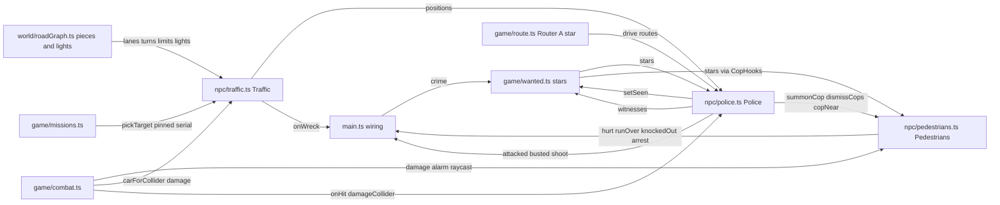

### 6.1 `src/npc/traffic.ts`

**Purpose.** NPC traffic: a pool of 28 cars that follow the street network lane by lane, obey traffic lights and stop signs, keep their distance with the Intelligent Driver Model (IDM), change lanes on four-lane roads with a simplified MOBIL rule, overtake slow cars on country roads through the oncoming lane, and wander by picking a weighted random exit at each junction. Each car is a kinematic Rapier body moved to the position its own code computes, so the player's car bumps into it. All 28 cars render through a few `InstancedMesh`es (one per car part per car type). The file also holds the private `TrafficLights` class, which draws the signal poles and lamps at every lit junction. Traffic cars can be shot (150 health), wrecked (they turn charred and smoke, then clear after 20 s), carjacked (`take`), and picked as mission targets (`pickTarget`, `pinned`, `serial`).

**Depends on:** `three` (meshes, maths), `@dimforge/rapier3d-compat` (kinematic bodies, colliders), `sim/pose.ts` (`yawPitchQuaternion`: yaw about Y then pitch about the car's own Z axis), `sim/entity.ts` (`SimEntity` type), `sim/smoke.ts` (`Smoke` type: `emit(position, darkness, size)`), `world/rng.ts` (`Rng`: seeded `range`, `int`, `chance`, `float`), `world/layout.ts` (`CityLayout` type: `layout.streets.net`), `world/terrain.ts` (`Terrain` type: `smoothHeight` for road level, `surfaceAt` for signal poles), `world/streets.ts` (`ROAD_SPECS` road widths for pole placement), `world/roadGraph.ts` (`RoadGraph`, `Piece`, `Light`, `pieceAt`, `turnKind`, `LANE_OFFSET` = 1.75 m, `LANE_SPACING` = 3.5 m), `vehicles/carModel.ts` (`CAR_DIMENSIONS`, `PAINT_COLORS`, `TAXI_YELLOW`, `carGeometry`, `carMaterials`, `paintMaterial`, `wheelGeometry`, `CarType`).
· **Used by:** `main.ts` (creates it, passes the player position and obstacle list, wires `smoke`, `onWreck`, carjacking via `jackable`/`take`, map markers and sound via `positions()`), `game/combat.ts` (`carForCollider`, `damage`), `game/missions.ts` (`pickTarget`, `TrafficCar.pinned`, `serial`, `wrecked`, `active`), `npc/police.ts` indirectly (through the `traffic()` hook = `traffic.positions()`), `audio/director.ts` indirectly (positions for engine sounds), tests (`tests/gameplay.test.cjs` reads `g.traffic.cars`, calls `damage` and `take`).

**Key constants.**

| Name | Value | Meaning / why |
|---|---|---|
| `POOL_SIZE` | 28 | Cars in the pool. Enough to make roads look busy within the 220 m spawn ring; the per-step cost is a scan over the others (O(n²) ≈ 0.15 ms per step for all 28, measured headless). |
| `SPAWN_MIN` | 60 m | Minimum spawn distance from the player: closer spawns would pop in visibly. The constructor's very first fill uses 25 m instead (nothing is on screen yet). |
| `SPAWN_MAX` | 220 m | Maximum spawn distance; also the radius of the road search for candidates. |
| `DESPAWN` | 260 m | Beyond this (horizontal distance) an unpinned car is respawned nearer. 40 m larger than `SPAWN_MAX` so a fresh car is not recycled at once. |
| `STOP_LINE_BACK` | 1.0 m | The stop line is this far before the end of a lane (the painted line sits just before the junction). |
| `SAME_LANE` | 2.4 m | Two cars on the same piece share a lane if their lateral offsets differ by less than this (lanes are 3.5 m apart). |
| `LANE_CHANGE_SPEED` | 1.5 m/s | Maximum sideways speed while changing lane. |
| `LOOKAHEAD` | 90 m | Distance ahead considered for curve limits and stop lines (`stopGap` ignores lines farther than this). |
| `TYPES` | `['sedan','sedan','sedan','taxi','sedan','van']` | Slot `k` gets `TYPES[k % 6]`: with 28 slots that is 19 sedans, 5 taxis, 4 vans. |
| `CAR_HEALTH` | 150 | Gunfire health. Cars take more than people (100). |
| `WRECK_TIME` | 20 s | A wreck stays put this long, then the slot respawns. |
| `charredMaterial` | `MeshStandardMaterial` 0x161514, roughness 1, metalness 0 | Matte burnt body for wrecks. A glossy black paint would still reflect the sky and read as silver. |
| `brakeMaterial` | `MeshBasicMaterial` 0xff2414, `toneMapped: false`, polygon offset −2/−2 | Lit brake lights drawn over the tail lights; unlit so they glow at night; polygon offset avoids z-fighting with the tail-light geometry. |
| `HIDDEN` | `Matrix4().makeScale(0,0,0)` | Shared zero-scale matrix that hides an instance. Never modified. (Before the audit fix each frame cloned a matrix per hidden part.) |
| `IDENTITY_QUAT`, `SCALE` | scratch | Used for wheel matrices. |

Inline numbers that matter (all in `traffic.ts`):

| Where | Value | Meaning |
|---|---|---|
| `respawn` road weights | local 1, collector 3, everything else (arterial, downtown, rural) 5 | Busier roads get more spawns. |
| `respawn` | lane length ≥ 20 m; `s` uniform in [4, length − 12] m | Avoids stubs and spawning inside a junction. |
| `respawn` | no other active car within 15 m | Avoids overlapping spawns. |
| `respawn` | 40 attempts | Then the car is parked inactive (body disabled) and retried next step. |
| `respawn` | outer lane with probability 0.65 on multi-lane roads | "Mostly the right-hand lane". |
| `respawn` | initial speed = 0.7 × desired speed | Cars appear already moving. |
| `newDriver` pace | mean of two U(0.85, 1.2) (triangular, centred ~1.0); with probability 0.12 replaced by U(0.68, 0.8) (a dawdler); vans × 0.93 | Personal fraction of the speed limit. |
| `newDriver` T | U(1.0, 2.0) s | IDM desired time gap. |
| `newDriver` a | vans U(1.0, 1.6), others U(1.3, 2.6) m/s² | IDM comfortable acceleration. |
| `newDriver` b | U(2.2, 3.4) m/s² | IDM comfortable braking. |
| `newDriver` s0 | U(1.6, 2.8) m | IDM standstill gap. |
| `chooseExit` | straight 3, U-turn 0.05, left/right 1; × 0.35 onto a smaller-rank road; × 1.6 onto a bigger one | Wandering that prefers big roads and going straight, so cul-de-sacs see only the odd car. |
| `decideIn` | first U(0, 0.5) s, then U(0.4, 0.7) s | Lane decisions ~2× per second, staggered between cars. |
| `idm` | v0 floor 0.1 m/s, gap floor 0.1 m, acceleration floor −9 m/s² | Avoids division by zero and absurd braking. |
| `curveSpeed` | braking used = 0.8 × driver `b` | Braking for bends is gentler than the comfortable maximum. |
| `stopGap` | considered when −1.5 m ≤ distance to line ≤ 90 m; junction-crossing check within 12 m; left-turn wait within 25 m | |
| stop sign | stopped when distance to line < 1.5 m and speed < 0.4 m/s | A "full stop". |
| `crossTraffic` | a car on a priority approach with remaining distance < 4·speed + 6 m | "Coming within ~4 s, or right at the junction". |
| `oncomingConflict` | oncoming = approach direction dot < −0.7; conflict when remaining < 35 m and speed > 2 m/s, or remaining < 8 m | |
| `crossingInJunction` | ignore a crossing car within 3 m of the end of its turn | It will be gone. |
| `decideLane` | skip if mid-change (\|lat − latTarget\| > 0.2) or < 14 m left; turn lane needed within 60 m of the end | |
| MOBIL | target lane gap ≥ 3 m; follower gap ≥ 3 m; follower's new braking ≥ −3 m/s²; bias +0.25 moving right, −0.35 moving left; threshold 0.2 m/s² | |
| `decideOvertake` | leader within 40 m and slower than v0 − 3 m/s; pass length = gap + 2·halfLength + 14 m; closing speed ≥ 3 m/s; manoeuvre ≤ 260 m and ≤ run − 10 m; oncoming assumed 20 m/s; clear = distance + 20·time + 20 m; nobody already within 30 m in the oncoming lane | |
| `updateOvertake` | done when 2·halfLength + 6 m past the target; chain to next queued car if its gap < 10 m; danger window (speed + 20)·2.5 + 15 m; give up after 18 s or if the target is > 45 m ahead; run-out < 15 m before a non-straight / controlled junction | |
| lateral motion | desired sideways speed = sign·min(1.5, 1.2·\|Δ\|)·min(1, v/3 + 0.3); smoothing factor min(1, 4·dt); snap when within 0.02 m and \|latVel\| < 0.05 | |
| `blockedSideways` | within 10 m; lengthwise overlap < halfLengths + 0.8 m; on the side being moved to within \|Δ\| + 2.1 m | |
| `leader` | head-on detection within 40 m (cos of yaw difference < −0.5, side < 1.8 m); crossing cars within 14 m (same way: side < 1.6 m; any way within 8 m: side < 1.4 m); obstacles within 34 m, side < 1.7 m, gap = along − halfLength − 1 m | |
| brake lights | on when not wrecked and (acc < −0.8 m/s² or speed < 0.3 m/s) | |
| smoke | starts at damage ≥ 0.35 (health ≤ 97.5); rate 3 + 8·damage puffs/s (wreck 14/s); emitted 1.5 m ahead (wreck 0.2 m), 1.1 m up, ±0.4 m jitter; darkness 0.7·damage (wreck 0.9); size 0.8 m (wreck 1.4 m) | |
| `TrafficLights` | lamps refreshed every 0.1 s; lamp radius 0.11 m; heights red 3.55, yellow 3.25, green 2.95 m; pole 3.6 m, collider cylinder half-height 1.8 m radius 0.1 m; pole sits `halfWidth − LANE_OFFSET + 0.8` m right of the lane end | |

**Types.**

`TrafficCar` (exported interface; one per pool slot, mutated in place):

| Field | Type | Meaning |
|---|---|---|
| `type` | `CarType` | `'sedan' \| 'taxi' \| 'van'`, fixed per slot. |
| `color` | `number` | Paint (hex sRGB). Taxis are `TAXI_YELLOW`; others a random `PAINT_COLORS` entry, chosen once in the constructor (respawn keeps it). |
| `slot` | `number` | Instance index within its type's meshes. |
| `body` | `RAPIER.RigidBody` | Kinematic-position-based body with one cuboid collider (`CAR_DIMENSIONS[type].boxHalf` at `boxCenter`). Disabled while inactive. |
| `piece` | `Piece` | The lane or turn it is on (shared cached object from `RoadGraph`). |
| `s` | `number` | Distance travelled along `piece`, m. |
| `speed` | `number` | m/s, ≥ 0 (traffic never reverses). |
| `acc` | `number` | Acceleration chosen this step, m/s² (drives the brake lights). |
| `lat`, `latTarget`, `latVel` | `number` | Sideways offset from the piece's line (m, + = right), where it wants to be, and its rate (m/s). On a lane piece 0 = inner lane, `LANE_SPACING` (3.5) = outer lane, −3.5 = oncoming lane (overtaking on a country road). |
| `exit` | `Piece` | The lane it will take at the end of the lane it is on (or, on a turn, the exit already chosen for the lane after it). |
| `driver` | `Driver` | Its habits (below). New on every respawn. |
| `planned` | `{ lane, exit, offIn, turn }` | Cache for `plannedTurn()`. |
| `stoppedAt` | `number` | Node id of the stop-sign junction it has already come to a full stop at (−1 none). |
| `decideIn` | `number` | Seconds until its next lane decision. |
| `passing` | `THREE.Vector3 \| null` | While overtaking: the position of what it is passing. For a traffic car this is that car's live `currPos` reference (so it tracks it); for an obstacle a clone. |
| `passTime` | `number` | Seconds spent on the current overtake. |
| `wheelSpin` | `number` | Accumulated wheel angle, rad. |
| `halfLength` | `number` | Half the car length, m (2.25 sedan/taxi, 2.45 van). |
| `prevPos`, `currPos` | `THREE.Vector3` | Position before and after the last step (for interpolation). |
| `prevYaw`, `currYaw` | `number` | Heading before/after the step; model forward is +X, so forward = (cos yaw, −sin yaw). |
| `currPitch` | `number` | Nose-up angle from the road slope, rad. |
| `active` | `boolean` | In the world (false = hidden, body disabled, waiting to respawn). |
| `health` | `number` | 150 → 0. |
| `wrecked` | `number` | Seconds since it was wrecked, or −1 while running. |
| `smokeTimer` | `number` | Seconds to the next smoke puff. |
| `pinned` | `boolean` | A mission target: never recycled for being far from the player. Cleared on respawn. |
| `serial` | `number` | Incremented on every respawn of this slot, so a mission can tell its car was replaced (e.g. carjacked). |

`ObstacleSource` (exported type) = `() => THREE.Vector3[]`: positions traffic must not drive into. `main.ts` passes the player's focus position, every player car's `interp.currPos` and the helicopter's `interp.currPos`.

Private types: `Driver { pace, T, a, b, s0 }` (fraction of the speed limit; IDM time gap s; comfortable acceleration and braking m/s²; standstill gap m). `Leader { gap, speed, car }` (bumper-to-bumper gap m, its speed m/s, the `TrafficCar` or null for a light, junction, oncoming meeting point or obstacle). `RouteStep { piece, lat, start }` (a piece ahead, the lateral offset the car will have on it, distance from the car to the piece's start, ≤ 0 for the current piece).

**API.**

#### `new Traffic(world, scene, layout, terrain, playerPosition, obstacles)`
- `world: RAPIER.World`, `scene: THREE.Scene`, `layout: CityLayout`, `terrain: Terrain` (road heights), `playerPosition: () => THREE.Vector3` (spawn/despawn centre), `obstacles: ObstacleSource`.
- Builds a `RoadGraph(layout.streets.net)` and the `TrafficLights` for every lit junction.
- Builds the instanced meshes. Per car type: body (shared white `paintMaterial(0xffffff)`, tinted per instance with `setColorAt`), glass, trim, headlights, taillights and, for the taxi, the roof sign; only body and glass cast shadows; all have `frustumCulled = false` because instances move every frame and the bounding sphere would go stale. Plus per type a charred wreck body and a brake-light mesh, and two meshes for all wheels (`tyres`, `rims`, 28 × 4 instances each, unit-radius wheel scaled per type). Draw calls: sedan 7, taxi 8, van 7, wheels 2 = 24 instanced meshes for all traffic.
- Creates 28 kinematic bodies with cuboid colliders, assigns colours (seeded `Rng(4242)`), then calls `respawn(car, 25)` for every car to fill the pool before the first frame.
- Called once by `main.ts` at startup.

#### `fixedUpdate(dt: number): void`
- One physics step for all cars. Order:
  1. `time += dt` (this is the clock the lights use; it starts at 0 when the game loads and is not the day/night clock).
  2. Every 0.1 s refresh lamp colours (`lights.update(time)`). Cars read the light state directly from `RoadGraph.lightState`, so only the visuals are throttled; there are hundreds of signal heads.
  3. `obstacleList = obstacles()` once per step.
  4. Per car: inactive → `respawn(car)`; not pinned and > 260 m from the player → `respawn(car)`; wrecked → hold still (`prevPos = currPos`, speed and acc 0), `wrecked += dt`, after 20 s `respawn(car)`; otherwise `drive(car, dt)`.
- Called by the main loop every fixed step (60 Hz).

#### `afterStep(): void`
- Empty. Traffic stores its own poses; nothing to read back from Rapier.

#### `render(alpha: number, frameDt: number): void`
- Emits smoke (`emitSmoke(frameDt)`), then writes every instance matrix: inactive cars get zero scale; active ones the pose interpolated between `prevPos`/`currPos` and `prevYaw`/`currYaw` (yaw difference wrapped to (−π, π]), pitch = `currPitch`. Brake lights get the same matrix or `HIDDEN`. Wrecks show the charred body and hide the painted one. Wheels: four per car at (±wheelBase/2, wheelRadius, ±track/2) in the car frame, scaled by `wheelRadius`, spun about Z by `−wheelSpin`; they copy the matrix of whichever body is showing. Marks every instance buffer `needsUpdate`.
- Called once per rendered frame.

#### `pickTarget(from: THREE.Vector3, minDist: number, maxDist: number): TrafficCar | null`
- A random running car (active, not wrecked, not already pinned) whose horizontal distance from `from` is in [minDist, maxDist]; null if none. Uses `Math.random` (not the seeded RNG; mission picks need no determinism).
- Called by `missions.ts` for Vera/Dusty/Sam's "wreck" missions with (90, 230); the mission then sets `pinned = true` and remembers `serial`.

#### `carForCollider(collider: RAPIER.Collider): TrafficCar | null`
- The active traffic car whose body owns `collider` (compared by body handle), or null. Linear scan over 28.
- Called by `combat.ts` when a bullet ray hits a collider.

#### `damage(car: TrafficCar, amount: number): void`
- Gunfire. No effect on inactive or already wrecked cars. Subtracts health; at ≤ 0: health 0, `wrecked = 0`, `speed = 0`, then `onWreck?.(car.currPos)`.
- Side effects through `onWreck` (set in `main.ts`): cash $30–80 dropped 2.2 m to the side, pedestrians within 30 m alarmed, crash sound, a toast, and `wanted.crime('wreck')` unless a mission objective is within 6 m (wrecking Vera's target is not a crime).

#### `jackable(position: THREE.Vector3, radius: number): TrafficCar | null`
- The nearest active, unwrecked car slower than 4 m/s within `radius` (horizontal), or null. `main.ts` uses radius 3.4 m for the carjack interaction.

#### `take(car): { type, color, position, yaw }`
- Carjacking: returns the car's type, colour, a clone of its position and its yaw so `main.ts` can create a drivable `Car` in its place; sets the slot inactive and disables its body. The next `fixedUpdate` respawns the slot elsewhere (which clears `pinned` and bumps `serial`).

#### `positions(): THREE.Vector3[]`
- New array of the `currPos` objects (live references, not copies) of active cars. Used by `main.ts` for the minimap markers and the sound director, and by the police (`PoliceHooks.traffic`) to slow down behind traffic.

#### `get debugCars`
- For tests: per slot `{ pos, speed, kind (piece kind), active, rural, lat, latTarget, pace, passing (boolean), acc, yaw }`.

#### Fields `stats`, `smoke`, `onWreck`
- `stats: { laneChanges, passStarted, passCompleted, passAborted }` counters for tests and the debug overlay.
- `smoke: Smoke | null` set by `main.ts`; without it no smoke.
- `onWreck: ((position) => void) | null` set by `main.ts` (see `damage`).

**Internals.**

*Respawn and pooling (`respawn(car, minDist = SPAWN_MIN)`).* First, unconditionally, `car.pinned = false` and `car.serial++` (a new car in this slot is nobody's mission target). It collects road edges within 220 m of the player from the street network's segment index (`net.index.forEachNear` calls back once per nearby *segment* and may repeat one, so an edge's weight is its class weight times how many of its segments are near; no deduplication). It then tries 40 times: pick a random edge, a random direction (`graph.lane(e, ±1)`), skip lanes shorter than 20 m, pick `s` in [4, length − 12], and accept if the point is between `minDist` and 220 m from the player and no active car is within 15 m. On success it gives the car a new `Driver`, a lane (outer with p = 0.65 on multi-lane roads), resets passing/stop state, picks an exit, sets speed to 0.7 × desired, resets health and wreck state, places it, copies `prevPos`/`prevYaw` (no interpolation from the old spot), teleports the body and enables it. On failure the car is set inactive and its body disabled; `fixedUpdate` retries it every step.

*Mission pinning and `serial`.* A pinned car is exempt from the 260 m recycle but not from anything else: a wreck still respawns after 20 s, and `take()` deactivates it. Before the audit fix (commit `ffd288c`, "Vera's target moving when carjacked"), a carjacked target slot would respawn elsewhere still pinned and the mission kept following "its" car, which had magically moved. Now respawn clears `pinned` and increments `serial`; `missions.ts` fails the mission ("the car got away") when `!car.active || car.serial !== m.targetSerial`, and succeeds when `car.wrecked >= 0`.

*Route lookahead (`buildRoute`).* Fills a reused 3-element `route` array:
- On a lane: `[current lane (lat = latTarget, start = −s), planned turn (lat 0, start = length − s), the turn's target lane (lat = turn.offOut, start = previous start + turn length)]`.
- On a turn: `[current turn, its target lane (lat = offOut), the turn already chosen out of that lane, built from offOut and `car.exit`]`.
- If the car is on a lane and the third piece is the reverse of the current lane (a U-turn at a dead end or cul-de-sac), `routeLength = 2`: cars on the reverse lane are oncoming, not leaders. (Fix in commit `775027a`.)

*Planned turn (`plannedTurn`, `exitOffset`).* The turn piece through the junction is `graph.turn(lane, exit, offIn, offOut)` with `offIn` = the lane offset it aims for (on a one-lane road forced to 0 unless negative, i.e. overtaking) and `offOut` from `exitOffset`: onto a one-lane road 0, except straight on onto a rural road while still in the oncoming lane (keeps `offIn`, so an overtake can continue through a plain bend); onto a multi-lane road: right turn or U-turn → outer lane (3.5), left turn → inner lane (0), straight → `max(0, offIn)`. Cached per car while lane, exit and offset are unchanged.

*Placement on the kinematic body (`place`).* Two points 1.5 m ahead of and behind `s` along the piece (`pieceAt`), each shifted sideways by `lat` along the right normal (−tz, tx); beyond the piece's ends they are extrapolated along its end direction. The car's position is their midpoint, at the mean of `terrain.smoothHeight` at both points (road level, so traffic follows the hills). Heading:

```text
yaw   = atan2(−(az − bz), ax − bx) − atan2(latVel, max(speed, 2))
pitch = atan2(ha − hb, |A − B|)
```

where A = (ax, az) is the front point, B the rear, ha/hb their heights. The second yaw term noses the car toward the side it is drifting to while changing lanes. `drive` then calls `yawPitchQuaternion(currYaw, currPitch)` and `setNextKinematicTranslation/Rotation`, so Rapier moves the body during the step and dynamic bodies it touches (the player's car) are pushed.

*IDM (`idm(d, v, v0, gap, dv)`).* The Intelligent Driver Model (Treiber 2000):

```text
free  = 1 − (v / max(v0, 0.1))^4
s*    = s0 + max(0, v·T + v·Δv / (2·√(a·b)))
acc   = max(−9, a·(free − (s* / max(s, 0.1))²))      if the gap s is finite
acc   = a·free                                        if there is no leader (s = ∞)
```

v: own speed (m/s); v0: desired speed; s: bumper-to-bumper gap to the leader (m); Δv = v − v_leader (closing speed, m/s); T, a, b, s0: the driver's time gap, comfortable acceleration, comfortable braking, standstill gap. Red lights, stop lines and obstacles are leaders standing still (v_leader = 0, so Δv = v). IDM gives smooth, collision-free following, natural queue start-up and stop-and-go waves from one formula.

*Desired speed and the curvature cap.* `desiredSpeed(car, piece) = piece.speed × driver.pace` (piece speeds from `ROAD_SPECS`: downtown 12.5, arterial 17, collector 12, local 10, rural 19 m/s; a turn takes the lower of its two lanes). `RoadGraph` precomputes, every `limitStep` m (≈6 m on lanes, ≈1.5 m on turns), the curvature κ from the circle through three points `step` apart, `κ = 2·|AB × BC| / (|AB|·|BC|·|AC|)`, and the limit

```text
v_lim = max(2.2, √(A_LAT / κ))      A_LAT = 3.0 m/s² (≈ 0.3 g)
```

`curveSpeed(car)` walks the route's pieces (stopping at pieces starting beyond 90 m) and each sample at distance d ahead (skipping samples more than one step behind, ignoring beyond 90 m) and returns

```text
v_curve = min over samples of √(v_lim² + 2·b'·max(0, d)),    b' = 0.8·b
```

the highest speed from which the car can still brake (at b') down to every limit ahead. Then `v0 = min(desiredSpeed, v_curve)`.

*Leader search (`leader(car, lat, routeAhead)`).* Finds the nearest thing ahead in the lane at lateral offset `lat`:
1. Builds `opposing`: for each lane on the route reached by going straight (it stops at the first non-straight turn), its reverse lane, the distance to that lane's far end and our offset on it.
2. For every other active car: if it is on one of the first `n` route pieces (identity check on shared `Piece` objects; `n = routeLength` or 1 when `routeAhead` is false) and within `SAME_LANE` of the offset we will have there, gap = `step.start + o.s − halfLengths` (only if ahead).
3. Else if it is on one of the `opposing` lanes and in our lane seen from its side (`|lat_mine + lat_theirs + 2·LANE_OFFSET| < 2.4`; offsets are measured from opposite centre-line sides, so an overtaker in the oncoming lane at −3.5 is in our lane at 0): a head-on meeting. Both close the gap, so it is treated as a *stopped car halfway*: gap = (distance − halfLengths)/2, speed 0.
4. Else, not on our route: if it is within 40 m ahead and facing us (cos of yaw difference < −0.5) and its offset from our *own path* (`sideOffset`, which follows the current piece's polyline and then straight on, so curves don't fool it) is under 1.8 m: also a halfway stopped leader. This catches an overtaker coming round a bend on a lane not in `opposing`. Otherwise, within 14 m ahead: a leader if it is going the same way (cos > 0.5) within 1.6 m sideways, or anywhere within 8 m ahead and 1.4 m sideways (crossing the junction).
5. The leader's speed is the other car's speed if it faces roughly our way (cos > 0), else 0.
6. Obstacles (player, player cars, helicopter) within 34 m and ahead, within 1.7 m of where the lane will be (`sideOffset`): gap = along − halfLength − 1, speed 0.

*Stop lines (`stopGap`).* Only on lanes. `toLine = length − s − halfLength − 1.0`. Returns `Infinity` if toLine > 90 or < −1.5. Otherwise, in order:
- toLine < 12 and `crossingInJunction` (a car already on a turn at this node, from another approach, whose path crosses ours; oncoming cars going straight or right are ignored unless one of us turns left; cars within 3 m of their turn's end are ignored) → stop at `max(0, toLine)`. This applies at every junction regardless of control (commit `775027a`).
- Lit junction: red → stop. Yellow → stop if `toLine > v²/(2b)` (it can stop comfortably), else go through. Green: a left turn within 25 m of the line waits if `oncomingConflict` (an oncoming car that isn't itself turning left is within 35 m and moving > 2 m/s, or within 8 m; or an oncoming car is already on a non-left turn in the junction).
- Stop sign (`graph.mustStop(lane)`: the junction is stop-controlled and this road has a lower rank than the biggest, or it is a 3+-way meeting of equal-rank roads with rank < 3, an all-way stop): until `stoppedAt === node`, stop at the line; when within 1.5 m at < 0.4 m/s, record `stoppedAt = node`. Afterwards keep waiting while `junctionBusy` (any car on a turn at this node from another approach) or `crossTraffic` (a car on a priority approach, not itself stop-controlled and not wrecked, with remaining < 4·speed + 6 m; at an all-way stop all approaches are checked).
- `stoppedAt` resets to −1 when the car enters a turn.

The stop line enters IDM as `idm(d, v, v0, stopGap, v)` (a stationary leader), and the final acceleration is the minimum of that and the car-following acceleration.

*Lane changes: simplified MOBIL (`decideLane`).* MOBIL ("Minimizing Overall Braking Induced by Lane changes", Kesting/Treiber/Helbing 2007) in full is: change if `ã_c − a_c + p·(ã_n − a_n + ã_o − a_o) > Δa_th` (incentive, with politeness p over the new and old followers) and `ã_n ≥ −b_safe` (safety). Here politeness p = 0 and an asymmetric bias is added:

```text
safety:     gap in target lane ≥ 3 m, follower gap ≥ 3 m,
            ã_follower = IDM(follower, v_f, v0_f, gap_f, v_f − v_me) ≥ −3 m/s²
incentive:  ã_me(target) − a_me(current) + bias > 0.2 m/s²
            bias = +0.25 when moving to the outer (right) lane, −0.35 when moving left
forced:     within 60 m of the lane end, the lane the turn needs
            (right or U-turn → outer 3.5, left → inner 0, straight → no preference)
```

`a_me` values use the leader in each lane *without* route lookahead (`routeAhead = false`) and the car's current v0. Only on multi-lane lanes (`lanes ≥ 2`), not mid-change, not within 14 m of the end. If the needed lane is the current one, nothing happens. A change only sets `latTarget` (and `stats.laneChanges++`); the sideways motion happens in `drive`. The follower (`follower(car, lat)`) is the nearest car behind in that lane: on the same piece with a smaller `s` and a matching offset, or on another piece within 30 m behind, within 1.6 m sideways and heading the same way (cos > 0.7).

*Overtaking on country roads (`decideOvertake`, `updateOvertake`, `straightRun`, `oncomingWithin`).* Only on one-lane `rural` lanes, not already passing and with |lat| ≤ 0.2:
1. Leader in our lane (with route) must be within 40 m and slower than v0 − 3 m/s; and if we are crawling (< 3 m/s) behind a car that is moving (> 1 m/s), don't (a queue, not an obstacle).
2. Time and distance:
   ```text
   pastLength = gap + 2·halfLength + 14            (m)
   time       = pastLength / max(3, v0 − v_leader) (s)
   distance   = time · max(v0, v)                  (m)
   ```
3. `straightRun`: the current lane plus the rural lanes that carry straight on through plain junctions (exactly 2 edges, no control, straight turn, single exit), up to 300 m. Never start toward a dead end (the last lane ends at a node with one edge; commit `775027a`: cars there turn round and come back). The manoeuvre must fit: `distance ≤ run − 10 m` and `≤ 260 m`.
4. The oncoming lane must be clear for `distance + 20·time + 20` m (`oncomingWithin`: any car on the reverse of a run lane, or any car in the junction at the far end of a run lane; any car ahead coming the other way (cos < −0.3, speed ≥ 1, not wrecked) within the distance and within `12 + 0.25·along` m sideways; any obstacle ahead within 8 m sideways).
5. Nobody already within 30 m in the oncoming lane (`leader(car, −3.5)`).
Then `latTarget = −3.5`, `passing` = the leader car's live position (or the nearest obstacle's position, cloned), `passTime = 0`, `stats.passStarted++`.

Every step while passing, `updateOvertake`: `along` = how far the target is ahead along our heading. Done when `along < −(2·halfLength + 6)`; if the next car in our lane (with route) is within 10 m, chain to it instead (passing a whole queue). Abort on danger (`oncomingWithin((v + 20)·2.5 + 15)`), when running out of road (< 15 m before a junction that isn't a plain straight-on uncontrolled 2-way node), after 18 s, or if the target pulled more than 45 m ahead. On finish or abort `latTarget = 0`, `passing = null`, and `passCompleted` or `passAborted` is counted. Oncoming cars brake for an overtaker in their lane through the "halfway stopped leader" rule in `leader`.

*Lateral motion (in `drive`).*

```text
Δ        = latTarget − lat
blocked  = |Δ| > 0.3 and blockedSideways(car, Δ)
want     = blocked ? 0 : sign(Δ) · min(1.5, 1.2·|Δ|) · min(1, v/3 + 0.3)
latVel  += (want − latVel) · min(1, 4·dt)
lat     += latVel · dt          (snap to latTarget when within 0.02 m and |latVel| < 0.05)
```

`blockedSideways` stops the drift while a car overlaps lengthwise on that side. Mid-change (|lat − latTarget| > 1.2 m) the leader in the lane being left still counts (`leader(car, lat)` is also evaluated and the nearer one used).

*Piece transitions (in `drive`).* While `s ≥ piece.length`: from a lane, `s −= length`, enter `plannedTurn`, `lat −= turn.offIn` (the turn already starts in the lane it aimed for, so only an unfinished lane change remains), `latTarget = 0`, `stoppedAt = −1`, and choose the exit for the lane after the turn (`chooseExit(turn.to)`); from a turn, `s −= length`, enter `turn.to`, `lat += offOut`, `latTarget = offOut`.

*`TrafficLights` (private class).* For every node with `control === 'lights'` and each of its edges, the arriving lane is an approach. One `InstancedMesh` for poles, one for heads, three for lamps (`CircleGeometry(0.11)`, one per colour, `MeshBasicMaterial` white tinted per instance). Each pole stands on the kerb to the right of the lane end, at `terrain.surfaceAt − 0.05`, the head and lamp discs facing oncoming traffic; each gets a static cylinder collider (no rigid body). `update(time, force)` sets each lamp's colour to its "on" colour (red (1, 0.1, 0.05)×2, yellow (1, 0.6, 0.05)×2, green (0.1, 1, 0.35)×2; values above 1 are HDR so they glow) or "off" (0.05 grey) only when that approach's state changed, and flags the colour buffers only if something changed. Light timing is `lightPhase` in `roadGraph.ts`: a 24 s cycle offset by `node × 3.7 s`; group 0 green 0–9 s, yellow 9–11.5 s; group 1 green 12–21 s, yellow 21–23.5 s; red otherwise (0.5 s all-red gaps).

*Small helpers:* `newDriver`, `desiredSpeed`, `chooseExit` (weighted pick, above), `obstacleNear` (nearest obstacle position, cloned, to remember what is being passed), `sideOffset` (signed lateral distance of a point from the car's own path `along` m ahead), `emitSmoke`.

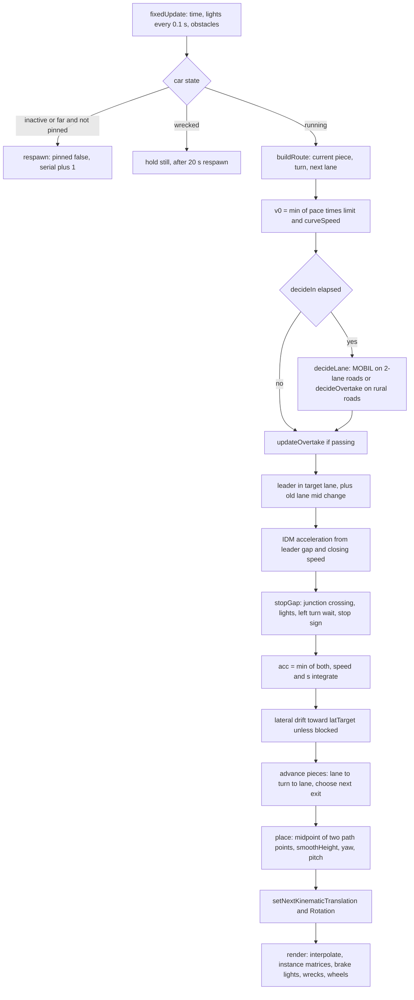

**Decisions.**
- Kinematic, path-following cars instead of Rapier raycast vehicles → far cheaper and perfectly predictable (no NPC car flips or wanders off the road); the player's car still collides with them as solids. Rejected: simulating every NPC car with the vehicle controller.
- IDM for following, simplified MOBIL for lane changes, per-driver parameters → realistic queues, platoons behind dawdlers and passing from a few formulas. MOBIL politeness is dropped (p = 0) and replaced by the keep-right bias and the hard follower-braking limit of 3 m/s².
- Pieces are cached shared objects, so "same lane?" is an identity check (`o.piece === r[k].piece`) instead of geometry.
- Lane decisions every 0.4–0.7 s, staggered; turn planning cached; curvature limits precomputed; lamp colours refreshed at 10 Hz → ~0.15 ms per step for 28 cars.
- Head-on encounters (overtakers) are modelled as a stopped car halfway between the two, so both brake and stop short of each other.
- A route ending in a U-turn is cut at the turn (commit `775027a`), and overtakes never start toward a dead end, because the cars there come back in the oncoming lane.
- Cars yield to anyone already crossing their path inside a junction, whatever the control (commit `775027a`); traffic lights alone did not prevent side-impacts with cars finishing a turn.
- Wrecks swap to a matte charred body rather than darkening the paint (glossy black reads as silver).
- Respawn clears `pinned` and increments `serial` (audit fix `ffd288c`) so missions detect a replaced target.
- Instanced rendering with zero-scale hiding; `frustumCulled = false` because instance bounds would go stale; shared `HIDDEN` matrix and scratch matrices to avoid per-frame allocations (audit fix).
- A leftover doc comment ("Yaw about Y, then pitch …") sits above `pickTarget`; it described the old private `orientation` helper that moved to `sim/pose.ts`.

### 6.2 `src/npc/pedestrians.ts`

**Purpose.** Pedestrians and police officers on foot. A pool of people, each a random character from the `CharacterLibrary` (own skin tone, hair, outfit colours and height), strolling a closed loop of sidewalk: round a downtown block, or in the suburbs out along one side of a street and back along the other. They pause now and then, wait if the player stands in their way, and react to the player through a small state machine: `walk`, `talk`, `flee`, `angry`, `down`, and `cop` for officers. Officers are a separate small pool in the same class, off-stage until a police car summons them; up to 2 stars they grab and arrest the player, from 3 stars they keep their distance and shoot. The class also provides hit tests for melee, bullets and touch aim assist, and knocks down anyone a fast player car drives into. No physics: people follow their loop exactly (or move straight at the player when angry or on duty).

**Depends on:** `three`, `sim/entity.ts` (`SimEntity`), `player/character.ts` (`CharacterModel` type: `root`, `reset()`, `knockDown()`, `play('hit'|'punch'|'shoot')`, `setAim('none'|'pistol')`, `setTalking(bool)`, `update(speed, onGround, dt)`), `player/characterLibrary.ts` (`CharacterLibrary` type: `randomLook(random, id?)`, async `create(look)`), `world/rng.ts` (`Rng`), `world/layout.ts` (`BLOCK_SIZE` = 64 m, `Block`, `CityLayout`), `world/streets.ts` (`ROAD_SPECS` for road width and sidewalk width).
· **Used by:** `main.ts` (creates it with `PedestrianHooks`, uses `alarm`, `peopleNear`, `nearestTalkable`), `game/combat.ts` (`meleeTarget`, `raycast`, `aimAssist`, `damage`, `alarm`), `ui/dialogue.ts` (`startTalking`, `endTalking`, the `Pedestrian` type), `npc/police.ts` (`summonCop`, `copsOut`, `copNear`, `dismissCops`).

**Key constants.**

| Name | Value | Meaning / why |
|---|---|---|
| `SPAWN_MIN` | 35 m | Minimum spawn distance (first fill on model load uses 15 m). |
| `SPAWN_MAX` | 120 m | Maximum spawn distance and road search radius (blocks: centre within 120 + 64 = 184 m). |
| `DESPAWN` | 150 m | Beyond this (horizontal), a person not lying down respawns nearer (an officer is dismissed). |
| `ANIMATE_WITHIN` | 70 m | Farther away the pose is frozen (saves CPU on phones). |
| `VISIBLE_WITHIN` | 90 m | Farther away they are hidden. |
| `LOOP_INSET_MIN` / `MAX` | 2.4 / 3.2 m | A block loop runs this far in from the block edge (sidewalks are the outer 4 m), clear of street trees at 1.4 m from the curb and lamp posts. |
| `MAX_HEALTH` | 100 | |
| `RUN_SPEED` | 4.3 m/s | Fleeing, chasing, officers. |
| `FLEE_TIME` | 9 s | Then back to walking. |
| `PUNCH_RANGE` | 1.3 m | Angry people punch within this; they stop at 0.8 × = 1.04 m. |
| `PUNCH_DAMAGE` | 7 | Per punch on the player. |
| `PUNCH_INTERVAL` | 1.1 s | Punch cooldown (also the officers' grab animation cooldown). |
| `GIVE_UP_DISTANCE` | 30 m | Angry people stop chasing beyond this. |
| `DOWN_TIME` | 12 s | Lying still before sinking away (at 0.8 m/s); respawn at 12 + 1.5 = 13.5 s. |
| `HIT_RADIUS` | 0.4 m | Body cylinder radius for bullets and cars. |
| `BODY_HEIGHT` | 1.75 m | Body cylinder height for bullets. |
| `ARREST_TIME` | 1.5 s | Held within `ARREST_RANGE` of an officer (≤ 2 stars, on foot) → busted. |
| `ARREST_RANGE` | 1.4 m | Officers stop at 0.7 × = 0.98 m from a player on foot. |
| `SHOOT_STARS` | 3 | From this many stars officers shoot instead of grabbing. |
| `SHOOT_RANGE` | 32 m | Maximum officer shooting distance. |
| `SHOOT_STAND_OFF` | 9 m | Shooting officers stop about this far away. |
| `COP_LOOK` | `'m_swat'` | Character id for officers (outfit index 0). |
| `RUN_OVER_SPEED` | 3 m/s (~11 km/h) | Slower, a car only nudges people; faster, it knocks them down. |

Other numbers: walking speed U(1.45, 1.8) m/s; pause chance `0.03·dt` per step (on average one pause per ~33 s of walking), pause length U(2, 5) s; "blocked" when the point 1.2 m ahead on the loop is within 1.0 m of the player (and within 2.5 m in height); flee look-ahead 2 m, reversing if that point is > 0.5 m closer to the player; talk ends beyond 5 m or after 30 s; angry gives up after 25 s; stagger 0.35 s after a non-lethal hit; fight-back chance 0.5 on a melee hit when health > 45; officer first shot after 1 + U(0, 1) s, then every U(1.2, 1.8) s; officer hit chance `clamp(0.55 − 0.012·d, 0.15, 0.5)`, × 0.6 if the player is in a vehicle; miss scatter ±1.5 m in x and z, −0.3…+1 m in y; muzzle 1.45 m above the feet, aim 0.4 m above the player's focus on foot, 0.3 m in a vehicle; run-over throw `min(4, 0.25·|v|)` m; run-over alarm radius 25 m; car proximity pre-check 7 m and 2.2 m in height; `nearestTalkable`/`meleeTarget` height checks use `ped.y + 0.9` (the player position is the focus point ~0.9 m above the feet) within 2 m / 1.5 m; melee cone cos ≥ 0.64 (~50°); aim assist aims at 1.1 m above the feet and ignores people within 0.5 m; `dismissCops(true, from)` keeps officers within 45 m.

**Types.**

`PedState` (exported) = `'walk' | 'talk' | 'flee' | 'angry' | 'down' | 'cop'`.

`Pedestrian` (exported interface):

| Field | Type | Meaning |
|---|---|---|
| `model` | `CharacterModel \| null` | Null until the model has downloaded; such a person stays out of the world. |
| `block` | `Block \| null` | The downtown block they circle (null on a suburban street). |
| `path` | `Float32Array` | Closed loop polyline (x, z pairs; first point repeated at the end). |
| `pathCum` | `Float32Array` | Cumulative distance at each loop point. |
| `pathLength` | `number` | Loop length, m (≥ 1). |
| `u` | `number` | Distance along the loop, m (wrapped by `loopPoint`). |
| `direction` | `1 \| -1` | Walking direction along the loop. |
| `speed` | `number` | Own walking speed, m/s. |
| `pause` | `number` | Seconds left standing still. |
| `moving` | `number` | Current speed (0 while paused/waiting), drives the animation. |
| `prevPos`, `currPos` | `THREE.Vector3` | Before/after the step (feet position, y = surface). |
| `facing` | `number` | Target yaw (model faces −Z, so `atan2(−dx, −dz)`). |
| `active` | `boolean` | In the world. |
| `state` | `PedState` | |
| `stateTime` | `number` | Seconds in the current state. |
| `health` | `number` | 100 → 0. |
| `stagger` | `number` | Seconds of hit reaction left (stands still, skips its state logic). |
| `punchCooldown` | `number` | Seconds to the next punch. |
| `cop` | `boolean` | From the officer pool. |
| `hold` | `number` | Officers: seconds the player has been held (toward an arrest). |
| `shotTimer` | `number` | Officers: seconds to the next shot. |

`CopHooks` (exported interface): what officers need from the game.

| Member | Type | Meaning |
|---|---|---|
| `stars()` | `number` | Current wanted stars (`wanted.stars`). |
| `canSee(from, to)` | `boolean` | Clear line of sight (main.ts: `police.clear(from, to)`). |
| `shoot(from, to, hit)` | `void` | An officer fired; main.ts draws a tracer, plays a gunshot and applies `OFFICER_DAMAGE` = 6 if `hit`. |
| `arrest()` | `void` | Held long enough: main.ts `busted()`. |

`PedestrianHooks` (exported interface):

| Member | Type | Meaning |
|---|---|---|
| `player()` | `{ position, onFoot }` | Player focus position, and whether on foot (people only fight people on foot). |
| `hitPlayer(damage)` | `void` | A punch landed (main.ts: `stats.damage`). |
| `knockedOut(position)` | `void` | Knocked out by fists/weapons (main.ts: drops $5–40 cash there). |
| `surface(x, z)` | `number` | Standing height (`Terrain.surfaceAt`: sidewalks follow the hills). |
| `vehicles()` | `{ position, forward, speed, halfLength, halfWidth }[]` | Cars that can run people over. main.ts passes only the player's cars (not gone, \|speed\| > 2 m/s), with a flattened unit forward. |
| `runOver(position)` | `void` | Run over: main.ts gives the player $10–60 directly and toasts. |
| `hurt?(ped, knockedOut)` | `void` | Someone was hurt by the player (all damage comes from the player). main.ts: `wanted.crime(ped.cop ? 'police' : knockedOut ? 'knockout' : 'assault')` and an "oof" sound on knockouts. |
| `cop?` | `CopHooks` | Without it no officers act (`copStep` returns at once). |

**API.**

#### `new Pedestrians(scene, layout, library, count, hooks, cops = 0)`
- Creates `count + cops` records; indices ≥ `count` are officers. Each gets a random look from a seeded `Rng(777)` (officers: `COP_LOOK` with `outfit: 0`) and starts the async model load. When a model arrives it is hidden, added to the scene, and (non-officers only) `respawn(ped, 15)` puts the person on a sidewalk. Officers wait off-stage until `summonCop`.
- main.ts: `count = touch ? 10 : 16`, `cops = touch ? 3 : 4`. Not created at all if the character library failed to load.

#### `summonCop(x: number, z: number): boolean`
- Activates the first officer that is inactive and loaded at (x, surface(x, z), z): resets the model, health 100, stagger 0, hold 0, `shotTimer = 1 + U(0,1)`, state `cop`, visible. Returns false if none is free (the pool is 3–4, two per stopping police car).
- Called by `Police.drive` when a pursuit car stops near a player on foot.

#### `get copsOut: number`
- Officers active and in state `cop` (knocked-out ones do not count). Used by `Police.manageUnits` at 0 stars.

#### `peopleNear(position, radius): boolean`
- Any active, non-officer, not-down person within `radius` (3D distance). main.ts uses 45 m to decide whether gunfire is a crime (added by the audit fix: before, gunfire with nobody around still counted).

#### `copNear(position, radius): boolean`
- Any on-duty officer within `radius` (3D). Officers count as police seeing you: `Police` uses 40 m for `seen` and `witnesses`.

#### `dismissCops(onlyHidden = false, from?): void`
- Sends officers away (inactive, hidden, `hold` 0, aim none). With `onlyHidden` and `from`, officers within 45 m of `from` stay. Called by `Police.reset()` (all), by `Police.manageUnits` at 0 stars (`true, player`) and when a parked car drives on (`true, player`).

#### `nearestTalkable(position, radius): Pedestrian | null`
- Nearest person in state `walk` (so not officers, not hostile, not down) within `radius` horizontally and with feet+0.9 within 2 m of `position.y`. main.ts uses `TALK_RADIUS` for the E "talk" interaction.

#### `startTalking(ped): void` / `endTalking(ped, outcome: 'calm' | 'flee' | 'angry'): void`
- `startTalking` sets state `talk`. `endTalking` does nothing unless the person is still in `talk`; otherwise sets `walk` (calm), `flee` or `angry`. Called by `ui/dialogue.ts` at the start and end of a chat.

#### `meleeTarget(origin, forward, range): Pedestrian | null`
- Nearest active, not-down person (officers included) within `range` horizontally, within 1.5 m in height (feet + 0.9 vs origin), and inside a cone of cos ≥ 0.64 (half-angle ~50°) around `forward`. Called by `combat.ts` for fists and the bat.

#### `raycast(origin, dir, maxDist): { ped, dist } | null`
- Bullets. Each body is a vertical cylinder (radius 0.4 m, height 1.75 m from the feet). With `dir` normalised, the ray parameter of closest approach to the body's axis seen from above is
  ```text
  t = −(o·d_xz) / |d_xz|²     where o = origin − feet (x, z only), d_xz = (dir.x, dir.z)
  ```
  The ray hits if 0 ≤ t ≤ maxDist, the horizontal miss distance at t is ≤ 0.4 m, and the ray height at t is 0–1.75 m above the feet. Returns the nearest hit. Rays that are nearly vertical (|d_xz|² < 1e-6) are skipped. `combat.ts` passes `maxDist` = distance to the first wall, so walls stop bullets.

#### `aimAssist(origin, dir, maxDist, cosLimit): Pedestrian | null`
- The person (aim point 1.1 m above the feet, 0.5–`maxDist` m away) with the largest cos angle to `dir` above `cosLimit`. Touch-screen aim assist in `combat.ts`.

#### `damage(ped, amount, kind: 'melee' | 'gun' | 'vehicle'): void`
- No effect on inactive or down people. Subtracts health.
- At ≤ 0: health 0, state `down`, `moving` 0, `model.knockDown()`, aim none, `hooks.hurt(ped, true)`, then `kind === 'vehicle' ? hooks.runOver(pos) : hooks.knockedOut(pos)` (you can't pick cash up from a car, so a run-over pays directly). Returns.
- Otherwise: stagger 0.35 s, `play('hit')`, `hooks.hurt(ped, false)`. Officers carry on (state unchanged). A non-angry civilian becomes `angry` if `kind === 'melee'`, health > 45 and a 50 % roll succeeds, else `flee`. An already angry person stays angry.

#### `alarm(position, radius): void`
- Every active civilian (not an officer) who is not down, angry or already fleeing, within `radius` (3D), switches to `flee` (this includes people in `talk`). Called by combat (melee 12 m, guns 45 m), carjacking (25 m), wrecks (30 m) and run-overs (25 m).

#### `fixedUpdate(dt): void`
- `checkVehicles()` first, then per person: skip if the model hasn't loaded; skip inactive officers; respawn if inactive, or if > 150 m away and not down (an officer is dismissed instead); `prevPos = currPos`; `stateTime += dt`; cooldowns; while staggering (and not down) stand still and skip the state logic; then the state logic below.

#### `afterStep(): void` — empty.

#### `render(alpha, frameDt): void`
- For active, loaded people: position interpolated between `prevPos` and `currPos`. Down: sink `max(0, stateTime − 12)·0.8` m and update the knocked-out pose (visibility is left as it was). Otherwise: `setTalking(state === 'talk')`; officers aim a pistol while on duty at ≥ 3 stars; turn smoothly toward `facing` (`diff·min(1, 8·frameDt)`, wrapped); hidden beyond 90 m; animated (`model.update(moving, true, frameDt)`) only within 70 m.

#### `setMaxActive(n: number): void`
- Graphics quality (§7.15): at most `n` ordinary pedestrians are out at once (officers and goons don't count). In `fixedUpdate`, civilians past the cap are dismissed (hidden, inactive; someone lying knocked out finishes first) and skipped. The pool and its models stay, so raising the cap brings people back through the normal respawn.

#### `get debugPeds`
- For tests: `{ pos, block, moving, active, state, health, cop }` per record.

**Internals.**

*State logic per step:*
- `walk`: if paused, count down and stand. Otherwise start a pause with probability `0.03·dt`; look 1.2 m ahead on the loop and stand still (`walkLoop` with speed 0) if the player is within 1.0 m of that point; else walk at own speed.
- `talk`: stand, face the player; back to `walk` if the player is more than 5 m away or after 30 s.
- `flee`: look 2 m ahead in the current direction; if that point is more than 0.5 m closer to the player, reverse; run along the loop at 4.3 m/s; after 9 s → `walk`.
- `angry`: give up (→ `walk`) if the player is not on foot, more than 30 m away, or after 25 s: `u = projectToLoop(currPos)` and the person snaps back onto the loop (prevPos copied, so no interpolation across the snap). Otherwise face the player, run straight at them (no collision; height from `surface`) until 1.04 m away, and punch (7 damage, cooldown 1.1 s) when within 1.3 m and level (`|player.y − 0.9 − ped.y| < 1.5`).
- `down`: stand; respawn after 13.5 s (for an officer, respawn means dismiss).
- `cop`: `copStep` (below).

*`checkVehicles()` (run-over checks).* For each vehicle from the hook with |speed| ≥ 3 m/s, for each active, not-down person within 7 m and 2.2 m in height: in the car's frame, `along = d·forward`, `across = |d × forward|`; inside the footprint if `|along| ≤ halfLength + 0.4` and `across ≤ halfWidth + 0.4`. Then the person is thrown `min(4, 0.25·|v|)` m along the car's direction of travel (reversing cars throw backwards), placed on the surface, `prevPos` copied, made to face away from the car, given `damage(ped, 1000, 'vehicle')` (always lethal, so they go down and their cash goes to the player) and an alarm of 25 m is raised. Only the player's cars are passed in, so traffic and police cars never run people over.

*`copStep(ped, player, onFoot, dt)`.* Officers never flee.
```text
shooting = stars ≥ 3
stopAt   = shooting ? 9 m : (onFoot ? 0.98 m : 6 m)
if stars > 0 and dist > stopAt: run toward the player at 4.3 m/s (straight line, surface height)
if stars == 0: stand (police.ts dismisses officers once out of sight)
```
- Arrest (stars 1–2): if the player is on foot, within 1.4 m and level, `hold += dt` (with a punch animation at the start of a grab, no damage); at `hold ≥ 1.5 s` → `hold = 0`, `hooks.arrest()`. Otherwise `hold` decays at 2× real time. A player in a vehicle can't be grabbed; officers wait 6 m away.
- Shooting (3+ stars): `shotTimer −= dt`; when ≤ 0 and within 32 m, reset the timer to U(1.2, 1.8) s, then require `canSee(muzzle, target)` (a blocked shot is simply skipped until the next interval), roll `hit` with `clamp(0.55 − 0.012·d, 0.15, 0.5)` (× 0.6 in a vehicle: the car body gives some cover), scatter the target on a miss, play the shoot animation and call `hooks.shoot`.

*Loops.* `setPath` closes the polyline and builds the cumulative distances. `blockLoop(cx, cz, h)` (module function) is a square of half-size `h = 32 − U(2.4, 3.2)` m round the block centre, corners (−,−) → (+,−) → (+,+) → (−,+). `streetLoop(edge)`: offset `width/2 + 0.55·sidewalk` from the centre line, a span of `min(160, length − 20)` m starting at `10 + U(0, length − 20 − span)`, sampled every ≤ 4 m out along the right side and back along the left. `loopPoint(u)` wraps `u`, binary-searches `pathCum` and interpolates, with y from `surface`. `projectToLoop(q)` is the inverse: nearest point on any loop segment.

*`respawn(ped, minDist)`.* Needs a loaded model; resets it; officers are dismissed instead. Candidates: downtown blocks whose centre is within 184 m, and street edges within 120 m with a sidewalk (`ROAD_SPECS[cls].sidewalk > 0`, so arterials, collectors and locals; downtown and rural roads have none) and length > 40 m (deduplicated with a `Set`). 30 attempts: a block with probability `nBlocks / (nBlocks + 0.5·nStreets)`, else a street loop; random `u`; accept if the point is between `minDist` and 120 m from the player. Then random direction, speed, full health, state `walk`, visible. On failure: inactive and hidden (retried next step).

*Small helpers:* `setState` (sets the state and zeroes `stateTime`), `dismiss`, `walkLoop` (advance `u`, set position, face the direction of motion), `groundHeight` (= `hooks.surface`).

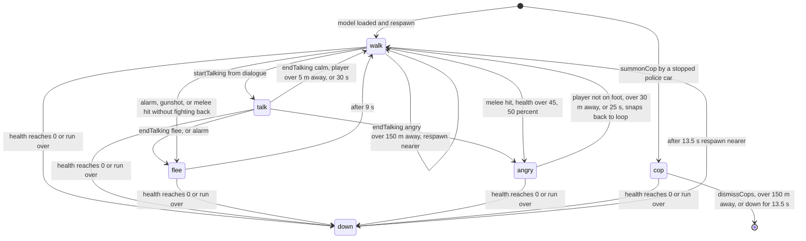

A non-lethal hit on any civilian who is not already `angry` (including one in `talk` or `flee`) re-enters `flee` or `angry` through `setState`, which restarts the state timer (so a fleeing person hit again runs for another 9 s). Staggering (0.35 s) pauses any state except `down`.

**Decisions.**
- No physics for people: they follow their loops exactly, which is cheap and keeps them on sidewalks; hits are geometric (cylinder for bullets, footprint rectangle for cars). Cheaper and more forgiving than per-bone hit boxes.
- Loops instead of pathfinding: a block perimeter downtown, a there-and-back loop along one street in the suburbs, kept 10 m clear of junctions.
- Officers are pedestrians (same model pipeline, same hit tests, same knock-out) in a separate pool, so they can be fought like anyone; they never flee.
- Arrest needs 1.5 s of continuous proximity (decaying at 2× when apart), so a running player can break free; shooting starts at 3 stars, matching the wanted level's escalation (§7.10 of the developer guide).
- Run over only above 3 m/s, and the cash goes straight to the player (you can't pick it up from a car). Only the player's cars count.
- `peopleNear` was added in the audit fix (`ffd288c`) so gunfire is a crime only with people (within 45 m) or police around.
- LOD: animation frozen beyond 70 m, hidden beyond 90 m (phones).

### 6.3 `src/npc/police.ts`

**Purpose.** The police, scaled by the wanted level: two patrol cars when the player is clean (they are also witnesses), 2 pursuit cars per star (max 6) that follow A* routes on the street network and, when close and in sight, drive straight at the player to ram (as a nudge) or box them in; officers dropped next to a player on foot (they live in `Pedestrians`); roadblocks of two cars across the road ahead at 4+ stars; a helicopter that circles overhead and shoots at 5 stars. It also decides "busted in a vehicle", reports every step whether any police can see the player (for losing stars), and answers `witnesses(position)` so crimes the police see count double. Police cars are kinematic like traffic, steered with pure pursuit on a bicycle model.

**Depends on:** `three`, `@dimforge/rapier3d-compat` (kinematic bodies, `castRay` line of sight), `sim/pose.ts` (`yawPitchQuaternion`), `sim/entity.ts`, `sim/smoke.ts` (`Smoke` type), `world/streets.ts` (`StreetNet`: `index.forEachNear`, `edges`, `nodes`, `pointAt`, `nearest`), `world/terrain.ts` (`Terrain.smoothHeight`, `WATER_Y`), `game/route.ts` (`Router.find(x0, z0, x1, z1, 'drive')` → `{ pts }`), `vehicles/carModel.ts` (`buildCarBody`, `buildWheel`, `CAR_DIMENSIONS.sedan`), `vehicles/heliModel.ts` (`buildHelicopter`, `HeliModel`), `npc/pedestrians.ts` (`Pedestrians` type: officers), `world/rng.ts` (`Rng(9110)`).
· **Used by:** `main.ts` (creates it with `PoliceHooks`; `witnesses` → `wanted.witnessed`; `damageCollider` ← `combat.onHit`; `reset()` on death and busted; `markers()` for the maps; `sirens()` and `helicopter` for the sound director; `bustProgress` for the HUD; `clear()` for the officers' `canSee`), tests (`tests/police.test.cjs`).

**Key constants.**

| Name | Value | Meaning / why |
|---|---|---|
| `DIM` | `CAR_DIMENSIONS.sedan` | Police cars are sedans: length 4.5 m, wheelbase W = 2.7 m, wheel radius 0.34 m. |
| `POOL` | 8 | Police cars (6 pursuit + 2 for a roadblock). |
| `PATROLS` | 2 | Patrol cars when clean. |
| `MAX_PURSUIT` | 6 | Pursuit cars cap (2 per star). |
| `SPAWN_MIN` / `SPAWN_MAX` | 230 / 400 m | New cars appear on a road this far from the player, preferably out of view. |
| `PURSUIT_SPEED` | 30 m/s (~108 km/h) | Top chase speed. |
| `PATROL_SPEED` | 13 m/s | Patrol cruising speed. |
| `ACCEL` | 7 m/s² | Speed-up limit. |
| `BRAKE` | 11 m/s² | Slow-down limit. |
| `LAT_ACC` | 7 m/s² | Cornering limit (v²/R ≤ 7). |
| `MAX_STEER` | 0.6 rad | Steering angle clamp. |
| `DIRECT_RANGE` | 45 m | Closer than this and in sight: drive straight at the player. |
| `SEE_RANGE` | 120 m | Maximum distance a car can see the player. |
| `ROUTE_EVERY` | 1.5 s | Pursuit route recompute interval (patrol: 6× = 9 s). |
| `HEALTH` | 100 | Police car health against gunfire. |
| `BUST_TIME` | 3 s | Stopped next to a police car this long in a vehicle → busted. |
| `BUST_RANGE` | 6.5 m | Horizontal distance for the bust check. |
| `DROP_RANGE` | 22 m | A pursuit car stopping this close to a player on foot drops officers. |
| `RESUME_RANGE` | 70 m | Player this far from a parked car (or back in a vehicle) → it drives on. |
| `ROADBLOCK_EVERY` | 25 s | Roadblock interval (first check after 10 s; retry every 3 s while the player is on foot or slower than 8 m/s). |
| `ROADBLOCK_AHEAD` | 230 m | Distance down the road for a roadblock. |
| `HELI_HEIGHT` | 38 m | Helicopter height above max(ground, player). |
| `HELI_SHOT_EVERY` | 2.4 s | Helicopter shot interval. |
| `HELI_DAMAGE` | 7 | Per helicopter hit (30 % chance). |

Other numbers: unit line-of-sight refresh every 0.4 s; officers' sighting radius 40 m; pursuit spawn speed 10 m/s; patrol goals 300–600 m from the player, snapped to a road within 400 m, re-picked within 25 m of the goal; route look-ahead `L = 5 + 0.55·v` m; nearest-route-point search window 25 points; "turning round" speed cap 6 m/s when |α| > 1.6 rad; traffic gap check 0.5–25 m ahead, 2.4 m sideways, cap `max(0, (along − 6)·1.2)`, after 2 s stuck at least 5 m/s; water check `4 + 0.6·v` m ahead, below `WATER_Y + 0.2`; stuck respawn after 6 s below 1 m/s if > 60 m from the player; recycling: > 650 m any, > 500 m patrol, wreck after 30 s, roadblock after 45 s or (> 160 m and > 8 s), all only when not in view; `visible`: always within 60 m, never beyond 350 m, else cos(camera forward, direction) > 0.35; `clear` ignores hits within the last 3.5 m and aims 0.4 m above `to`; officers dropped ±2.3 m to each side; roadblock cars ±2.4 m from the road centre; ram threshold closing > 9 m/s and > police closing + 3 m/s, within 4.2 m, height difference ≤ 3 m; attack cooldown 3 s; helicopter arrives from 300 m at +20 m, circles at radius 30 m and 0.15 rad/s, flies ≤ 35 m/s, leaves climbing 8 m/s and drifting +X at 25 m/s until > 400 m; spotlight colour 0xfff4d6, distance 140, angle 0.22, penumbra 0.6, decay 1.2, shown at night > 0.2 with intensity `400·night`; rotor 40 rad/s, tail 60 rad/s; light bar alternates every 0.25 s; smoke below 50 health (every 0.25 s, darkness 0.5, size 0.8; wreck every 1/14 s, 0.9, 1.4).

**Types.**

`Role` (private) = `'off' | 'patrol' | 'pursuit' | 'block' | 'wreck'`. "Parked" is not a role but the `parked` flag on a pursuit car.

`Unit` (private interface, one per car):

| Field | Type | Meaning |
|---|---|---|
| `group` | `THREE.Group` | White sedan body (0xf2f2f0), two navy stripes (0x1a2f66), light bar, four wheels. Its own meshes (~18 draw calls), visible only while not `off`. |
| `wheels` | `THREE.Group[]` | Spun in `render`. |
| `red`, `blue` | `MeshBasicMaterial` | Light bar halves, recoloured to flash. |
| `body` | `RAPIER.RigidBody` | Kinematic-position-based, cuboid collider; disabled while off (parked at y = −500). |
| `role` | `Role` | |
| `prevPos`, `pos` | `Vector3` | Interpolation pair. |
| `prevYaw`, `yaw`, `pitch` | `number` | Heading (forward = (cos yaw, −sin yaw)) and slope pitch. |
| `speed` | `number` | m/s, ≥ 0. |
| `wheelSpin` | `number` | |
| `health` | `number` | 100 → 0 (→ `wreck`). |
| `route`, `routeIdx`, `routeAge` | `number[] \| null`, `number`, `number` | A* route points (x, z pairs), index of the nearest point, seconds since it was computed. |
| `goal` | `{x, z} \| null` | Patrol destination. |
| `sees`, `seeTimer` | `boolean`, `number` | Line of sight to the player, refreshed every 0.4 s. |
| `parked` | `boolean` | Officers are out: the car waits. |
| `time` | `number` | Seconds since placed / wrecked (age of a roadblock or wreck). |
| `stuck` | `number` | Seconds spent below 1 m/s while not in direct mode. |
| `smokeTimer` | `number` | |

`PoliceHooks` (exported interface):

| Member | Type | Meaning |
|---|---|---|
| `player()` | `{ position, velocity, onFoot, body }` | main.ts: the focus position; the current vehicle body's linear velocity, or a shared zero vector on foot (so on foot the police see a stationary player); whether on foot; the vehicle body or null. |
| `stars()` | `number` | `wanted.stars`. |
| `setSeen(seen)` | `void` | Each step: can any police see the player (`wanted.seen = seen`). |
| `attacked()` | `void` | The player hurt the police: `wanted.crime('police')` (+1 heat and at least 2 stars). |
| `busted()` | `void` | main.ts `busted()`. |
| `night()` | `number` | 0 day … 1 night (`dayNight.lighting.night`) for the searchlight. |
| `shoot(from, to, hit, damage)` | `void` | Something fired at the player: tracer, gunshot (rifle sound), `stats.damage(damage)` if hit. |
| `traffic()` | `THREE.Vector3[]` | `traffic.positions()`, read once per step. |

**API.**

#### `new Police(world, scene, net, terrain, camera, peds, hooks)`
- Creates the `Router` on `net`, 8 units (`makeUnit`: car body, stripes, light bar at (−0.25, 1.47, 0), wheels, a disabled kinematic body), the helicopter model (`buildHelicopter(0x1a3a7a)`, hidden) and the searchlight (`SpotLight`, hidden). `peds` may be null (no officers). `camera` is only used by `visible()`. Called once by main.ts.

#### `markers(): THREE.Vector3[]`
- `sirens()` plus the helicopter position while it is up. For the minimap and full map ("cop" markers). Live references.

#### `sirens(): THREE.Vector3[]`
- Positions (live references) of units in `pursuit` or `block`: the ones with flashing lights. Used by `audio/director.ts`, which voices the two nearest sirens. Patrol and wreck units are silent.

#### `get helicopter: THREE.Vector3 | null`
- The helicopter's position while up, else null (sound director's rotor voice).

#### `witnesses(position: THREE.Vector3): boolean`
- True if the helicopter is up (it always sees you, including while it flies away), or an on-duty officer is within 40 m of `position`, or any unit that is not `off` or `wreck` is within 120 m with a clear line of sight from its driver seat (a Rapier ray cast, done on demand, not throttled). main.ts sets `wanted.witnessed = () => police.witnesses(playerPosition())`; a witnessed crime counts double (except crimes against the police). main.ts also uses it for "gunfire is a crime".

#### `damageCollider(collider, amount): boolean`
- If `collider` belongs to a non-`off` unit: `attacked()` (crime, 3 s cooldown) — even if it is already a wreck — and, unless a wreck, subtract health; at ≤ 0 it becomes a `wreck` (speed 0, time 0). Returns true if it was a police car, false otherwise. main.ts calls it from `combat.onHit` for bullets that hit a collider that is not a traffic car.

#### `reset(): void`
- Despawns every unit, dismisses all officers, hides the helicopter and searchlight, zeroes the bust timer. Does not reset `roadblockTimer`, `heliShot` or `attackCooldown`. Called by main.ts on death (`stats.onDeath`) and after the busted fade.

#### `clear(from, to, exclude?): boolean`
- Line of sight: a solid ray from `from` toward `to` raised by 0.4 m; true if the distance is < 1 m, nothing is hit, or the first hit is within the last 3.5 m (the player or their own car). `exclude` skips one rigid body (the looking car's own). Public because main.ts uses it for the officers' `canSee`.

#### `fixedUpdate(dt): void`
- Order: read `player` and `stars`; `trafficNow = hooks.traffic()` (once per step, shared by every car's gap check; audit fix, before each car called the hook); attack cooldown; `manageUnits`; per non-off unit: save prev pose, `time += dt`, refresh `sees` every 0.4 s (not for wrecks), drive pursuit/patrol units (others: speed 0), `pose`, `checkRam`; `seen` = any unit sees ∨ an officer within 40 m ∨ helicopter up; `updateHeli`; `hooks.setSeen(seen)`; `updateRoadblock`; `checkBusted`.

#### `afterStep(): void` — empty.

#### `get bustProgress: number | null`
- `bustTimer / BUST_TIME` once the timer exceeds 0.3 s, else null. The HUD's blue bust bar (`hud.setWanted(stars, evading, bustProgress)`).

#### `render(alpha, frameDt): void`
- Interpolated pose for each active car (yaw difference wrapped), wheel spin `−v/r·frameDt`, light bar: red bright (0xff2020) in the first quarter-second and blue bright (0x2050ff) in the next while in `pursuit` or `block`, otherwise dark (0x551111 / 0x111a55); smoke below 50 health. Helicopter: interpolated position, yaw toward the player, rotor spin, blades hidden and blur disc shown, searchlight at night aimed at the player.

#### Fields `smoke`, `stats`
- `smoke: Smoke | null` (main.ts). `stats: { spawned, roadblocks, dropped, busted }` for tests.

**Internals.**

*`manageUnits(player, stars)` — tasks and recycling.* `wantPursuit = min(6, 2·stars)`, `chasing` = units in pursuit.
1. If stars > 0 and chasing < wanted: turn one patrol into pursuit (route cleared) if there is one; else spawn one `off` unit as pursuit (`stats.spawned++`). **Return** (one change per step; the recycling in step 4 is skipped on such a step).
2. If stars > 0 and chasing > wanted (a star was lost): the surplus pursuers that are not `visible`, farthest first, become patrols (parked cleared, goal and route reset). This is "the chase thinning" (audit fix `ffd288c`: before, the chase never thinned out until all stars were gone). Cars in view keep chasing for now; they are re-checked every step.
3. If stars == 0: every pursuer becomes a patrol; if officers are out, dismiss those more than 45 m from the player; if fewer than 2 patrols, spawn one; patrols beyond the first two are despawned once not visible.
4. Recycle: any unit > 650 m away, a patrol > 500 m, a wreck older than 30 s, a roadblock older than 45 s or (> 160 m and older than 8 s) — the last three only when not visible.

*`spawn(u, player, role)`.* Collects edges near the player within 400 m (per segment, may repeat); 40 attempts: random edge, random point; reject unless 230–400 m away, above the water (`smoothHeight ≥ WATER_Y + 0.3`) and, for the first 30 attempts, not visible. Faces along the road in the direction that points more toward the player. `place` sets role, position at road height, yaw, speed (10 m/s for pursuit, else 0), health 100, a random `routeAge` in [0, 1.5) s (staggers A* searches between cars), clears goal/parked/time/stuck/sees, enables and teleports the body, shows the group. `despawn` sets `off`, hides, disables the body, clears `parked`.

*`visible(p, player)`.* "The player might be looking at it": within 60 m always, beyond 350 m never, else the cosine between the camera's horizontal view direction and the direction to `p` exceeds 0.35. Used so cars appear, leave or give up only out of view.

*`drive(u, player, dt)` — one step for a patrol or pursuit car.*
1. Parked pursuit car: brake (`speed −= 11·dt`, no movement) until the player is more than 70 m away or is no longer on foot; then un-park and dismiss officers more than 45 m from the player. Return.
2. Pursuit, player on foot within 22 m and the car slower than 3 m/s: park and `summonCop` at ±2.3 m along the car's side vector (sin yaw, cos yaw); `stats.dropped += n` (0–2, depending on free officers). Return.
3. Target point and speed. `targetSpeed` = 30 (pursuit) or 13 (patrol). **Direct mode** when pursuing, within 45 m and `sees`: aim at `player + 0.5 s × velocity`; if the player is driving at ≥ 2 m/s, `targetSpeed = playerSpeed + 5` (ram, a little faster). Otherwise **route mode**: a patrol picks a new goal when it has none or is within 25 m of it (random direction, 300–600 m from the *player*, snapped to the nearest road within 400 m); the goal is the player for pursuit. The route is recomputed (`Router.find(..., 'drive')`) when missing or older than 1.5 s (pursuit) / 9 s (patrol); with no route the car aims straight at the goal, else at `lookAhead(5 + 0.55·v)`.
4. Pure-pursuit steering (below) and the speed caps (below).
5. `speed += clamp(target − speed, −11·dt, +7·dt)`; `yaw += v·tan(steer)/W·dt`; `pos += (cos yaw, −sin yaw)·v·dt`.
6. `stuck` grows while below 1 m/s and not in direct mode; after 6 s, if more than 60 m from the player, respawn elsewhere with the same role (or despawn if no spot).

*Pure pursuit and the bicycle model.* For the target point at distance L (floored at 2 m) and signed angle α from the nose (positive toward increasing yaw):

```text
α      = atan2(f_z·dx − f_x·dz, f_x·dx + f_z·dz)        f = (cos yaw, −sin yaw), (dx, dz) = target − pos
R      = L / (2·sin α)                                   radius of the circle through the car and the target, tangent to the heading
steer  = clamp(atan(W / R), −0.6, 0.6) = clamp(atan(2·W·sin α / L), ±0.6)     W = 2.7 m wheelbase
ω      = v · tan(steer) / W                              bicycle-model yaw rate (rad/s)
```

*Speed caps* (applied in order, each a `min`):

```text
cornering:     v ≤ √(LAT_ACC · L / (2·|sin α|)) = √(7 · R)        when |sin α| > 0.02   (v²/R ≤ 7 m/s²)
turning round: v ≤ 6 m/s                                           when |α| > 1.6 rad
traffic gap:   v ≤ min over cars/units ahead of max(0, 1.2·(along − 6))   (route mode only; ≥ 5 m/s after 2 s stuck)
closing-speed: v ≤ max(0, v_player·f) + 5 + 0.8·max(0, d − 12)    pursuit within 60 m
stopping:      v ≤ √(2 · (0.6·BRAKE) · max(0, d − 5)) = √(13.2 · max(0, d − 5))   pursuit, player on foot or slower than 2 m/s
stop:          v = 0                                               pursuit, player on foot within 22 m
water:         v = 0                                               ground 4 + 0.6·v m ahead below WATER_Y + 0.2
```

d is the horizontal distance to the player; `v_player·f` is the player's velocity along the police car's heading (a car driving toward the police gets 0). The stopping cap is the speed from which a gentle braking of 6.6 m/s² stops the car 5 m short. The closing-speed cap is the **head-on ram fix**: a kinematic car is immovable, so a full-speed hit would land entirely on the player; now the police close in at most 5 m/s faster than the player's speed along their heading once within 12 m (more margin farther out), so a ram is a nudge and a car meeting you head-on slows to ≤ 5 m/s. `tests/police.test.cjs` checks that a player parked in a car at 3 stars is busted without being shoved more than 2 m or losing more than 20 health.

*`lookAhead(u, L)`.* Moves `routeIdx` to the nearest of the next 24 route points (it never goes back), then walks L metres along the polyline from that point and returns the point there (or the last point).

*`clearAhead(u, f)`.* For every traffic position and every other active unit 0.5–25 m ahead and within 2.4 m sideways: `limit = max(0, (along − 6)·1.2)`. After 2 s stuck, at least 5 m/s: a car slowly ghosting through a jam is better than a stuck chase.

*`pose(u)`.* Road height at the front and rear axle (± W/2 along the heading, `smoothHeight`), y = mean, `pitch = atan2(front − back, W)`, then `setNextKinematicTranslation/Rotation`. Runs for every active unit each step (roadblocks and wrecks included).

*`checkRam(u, player)` — fair ram crime.* Only while the player is in a vehicle and the unit is not off or wrecked; within 4.2 m horizontally and 3 m vertically (flying over isn't ramming — audit fix). With `(dx, dz)` from the player to the police car and d its length:

```text
closing = (v_player · (dx, dz)) / d                      the player's speed toward the police car
theirs  = v_police · (f_police · (−dx, −dz)) / d          the police car's speed toward the player
attacked if closing > 9 m/s and closing > theirs + 3 m/s
```

So only the player doing the ramming is a crime; being rammed by the police is not. `attacked()` has a 3 s cooldown so one collision is one crime. Applies to patrol and roadblock cars too.

*`checkBusted(player, stars, dt)`.* Off (timer 0) at 0 stars or on foot (officers handle arrests on foot). `slow` = player horizontal speed < 1 m/s; `close` = a pursuit or block unit within 6.5 m horizontally **and within 3 m vertically** (the hover fix from audit `ffd288c`: a helicopter hovering over police cars was busted). The timer grows while both hold, otherwise resets to 0; above 3 s → timer 0, `stats.busted++`, `hooks.busted()`.

*`updateRoadblock(player, stars, dt)` and `roadAhead`.* From 4 stars. Count down; when due: on foot or slower than 8 m/s → try again in 3 s; else reset to 25 s, find the point 230 m ahead with `roadAhead`, and if at least two units are `off`, place two cars across the road, ±2.4 m either side of the centre line, perpendicular to the road and facing each other ("nose to nose"), in role `block` (`stats.roadblocks++`). If no point or not enough free cars, it simply waits 25 s. `roadAhead(from, dir, ahead)`: snap to the nearest road within 20 m (else null), take the travel direction along that edge that agrees with `dir`, and walk `ahead` metres: at each junction take the edge whose starting direction best matches the current heading (largest dot product); if there is none or the best dot is below 0.3 (a dead end or a turn sharper than ~73°), block at the junction node itself; after 12 junctions give up (null).

*`updateHeli(player, stars, dt)`.* At 5 stars and not up: appear 300 m away in a random direction, 58 m above the player. While up and stars < 5: climb 8 m/s and drift +X 25 m/s, and vanish once more than 400 m from the player (until then it still counts as seeing you). At 5 stars: circle 30 m round the player at 0.15 rad/s, at `max(ground, player.y) + 38 m`, moving toward that point at up to 35 m/s, yawed toward the player. Every 2.4 s it shoots from 1.5 m below its body if `clear(from, target)`: 30 % to hit (7 damage), misses scattered ±2 m. It is visual only (no physics body) and cannot be shot down.

*Small helpers:* `makeUnit`, `place`, `despawn`, `lineOfSight` (from 1.4 m above the car, excluding its own body), `attacked` (cooldown wrapper).

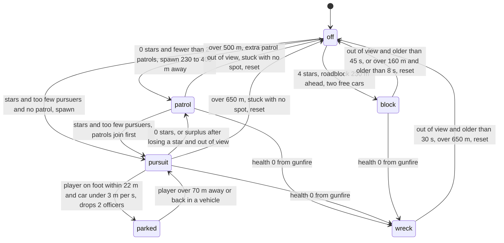

(`parked` is the `parked` flag on a pursuit unit; its lights keep flashing and it still counts for busting and sirens.)

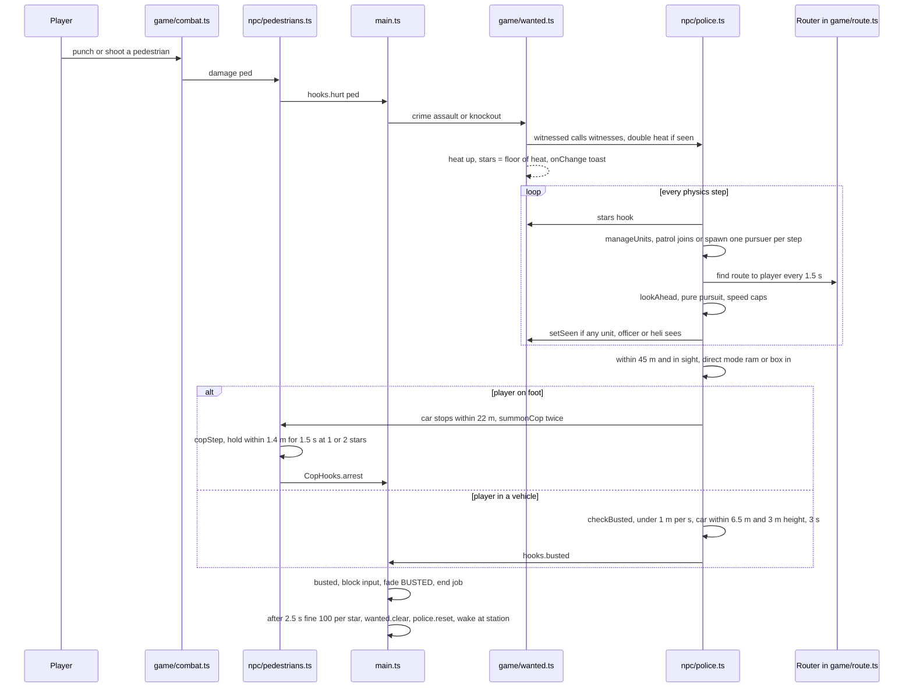

What `main.ts`'s `busted()` does (documented with main.ts; summarised for the sequence): ignore if already pending or the player is dead; remember `stars = max(1, wanted.stars)`; block input; fade to "BUSTED"; end any side job; after 2500 ms, if the player died during the fade only the hospital respawn happens (no fine; audit fix "busted and killed paying twice"); else fine `min(money, 100·stars)`, `wanted.clear()`, `police.reset()`, stream in the world around the nearest police station, place the player there on foot, unblock input and toast.

**Decisions.**
- Kinematic cars like traffic, so the police shove the player's car when they ram it; consequently the ram speed must be capped (closing-speed cap), or the immovable kinematic car would hit with full force (the head-on ram fix; tested in `police.test.cjs`).
- A* routes on the street graph far away (recomputed every 1.5 s, staggered between cars), straight-line pursuit of the predicted position (0.5 s ahead) when within 45 m and in sight. Pure pursuit with a bicycle model gives smooth, plausible steering with one parameter (the look-ahead `L = 5 + 0.55·v`), and the cornering cap `√(a_lat·R)` makes them brake for corners.
- On foot or stopped: pull up beside the player (stopping-distance cap) instead of ploughing into them; officers do the arrest on foot, the bust timer in a vehicle.
- Ramming a police car is a crime only if the player was the one closing fast (`closing > theirs + 3`), so being rammed doesn't raise your stars.
- Busting and ramming ignore cars more than 3 m above or below the player (hovering over the police is safe).
- Spawning, giving up and leaving happen out of the player's view (`visible`), so cars don't pop.
- Losing a star returns surplus pursuers that are out of view to patrol (chase thinning, audit fix).
- `hooks.traffic()` is read once per step (audit fix) instead of once per car.
- The helicopter is visual only and always counts as seeing the player, so at 5 stars stars can only be lost after it has left.

### 6.z Self-test

1. A traffic car is 5 m from a red light's stop line, driving 10 m/s. Which function produces the braking, and what "leader" does IDM see? → `stopGap` returns the distance to the line (`length − s − halfLength − 1.0`), and `drive` takes `min(acc, idm(d, v, v0, stopGap, v))`: a stationary leader with Δv = v. §6.1
2. What does `curveSpeed` return and which constant from `roadGraph.ts` sets the limits? → The highest speed from which the car can brake at 0.8·b to every curvature limit within 90 m, `min √(v_lim² + 2·b'·d)`, with `v_lim = max(2.2, √(3.0/κ))` (A_LAT = 3 m/s²). §6.1
3. Under what conditions does a car on a four-lane road move left? → Not mid-change, ≥ 14 m to go; either it needs the inner lane for a left turn within 60 m, or the IDM gain `ã − a − 0.35 > 0.2 m/s²`, with ≥ 3 m gaps and the new follower braking no harder than 3 m/s². §6.1
4. A mission pins a traffic car and the player carjacks it. How does the mission find out? → `take()` deactivates the slot; the next `fixedUpdate` respawns it, which clears `pinned` and increments `serial`; `missions.ts` sees `serial !== targetSerial` and fails ("the car got away"). §6.1
5. How fast must a player car go to knock a pedestrian down, and who gets the cash? → |speed| ≥ 3 m/s (~11 km/h; main.ts only passes cars faster than 2 m/s); `damage(ped, 1000, 'vehicle')` calls `hooks.runOver`, which gives the player $10–60 directly. §6.2
6. At 2 stars on foot, what makes you busted, and how is it different at 3 stars? → An officer within 1.4 m (and level) for a cumulative 1.5 s (`hold`, decays at 2× when apart) calls `CopHooks.arrest`. At 3+ stars officers stop ~9 m away and shoot every 1.2–1.8 s instead (hit chance `clamp(0.55 − 0.012·d, 0.15, 0.5)`, × 0.6 in a vehicle). §6.2
7. Why is a police car's speed capped near a moving player, and what is the formula? → Kinematic cars are immovable, so a full-speed ram would land entirely on the player; within 60 m `v ≤ max(0, v_player·f) + 5 + 0.8·max(0, d − 12)`. §6.3
8. What is the steering angle for a target 20 m ahead at α = 0.3 rad? → `atan(2·2.7·sin 0.3 / 20) ≈ atan(0.0798) ≈ 0.080 rad`, within the ±0.6 clamp; yaw rate `v·tan(steer)/2.7`. §6.3
9. Why can't a helicopter hovering 30 m over a police car be busted, and why doesn't flying over count as ramming? → `checkBusted` and `checkRam` both require the police car to be within 3 m vertically (audit fix `ffd288c`). §6.3
10. You drop from 3 to 2 stars. What happens to the six pursuers? → `wantPursuit` becomes 4; the two farthest pursuers that are not `visible` become patrols (thinning); visible ones keep chasing until they leave view. §6.3

---

## 7. Game systems and sound

This area is everything that turns the moving-around sandbox into a game: the player's **health, money and weapons** (`game/stats.ts`), **on-foot combat** (`game/combat.ts`, `game/weaponModels.ts`), **cash pickups** (`game/pickups.ts`), **gun stores** (`game/shop.ts`), the **special places** — hospitals, police stations and extra stores — carved out of the generated world (`game/places.ts`), **missions** from eight fixed givers (`game/missions.ts`), **A\* directions** on the street graph (`game/route.ts`), the **wanted level** (`game/wanted.ts`), **side jobs** (`game/jobs.ts`), **saved progress** (`game/save.ts`), and all **synthesised sound** (`audio/sound.ts`, `audio/director.ts`, `audio/radio.ts`).

None of these modules knows about the others directly except through small, explicit seams. `src/main.ts` constructs every object, wires their callbacks (`stats.onDeath`, `combat.onGunfire`, `traffic.onWreck`, `wanted.witnessed`, …) and decides the order things run in. Objects that must advance with the simulation implement `SimEntity` (`sim/entity.ts`: `fixedUpdate(dt)`, `afterStep()`, `render(alpha, frameDt)`) and are pushed into main's `entities` list, so they step at the fixed 60 Hz physics rate (`PHYSICS_STEP = 1/60 s`): `PlayerStats`, `Wanted`, `Cash`, `Missions`, and `Jobs` (wrapped in an ad-hoc entity). Everything else — `Navigator`, `Autosave`, `Shop`, `Combat.render`, `SoundDirector` — is called once per rendered frame with the variable frame time, because none of it moves physics bodies.

Main data flow: **crimes** (punches, gunfire, carjacking, wrecking cars, attacking police) are reported by main.ts callbacks into `Wanted.crime()`; the police (`npc/police.ts`, documented in the NPC section) read `wanted.stars` and write `wanted.seen`. **Money** moves through `PlayerStats.money` from many places (pickups, missions, jobs, fines, death, purchases); main.ts watches it each frame to play a chime and trigger an autosave. **Routing** is one `Router` class used by both the player's `Navigator` and the police pursuit code. **Sound** is fed a `SoundState` snapshot each frame by main.ts and turns it into Web Audio parameter changes.

```mermaid
flowchart LR
  Main["main.ts wiring"]
  Stats["game/stats.ts PlayerStats"]
  Combat["game/combat.ts Combat"]
  Cash["game/pickups.ts Cash"]
  Shop["game/shop.ts Shop"]
  Places["game/places.ts createPlaces"]
  Missions["game/missions.ts Missions"]
  Wanted["game/wanted.ts Wanted"]
  Jobs["game/jobs.ts Jobs"]
  Nav["game/route.ts Navigator and Router"]
  Save["game/save.ts Autosave"]
  Police["npc/police.ts Police"]
  Dir["audio/director.ts SoundDirector"]
  Snd["audio/sound.ts Sound"]
  Radio["audio/radio.ts Radio"]
  Main --> Stats
  Main --> Combat
  Combat -->|fireRound| Stats
  Combat -->|onGunfire onMelee| Main
  Cash -->|adds money| Stats
  Shop -->|buyWeapon buyAmmo buyAddon| Stats
  Places -->|stores| Shop
  Places -->|nearestHospital nearestPolice| Main
  Missions -->|reward| Stats
  Jobs -->|pay| Stats
  Jobs -->|setWaypoint job| Nav
  Main -->|crime| Wanted
  Police -->|seen and attacked| Wanted
  Police -->|Router.find| Nav
  Main -->|stats missions jobs| Save
  Main -->|SoundState each frame| Dir
  Dir --> Snd
  Dir --> Radio
  Main -->|one-shots| Snd
```

**Two life-cycle sequences that span files** (all in `main.ts`, using this area's APIs):

*Death* (`stats.onDeath` listeners run in registration order): main's handler → find `places.nearestHospital(where)` → `onFoot.knockDown()` → `input.setBlocked(true)` → fade "You were knocked out" → `wanted.clear()` → `police.reset()` → `jobs.end('you were knocked out')`; then the missions listener → `missions.playerDied()` (fails any mission, closes any offer). After **2.5 s** (`setTimeout`): `stats.respawn()` (−20 % cash, full health) → stand up, breath = 12 s → `city.streamer.loadAround(hospital.spawn, 450)` → `onFoot.placeAt(spawn, heading, heading)` → `player.setMode(onFoot)` → unblock input → toast "You woke up at <name> — $<money> left". Autosave refuses to write while `stats.dead` is true, so a save can't capture the half-dead state.

*Busted* (`busted()`, called by police/officers): guarded by `bustedPending` and `stats.dead` → `stars = max(1, wanted.stars)` captured now → block input → fade "BUSTED" → `jobs.end('busted')`. After **2.5 s**: clear `bustedPending`; if the player died during the fade, just release the input block and return (the death respawn wins — the audit fix for "busted and killed paying twice"); else nearest police station → `fine = min(money, 100 × stars)` → `wanted.clear()` → `police.reset()` → load chunks 450 m → place on foot → toast "Busted! Fined $<fine> at <station>". Being busted does **not** fail a running mission (only death does).

---

### 7.1 `src/game/stats.ts`

**Purpose.** The player's numbers: health (with regeneration), money, owned weapons, ammo (normal and armour-piercing), weapon add-ons, the weapon in hand, and the dead flag. Also the static weapon/add-on catalogue that the shop, HUD and combat read. It is a `SimEntity` only so health regenerates on the fixed step. It also owns the save format of these fields (`toJSON` / `load`), including validation of untrusted saved data.

**Depends on:** `sim/entity.ts` (the `SimEntity` interface, type only). · **Used by:** `main.ts` (creates it, wires `onDamage` / `onDeath`, money watching, save/load), `ui/hud.ts` (`MAX_HEALTH`, health, money, `weapon`, `ammo`, `apAmmo`), `player/onFoot.ts` (`current`, `cycleWeapon`, `scoped`, `moveSpeedMultiplier`, `weapon`, `damage` for falls/drowning, `owned.size`), `player/car.ts`, `player/heli.ts`, `player/boat.ts` (crash damage), `game/combat.ts` (`weapon`, `fireRound`), `game/pickups.ts`, `game/shop.ts`, `game/missions.ts`, `game/jobs.ts` (`money`, `onDamage`), `game/weaponModels.ts` (`WeaponId` type).

**Key constants.**

| Name | Value | Meaning / why |
|---|---|---|
| `MAX_HEALTH` (exported) | 100 | Full health. NPCs also have 100, so weapon damage reads as "hits to knock out". |
| `START_MONEY` (exported) | $200 | Enough for the bat straight away with $100 left toward the pistol (economy commit `24e6208`). |
| `REGEN_DELAY` | 6 s | Time since the last damage before health comes back. |
| `REGEN_RATE` | 5 health/s | Regeneration speed (0.0833 per 60 Hz step). |
| `DEATH_MONEY_LOSS` | 0.2 | Fraction of cash lost on death. |
| `AP_DAMAGE` (exported) | 1.5 | Armour-piercing damage multiplier (+50 %). |
| `CARRY_SPEED` | fists 1, bat 1, pistol 0.95, rifle 0.9 | Move-speed multiplier holding each weapon: guns weigh you down. |
| `GRIP_SPEED` | 1.2 | Move-speed multiplier with a light grip on the weapon in hand (replaces `CARRY_SPEED`, it does not multiply it). |
| `WEAPON_ORDER` (exported) | `['fists','bat','pistol','rifle']` | Cycling order and the order `load` iterates. |

**Weapon catalogue (`WEAPONS`).**

| id | name | price | melee | damage | range | cooldown | auto | ammoPrice / ammoPack | startAmmo |
|---|---|---|---|---|---|---|---|---|---|
| `fists` | Fists | $0 | yes | 12 | 1.7 m | 0.45 s | – | – | – |
| `bat` | Baseball bat | $100 | yes | 35 | 2.3 m | 0.7 s | – | – | – |
| `pistol` | Pistol | $300 | no | 34 | 80 m | 0.3 s | – | $30 / 12 ($2.50 a round) | 24 |
| `rifle` | Rifle | $800 | no | 50 | 150 m | 0.11 s | yes | $60 / 30 ($2 a round) | 60 |

**Add-ons (`ADDONS`) and AP ammo (`AP_AMMO`).**

| Item | Price per weapon | Effect |
|---|---|---|
| `scope` "Scope" | pistol $150, rifle $200 | "4× zoom while aiming" (read by `onFoot` via `scoped`; the camera rig zoom is 4). |
| `grip` "Light grip" | bat $60, pistol $80, rifle $120 | "+20% run speed" (`moveSpeedMultiplier` = 1.2 while that weapon is in hand). |
| AP rounds | pistol $75 / 12 ($6.25 a round), rifle $150 / 30 ($5 a round) | ×1.5 damage; a separate stock fired **before** normal rounds. |

**Damage formulas.**

```text
damage per shot = w.damage × (AP_DAMAGE if apAmmo[w] > 0 else 1)
  pistol: 34 normal, 51 AP      rifle: 50 normal, 75 AP
hits to knock out a 100-health NPC: fists 9, bat 3, pistol 3 (AP 2), rifle 2 (AP 2)
regen per fixed step: health = min(100, health + 5 × dt)   only if !dead and sinceDamage > 6 s
death: money' = floor(money × (1 − 0.2)) = floor(0.8 × money)
```

Cooldowns tick on the 60 Hz step, so the real fire interval is quantised to whole steps (rifle 0.11 s → 7 steps ≈ 0.117 s ≈ 8.6 rounds/s).

**Types.**

`WeaponId = 'fists' | 'bat' | 'pistol' | 'rifle'`. `AddonId = 'scope' | 'grip'`.

`WeaponDef`:

| Field | Type | Meaning |
|---|---|---|
| `id` | `WeaponId` | Key. |
| `name` | `string` | Display name. |
| `price` | `number` | $; 0 = always owned. |
| `melee` | `boolean` | Melee (cone hit) vs gun (ray). |
| `damage` | `number` | Per hit. |
| `range` | `number` | m (melee reach or bullet range). |
| `cooldown` | `number` | s between attacks. |
| `auto?` | `boolean` | Keeps firing while the button is held. |
| `ammoPrice?` | `number` | $ per pack. |
| `ammoPack?` | `number` | Rounds per pack. |
| `startAmmo?` | `number` | Rounds included with the gun. |

`AddonDef`:

| Field | Type | Meaning |
|---|---|---|
| `id` | `AddonId` | Key. |
| `name` | `string` | Display name. |
| `description` | `string` | Shop sub-line. |
| `price` | `Partial<Record<WeaponId, number>>` | Which weapons accept it, and its price on each. |

**API.**

#### `class PlayerStats implements SimEntity`
Public fields: `health = MAX_HEALTH`, `money = START_MONEY`, `readonly owned: Set<WeaponId>` (starts `{'fists'}`), `readonly ammo: Record<WeaponId, number>` and `readonly apAmmo` (all 0), `readonly addons: Set<string>` of `"weapon:addon"` keys, `current: WeaponId = 'fists'`, `dead = false`. Private: `sinceDamage = Infinity`, listener arrays.

#### `onDamage(listener: (amount: number) => void): void` / `onDeath(listener: () => void): void`
- Register listeners; called in registration order. Registered by main.ts (HUD hurt flash, crash sound in vehicles when amount ≥ 3, on-foot flinch), `Jobs` constructor (crash counting), main's death handler and `missions.playerDied`.

#### `get weapon(): WeaponDef`
- `WEAPONS[current]`.

#### `get armed(): boolean`
- True when `current !== 'fists'`. Carjacking requires it (main.ts).

#### `damage(amount: number): void`
- Ignored if `dead` or `amount <= 0`. `health = max(0, health − amount)`, resets `sinceDamage = 0`, fires every damage listener with `amount`; if health reaches exactly 0 sets `dead = true` and fires death listeners (once — further damage is ignored while dead).
- Called by: officers / police shots (main.ts), pedestrians fighting back (`hitPlayer`), falls and drowning (`onFoot`), crashes (`car`, `heli`, `boat`), all from the physics step.

#### `respawn(): void`
- `money = floor(money × 0.8)`, `health = 100`, `dead = false`, `sinceDamage = Infinity` (so regen isn't delayed). Weapons, ammo and add-ons are kept. Called by main.ts 2.5 s after death.

#### `buyWeapon(id): boolean`
- Fails (false) if already owned or `money < price`. Else deducts price, adds to `owned`, adds `startAmmo ?? 0` to `ammo[id]`, and **switches to it** (`current = id`). Called by the shop's Buy button.

#### `hasAddon(weapon, addon): boolean`
- `addons.has("weapon:addon")`.

#### `buyAddon(weapon, addon): boolean`
- Fails if the add-on doesn't fit that weapon (`price` undefined), the weapon isn't owned, already fitted, or not enough money. Else deducts and records.

#### `buyApAmmo(id): boolean`
- Fails if no `AP_AMMO[id]`, not owned, or not enough money. Else deducts `price` and adds `pack` to `apAmmo[id]`.

#### `roundsLeft(id): number`
- `ammo[id] + apAmmo[id]`.

#### `fireRound(): number | null`
- Consumes one round of the **current** weapon: an AP round first (returns `damage × 1.5`), else a normal round (returns `damage`), else returns `null` (out of ammo). Called by `Combat.update` for guns.

#### `get moveSpeedMultiplier(): number`
- `1.2` if the current weapon has a grip, else `CARRY_SPEED[current]`. `onFoot` multiplies walk/run speed by it.

#### `get scoped(): boolean`
- Current weapon has a scope. `onFoot` uses it for the SCOPE touch button and 4× zoom while aiming.

#### `buyAmmo(id): boolean`
- Fails if the weapon has no `ammoPrice` (melee), isn't owned, or money is short. Else deducts `ammoPrice` and adds `ammoPack`.

#### `cycleWeapon(): void`
- Next owned weapon in `WEAPON_ORDER`, wrapping. With only fists, stays on fists.

#### `toJSON(): { health; money; owned: string[]; ammo; apAmmo; addons: string[]; current: string }`
- Plain copies for the save (`SaveData.stats`).

#### `load(data: ReturnType<PlayerStats['toJSON']>): void`
- Restores a save **defensively**; nothing in `data` is trusted:
  - `num(v)`: a finite number → `max(0, floor(v))`, anything else → 0.
  - `money = num(data.money)`.
  - `health = clamp(num(data.health), 20, 100)` — "never wake up nearly dead".
  - `owned`: only if `data.owned` is an array; each id must pass `isWeapon` = `typeof id === 'string' && Object.hasOwn(WEAPONS, id)`. **Own keys only**: `"constructor" in WEAPONS` is true, so the old `in` test would have accepted `"constructor"` (audit fix). Items are *added* to the existing set (fists stays).
  - `ammo` / `apAmmo`: for each id in `WEAPON_ORDER`, `num(data.ammo?.[id])`.
  - `addons`: only strings from an array; split on `:`; kept if weapon passes `isWeapon` and `Object.hasOwn(ADDONS, a)`.
  - `current`: only if a known weapon that's owned.
- Called once at startup by main.ts after `loadSave()`.

#### `fixedUpdate(dt): void`
- `sinceDamage += dt`; regenerates as in the formula above. `afterStep()` and `render()` are no-ops.

**Decisions.**
- Prices tuned to how fast you actually earn (commit `24e6208`): bat at once, pistol after ~1–2 min of collecting cash, rifle after ~4–5 min; everything together ≈ 45 % of the cash lying around the city at once.
- AP rounds are a separate stock fired first, rather than a toggle → no extra control, and buying them is an obvious upgrade.
- A grip *replaces* the carry penalty rather than stacking with it → a gripped rifle runs at 1.2×, not 1.08×.
- `load` validates every field (audit "unchecked save data") → a hand-edited or corrupted save can't inject NaN money, unknown weapons or prototype keys.

---

### 7.2 `src/game/combat.ts`

**Purpose.** On-foot attacking, called every physics step while on foot. Melee weapons hit the nearest pedestrian in a cone in front of the player; guns cast a ray **from the camera through the screen centre** (where the crosshair is) and hit the first thing along it: a pedestrian, a traffic car, a police car/officer collider (via `onHit`) or a wall. It also draws short-lived tracers and a muzzle flash, alarms nearby pedestrians, and reports gunfire/melee to main.ts for sound and the wanted level.

**Depends on:** `three`, `@dimforge/rapier3d-compat` (`World.castRay`, `Ray`), `input/actions.ts` (`consumePressed('attack')`, `isDown('attack')`), `npc/pedestrians.ts` (`meleeTarget`, `damage(ped, amount, 'melee'|'gun')`, `alarm`, `aimAssist`, `raycast`), `npc/traffic.ts` (`carForCollider`, `damage`), `game/stats.ts` (`weapon`, `fireRound`). · **Used by:** `player/onFoot.ts` (holds `combat`, calls `update` each step with the chest position and its own collider), `main.ts` (constructs it, sets `onHit`, `onMelee`, `onGunfire`, calls `render(frameTime)`, and uses `addTracer` for shots fired *at* the player).

**Key constants.**

| Name | Value | Meaning / why |
|---|---|---|
| `MELEE_ALARM_RADIUS` | 12 m | Pedestrians within this flee/react after a melee hit (or any bat swing). |
| `GUN_ALARM_RADIUS` | 45 m | Pedestrians alarmed by a gunshot. Same 45 m main.ts uses to decide whether gunfire is a crime. |
| `TRACER_TIME` | 0.07 s | Tracer line lifetime. |
| `TOUCH_AIM_ASSIST` | `cos(7°)` ≈ 0.9925 | Cone (as a dot-product threshold) for snapping tap-to-shoot onto a pedestrian on touch screens. |
| out-of-ammo cooldown | 0.4 s | Cooldown applied when the trigger is pulled with no ammo. |
| muzzle flash | sphere r 0.12 m, 0.05 s | Additive yellow flash. |
| muzzle offset | chest + facing × 0.55 m, +0.25 m up | Where tracers start (the hands). |

**Types.**

`AttackEvent`:

| Field | Type | Meaning |
|---|---|---|
| `facing` | `THREE.Vector3` | Unit horizontal vector the player should turn to face (the camera's view, flattened). |
| `melee` | `boolean` | Which animation to play. |

**API.**

#### `new Combat(scene, world, camera, input, stats, peds: Pedestrians | null, traffic, touch: boolean, notify: (text) => void)`
- Creates the (hidden) flash mesh and adds it to the scene. `peds` may be null (character library failed to load).

Public callback fields (all default `null`):
- `onHit: (collider, damage) => void` — a bullet hit a solid collider that isn't a traffic car; main.ts forwards it to `police.damageCollider` (police cars).
- `onMelee: (position, hit, bat) => void` — every swing; main.ts plays `sound.hit` or `sound.swoosh`.
- `onGunfire: (position) => void` — every shot; main.ts plays `sound.gunshot` and reports `wanted.crime('gunfire')` if pedestrians are within 45 m or police witness it.

#### `update(dt, chest: THREE.Vector3, exclude: RAPIER.Collider): AttackEvent | null`
Per physics step, in order:
1. `cooldown = max(0, cooldown − dt)`.
2. `pressed = input.consumePressed('attack')`; `wants = auto ? isDown('attack') || pressed : pressed`. Return null if not wanted or still cooling down.
3. `cooldown = w.cooldown`. `facing` = camera world direction with y = 0, normalised.
4. **Melee:** `target = peds.meleeTarget(chest, facing, range)`; if found `peds.damage(target, damage, 'melee')`. Call `onMelee(chest, !!target, id === 'bat')`. Alarm pedestrians within 12 m **if the swing hit or the weapon isn't fists** (a missed punch is harmless; a missed bat swing is alarming). Return `{facing, melee: true}`.
5. **Gun:** `damage = stats.fireRound()` (AP first). If `null`: show "Out of ammo — buy more at Guns & Ammo" once per empty streak (`outOfAmmoShown`), set cooldown 0.4 s, return null.
6. Aim: `origin` = camera position, `dir` = camera view. On touch with pedestrians, `peds.aimAssist(origin, dir, range, cos 7°)` may replace `dir` with the direction to that ped's `currPos + (0, 1.1, 0)`.
7. Skip ahead along the ray by `max(0, |origin − chest| − 0.5)` so the ray starts roughly level with the player — the camera is behind the player and must not hit things between itself and the player.
8. `wallHit = world.castRay(ray, range, solid = true, …, exclude)`; `wallDist = wallHit ? timeOfImpact : range` (dir is unit, so toi is metres).
9. `pedHit = peds.raycast(start, dir, wallDist)` (pedestrians are not Rapier bodies; they use their own cylinder test, limited to before the wall).
10. If a ped was hit → `peds.damage(ped, damage, 'gun')`; else if a wall was hit → if it's a traffic car (`traffic.carForCollider`) `traffic.damage(car, damage)`, else `onHit(collider, damage)`.
11. Tracer from the muzzle to the hit point; flash for 0.05 s; alarm pedestrians within 45 m; `onGunfire(chest)`. Return `{facing, melee: false}`.

- Side effects: pedestrian/traffic damage, scene objects (tracers), callbacks.
- Note: range is measured from the skipped-ahead start point, not the camera.

#### `addTracer(from, to): void`
- Adds a `THREE.Line` with the shared additive tracer material, life 0.07 s. Also used by main.ts for officers' and police shots at the player.

#### `render(frameDt): void`
- Per frame: ages tracers, removing and disposing geometry of expired ones (the material is shared and kept); flash visible while `flashLife > 0`.

**Decisions.**
- Ray from the camera, not from the gun barrel → the bullet goes where the crosshair is (third-person cameras otherwise make you miss what you aim at). The forward skip prevents hitting objects behind the player.
- Pedestrians are tested separately from Rapier (cheap cylinder test) but only up to the wall distance → walls stop bullets.
- Touch aim assist (7°) → precise thumb aiming is hard.
- Melee alarm rules (missed fists don't alarm) → harmless shadow-boxing isn't treated as violence.

---

### 7.3 `src/game/weaponModels.ts`

**Purpose.** Builds the simple procedural meshes of the bat, pistol and rifle, in metres, for parenting to the character's right-hand bone (grip at the origin).

**Depends on:** `three`; `game/stats.ts` (`WeaponId` type). · **Used by:** `player/onFoot.ts` (builds each model once, caches it, and reuses it on weapon switches — the audit fixed a GPU leak where switching rebuilt models).

**API.**

#### `buildWeaponModel(id: WeaponId): THREE.Object3D | null`
- Returns a `THREE.Group`, or `null` for `fists`.
- Bat: tapered cylinder (radius 0.035 → 0.018 m, length 0.85 m, shifted +0.32 m along Y) colour `0xb08350` plus a knob sphere (r 0.024 m) at Y −0.1; extends along the hand's +Y (along the fingers).
- Pistol: slide box 0.035×0.05×0.19 m and grip box 0.03×0.1×0.045 m.
- Rifle: body 0.05×0.08×0.55, barrel cylinder r 0.013 m × 0.32 m rotated to +Z, stock 0.045×0.1×0.22 (wood-brown), magazine 0.035×0.12×0.05.
- Guns are built upright with the barrel along +Z, then the group is rotated `rotation.z = π`: the hand's +Y runs along the fingers, which point *down* when holding a grip, so the gun is flipped upright (slide on top); the barrel already points along the hand's +Z, i.e. forward.
- All meshes `castShadow = true`, `MeshStandardMaterial` with per-part metalness/roughness (small helper `mesh(geometry, color, metal = 0.3, rough = 0.5)`).

---

### 7.4 `src/game/pickups.ts`

**Purpose.** Cash lying around: glowing, spinning, bobbing bundles of notes. Walk over one (on foot) to collect it; seeded ones come back after 2 minutes; one-off drops (knocked-out pedestrians, wrecked cars' drivers) disappear after 2 minutes if nobody picks them up. All bundles are one `InstancedMesh`; only those near the player are drawn.

**Depends on:** `three`; `sim/entity.ts`; `game/stats.ts` (`money`); `world/rng.ts` (`Rng`, `hashSeed`); `world/layout.ts` (`BLOCK_SIZE`, `LOT`, `CityLayout` blocks, `streets.net`, `streets.parcels`); `world/streets.ts` (`ROAD_SPECS`, `net.pointAt`, `net.kerbDistance`). · **Used by:** `main.ts` (constructs it; `onCollect` → toast; `drop` from knocked-out pedestrians and `traffic.onWreck`; entity list).

**Key constants.**

| Name | Value | Meaning / why |
|---|---|---|
| `PICKUP_RADIUS` | 1.3 m | Horizontal collect radius (also requires \|Δy\| < 2.2 m). |
| `RESPAWN_TIME` | 120 s | A seeded bundle reappears this long after being taken. |
| `DROP_LIFE` | 120 s | Dropped cash disappears after this (audit fix, see Decisions). |
| `MAX_PICKUPS` | 160 | InstancedMesh capacity = most drawn at once. |
| `DRAW_DISTANCE` | 180 m | Only bundles within this horizontal distance of the focus are drawn. |
| drop cap | 40 | `drop()` refuses when 40 dropped bundles already exist. |
| seed | `hashSeed(layout.seed, 5150, 77)` | Own random stream → same seed, same spots. |

**Placement (constructor).**
- Downtown blocks: a park block gets `rng.int(1, 3)` bundles at random points inside the lot (4 m margin); other blocks get one with probability 0.8, on the sidewalk ring: `edge = BLOCK_SIZE/2 − range(2, 3)` (2–3 m in from the curb), along a random side, 6 m clear of corners.
- Suburbs: every street edge that has a sidewalk and isn't `downtown` class: first spot at `range(30, 250)` m, then every `range(180, 320)` m until 15 m before the end (≈ one per 250 m); offset to a random side by `width/2 + sidewalk/2`; kept only if `net.kerbDistance(x, z, 10) > 0.2` (not on another road).
- Park parcels: `rng.int(1, 3)` bundles in the parcel's rotated rectangle (6 m margin).
- Amount: `5 × rng.int(2, 16)` = **$10–80**; height `surface(x, z)` (sidewalk tops follow the hills).
- Mesh: box 0.36×0.14×0.2 m, colour `0x3f9b4a`, emissive `0x46d160` at 0.6 (visible from afar), `frustumCulled = false`.

**Types.** Private `Pickup`: `position: Vector3`, `amount: number`, `away: number` (seconds until it reappears; 0 = present), `dropped: boolean`, `life: number` (dropped cash: seconds left; seeded: `Infinity`).

**API.**

#### `new Cash(scene, layout, stats, collector: () => Vector3 | null, focus: () => Vector3, surface: (x, z) => number)`
- `collector` returns the player's position only when on foot (null in vehicles → no collecting from cars); `focus` is the player anywhere (for drawing).

#### `onCollect(listener: (amount) => void): void`
- Called with the amount on each pickup (main.ts toasts "+$amount").

#### `drop(position, amount): void`
- One-off bundle at a copy of `position`, `life = 120 s`. Ignored if 40 dropped bundles exist. Callers: main.ts `knockedOut` (`5 × dropRng.int(1, 8)` = $5–40) and `traffic.onWreck` (`10 × dropRng.int(3, 8)` = $30–80, at the wreck position + 2.2 m in x, **keeping the wreck's y**).

#### `fixedUpdate(dt): void`
- Iterates backwards. Dropped: `life −= dt`; at ≤ 0 removed. Taken seeded bundles count `away` down and are skipped. Then, if on foot, within 1.3 m horizontally and 2.2 m vertically: `stats.money += amount`, listeners fire; dropped ones are removed, seeded ones get `away = 120`.

#### `render(): void`
- Rebuilds instance matrices for present bundles within 180 m (up to 160): yaw `time × 2 + phase`, height `+0.45 + 0.1 sin(3 time + phase)`, where `phase = 0.37 x + 0.61 z` (so they don't spin in sync). Sets `mesh.count`.

#### `get available(): { position; amount }[]`
- Present bundles (`away === 0`), for tests and the minimap.

**Decisions.**
- One `InstancedMesh` + distance cull → hundreds of bundles cost one draw call.
- Seeded `Rng(hashSeed(...))` → determinism rule: same world, same cash.
- **Audit fix "wreck cash buried":** main.ts used to set the wreck drop's `y = 0`, which is underground on hills; now it keeps the car's height.
- **Audit fix "drops stopping":** dropped cash was only removed when picked up, so after 40 un-collected drops the cap blocked all new drops forever; now drops expire after `DROP_LIFE` = 120 s and free their slot.
- No collecting from vehicles (`collector` returns null) → you have to get out and walk over it.

---

### 7.5 `src/game/shop.ts`

**Purpose.** The gun stores: a shopfront on the downtown building face nearest the spawn, plus every `StoreSite` placed by `places.ts`. Each has a lit "GUNS & AMMO" sign, a door panel and a pulsing ring marker; **E** at any door opens the same DOM buy menu (weapons, ammo, add-ons, AP rounds).

**Depends on:** `three`; `input/actions.ts` (`setBlocked`, `exitPointerLock`); `player/onFoot.ts` (`Interactable` type); `world/layout.ts` (`CityLayout` blocks/buildings); `game/places.ts` (`StoreSite` type); `game/stats.ts` (`ADDONS`, `AP_AMMO`, `AP_DAMAGE`, `WEAPONS`, buy methods). · **Used by:** `main.ts` (constructs with `city.spawn`, `places.stores`; pushes `interactables` to `onFoot`; `render(frameTime)`; `doors` for map markers).

**Key constants.**

| Name | Value | Meaning |
|---|---|---|
| `SHOP_ITEMS` | `['bat','pistol','rifle']` | Rows in the menu (fists aren't sold). |
| door stand-off | 1.2 m out from the wall | Interaction point and marker position. |
| interact radius | 2.2 m | `Interactable.radius`. |
| sign | 4.2×1.05 m plane, 0.08 m out, centre 3.95 m above the door's ground | Canvas 512×128, gold on dark. |
| door panel | 1.6×2.4 m, 0.05 m out, centre +1.05 m | |
| marker | ring 0.6–0.85 m, +0.03 m | Opacity `0.5 + 0.35 sin(3 t)`. |
| panel z-index | 60 | Above other UI. |

**API.**

#### `new Shop(scene, layout, near: Vector3, stats, input, sites: StoreSite[] = [], surface)`
- First store: private `storeSpot(layout, near, surface)` scans every face centre of every downtown building (4 faces each, outward normal ±X/±Z) and picks the one nearest `near`; door y = `surface` 1 m outside along the normal.
- For each spot (first + sites): sign, door panel, marker (all markers share one material), door stand point, interactable `{label: 'shop', position: door, radius: 2.2, activate: open}`.
- Public: `door` (first store's stand point), `doors` (all), `interactables`.

#### `render(frameDt): void`
- Pulses the shared marker material's opacity (one material → one update animates all).

#### `open(): void`
- No-op if open. `input.setBlocked(true)` (counted block), `exitPointerLock()` (free the mouse), builds the fixed-position panel; `pointerdown`/`mousedown`/`click` are stopped from propagating so menu clicks don't reach the game.

#### `close(): void`
- Only if open: removes the panel and releases **one** input block. (Audit fix "menus unfreezing each other": blocks are counted in `Input`, and `close()` must not release a block it never took.)

**Internals.** `redraw()` rebuilds the panel: title with money; per weapon a row "kind · damage N · R rounds + A AP" with "Buy $price" (unowned), "+pack ammo $price" (owned gun) or "Owned" (bat); for owned weapons, indented add-on sub-rows ("Fitted" or price button) and an AP sub-row ("+50% damage · $x.xx a round · fired first"); a footer "Q switches weapons · F / click to attack" and a "Leave" button. Buttons are disabled (grey) when unaffordable; every click calls the stats method then redraws. Small helpers: `button`, `subRow`, `label`, `signTexture`.

**Decisions.** DOM UI, no framework (project rule: no new dependencies). One menu for all six stores. Input blocked while open so walking keys don't move the player.

---

### 7.6 `src/game/places.ts`

**Purpose.** Chooses, deterministically from the layout, the special places — **hospitals** (respawn after death), **police stations** (wake-up after being busted) and **extra gun stores** — and rewrites the layout's buildings there (block buildings, parcel buildings, trees, roof props) **before any chunk is built**, so streamed meshes and colliders already include them. Adds the signs to the scene.

**Depends on:** `three`; `world/layout.ts` (`CURB_HEIGHT`, `LOT`, `MID`, `PARAPET`, `PITCH`, `ROAD_WIDTH`, `STYLE_BRICK`, `STYLE_CONCRETE`, `STYLE_METRICS`, `VILLAGES`, `lineCoord`, `Block`, `CityLayout`, `ParkingSpot`, `Zone`); `world/suburbs.ts` (`Parcel`, `ParcelKind`). · **Used by:** `main.ts` (`createPlaces(city.layout, scene, surface)` once at startup; parked cars + ambulances at `hospitals[].parking`; `nearestHospital` on death and for the ambulance job; `nearestPolice` on busted; map markers), `game/shop.ts` (`StoreSite` type).

**Key constants.**

| Name | Value | Meaning |
|---|---|---|
| `HOSPITAL_PARCELS` | `['stripmall','school','bigbox','shop','village']` | Parcel kinds a hospital/police station may take, in order of preference. |
| `STORE_PARCELS` | `['stripmall','shop','village']` | Parcel kinds a store may take. |
| parcel search radius | 600 m | `pickParcel` only looks this far from the target. |
| reserved blocks | (MID, MID+2), (MID+1, MID+2), (MID−1, MID+2), (MID, MID+1) | Spawn, helipad and downtown mission-giver blocks stay as they are. |

`HOSPITAL_TARGETS` (8): City General Hospital (−200, −200, downtown), Northside Hospital (100, −820, suburb), Eastside Hospital (860, 150, suburb), Westside Hospital (−860, −100, suburb), Seaside Hospital (300, 1520, beachtown), and "<village> Clinic" at each village centre (`lineCoord(i), lineCoord(k)`): Eastfield (i 46, k 22), Westbrook (6, 30), Pinecrest (42, 6).

`POLICE_TARGETS` (5): Central Police Station (220, 160, downtown), Northside Police (−520, −600, suburb), Eastside Police (700, 640, suburb), Westside Police (−700, 260, suburb), Seaside Police (−60, 1500, beachtown).

`STORE_TARGETS` (5): Seaside (−420, 1520, beachtown), Northside (−320, −700, suburb), Eastside (720, −420, suburb), Westside (−720, 520, suburb), Eastfield (village 0 centre + (80, 80), village).

**Types.**

`Hospital` (also used for police stations):

| Field | Type | Meaning |
|---|---|---|
| `name` | `string` | Shown in the wake-up toast. |
| `spawn` | `THREE.Vector3` | Capsule-centre spot in front of the door (surface + 1.0 m). |
| `heading` | `number` | Camera yaw to face on waking (away from the door). |
| `door` | `THREE.Vector3` | Door point (maps, ambulance job target). |
| `parking` | `ParkingSpot[]` | Two parked cars (main.ts spawns a car and an ambulance at hospitals; police parking is unused). |

`StoreSite`: `name: string`, `door: Vector3` (point on the wall), `normal: Vector3` (wall's outward normal).

`Places`: `usedParcels: Set<Parcel>`, `hospitals: Hospital[]`, `police: Hospital[]`, `stores: StoreSite[]`, `nearestHospital(x, z): Hospital`, `nearestPolice(x, z): Hospital`.

**API.**

#### `createPlaces(layout, scene, surface): Places`
Order: hospitals → police → stores (earlier ones take the better spots).
- **Targets in a downtown zone** → `pick(x, z, zones)`: the nearest block of that zone that isn't a helipad or reserved; it becomes reserved.
- **Other targets** → `pickParcel(x, z, kinds)`: for each kind in order, the nearest unused parcel of that kind with buildings within 600 m; first kind that has one wins; added to `usedParcels`. If none, that place is skipped (so the lists can be shorter than the target tables).
- `blockHospital(b, name, index, look)`: concrete block 42 × 26 m, 4 floors (2 in a village zone), `height = groundFloor + floors × floor + PARAPET` (`STYLE_CONCRETE` metrics), centred `z = cz − LOT/2 + depth/2 + 3` (set back north, forecourt to the south); clears park/lawn/roof props and in-lot trees (keeps street trees); door = surface at (cx, z + depth/2 + 1); 9 × 1.8 m sign at `door.y + groundFloor + 0.45`; two cars in the south street's curb lane (`laneZ = cz + PITCH/2 − ROAD_WIDTH/2 + 1.75`) at cx − 9 (sedan) and cx + 4 (van if index odd), yaw π; spawn 5 m in front, +1 m; heading π.
- `parcelHospital(p, name, index, look)`: `big = p.w > 80` → 42 × 26 m, 4 floors, at the back (`back = d/2 − depth/2 − 4`); else a clinic `min(22, w − 2) × min(14, d − 4)`, 2 floors, near the front (`back = −d/2 + depth/2 + 2`). Replaces `p.buildings`, removes trees within `max(width, depth)/2 + 3` m, and on a school also clears fields/grass/stalls and paves the front half. Door in the front wall (−v side); sign turned to face −v (`atan2(−vx, −vz)`); two cars 12 m in front at u = −7 and +4, facing the building (`yaw = atan2(−vz, vx)`), van if index odd; spawn 5 m in front; `heading = atan2(vx, vz)`.
- Looks: hospital = sign "✚ HOSPITAL" (white on red, 640×128 canvas), walls `[0.78, 0.8, 0.82]`, building `kind: 'hospital'`; police = "★ POLICE" (white on navy), walls `[0.36, 0.42, 0.52]`.
- Stores on a parcel: door in the front wall of the parcel's first building; on a strip mall toward one end (`along = (width/2 − 8) × sign(p.x)`), else centred; door y = surface 1 m outside. Downtown stores (none in the current target list, but supported): a low brick shop 26 × 16 m along the southern sidewalk.
- Parcel-local axes `axes(yaw)`: `u = (cos yaw, −sin yaw)` along the street, `v = (sin yaw, cos yaw)` into the parcel (the front faces the street at −v).

#### `nearestHospital(x, z)` / `nearestPolice(x, z)`
- Linear scan by horizontal distance to `spawn`. `nearestPolice` falls back to hospitals if no station could be placed.

**Decisions.**
- Mutating layout data before chunks are built → streamed meshes and colliders automatically include the places; no special-case rendering.
- Deterministic (nearest-to-target, no randomness) → same seed, same places.
- Police stations reuse the hospital builder with a different `Look` → one code path.
- Quirk to know: in `parcelHospital` the parked car's `colorIndex = (index × 3 + round(a)) % 9` is negative for `a = −7` and `index ≤ 2` (JS `%` keeps the sign), so `PAINT_COLORS[negative]` is `undefined` and three.js falls back to its default (white) paint for that car.

---

### 7.7 `src/game/missions.ts`

**Purpose.** Missions handed out by eight fixed, invulnerable givers with a bobbing yellow "!" badge. A giver is *not* a pedestrian: just a character model plus a static Rapier capsule collider (so bullets and fists simply stop on it). One mission at a time; success pays a base reward plus a bonus per second left on the clock; failure (timeout, target escaped, death) costs nothing.

**Depends on:** `three`; `@dimforge/rapier3d-compat` (static giver colliders); `input/actions.ts` (`consumePressed('choice1'|'choice2')`); `sim/entity.ts`; `player/character.ts` (`CharacterModel`: `setTalking`, `play('wave')`, `update`); `player/characterLibrary.ts` (`create(look)`, `Look`); `player/onFoot.ts` (`Interactable`); `npc/traffic.ts` (`pickTarget`, `TrafficCar` fields `pinned`, `serial`, `wrecked`, `active`, `currPos`); `game/stats.ts` (`money`); `world/layout.ts` (`BLOCK_SIZE`, `MID`, `VILLAGES`, `WORLD_HALF`, `lineCoord`, `blockAt`, blocks, `Building`); `world/streets.ts` (`ROAD_SPECS`, `net.index.nearest`, `net.pointAt`, `net.kerbDistance`, `net.other`, nodes/edges); `world/terrain.ts` (`WATER_Y` = −0.5 m). · **Used by:** `main.ts` (constructs it with hooks; `interactables` → `onFoot`; `stats.onDeath(() => missions.playerDied())`; `objectives()` for the maps and to exempt a mission's target car from the "wreck" crime; `givers` for map markers; `record` for the save; entity list).

**Key constants.**

| Name | Value | Meaning |
|---|---|---|
| `DELIVERY_RADIUS` | 6 m | Reach a delivery/long-haul spot (also \|Δy\| < 4 m). Beacon radius is 0.6× this. |
| `PACKAGE_RADIUS` | 3 m | Collect a package (\|Δy\| < 3 m). |
| `RING_RADIUS` | 7 m | Inner radius of a sky ring; pass within 7 m (3D) of its centre. |
| `RING_CLEARANCE` | `RING_RADIUS + 8` = 15 m | Every ring keeps this from buildings and the ground. |
| `BUOY_RADIUS` | 4 m | Tag a buoy (horizontal) while swimming. |
| `GATE_RADIUS` | 9 m | Pass a race gate (horizontal) while driving. Gate torus radius 0.8× this. |
| `FLAG_RADIUS` | 4 m | Reach a summit flag (\|Δy\| < 4 m) on foot. |
| `GIVER_RADIUS` | 2.6 m | Talk range (interactable radius). |
| offer close distance | 5 m | Walking further from the giver closes the offer. |
| giver wave | first after `4 + 3k` s, then every 8–16 s | Idle wave when within 70 m. |

`REWARDS` (base $ + $ per second left):

| Kind | Base | Bonus/s | Time limit | Points |
|---|---|---|---|---|
| `delivery` | 150 | 2 | `round(dist/9 + 25)` s | 1 sidewalk spot 400–1100 m away |
| `packages` | 200 | 1.5 | 200 s | 4 sidewalk spots 60–450 m away (needs all 4) |
| `wreck` | 250 | 2 | 120 s | a traffic car 90–230 m away |
| `rings` | 300 | 3 | none until ring 1, then 75 s | 6 sky rings |
| `swim` | 220 | 2 | 150 s | 5 buoys (needs all 5) |
| `race` | 350 | 4 | none until gate 1, then `round(L/15 + 15)` s | 6–8 gates (needs ≥ 6) |
| `summit` | 300 | 1 | 300 s | 3 hilltop flags (needs 3) |
| `longhaul` | `round((150 + 0.15·dist)/10)·10` | 1.5 | `round(dist/11 + 40)` s | 1 sidewalk spot 1200–2200 m away |

`dist` = straight-line distance (m) from the player at acceptance; `L` = summed straight distance between consecutive gates from gate 0 to the last. Speeds implied: 9 m/s city driving, 11 m/s long-haul, 15 m/s country race.

**Givers.**

| Giver | Where | Kinds | Greeting |
|---|---|---|---|
| Marco | block (MID, MID+1), downtown | delivery, packages | "Need a courier. Quick money, no questions." |
| Vera | block (MID−1, MID+2) | wreck | "There's a car out there I want off the road." |
| Captain Reyes | block (MID+1, MID+2) | rings | "Fancy yourself a pilot? Prove it." |
| Lena | near (−120, 1521), beachtown | swim | "Lifeguard trials today. Think you can keep up?" |
| Farmer Joe | Eastfield − (60, 70) | race | "Fancy a spin round the farm roads? I'll time you." |
| Ranger Kim | Pinecrest + (−60, 60) | summit | "The view from up top is worth it. No cars on the trails." |
| Dusty | Westbrook + (70, −60) | longhaul, wreck | "Got a load that needs to go a long way. You drive?" |
| Sam | near (320, −640), suburb | packages, wreck | "Busy day in the neighbourhood. Want some work?" |

Downtown givers stand on the sidewalk 1.2 m in from the block's west edge, 6 m from its south-west corner, facing −X (`facing = π/2`). Outer givers stand on the nearest road with a sidewalk within 400 m of their point (`net.index.nearest` skipping edges whose class has `sidewalk === 0`), on the side their point is, at `width/2 + 0.6 × sidewalk` from the centreline, facing the road. Each gets a static capsule collider (half-height 0.55 m, radius 0.35 m) centred 0.9 m above the feet, and a fixed `Look` (`GIVER_LOOKS` for the three downtown, `OUTER_GIVERS[].look` for the rest).

**Types.**

`MissionKind = 'delivery' | 'packages' | 'wreck' | 'rings' | 'swim' | 'race' | 'summit' | 'longhaul'` (private).

`Giver` (private, exposed through `givers`): `name`, `kinds: MissionKind[]`, `position` (feet), `facing`, `model: CharacterModel | null` (loaded async), `marker: THREE.Sprite`, `greeting`, `waveTimer`.

`Mission` (private):

| Field | Type | Meaning |
|---|---|---|
| `kind` | `MissionKind` | |
| `giver` | `Giver` | Whose marker to hide/show; whose record to update. |
| `title` | `string` | HUD line text. |
| `timeLeft` | `number` | Seconds; `Infinity` while waiting to start (rings, race). |
| `baseReward`, `bonusPerSecond` | `number` | From `REWARDS` (long haul recomputes base). |
| `points` | `THREE.Vector3[]` | Destination / packages / rings / buoys / gates / flags, in order. |
| `done` | `number` | Points reached. |
| `target` | `TrafficCar \| null` | Wreck missions. |
| `targetSerial` | `number` | The target slot's `serial` when the mission started. |

`MissionHooks` (exported):

| Field | Type | Meaning |
|---|---|---|
| `isDriving()` | `boolean` | Player mode is Driving (race gates count only then). |
| `isSwimming()` | `boolean` | On foot and swimming (buoys count only then). |
| `isOnFoot()` | `boolean` | On foot (summit flags count only then). |
| `ground(x, z)` | `number` | Terrain height without sidewalks (`terrain.heightAt`). |

**Lifecycle diagram.**

```mermaid
stateDiagram-v2
  [*] --> Idle
  Idle --> Offer : E at giver, makeOffer picks a random kind
  Offer --> Idle : 2 or Not now or walked over 5 m away or died
  Offer --> Starting : 1 or Accept
  Starting --> Idle : start returned false, toast No job right now
  Starting --> Active : points built, giver marker hidden
  Active --> Waiting : rings or race, timeLeft is Infinity
  Waiting --> Active : first ring or gate reached, clock set
  Active --> Success : per-kind goal met
  Active --> Fail : timeLeft reaches 0
  Active --> Fail : wreck target inactive or serial changed
  Active --> Fail : playerDied
  Waiting --> Fail : playerDied
  Success --> Idle : pay base plus bonus, record done and best, cleanup
  Fail --> Idle : toast reason, unpin target, cleanup
```

Per-kind completion checks in `fixedUpdate` (`p` = player position, any mode unless stated):

| Kind | Completes when | Mode requirement |
|---|---|---|
| delivery, longhaul | horizontal distance to `points[0]` < 6 m and \|Δy\| < 4 m | any |
| packages | each still-visible package within 3 m (\|Δy\| < 3) is hidden and counted; done when all 4 | any |
| wreck | `target.wrecked >= 0` → success; `!target.active` or `target.serial !== targetSerial` → fail "the car got away" | any |
| swim | next buoy (in order) within 4 m horizontally | `isSwimming()` |
| race | next gate (in order) within 9 m horizontally; gate 1 starts the clock | `isDriving()` |
| summit | any still-visible flag within 4 m (\|Δy\| < 4), any order | `isOnFoot()` |
| rings | next ring within 7 m (3D distance); ring 1 starts the 75 s clock | `isFlying()` |

Timeout reasons: "the car got away" for wreck, "out of time" otherwise; death: "you were knocked out".

**API.**

#### `new Missions(scene, world, layout, library | null, stats, traffic, input, playerPosition, isFlying, helipad, notify, touch, surface, hooks)`
- Places givers (see table), creates their colliders, sprites and interactables (`available` only when no mission and no offer is open; `activate` → `makeOffer`), loads models asynchronously, and builds the shared markers: a translucent red 60 m-tall open cylinder **beacon** (radius 3.6 m) and a red spinning **target arrow** cone. Builds two DOM elements: the offer panel (bottom centre, z-index 26) and the HUD mission line (top centre, z-index 20, `pointer-events: none`).

Public fields: `givers`, `interactables`, `record: Record<string, {done, best}>` (per giver name; saved).

#### `get active(): boolean`
- A mission is running.

#### `ringClear(p: THREE.Vector3): boolean` (public, used by tests)
- False if `p.y − 15 < ground(p) + 2`. Otherwise for every building near (`buildingsNear(p, 15 + 120)`), computes the horizontal distance from `p` to the building's rotated footprint (`a = dx cos yaw − dz sin yaw`, `b = dx sin yaw + dz cos yaw`, `out = hypot(max(0, |a| − w/2), max(0, |b| − d/2))`); if `out < 15`, requires `p.y − 15 ≥ ground(bl.x, bl.z) + height + roofHeight + 3`.

#### `playerDied(): void`
- `finish(false, 'you were knocked out')` and close any open offer. Registered as a `stats.onDeath` listener.

#### `fixedUpdate(dt): void`
- Counts the clock down (only if finite) and fails at ≤ 0; then runs the per-kind check above.

#### `render(_alpha, frameDt): void`
- Givers within 70 m animate: `setTalking(true)` while offering, otherwise a wave when `waveTimer` expires; badge at feet + 2.35 m + 0.08 sin(2.5 t). Offer: closes if the player is > 5 m away; key 1 accepts, key 2 declines. Mission markers: beacon on delivery/long-haul point; buoys bob (`WATER_Y − 0.1 + 0.15 sin(1.6 t + i)`) with the next one scaled 1.25; next race gate bright green (`0x4cd964`), others dark; packages spin; wreck arrow over the target at y 3.2 + 0.2 sin(4t); next ring bright yellow. HUD line `title (done/total) · m:ss`, red when < 15 s.

#### `objectives(): THREE.Vector3[]`
- Where the minimap points: the destination (delivery/long haul), all remaining packages/flags, the target car's `currPos` (wreck), or the next ring/buoy/gate. Empty with no mission. Main.ts also uses it to decide that wrecking a car within 6 m of an objective is not a crime.

**Internals.**
- `makeOffer(giver)`: random kind from `giver.kinds` (`Math.random`), clears stale 1/2 presses, shows name, greeting, title "— $base+" and description, with Accept/Not now buttons (labels "1. Accept"/"2. Not now" on desktop).
- `acceptOffer` → `start(giver, kind)`; on `false` toasts "No job right now — try again in a moment.".
- `start` builds the mission per kind (table above). Wreck: `traffic.pickTarget(from, 90, 230)` (random active, un-wrecked, unpinned car in range), sets `car.pinned = true` (pinned cars don't despawn when far away) and stores `targetSerial = car.serial`. On success, toasts "Mission: <title prefix>".
- `sidewalkSpot(from, min, max)`: candidate downtown blocks (centre within `[min − 64, max + 64]`) and sidewalk street edges; up to 80 attempts, choosing an edge with probability `edges / (edges + 4 × blocks)` (edges ≥ 30 m long, point 12 m from either end, offset to the sidewalk, rejected if `kerbDistance < 0.2`), else a block's sidewalk ring 2 m in from the edge; accept if the straight distance is in `[min, max]`. Height from `surface`.
- `buoyLine(from)`: walk south from the giver in 5 m steps until ground is ≥ 1.5 m below `WATER_Y`; five buoys at `z + 15 + 28 i`, alternating x offsets ±(25–45) m; each kept only if ≥ 1.2 m deep; at `y = WATER_Y`.
- `raceRoute(from)`: nearest junction (≤ 600 m) touching a non-`local` road; walk up to 200 steps along non-local edges never straight back (except at a dead end), scoring options `1000·visited + 0.2·|node| + random·300` (prefer unvisited junctions, toward the map centre); a gate on each fresh junction once ≥ 160 m since the last gate; stop at 8 gates. Gate height: torus centre `0.8 × 9 − 0.5` m above ground, facing the next gate.
- `summits(from)`: 25 m grid of points 150–650 m away (inside `WORLD_HALF − 120`), sorted by height; greedily choose up to 3 at least 150 m apart; stop once below `WATER_Y + 3`.
- `ringCourse()`: start at the helipad, heading toward the world origin; for ring `i` (0–5) target altitude `45 + 10 i` (+0–10 random) but at least `ground + 15 + 3`; up to 40 attempts with heading jitter `±(0.6 + 0.04 × attempt)` rad and step `(70 if i = 0 else 110) × (0.8–1.2)` m, clamped to `WORLD_HALF − 200`; accept the first `ringClear` spot. If none, go straight 110 m at the base altitude and climb 5 m at a time until clear (cap 400 m).
- `buildingsNear(x, z, radius)`: downtown block buildings, suburban houses, parcel buildings, plus a synthetic building for each church steeple (with a 7 m roof).
- `finish(success, reason)`: success → `bonus = round(timeLeft × bonusPerSecond)` if the clock is finite, else 0; `money += base + bonus`; `record[giver].done++`, `best = max(best, round(timeLeft))`; toast "Mission complete! +$total (incl. $bonus time bonus)". Failure → toast "Mission failed — reason". Always: unpin the target, remove and dispose package/buoy/flag/ring/gate meshes (geometry + material), hide beacon and arrow, show the giver's marker.
- Helpers `badgeTexture`, `buoyMesh` (red cylinder, white band, yellow light), `flagMesh` (3.2 m pole + red pennant).

**Decisions.**
- Givers are not pedestrians → they can't be hurt, flee or be pooled away, and can stand at fixed spots forever.
- Rings and race start their clock at the first point → time spent getting a helicopter/car to the start isn't penalised.
- Mode requirements per kind (swimming, driving, on foot, flying) → you can't cheat a swim or hike with a vehicle.
- **Pinned target + serial (audit fix "Vera's target moving when carjacked"):** traffic slots are pooled and reused. If the player carjacked the target, the slot was respawned as a different car and the mission silently followed the new car. Now `Traffic.respawn` unpins the slot and increments `serial`; the mission fails ("the car got away") when the serial changes.
- Mission randomness uses `Math.random`, not the seeded world RNG → missions are gameplay, not world data; determinism is only required for world generation.

---

### 7.8 `src/game/route.ts`

**Purpose.** Directions: the best route along the street network from the player to a waypoint (A\*), and the `Navigator` that keeps a waypoint and its route up to date as the player moves. The `Router` is also used by the police (`npc/police.ts`) for pursuit routes and by `Jobs` to measure task distances.

**Depends on:** `world/streets.ts` (`ROAD_SPECS` speeds, `StreetNet`: `nodes`, `edges` with `a`, `b`, `length`, `cum`, `pts`, `cls`; `net.nearest`, `net.other`). · **Used by:** `main.ts` (`new Navigator(net, onArrive)`; `setWaypoint`/`clear` from full-map clicks; `update` every frame; `route`, `remaining`, `waypoint`, `owner` for maps, HUD and save), `npc/police.ts` (`new Router(net)`, `find(..., 'drive')`), `game/jobs.ts` (`navigator.router.find`, `setWaypoint(x, z, 'job')`, `clear`, `owner`, `waypoint`).

**Key constants.**

| Name | Value | Meaning |
|---|---|---|
| `OFFROAD_MIN` | 8 m | A destination more than this from the nearest road gets a straight final leg. |
| `FASTEST` | `max(ROAD_SPECS[*].speed)` = 19 m/s (`rural`) | Heuristic divisor when driving. |
| snap radius | 2000 m | `net.nearest(x, z, 2000)` for both ends. |
| arrival radius | 15 m | User waypoints clear when this close. |
| trim interval | 0.5 s | How often the route is trimmed / off-route checked. |
| re-route | > 25 m off route and ≥ 2 s since the last route | |

Road speeds used for costs (`ROAD_SPECS`): downtown 12.5, arterial 17, collector 12, local 10, rural 19 m/s.

**Types.**

`TravelMode = 'drive' | 'walk' | 'direct'`.

`Route`:

| Field | Type | Meaning |
|---|---|---|
| `pts` | `number[]` | Flat x, z pairs from the start (you) to the destination. |
| `offroad` | `number` | Point index where the off-road leg begins: points `0 … offroad−1` follow roads; the segment(s) from point `offroad − 1` on are drawn dashed. Equals the point count if there is no off-road leg. |
| `length` | `number` | Total polyline length, m. |

Private `Snap`: `edge`, `s` (distance along the edge from node `a`), `x`, `z`, `dist` (from the query point to the road).

**A\* formulas.**

```text
cost(e, len) = len / ROAD_SPECS[e.cls].speed     (drive: seconds)
             = len                               (walk: metres)
h(n)         = |n − goalSnap| / 19               (drive)
             = |n − goalSnap|                    (walk)
seeds:   g(from.edge.a) = cost(from.edge, from.s)
         g(from.edge.b) = cost(from.edge, from.edge.length − from.s)
tail(n)  = cost(to.edge, to.s)                   if n = to.edge.a
         = cost(to.edge, to.edge.length − to.s)  if n = to.edge.b
         = ∞ otherwise
best     = cost(from.edge, |to.s − from.s|)      if both snaps are on the same edge, else ∞
stop when popped g(u) + h(u) ≥ best
```

`h` is admissible (straight line ≤ road distance; and no road is faster than 19 m/s, so `d/19` never overestimates time), so A\* returns the optimal route.

```mermaid
flowchart TD
  A["find x0 z0 x1 z1 mode"] --> B{"mode is direct"}
  B -->|yes| C["return 2-point line, offroad 2"]
  B -->|no| D["snap both ends to nearest road within 2000 m"]
  D --> E{"either snap missing"}
  E -->|yes| F["return null"]
  E -->|no| G["seed both ends of start edge with cost along it"]
  G --> H["best = same-edge cost or infinity"]
  H --> I{"open heap empty"}
  I -->|no| J["pop u with least g plus h, skip if closed"]
  J --> K{"g plus h at least best"}
  K -->|yes| N
  K -->|no| L["if u is an end of goal edge, best = g plus tail"]
  L --> M["relax every edge of u, push improved neighbours"]
  M --> I
  I -->|yes| N{"best finite"}
  N -->|no| F
  N -->|yes| O["walk cameFrom back to a seeded junction"]
  O --> P["slice start edge, chain edges, slice goal edge"]
  P --> Q["prepend x0 z0, offroad = point count"]
  Q --> R{"goal snap over 8 m from road"}
  R -->|yes| S["append x1 z1 as off-road leg"]
  R -->|no| T["sum length, return Route"]
  S --> T
```

**API.**

#### `class Router`
- `lastExpanded: number` — junctions expanded by the last search (for tests; ~150 of ~850 on a 2.4 km route, ~5 ms).
- `constructor(net: StreetNet)`.

#### `find(x0, z0, x1, z1, mode: TravelMode): Route | null`
- `'direct'`: `{pts: [x0, z0, x1, z1], offroad: 2, length: straight distance}` (helicopter, boats).
- Otherwise A\* as above, with typed arrays `g: Float64Array` (∞), `cameFrom: Int32Array` (−1 unknown, −2 seeded from the start, else edge id), `closed: Uint8Array`, and a private binary min-heap `Heap` (push/pop by key `f = g + h`; lazy deletion — stale entries are skipped via `closed`).
- Polyline: if `bestEnd < 0` (same-edge route won) → `slice(from.edge, from.s, to.s)`. Else rebuild the chain of edges from the seeded junction to `bestEnd`, then `slice(start edge, from.s → that junction's end)`, each chain edge in its travel direction (dropping the duplicate junction point), and `slice(goal edge, bestEnd's end → to.s)`. Prepend `(x0, z0)`; `offroad = points so far`; append `(x1, z1)` if `to.dist > 8`; sum length.
- Returns `null` when no road lies within 2000 m of either end or no route exists.
- Called by: `Navigator.recompute`, `Police` (every 1.5 s per pursuer, staggered), `Jobs.setTask`.

#### `class Navigator`
Fields: `waypoint: {x, z} | null`, `owner: 'user' | 'job'` (who set it), `route: Route | null` (trimmed, from where you are), `readonly router: Router`; private `full` (untrimmed route), `mode`, `sinceCheck`, `sinceRoute`.

#### `new Navigator(net, onArrive: () => void)`
- `onArrive` is main's "You have arrived" toast.

#### `setWaypoint(x, z, owner = 'user'): void`
- Sets the waypoint and owner, drops the routes, sets `sinceRoute = ∞` so the next `update` routes.

#### `clear(): void`
- No waypoint, no route.

#### `get remaining(): number | null`
- `route.length` (m) or null. Shown under the minimap.

#### `update(dt, x, z, mode): void` (per frame)
1. No waypoint → return.
2. If within 15 m **and** `owner === 'user'` → `clear()`, `onArrive()`, return. (A job's waypoint is never cleared on arrival: the job decides.)
3. Advance timers. If the mode changed or there is no full route → `recompute`, return. (If `find` returned null, this repeats every frame.)
4. `'direct'` → `recompute` every frame (a straight line from wherever you are).
5. At most every 0.5 s: `off = trim(x, z)`; if `off > 25 m` and `sinceRoute > 2 s` → `recompute`.

Main.ts passes mode `'walk'` on foot, `'drive'` in a car, `'direct'` in the helicopter or a boat.

**Internals.**
- `slice(e, s0, s1)`: the edge polyline between distances `s0` and `s1` in either direction, interpolated ends included (uses the edge's cumulative lengths `cum`).
- `snap(x, z)`: `net.nearest` → `{edge, s = cum[seg] + segLen × t, x, z, dist}`.
- `trim(x, z)`: projects the position onto each segment of the full route, finds the nearest point (segment index `bestI`), and sets `route = [you, nearest point, …points after bestI]` with `offroad = max(2, full.offroad − bestI + 1)` (re-indexed) and a recomputed length. Returns the distance off the route.

```mermaid
flowchart TD
  U["Navigator update each frame"] --> W{"waypoint set"}
  W -->|no| X["return"]
  W -->|yes| Y{"within 15 m and owner user"}
  Y -->|yes| Z["clear and onArrive"]
  Y -->|no| M{"mode changed or no route"}
  M -->|yes| R["recompute with Router.find"]
  M -->|no| D{"mode direct"}
  D -->|yes| R
  D -->|no| T{"0.5 s since last check"}
  T -->|no| X
  T -->|yes| TR["trim route at nearest point"]
  TR --> O{"over 25 m off and 2 s since route"}
  O -->|yes| R
  O -->|no| X
```

**Decisions.**
- Time cost when driving → routes prefer arterials and country roads over winding residential streets; distance on foot → the shortest way.
- Admissible straight-line heuristic → optimal, while expanding only a fraction of the junctions (tested against plain Dijkstra on 30 random pairs: no longer routes).
- Virtual start/goal through both ends of the snapped edges → players and waypoints are rarely at junctions; handles "same road" too.
- Off-road final leg drawn dashed → a waypoint in a field or the lake is still reachable.
- Trim + delayed re-route (25 m, 2 s) → the line follows you without re-running A\* every frame, and doesn't flap at junctions.

---

### 7.9 `src/game/wanted.ts`

**Purpose.** The 0–5 star wanted level. Crimes add *heat* (one star = 1.0); stars are the whole part of heat. While no police unit can see you, a timer runs; after `LOSE_TIME` you lose one star and the timer restarts. Below one star leftover heat fades. Dying, being busted or a new game clears everything. The wanted level is never saved. How hard the police push follows the stars (`npc/police.ts`): 1–2★ chase and ram, 3★+ officers shoot, 4★+ roadblocks, 5★ helicopter.

**Depends on:** `sim/entity.ts`. · **Used by:** `main.ts` (reports crimes; sets `witnessed`; `onChange` toasts; `clear` on death/busted; HUD `stars`/`evading`), `npc/police.ts` via main.ts callbacks (`stars`, `setSeen` → `wanted.seen`, `attacked` → `crime('police')`), pedestrians' officer logic via `stars`.

**Key constants.**

| Name | Value | Meaning |
|---|---|---|
| `MAX_STARS` (exported) | 5 | Top level; heat capped at 5.99. |
| `LOSE_TIME` (exported) | 20 s | Unseen time to drop one star. |
| `CRIMES` (exported) | see below | Heat per crime. |
| gunfire cooldown | 2 s | Gunfire counts at most once per 2 s. |
| heat fade below 1★ | 0.02 per s | 0.5 fades in 25 s, 0.99 in ~50 s. |
| evading threshold | `unseen > 2 s` | HUD stars blink. |

`CRIMES`:

| Crime | Heat | Reported by (main.ts) |
|---|---|---|
| `assault` | 0.5 | pedestrians' `hurt` hook (hit, not knocked out) |
| `knockout` | 1 | `hurt` with `knockedOut` (fists, bat, gun or car) |
| `gunfire` | 0.5 | `combat.onGunfire` if pedestrians within 45 m or police witness it |
| `carjack` | 1 | carjack interactable |
| `wreck` | 1 | `traffic.onWreck`, unless the wreck is within 6 m of a mission objective |
| `police` | 1, and heat ≥ 2 | hurting an officer (`hurt` with `ped.cop`), `police.attacked` (shooting/ramming police) |

`Crime = keyof typeof CRIMES`.

**Formula.**

```text
amount = CRIMES[kind] × (2 if kind ≠ 'police' and witnessed() else 1)
heat   = min(5.99, heat + amount);  if kind = 'police': heat = max(heat, 2)
stars  = min(5, floor(heat))
```

Examples: one unseen punch (0.5) gives no star; a second gives 1★; one punch the police see gives 1★; a knock-out in view gives 2★.

```mermaid
stateDiagram-v2
  [*] --> Clean
  Clean : 0 stars, heat under 1 fades 0.02 per s
  Wanted : 1 to 5 stars
  Seen : police see you, unseen = 0
  Unseen : unseen timer runs
  Clean --> Clean : crime adds heat but stays under 1
  Clean --> Wanted : crime heat reaches 1, doubled if witnessed except police crimes
  Wanted --> Wanted : more crimes, cap 5.99, police crime at least 2
  Wanted --> Seen
  Seen --> Unseen : no unit sees you
  Unseen --> Seen : any sighting resets timer
  Unseen --> Unseen : 20 s unseen, drop exactly one star
  Unseen --> Clean : last star dropped
  Wanted --> Clean : clear on death busted or new game
```

**API.**

#### `class Wanted implements SimEntity`
Fields: `heat = 0`, `unseen = 0` (s since police last saw you, only counts while wanted), `seen = false` (set each step by the police), `witnessed: (() => boolean) | null` (main.ts sets it to `police.witnesses(playerPosition())`).

#### `get stars(): number`
- `min(5, floor(heat))`.

#### `get evading(): boolean`
- `stars > 0 && unseen > 2`.

#### `onChange(listener: (stars, previous) => void): void`
- Fired only when the star count actually changes. Main.ts toasts "The police are after you!" (0 → more) and "You lost the police" (→ 0).

#### `crime(kind: Crime): void`
- Gunfire: ignored if the 2 s cooldown is running, else starts it. Applies the formula, sets `unseen = 0`, notifies.

#### `clear(): void`
- `heat = 0`, `unseen = 0`, notify. Called on death, busted.

#### `fixedUpdate(dt): void`
- Gunfire cooldown ticks down. At 0★: `unseen = 0`, heat fades. Else if `seen`: `unseen = 0`. Else `unseen += dt`; at ≥ 20 s: `heat = stars − 1` (**exactly** one star less, the fraction dropped), `unseen = 0`, notify.

**Decisions.**
- Heat with fractional crimes → minor offences need repeating before the police care.
- Witnessed doubling, but not for police crimes (they're always "seen", so doubling would double-count) and a 2★ floor for attacking police.
- Gunfire rate-limited → a rifle burst doesn't jump straight to 5★.
- Dropping to exactly `stars − 1` → each star takes a full 20 s to lose; no fractional leftovers carry over.
- Not saved → reloading is a fresh start with the police.

---

### 7.10 `src/game/jobs.ts`

**Purpose.** Side jobs worked in shifts: in a taxi, an ambulance (one at each hospital) or a van, **J** / JOB starts a shift; pressing it again or getting out ends it. Each task sets the destination through the `Navigator` (owner `'job'`), so the route line, the distance and re-routing all work as for the player's own destinations.

**Depends on:** `three`; `world/streets.ts` (`StreetNet`: `nearest`, `pointAt`, `halfWidth`, edges); `world/layout.ts` (`Building` — suburban houses); `player/characterLibrary.ts` (`create`, `randomLook`); `player/character.ts` (`reset`, `knockDown`, `play('wave')`, `update`); `game/route.ts` (`Navigator`, `router.find`); `game/stats.ts` (`money`, `onDamage`); `world/rng.ts` (`Rng`). · **Used by:** `main.ts` (constructs with hooks; `toggle` on the `job` action each physics step; `fixedUpdate` via an ad-hoc entity; `end` on death/busted; `render`, `hudText`, `active`, `kind` (ambulance beacons), `record` (save); map clicks are refused while `active`).

**Key constants.**

| Name | Value | Meaning |
|---|---|---|
| `STOP_RADIUS` | 9 m | Within this of the target … |
| `STOP_SPEED` | 2.5 m/s | … and slower than this counts as "stopped there". |
| `AVERAGE_SPEED` | 9 m/s | For time limits. |
| `CRASH_DAMAGE` | 5 | A health hit ≥ 5 while carrying a fare/patient counts as a crash. |
| `JOB_NAMES` (exported) | taxi "Taxi", ambulance "Ambulance", delivery "Delivery" | HUD/toasts. |
| RNG | `new Rng(Date.now() % 100000)` | Different jobs each session (not world data). |

**Types.** `JobKind = 'taxi' | 'ambulance' | 'delivery'`.

Private `Task`: `label` (HUD), `target {x, z}`, `timeLeft` (s), `limit` (starting limit), `distance` (route length at task start, m — for pay).

`JobHooks` (exported):

| Field | Type | Meaning |
|---|---|---|
| `vehicle()` | `{kind: JobKind \| null; position; speed} \| null` | The car you're in (null if not in a car); `kind` from main's `jobKind`: livery `ambulance` → ambulance, `taxi` type → taxi, `van` → delivery, else null. |
| `hospital(x, z)` | `Vector3` | Nearest hospital door. |
| `surface(x, z)` | `number` | Standing height. |
| `toast(text, seconds?)` | `void` | HUD message. |

**Pay and time formulas.**

```text
time limit (taxi / ambulance task) = D / 9 + 30 s
    D = Router.find(from, target, 'drive').length, or 1.4 × straight distance if no route
delivery run limit = (Σ 1.4 × straight leg, nearest-first tour from the start) / 9 + 60 s
    (one clock for the whole run; each next drop inherits the remaining time)

taxi fare       = round((25 + 15·km + 0.5·max(0, tLeft)) × max(0.3, 1 − 0.1·crashes))
ambulance       = round((60 + 20·km + 1.0·max(0, tLeft)) × max(0.3, 1 − 0.1·crashes))
    km = D/1000 of the drop-off leg; tLeft = seconds left on the drop-off leg
delivery        = $30 per drop, + $60 bonus when the last drop is reached in time
```

```mermaid
stateDiagram-v2
  [*] --> OffShift
  OffShift --> Pickup : J in taxi or ambulance
  OffShift --> Deliver : J in van
  Pickup : drive to fare 300-900 m or patient 400-1200 m, limit D over 9 plus 30
  Dropoff : taxi 600-2000 m away, ambulance to nearest hospital road point
  Deliver : up to 4 houses 120-1000 m, nearest first, one run clock
  Pickup --> Dropoff : stopped within 9 m under 2.5 m per s, crashes reset
  Pickup --> Pickup : time out, toast, next pickup
  Dropoff --> Pickup : stopped at target, pay fare formula
  Dropoff --> Pickup : time out, toast, next pickup
  Deliver --> Deliver : stopped at drop, pay 30, next drop keeps clock
  Deliver --> Deliver : last drop, pay 30 plus 60 bonus, new run
  Deliver --> Deliver : time out, new run
  Pickup --> OffShift : J again, left vehicle, death or busted
  Dropoff --> OffShift : J again, left vehicle, death or busted
  Deliver --> OffShift : J again, left vehicle, death busted or no houses nearby
```

**API.**

#### `class Jobs`
Public fields: `kind: JobKind | null`, `stage: 'pickup' | 'dropoff' | 'deliver'`, `task: Task | null`, `earned` and `done` (this shift), `record: Record<string, {done, earned}>` (lifetime per job; saved).

#### `new Jobs(scene, net, houses: Building[], library | null, navigator, stats, hooks)`
- Registers `stats.onDamage`: while on a shift **in the dropoff stage**, a hit ≥ 5 increments `crashes` (taxi and ambulance; the delivery stage never counts).

#### `get active(): boolean`
- On a shift.

#### `toggle(): void`
- On a shift → `end()`. Otherwise, if not in a job vehicle → toast "Get in a taxi, an ambulance or a van to work a shift". Else start: `kind`, reset `earned`/`done`, remember the user's own waypoint (`savedWaypoint`, only if `navigator.owner === 'user'`), toast "<Job> shift started — follow the route", `next(position)`.

#### `end(reason = ''): void`
- Toast "<Job> shift over (reason): N done, $X earned"; clear kind/task; hide the person; clear the navigator if it holds a job waypoint; restore the user's saved waypoint.

#### `fixedUpdate(dt): void`
- Not on a shift or no task → return. Not in a vehicle of the same kind → `end('you left the vehicle')`. Clock down; at ≤ 0 toast "Out of time — the patient didn't make it / the fare gave up / too slow" and `next()`. If within 9 m and slower than 2.5 m/s → `arrived()`.

#### `render(frameDt, player: Vector3): void`
- Animates the waiting person: a fare turns to face the player and waves every 2.2 s; a patient lies still.

#### `hudText(): string | null`
- `"<Job>: <label> · m:ss · $earned"`, or null off-shift.

**Internals.**
- `arrived(at)`: delivery → `dropsDone++`, shift the queue, pay 30 ("Delivered"); more drops → next drop with the remaining time; last → pay 60 ("Run complete! Bonus"), `done++`, new run. Pickup → hide the person, stage `dropoff`, `crashes = 0`; taxi target = `roadPoint(at, 600, 2000)`, toast "Fare on board — take them to the flag"; ambulance target = nearest road point (≤ 200 m) to the nearest hospital door, toast "Patient on board — get them to hospital!". Drop-off → pay the formula, `done++`, `next()`.
- `pay(amount, text)`: `money += amount`, `earned += amount`, `record[kind].earned += amount`, and `record[kind].done++` unless it's a per-drop "Delivered" payment (so a delivery run counts once, on its bonus); toast "text: +$amount".
- `next(from)`: delivery → `pickHouses`; none → `end('no houses nearby')`; else run limit (formula) and `setTask('Deliver (1/N)')`. Taxi/ambulance → stage `pickup`, `roadPoint(from, 300|400, 900|1200)`, label "Pick up the fare" / "Reach the patient", `showPerson(spot, lying = ambulance)`.
- `setTask(label, target, from, timeLeft?)`: route length by `router.find(..., 'drive')` (fallback 1.4 × straight), limit `timeLeft ?? D/9 + 30`, `navigator.setWaypoint(target, 'job')`.
- `roadPoint(from, min, max)`: up to 60 tries of a random angle and radius; nearest road within 150 m; accept if the snapped distance is in `[0.8 min, 1.2 max]` and the edge is ≥ 30 m long; return a point offset `halfWidth − 1.2` m to the kerb side (right of the tangent). Fallback `(from.x + min, from.z)`.
- `pickHouses(from)`: houses 120–1000 m away; pick up to 4 at random; each target is the nearest road point within 60 m of the house (skipped if none); order nearest-first greedily. Fewer than 4 where houses are scarce (`dropsTotal`).
- `showPerson(at, lying)`: one shared character model created lazily from `library.randomLook`; placed at the surface height; `knockDown()` for a patient. If the download fails, `personLoading` is reset so the next fare retries (audit fix).

**Decisions.**
- Jobs drive the shared `Navigator` with `owner = 'job'` → route line, distance and re-routing for free; the job, not the 15 m arrival check, decides completion; only user waypoints are saved; the user's waypoint comes back after the shift.
- Time limits from the route length at 9 m/s (+ slack) → fair on any trip.
- Crash penalty floored at 30 % pay → a rough ride still pays something.
- `dropsTotal` instead of a hard-coded "/4" (audit fix) → correct labels when fewer houses are found.

---

### 7.11 `src/game/save.ts`

**Purpose.** Saved progress in `localStorage`: one small JSON object under one versioned key, so closing the tab doesn't lose money, weapons, missions, jobs, position, time of day or the map destination. Data from an older/unknown version, or anything that doesn't parse or validate, is ignored and you start a new game. The wanted level is never saved. Also the `Autosave` scheduler.

**Depends on:** `import.meta.env.BASE_URL` (Vite). Browser `localStorage`, `window`/`document` events. · **Used by:** `main.ts` only (`loadSave` at startup, `Autosave` with a `writeSave` callback, `clearSave` for New game).

**Key constants.**

| Name | Value | Meaning / why |
|---|---|---|
| `KEY` | `'opencity.save.v1'` + (`BASE_URL` if it isn't `'/'`) | e.g. `'opencity.save.v1/preview/'` for the `/preview/` build, so trying a preview never overwrites the live game's save on the same origin (commit `074a22e`). |
| `VERSION` | 1 | Saves with another version are ignored. |
| `Autosave.interval` | 30 s (default) | Periodic save. |
| `Autosave.soon` | 1 s (default) | Delay after `changed()`. |

**Types.**

`SaveData`:

| Field | Type | Meaning |
|---|---|---|
| `version` | `number` | Must equal `VERSION`. |
| `stats` | `{health; money; owned: string[]; ammo: Record<string, number>; apAmmo: Record<string, number>; addons: string[]; current: string}` | `PlayerStats.toJSON()`; validated later by `PlayerStats.load`. |
| `missions` | `Record<string, {done: number; best: number}>` | Per giver name: completions and best (most) time left, s. |
| `jobs` | `Record<string, {done: number; earned: number}>` | Per job kind. |
| `player` | `{x; z; heading}` | Where to wake up and the camera/facing yaw. |
| `hours` | `number` | Time of day. |
| `waypoint` | `{x; z} \| null` | The user's map destination (never a job's). |

**API.**

#### `loadSave(): SaveData | null`
- Parses `localStorage[KEY]` (missing → `null` → returns null). Validation, any failure → `null`:
  - `isObject(data)` (non-null, non-array object), `version === 1`, `isObject(stats)`, `isObject(player)`;
  - `player.x`, `player.z`, `player.heading` and `hours` all `Number.isFinite`.
- Sanitises the rest instead of rejecting: `missions = records(missions, ['done','best'])`, `jobs = records(jobs, ['done','earned'])` (keep only `{name: {field: finite number}}` entries, copying only those fields); `waypoint` kept only if an object with finite `x`, `z`, else `null`.
- Any exception (corrupt JSON, blocked storage) → `null`.

#### `writeSave(data: Omit<SaveData, 'version'>): void`
- `localStorage.setItem(KEY, JSON.stringify({version: 1, ...data}))`; errors (private mode, quota) are swallowed — playing on without saving is fine.

#### `clearSave(): void`
- Removes the key (errors ignored).

#### `class Autosave`
- `constructor(save: () => void, interval = 30, soon = 1)`: registers `window 'pagehide'` and `document 'visibilitychange'` (when `hidden`) to call `now()`.
- `changed()`: if nothing is pending, schedule a save in `soon` s (repeated calls don't postpone it).
- `stop()`: never save again.
- `now()`: unless stopped, call `save()`, reset `sinceSave` and `pending`.
- `update(dt)`: called **per rendered frame** by main.ts with the frame time; counts down a pending save and saves every `interval` s.

**How main.ts uses it.** At startup: `loadSave()` → if present: `stats.load(saved.stats)` (validates weapons/add-ons/numbers) → `missions.record`, `jobs.record` → `dayNight.hours = ((hours % 24) + 24) % 24` → spot at `terrain.surfaceAt(x, z) + 1.0` → `city.streamer.loadAround(spot, 450)` (ground exists before placement) → `onFoot.placeAt(spot, heading, heading)` → restore the waypoint. The `Autosave` callback skips while `stats.dead` (mid-respawn); saves the on-foot position, or **in a vehicle the nearest road point within 400 m** (never wake up in the air or at sea); `heading = onFoot.facingYaw`; waypoint only if `owner === 'user'`. Each frame, if `stats.money` changed → chime if it rose by ≥ $20, `autosave.changed()`; then `autosave.update(frameTime)`. **New game** (full map, after `confirm`): `autosave.stop()` → `clearSave()` → `location.reload()`.

```mermaid
sequenceDiagram
  participant M as main.ts
  participant S as save.ts
  participant LS as localStorage
  participant P as PlayerStats
  participant W as World streamer
  M->>S: loadSave
  S->>LS: getItem KEY
  LS-->>S: JSON or null
  S->>S: validate version, objects, finite x z heading hours
  S->>S: sanitise missions jobs waypoint
  S-->>M: SaveData or null
  M->>P: load stats, clamp health 20 to 100
  M->>M: restore records and hours
  M->>W: loadAround saved spot 450 m
  M->>M: placeAt spot, set waypoint
  loop every frame
    M->>S: changed if money moved
    M->>S: update frameTime
    S->>M: save callback after 1 s pending or 30 s
    M->>S: writeSave unless dead
    S->>LS: setItem
  end
  Note over S,LS: pagehide or visibilitychange hidden also call now
  M->>S: New game, stop and clearSave
  S->>LS: removeItem
  M->>M: location.reload
```

**Decisions.**
- Small JSON, one key, versioned → cheap to save often (a few hundred bytes); incompatible saves are simply ignored.
- Save every 30 s, ~1 s after money changes (purchases, rewards, job pay, death, fines all move money) and on page hide/close → little progress lost on any exit, including mobile tab kills where `pagehide`/`visibilitychange` are the only reliable hooks.
- `stop()` before reload on New game → otherwise the reload's own `pagehide` would write the old game back.
- **Audit fix "unchecked save data":** every field is checked (`isObject`, `Number.isFinite`, `records`, plus `PlayerStats.load`'s own-key checks) → hand-edited or half-written saves (NaN times, prototype names like `"constructor"`, bad records) fall back safely instead of breaking the game.
- Wanted level not saved → a reload is a fresh start with the police.

---

### 7.12 `src/audio/sound.ts`

**Purpose.** All sound is synthesised with the Web Audio API — no audio files, no libraries. `Sound` owns the single `AudioContext`, the master/effects/music gain structure, a shared white-noise buffer, positional panners, and every **one-shot** effect (gunshot, hit, swoosh, oof, crash, step, chirp, cricket, chime). The file also exports the **continuous voices** (`EngineVoice`, `NoiseVoice`, `RotorVoice`, `SirenVoice`) that `SoundDirector` builds once and adjusts each frame. Gains are kept modest: sound is background texture, not the main event.

**Depends on:** `three` (`Vector3`, `Camera.getWorldDirection`), the browser's Web Audio API and `localStorage`. · **Used by:** `main.ts` (constructs `Sound`; calls one-shots on game events; `toggleMute`, `muted`, `start` from the 🔊 button), `audio/director.ts` (voices, `setListener`, `step`, `chirp`, `cricket`, `onStart`), `audio/radio.ts` (`ctx`, `music`, `noise`, `filter`, `settings`, `save`).

**Key constants.**

| Name | Value | Meaning / why |
|---|---|---|
| `STORAGE_KEY` | `'opencity.audio'` | localStorage key for `{muted, station}`. |
| master gain | 0.8 (0 when muted) | Mute ramps with `setTargetAtTime(…, 0.05)`. |
| compressor | threshold −16 dB, ratio 4 | A pile-up of crashes and gunfire doesn't clip. |
| music bus gain | 0.35 | Radio under the effects. |
| sfx bus gain | 1 | |
| noise buffer | 2 s, mono, `Math.random()·2 − 1` | Shared by every noise sound. |
| one-shot cap | `live > 60` → skip | Never more than ~60 one-shot graphs alive. |
| default panner | `panningModel 'equalpower'`, `distanceModel 'inverse'`, `refDistance 8`, `maxDistance 400`, `rolloffFactor 1.2` | |
| listener smoothing | `setTargetAtTime` τ = 0.02 s | Panner position τ = 0.03 s. |

Inverse distance roll-off (Web Audio spec), for a source at distance `d` with reference distance `ref` and roll-off `r`:

```text
gain(d) = ref / (ref + r × (max(d, ref) − ref))
e.g. default ref 8, r 1.2: d = 8 m → 1.0, 28 m → 0.25, 108 m → 0.0625
(maxDistance does not clamp the inverse model)
```

**Types.** Private `Settings`: `muted: boolean`, `station: number` (car radio, −1 = off, 0–2 a station).

**Audio graph.**

```mermaid
flowchart LR
  Gesture["first pointerdown keydown or touchstart"] --> Ctx["AudioContext created in start"]
  Ctx --> Dest["ctx.destination"]
  Master["master gain 0.8 or 0"] --> Comp["DynamicsCompressor -16 dB ratio 4"]
  Comp --> Dest
  Sfx["sfx bus gain 1"] --> Master
  Music["music bus gain 0.35"] --> Master
  Noise["shared 2 s noise buffer"] --> Filt["Biquad filters"]
  Filt --> Voices
  Voices["continuous voices: engine x2, rotor x2, noise x5, traffic x3, siren x2"] -->|positional ones| Pan["PannerNode at world position"]
  Voices -->|non-positional| Sfx
  Pan --> Sfx
  OneShot["one-shot out gain"] -->|at given| Pan2["one-shot panner"]
  OneShot -->|at null| Sfx
  Pan2 --> Sfx
  Radio["radio notes and drums"] --> Music
  Listener["ctx.listener follows camera each frame"] -.-> Pan
  Listener -.-> Pan2
  Hidden["visibilitychange hidden"] -->|suspend| Ctx
  Visible["visibilitychange visible"] -->|resume| Ctx
```

**API.**

#### `class Sound`
Public: `ctx: AudioContext | null` (null until the first gesture), `master`, `sfx`, `music` (`GainNode`s, valid after `start`), `readonly settings` (loaded at construction), `live` (one-shot graphs alive, for tests).

#### `new Sound()`
- Adds capture-phase, passive `pointerdown`, `keydown`, `touchstart` listeners on `window` that call `start()` (browsers only allow audio after a user gesture).
- Adds a `document 'visibilitychange'` listener: when hidden → `ctx.suspend()`; when visible → `ctx.resume()` (audit fix "sound playing in a hidden tab": the game loop stops in the background but loops/voices kept droning).

#### `onStart(listener): void`
- Runs `listener` now if the context exists, else queues it for `start()`. `SoundDirector` uses it to build its voices.

#### `start(): void`
- If a context exists: resume it when its state isn't `'running'` (`'suspended'`, or iOS's `'interrupted'` after a phone call) **and** the page is visible (so a tap can't un-suspend a hidden tab). Return.
- Else create `AudioContext` (or `webkitAudioContext`; none → silently no sound), master gain (0 if muted), compressor → destination, sfx and music buses, the noise buffer; run and clear queued `onStart` listeners.

#### `get muted(): boolean` / `toggleMute(): void` / `save(): void`
- Toggle flips `settings.muted`, saves, and ramps master to 0 / 0.8. `save` writes `settings` to localStorage (errors ignored).

#### `setListener(camera): void` (per frame, from the director)
- Listener position = camera position, forward = camera view direction, up = (0, 1, 0). Uses `AudioParam`s with `setTargetAtTime(…, 0.02)` where supported, else the legacy `setPosition`/`setOrientation`.

#### Building blocks (public, used by the voices and the radio)
- `noise(): AudioBufferSourceNode` — a looping source over the shared buffer with `loopStart = random 0–1 s` (playback starts at offset 0; loops wrap to `loopStart`).
- `filter(type, frequency, q = 1): BiquadFilterNode`.
- `gain(value = 0): GainNode`.
- `panner(ref = 8, max = 400): PannerNode` — settings above.
- `static place(p, at, t)` — smoothly move a panner (τ 0.03 s) or legacy `setPosition`.

#### One-shot effects
All go through private `oneShot(at | null, volume, build, ref = 8)`: refuses if no context, **muted** (one-shots are skipped entirely, not just silenced), or `live > 60`; creates an output gain at `volume`, optionally a panner placed at `at` (its position also set *immediately*, so it doesn't sweep in from the origin), connects to `sfx`; `build(out, t)` returns its sources and length; every source is stopped at `t + length`; when the last one ends, all nodes disconnect and `live--`. Envelopes use private `env(g, t, peak, decay, attack = 0.003)`: 0.0001 at `t` → exponential to `peak` at `t + attack` → exponential to 0.0001 at `t + attack + decay`.

| Method | Volume | Recipe | Length | Panner ref | Called by (main.ts unless noted) |
|---|---|---|---|---|---|
| `gunshot(at, rifle = false)` | 1.1 rifle / 0.85 | noise → high-pass 900 Hz, env decay 0.22 / 0.14 s; sine thump 140 / 180 Hz → 45 Hz in 0.12 s, env 0.9, decay 0.12 s | 0.4 s | 15 m | player shots (`rifle` if current weapon is the rifle), officers' shots (`rifle` false), police shots (`rifle` true) |
| `hit(at, bat = false)` | 0.7 | sine 220 (bat) / 120 Hz → 50 Hz in 0.1 s, env decay 0.1; noise → band-pass 1200 / 600 Hz Q 1.5, env 0.6 decay 0.06 | 0.2 s | 8 m | `combat.onMelee` with a hit |
| `swoosh(at)` | 0.25 | noise → band-pass 500 → 2500 Hz in 0.15 s, Q 2, env decay 0.15 attack 0.04 | 0.25 s | 8 m | `combat.onMelee` with a miss |
| `oof(at)` | 0.45 | sawtooth 190–250 Hz → 90 Hz in 0.25 s through band-pass 700 Hz Q 3 (vowel-like formant), env decay 0.25 attack 0.02 | 0.35 s | 8 m | a pedestrian knocked out |
| `crash(at \| null, strength)` | `0.5 + 0.8 s` | `s = clamp(strength, 0.15, 1)`; noise → low-pass `900 + 1500 s` Hz, env decay `0.3 + 0.5 s`; square 160–240 Hz → band-pass 1400 Hz Q 6, env `0.35 s` decay 0.25 | 1 s | 12 m | vehicle damage ≥ 3 → `crash(null, amount/40)`; a traffic wreck → `crash(pos, 1)` |
| `step(running, water)` | 0.18 water / 0.12 run / 0.08 walk | water: noise → band-pass 900 Q 0.8, decay 0.25, attack 0.03; land: low-pass 1300 (run) / 900 Hz, decay 0.06, attack 0.002 | 0.35 / 0.12 s | none (your feet) | `SoundDirector` |
| `chirp(at)` | 0.12 | 1–3 sine notes 0.11 s apart, from `f0 = 2600–4200 Hz` sweeping up ×1.25–1.65 in 0.07 s, env decay 0.07 attack 0.01 | `notes × 0.11 + 0.15` s | 20 m | `SoundDirector`, day |
| `cricket(at)` | 0.05 | sine 4300–4800 Hz amplitude-modulated by a 28 Hz square (depth 0.5 around 0.5, so the gain pulses 0–1), env decay 0.45 attack 0.05 | 0.6 s | 15 m | `SoundDirector`, night |
| `chime()` | 0.18 | sines 880 Hz then 1320 Hz 0.09 s later, env decay 0.25 | 0.5 s | none | money rose by ≥ $20 in a frame |

#### `class EngineVoice` (exported)
- `constructor(s, base: number, positional: boolean)`: two sawtooth oscillators (b detuned +9 cents) mixed at 0.5, plus noise → band-pass 300 Hz → gain 0.15, all into a low-pass (500 Hz, Q 2) → output gain (0) → optional panner (ref 6 m, max 250 m) → sfx. Started immediately and run forever.
- `readonly panner: PannerNode | null`.
- `set(rpm, load, volume, at?)`: `rpm` 0 (idle) … 1 (red line), `load` 0 … 1 (throttle), `volume` 0 … 1:

```text
f_a = base × (1 + 2.6 × rpm)        f_b = f_a / 2   (one octave down)     τ = 0.05 s
low-pass cutoff = 350 + 900 × rpm + 900 × load  Hz                         τ = 0.08 s
output gain     = volume × (0.06 + 0.05 × load)                           τ = 0.1 s
```

#### `class NoiseVoice` (exported)
- `constructor(s, type, frequency, q = 1, bus = s.sfx)`: noise → filter → gain (0) → bus. `readonly filter`, `readonly out`.
- `set(volume, frequency?, rate = 0.15)`: gain → `volume` with time constant `rate`; filter frequency (τ 0.1 s) if given.

#### `class RotorVoice` (exported)
- Noise → low-pass 380 Hz → "chop" gain (0.5) whose gain is modulated by a square LFO via a depth gain of 0.5 (so the level swings 0 … 1 at the LFO rate: "wop-wop-wop"), plus a triangle turbine whine; → output → optional panner (ref 15 m, max 600 m) → sfx.
- `set(rotor, volume, at?)`: LFO = `max(0.5, 9 × rotor)` Hz (blade-pass rate: two blades × rotor speed), whine `600 + 1800 × rotor` Hz at gain `0.04 × rotor`, output `volume × rotor × 0.5`.

#### `class SirenVoice` (exported)
- Square oscillator at 960 Hz whose frequency is modulated ±330 Hz by a sine LFO at 0.35–0.45 Hz (a slow wail), → low-pass 2200 Hz → output → panner (ref 20 m, max 700 m) → sfx. `readonly panner`.
- `set(volume, at)`: output `volume × 0.07` (τ 0.2 s), panner to `at`.

**Decisions.**
- Pure synthesis → no asset downloads, nothing to license, tiny bundle; every sound can be parameterised by game state.
- One shared noise buffer → noise sounds cost no allocation beyond nodes.
- One-shots disconnect themselves and are capped at 60 live → nothing piles up (a test fired 50 at once; all gone 2.5 s later).
- Compressor on the master → bursts don't clip.
- Hidden-tab handling (audit): suspend/resume on `visibilitychange`, resume from `'interrupted'` only when visible, and the radio skips missed notes (see §7.14).
- `loadSettings` validates the stored station (integer −1 … 2, else 0) and coerces `muted` to a boolean (audit "saves" row).

---

### 7.13 `src/audio/director.ts`

**Purpose.** Decides what you hear each frame from the state of the game: your engine (car, helicopter or boat), tyre screech, footsteps/splashes, the three nearest traffic engines, the two nearest police sirens and the police helicopter, wind, waves, city hum, birds by day and crickets at night, and the car radio. It owns the continuous voices — built once, when the audio context starts — and only sets their levels and pitches.

**Depends on:** `three`; `audio/sound.ts` (`Sound`, `EngineVoice`, `NoiseVoice`, `RotorVoice`, `SirenVoice`); `audio/radio.ts` (`Radio`). · **Used by:** `main.ts` (constructs `new SoundDirector(sound)`; calls `update(frameTime, state)` every frame; `director.radio.cycle()` on the `radio` action while Driving or Boating).

**Key constants.**

| Name | Value | Meaning |
|---|---|---|
| `GEARS` | `[0, 6, 12, 19, 27, 36, 60]` m/s | Speed bands of the fake gearbox (6 gears). |
| car engine base | 38 Hz | `EngineVoice(s, 38, false)` |
| boat engine base | 62 Hz | higher, buzzier |
| traffic engines | 3 voices, bases 34, 39, 44 Hz, positional | |
| sirens | 2 voices | |
| traffic hearing range | 90 m | |
| footstep stride | 0.8 m walk, 1.1 m run, 1.3 m swim | |
| running threshold | 3.2 m/s | |
| teleport guard | moved ≥ 3 m in a frame → no step | |
| ambient timer | 0.6–2.8 s | between bird/cricket attempts |

**Types.** `SoundState` (exported; built by main.ts each frame):

| Field | Type | Meaning |
|---|---|---|
| `camera` | `THREE.Camera` | Listener pose. |
| `mode` | `'foot' \| 'car' \| 'heli' \| 'boat'` | |
| `focus` | `THREE.Vector3` | Feet / vehicle centre. |
| `swimming` | `boolean` | |
| `car` | `{speed; throttle; slide} \| null` | Signed speed m/s, throttle −1…1, sideways slide speed m/s. |
| `rotor` | `number` | Player helicopter rotor 0…1. |
| `boat` | `{speed; throttle} \| null` | |
| `height` | `number` | Metres above ground or water (for wind). |
| `traffic` | `THREE.Vector3[]` | Traffic car positions. |
| `sirens` | `THREE.Vector3[]` | Pursuing/blocking police cars. |
| `policeHeli` | `THREE.Vector3 \| null` | |
| `night` | `number` | 0 day … 1 night. |
| `water` | `number` | 0…1: fraction of 8 points on a 40 m ring that are below `WATER_Y` (main's `waterAround`). |
| `urban` | `number` | 0…1: downtown 1, suburb/beachtown 0.45, village 0.25, else 0 (main's `urbanAround`). |

**Formulas.**

```text
Engine rpm (car):  v = |speed|; g = largest index ≤ 5 with v > GEARS[g]   (gear 0…5)
                   rpm = min(1, 0.15 + 0.85 × (v − GEARS[g]) / (GEARS[g+1] − GEARS[g]))
                   → EngineVoice.set(rpm, max(0, throttle), 1)
                   e.g. 10 m/s: gear 1 (6–12), rpm 0.717, f = 38 × (1 + 2.6 × 0.717) ≈ 109 Hz
Screech:           volume = (slide > 3.5 and v > 5) ? min(0.12, 0.03 × (slide − 3.5)) : 0
                   band-pass = 2200 + 60 × slide Hz, rate 0.05 s
Boat:              EngineVoice.set(min(1, |speed| / 22), |throttle|, 1.2); wake = min(0.15, 0.008 × |speed|)
Helicopter:        RotorVoice.set(mode = heli ? rotor : 0, 1)
Police heli:       RotorVoice.set(present ? 1 : 0, 1.4, position or focus)
Wind:              moving = |car speed| in a car, 20 in the heli, else 0
                   volume = min(0.12, 0.012 + 0.0006 × height + 0.002 × moving)
                   low-pass = 300 + min(900, 25 × moving + 4 × height) Hz
Waves:             swell = 0.6 + 0.4 × sin(0.9 t) × sin(0.37 t)
                   volume = 0.09 × water × swell, low-pass 500 + 400 × swell, rate 0.3 s
City hum:          volume = 0.05 × urban × (1 − 0.5 × night)   (low-pass 140 Hz noise)
```

**API.**

#### `new SoundDirector(s: Sound)`
- Creates `readonly radio = new Radio(s)` and registers `build()` with `s.onStart` (voices need a running context).

#### `update(dt, st: SoundState): void` (per frame)
1. `radio.update(mode is car or boat)` — runs even before audio starts (the radio itself needs `ctx`).
2. Return if no context or voices not built yet. Advance `time`; `s.setListener(camera)`.
3. Your vehicle: car engine + screech (or silent), helicopter rotor, boat engine + wake (formulas above).
4. Footsteps (on foot): horizontal distance moved since last frame; if < 3 m, accumulate `stride`; `speed = moved/dt`; `running = speed > 3.2`; when `stride > every` and `speed > 0.5` → `s.step(running, swimming)`, reset stride.
5. Traffic: the 3 nearest positions within 90 m drive the 3 positional engine voices at fixed `rpm 0.3, load 0.3, volume 0.8`; unused voices volume 0.
6. Police: 2 nearest sirens at volume 1 (unused → 0); police heli rotor.
7. Ambience: wind, waves, hum. On foot, when the ambient timer expires (reset to 0.6–2.8 s): with probability `green = 1 − 0.7 × urban`, place a sound 8–33 m away horizontally and 3–8 m up; `night > 0.6` → cricket, `night < 0.3` → chirp, in between (dusk/dawn) nothing.

**Decisions.** Continuous voices are always running and faded by gain rather than created/destroyed → no clicks, no node churn. Only the nearest 3 traffic cars and 2 sirens are voiced → a fixed, small cost regardless of crowd size. Birds/crickets more likely in green places → ambience follows the zone.

---

### 7.14 `src/audio/radio.ts`

**Purpose.** The car radio: three stations of endlessly generated music, played only in cars and boats. Each station is a tempo, a key, a scale, a chord progression and simple synth voices (bass, chords, a wandering lead, kick/snare/hat). A scheduler books notes ahead on the audio clock (the standard "lookahead" pattern: `setInterval` timers are jittery, the audio clock isn't). The melody random-walks the scale, landing on chord notes on the beat, so it never repeats exactly but always fits the chords.

**Depends on:** `audio/sound.ts` (`Sound`: `ctx`, `music` bus, `noise()`, `filter()`, `settings.station`, `save()`). · **Used by:** `audio/director.ts` (owns it; `update` each frame), `main.ts` (`director.radio.cycle()` on R / RADIO).

**Note math.** Notes are integers `n` = semitones above A1:

```text
f = 55 · 2^(n / 12)   Hz          (n = 0 → A1 = 55 Hz, n = 12 → A2 = 110 Hz)
note(step, octave) = key + 12·octave + scale[step mod 7] + 12·floor(step / 7)
    step = scale degree (0-based, may be negative or ≥ 7); mod is the positive remainder
e.g. Neon 101 bass root on chord i: key 7, octave 1, step 0 → n = 19 → 55·2^(19/12) ≈ 164.8 Hz (E3)
```

**Scheduling math.**

```text
beat = 60 / bpm  s;  one eighth = beat / 2
every 50 ms (setInterval):
  if nextTime < ctx.currentTime: nextTime = ctx.currentTime + 0.05     (skip missed notes after a stall)
  while nextTime < ctx.currentTime + 0.2:                              (0.2 s lookahead)
      t = nextTime + (eighth is odd ? swing × beat × 0.5 : 0)          (swing delays off-beats)
      playEighth(eighth, t); nextTime += beat / 2; eighth++
on start: nextTime = ctx.currentTime + 0.1
```

**Stations (`STATIONS`, exported).** Scales: `MAJOR [0,2,4,5,7,9,11]`, `MINOR [0,2,3,5,7,8,10]`, `DORIAN [0,2,3,5,7,9,10]`.

| # | name | bpm | swing | key (n) | scale | progression (degrees, one per bar) | chord voice | lead | drums (beats in bar) |
|---|---|---|---|---|---|---|---|---|---|
| 0 | Neon 101 — synth pop | 118 | 0 | 7 (E) | minor | 0, 5, 2, 6 (i–VI–III–VII) | sawtooth, length 0.45 beat, every 0.5 beat, triads | square, density 0.55, octave 3, decay 0.25 s | kick 0, 2; snare 1, 3; hat every 0.5 |
| 1 | Chill 88 — lo-fi | 78 | 0.28 | 5 (D) | dorian | 0, 3, 6, 2 (i7–IV7–VII7–III7) | triangle, 1.8 beats, every 2 beats, sevenths | sine, 0.35, octave 3, 0.6 s | kick 0, 2.5; snare 1, 3; hat every 0.5 |
| 2 | Route 66 — country | 104 | 0.12 | 10 (G) | major | 0, 3, 4, 0 (I–IV–V–I) | triangle, 0.2 beat, every 0.5 beat, triads | triangle, 0.6, octave 3, 0.18 s | kick 0, 2; snare 1, 3; hat every 1 |

**Types.** Private `Station`: `name`, `bpm`, `swing` (0 straight … 0.33 triplet feel), `key`, `scale`, `progression`, `chord {type, length (beats), every (beats), sevenths}`, `lead {type, density (probability per eighth), octave, decay (s)}`, `drums {kick: number[], snare: number[], hat (interval in beats)}`.

**What one eighth note plays (`playEighth`).** `beatInBar = (e mod 8) / 2` (0, 0.5 … 3.5); `bar = floor(e / 8)`; `degree = progression[bar mod 4]`; chord steps = `degree, +2, +4` (+6 with sevenths).
- Drums: kick if `beatInBar ∈ kick`; snare if `∈ snare`; hat when `beatInBar / hat` is a whole number, level 0.5 on beats, 0.3 off-beats.
- Bass (triangle, octave 1): root on beats 0 and 2 (length 0.9 beat, peak 0.28, decay 0.6 s); on beat 3.5 with probability 0.5 the fifth (`degree + 4`, length 0.4 beat, peak 0.2, decay 0.3 s).
- Chords (octave 2): when `beatInBar / every` is whole, every chord step (length `beat × chord.length`, peak 0.045, low-pass 1600 Hz).
- Lead (octave 3): with probability `density`, step the walk +1 (35 %), −1 (35 %), +2 (15 %), −2 (15 %), clamp to −3 … 9; on a whole beat, if not a chord tone, snap to the nearest chord tone searching ±1, ±2, ±3 (up first); play length 0.5 beat, peak 0.07, decay `lead.decay`, low-pass 3000 Hz.

**API.**

#### `class Radio`
Public: `station: number` (index or −1 = off; initialised from `Sound.settings.station`), `booked` (notes booked, for tests). Private: `on`, `timer`, `nextTime`, `eighth`, `leadNote`.

#### `get name(): string`
- `'Radio off'` or the station name.

#### `cycle(): string`
- Next station: 0 → 1 → 2 → off (−1) → 0; saves to `Sound.settings` / localStorage; restarts the bar count (`eighth = 0`); returns the new name (main.ts toasts "📻 name").

#### `update(playing: boolean): void` (per frame, from the director)
- `want = playing && station ≥ 0 && ctx exists`. On a change: clears the interval; when turning on, `nextTime = currentTime + 0.1` and starts a 50 ms `setInterval(schedule)`.

**Internals.**
- `schedule()`: as in the scheduling math; returns if no context or the radio is off.
- `tone(type, n, t, length, peak, decay, cutoff = 900)`: oscillator at `55·2^(n/12)` → low-pass → gain; envelope 0.0001 → `peak` in 10 ms → 0.0001 at `t + max(0.05, min(length, decay))`; stops at `t + length + 0.05`; disconnects itself on end; `booked++`.
- `kick(t)`: sine 130 → 42 Hz in 0.12 s, gain 0.5 → 0.0001 in 0.25 s, stop at 0.3 s.
- `snare(t)`: `noiseHit` band-pass 1800 Hz, peak 0.25, decay 0.14 s. `hat(t, level)`: high-pass 7000 Hz, peak `0.08 × level`, decay 0.04 s.
- All output goes to `Sound.music` (gain 0.35).

**Decisions.**
- Lookahead scheduling on the audio clock → tight timing despite jittery timers.
- **Stall skip (audit fix):** a hidden tab throttles timers; on return the scheduler used to book every missed eighth at once (a burst); now it jumps `nextTime` to just after "now".
- Generative music with chord-tone snapping → endless, non-repeating, always consonant; no music files.
- Plays only in cars and boats (not the helicopter or on foot), like a real car radio.

---

### 7.15 `src/game/quality.ts`

**Purpose.** Graphics quality: how much the game draws, so it stays playable on slow machines. Three presets (High, Medium, Low) and **Auto**, the default, which picks among them from the measured frame rate. The choice is saved in `localStorage['opencity.quality']`; the level Auto settled on in `localStorage['opencity.quality.auto']`, so the next visit starts there.

**Depends on:** `world/chunks.ts` (type `StreamDistances`). · **Used by:** `main.ts` (the `apply` callback, the full map's "⚙ Graphics" button, `feed` every frame, the debug line), `tests/harness.cjs` (pins `high`), `tests/quality.test.cjs`.

| Setting | High | Medium | Low |
|---|---|---|---|
| Pixel ratio cap (the device's own ratio is the other cap) | 2 | 1.25 | 0.75 (Auto goes on down to 0.5) |
| Antialiasing (only at start-up) | on | on | off |
| Sun shadows | 2048 map | 1024 map | off |
| Far tier load / unload | 850 / 1000 m | 650 / 780 m | 480 / 600 m |
| Near tier load / unload | 400 / 520 m | 300 / 400 m | 220 / 300 m |
| Fog end / camera far | 1100 / 2500 m | 850 / 1800 m | 620 / 1300 m |
| Pedestrians out (desktop; touch keeps its pool of 10) | 16 | 12 | 8 |

**Why these levers.** On an older graphics card the cost is mostly pixels (a high-DPI screen at ratio 2 draws four times the pixels of ratio 1), the shadow pass (it draws the shadow casters a second time into a 2048² map) and how much world is in view. Streaming distances also cut CPU work (fewer chunks to build) and memory. In the tests, Low takes the loaded far chunks around downtown from 36 to 22.

**API.**
- `type QualityLevel = 'high' | 'medium' | 'low'`, `type QualityChoice = 'auto' | QualityLevel`, `interface QualityPreset`, `PRESETS`.
- `new Quality(apply, devicePixelRatio, touch)`: reads the saved choice, starts Auto at its saved level (else High, or Medium on touch devices) and calls `apply(preset, pixelRatio, level)` at once.
- `static antialias()`: from storage, for the renderer's constructor (a WebGL context's antialiasing can't change later; the menu toasts "changes after a reload").
- `cycle()` (Auto → High → Medium → Low), `set(choice)`, `label` ("Auto (Medium)"), `level`, `preset`, `pixelRatio`.
- `feed(frameDt, counts)`: every rendered frame, with the **unclamped** frame time; `counts` is false while the full map is open or the tab hidden.

**Auto.**
- Ignores the first 10 s (loading, shader compiles), frames over 0.5 s (a pause or a hidden tab; they also restart the window) and frames that don't count.
- Averages FPS over 4 s windows. Below 40 → one level down. Above 58 for 3 windows in a row → one level up. At most one change per 6 s (windows inside that gap are skipped), so it doesn't bounce back and forth.
- On Low it lowers the pixel ratio further in steps of 0.125, down to 0.5; stepping up raises it back before going to Medium.

**Where the preset lands** (`main.ts` `apply`): `renderer.setPixelRatio` + `setSize`; `renderer.shadowMap.enabled`; `sky.setQuality` (§4.7); `water.fogFar`; `city.streamer.setDistances` (§4.3); `camera.far`; `pedestrians.setMaxActive` (§6.2: people over the cap are dismissed, the pool isn't re-created); and the button label.

**Tests.** The harness pins `high` (headless frame rates would push Auto to Low). `tests/quality.test.cjs`: Low lowers everything and unloads far chunks, the choice survives a reload, and Auto, fed slow frames, steps High → Medium → Low → pixel ratio 0.5, ignores a 5 s frame, then climbs back.

---

### 7.z Self-test

1. **A player with $437 dies. How much money do they have after waking, and where do they wake?** → `floor(437 × 0.8)` = $349, at the hospital nearest to where they fell (`places.nearestHospital`), 2.5 s later, with full health and all weapons. → §7.1, §7.6, section intro.
2. **How much damage does a rifle shot do with AP rounds in stock, and which ammo is used first?** → 50 × 1.5 = 75; AP rounds are always fired before normal rounds (`fireRound`). → §7.1
3. **One punch the police don't see: how many stars? One punch they do see? Shooting a police car with no stars?** → 0★ (heat 0.5); 1★ (0.5 × 2); 2★ (police crime: +1 not doubled, then heat raised to at least 2). → §7.9
4. **How do you lose a star, and what happens to leftover heat?** → Stay out of every police unit's sight for 20 s (`LOSE_TIME`); heat becomes exactly `stars − 1`; the timer restarts for the next star; below 1★ heat fades 0.02/s. Death and busted call `clear()`. → §7.9
5. **Why does Vera's wreck mission check `targetSerial`?** → Traffic slots are pooled; carjacking the target respawns that slot as a new car, which unpins it and increments `serial`. Without the check the mission silently followed the new car (audit fix); now it fails "the car got away". → §7.7
6. **What does a taxi fare pay for a 2 km drop-off finished with 40 s left after one hard crash?** → `round((25 + 15 × 2 + 0.5 × 40) × (1 − 0.1)) = round(67.5) = $68`. → §7.10
7. **What is the A\* heuristic when driving, and why is it admissible?** → Straight-line distance to the goal's snap point ÷ 19 m/s (`FASTEST`, the rural speed limit); no road is faster and no path is shorter than the straight line, so it never overestimates the travel time. → §7.8
8. **When does the game save, and why does New game call `autosave.stop()` first?** → Every 30 s, 1 s after money changes, and on `pagehide` / `visibilitychange` → hidden. The reload fires `pagehide`, which would otherwise write the old game back after `clearSave()`. → §7.11
9. **What frequency is radio note n = 24, and how far ahead are notes booked?** → `55 · 2^(24/12)` = 220 Hz (A3); the 50 ms scheduler books up to 0.2 s ahead on the AudioContext clock and skips missed notes after a stall. → §7.14
10. **Why was dropped cash given a 120 s life?** → Dropped bundles were only removed when collected, so after 40 uncollected drops the cap blocked every new drop; expiry frees the slots. (Separately, wreck cash used to be dropped at y = 0, underground on hills; it now keeps the wreck's height.) → §7.4

---

## 8. The interface and the main loop

This area is the glue and the face of the game. `src/main.ts` is the composition root: it is the only file that knows every system. It creates the renderer, the physics world, the streamed city, the player, every vehicle, every NPC system and every game system, wires them to each other through small hook objects and closures, and then runs the game loop: a fixed 60 Hz physics step driven by an accumulator, followed by one render pass per display frame. No other module imports `main.ts`; everything it builds is exposed to the browser console and to the tests as `window.game`.

`src/ui/` holds the on-screen interface. All of it is plain DOM elements styled with inline CSS (no UI framework: "a UI framework would be a dependency for very little gain", DEVELOPER_GUIDE §7.8), plus two `<canvas>` maps. `Hud` draws the health/cash/weapon panel, wanted stars, prompts, toasts, the crosshair, scope, hurt flash, underwater tint, breath bar and the full-screen fade used by death and busted. `Minimap` and `FullMap` draw the pre-rendered world picture from `world/mapImage.ts` with markers and the route. `CharacterPicker` is the "choose your look" panel, `Dialogue` the speech bubble used when chatting with pedestrians, `DebugOverlay` the FPS readout. Every UI class is created only by `main.ts` and updated once per rendered frame (never per physics step).

The main data flow per frame is: real time → accumulator → N × `step()` (player mode reads abstract input and sets forces → every `SimEntity.fixedUpdate` → `world.step()` → every `afterStep`) → `city.update` (chunk streaming) → `render(alpha)` of every entity and of the player mode (cameras last) → UI, sound, maps → `renderer.render` → debug readout. Menus and fades freeze gameplay through one shared, *counted* input block (`Input.setBlocked`), so overlapping menus cannot unfreeze each other.

### Startup sequence

```mermaid
sequenceDiagram
  participant M as main.ts
  participant R as Rapier and CharacterLibrary
  participant W as World city places water
  participant U as UI hud maps debug
  participant P as Player and vehicles
  participant N as NPCs police jobs missions
  participant L as Loop
  M->>M: showLoading
  M->>R: Promise.all RAPIER.init and CharacterLibrary.load
  R-->>M: library or null
  M->>R: loadLook then library.create look then preloadAll
  M->>M: WebGLRenderer, Scene, Camera, createSky, RAPIER.World
  M->>W: createCity seed 1337
  M->>W: createPlaces BEFORE any chunk is built
  M->>W: streamer.loadAround spawn 450 m, new Water
  M->>U: Input, Sound, SoundDirector, TouchControls, createWorldMap
  M->>U: Minimap, Hud, Navigator, FullMap, DebugOverlay
  M->>P: PlayerStateMachine, PlayerStats, OnFootMode
  M->>N: Wanted, DayNight, VehicleLight into entities
  M->>P: getOut, onSink, addPlayerCar, parked cars, hospital cars, heli, boats
  M->>N: Cash, Shop, stats.onDamage and onDeath
  M->>N: Traffic, Pedestrians with hooks, carjack, Combat, Smoke
  M->>N: Police with hooks, Jobs with hooks, combat and wanted hooks, busted
  M->>N: Missions, Dialogue and talk interactable
  M->>P: player.onChange then setMode onFoot
  M->>U: CharacterPicker, open if no saved look
  M->>M: loadSave and restore, new Autosave, fullMap.onNewGame
  M->>M: parkVehicles, step, simulate, window.game, resize, mute button
  M->>L: loading.remove then renderer.setAnimationLoop
```

### Frame loop and fixed step

```mermaid
flowchart TD
  A["rAF callback now"] --> B["frameTime = clamp now - last to 0..0.25 s"]
  B --> C["accumulator += frameTime"]
  C --> D{"accumulator >= 1/60"}
  D -->|yes| S1["water.step"]
  S1 --> S2["parkVehicles"]
  S2 --> S3["player.update - active mode reads input"]
  S3 --> S4["J pressed: jobs.toggle"]
  S4 --> S5["entities fixedUpdate"]
  S5 --> S6["world.step - Rapier"]
  S6 --> S7["entities afterStep"]
  S7 --> S8["accumulator -= 1/60"]
  S8 --> D
  D -->|no| E["city.update - stream chunks"]
  E --> F["alpha = accumulator / step, entities render"]
  F --> G["player.render - cameras last"]
  G --> H["sky, water, HUD, touch, autosave"]
  H --> I["shop, combat, smoke, dialogue, picker"]
  I --> J["navigator.update, route to maps, HUD route wanted job"]
  J --> K["mute and radio keys, sound director, jobs.render, beacons"]
  K --> L2["minimap.update, fullMap.update"]
  L2 --> M2["renderer.render"]
  M2 --> N2["debug.update"]
```

### Death versus busted

```mermaid
flowchart TD
  D0["stats.damage brings health to 0"] --> D1["stats.dead = true, deathListeners"]
  D1 --> D2["onDeath: knockDown, setBlocked true, fade You were knocked out, wanted.clear, police.reset, jobs.end"]
  D1 --> D2b["missions.playerDied"]
  D2 --> D3["after 2500 ms: stats.respawn minus 20 percent cash, standUp, breath 12"]
  D3 --> D4["loadAround hospital 450 m, placeAt hospital spawn, setMode onFoot"]
  D4 --> D5["setBlocked false, fade off, toast You woke up at"]
  B0["police or officer calls busted"] --> B1{"bustedPending or stats.dead"}
  B1 -->|yes| B9["ignored"]
  B1 -->|no| B2["bustedPending = true, stars = max 1 and wanted.stars"]
  B2 --> B3["setBlocked true, fade BUSTED, jobs.end busted"]
  B3 --> B4["after 2500 ms: bustedPending = false"]
  B4 --> B5{"stats.dead now"}
  B5 -->|yes, killed during the fade| B6["setBlocked false only, the death timer finishes the respawn"]
  B5 -->|no| B7["fine = min money and 100 x stars, wanted.clear, police.reset"]
  B7 --> B8["loadAround station 450 m, placeAt station, setMode onFoot, setBlocked false, fade off, toast"]
```

### UI layering and the input-block counter

```mermaid
flowchart LR
  subgraph Layers["z-index, bottom to top"]
    Z0["canvas WebGL - no z-index"]
    Z10["10 touch controls root"]
    Z13["13 underwater tint"]
    Z14["14 scope"]
    Z15["15 hurt vignette"]
    Z20["20 HUD panels, crosshair, minimap, mission HUD line"]
    Z21["21 mute button, LOOK button"]
    Z25["25 dialogue bubble"]
    Z26["26 mission offer panel"]
    Z30["30 debug overlay"]
    Z40["40 Click to play"]
    Z45["45 character picker"]
    Z50["50 death and busted fade"]
    Z55["55 full map"]
    Z60["60 gun store menu"]
  end
  subgraph Block["Input.setBlocked counter"]
    K1["FullMap.open +1, close -1"]
    K2["CharacterPicker.open +1, close -1"]
    K3["Shop.open +1, close -1"]
    K4["death +1, respawn timer -1"]
    K5["busted +1, busted timer -1"]
    KC["blockCount, blocked when above 0"]
  end
  K1 --> KC
  K2 --> KC
  K3 --> KC
  K4 --> KC
  K5 --> KC
```

`Input.setBlocked(true)` increments `blockCount`, `setBlocked(false)` decrements it (never below 0), and `blocked = blockCount > 0`. Every `true` also clears held keys, pending presses and the touch stick. While blocked, `keydown` and mouse buttons are ignored, `isDown()` returns false and `moveAxis()` returns `{x:0,y:0}`. The counter was introduced by the audit fix `ffd288c` ("menus unfreezing each other"): before it, opening the full map over the look picker and closing the map unfroze the game under the still-open picker. Because blocked input ignores key presses, the full map and the picker each install their *own* `window` `keydown` listener to close on M/Esc and P/Esc.

---

### 8.1 `src/main.ts`

**Purpose.** Composition root and game loop. `main()` (async, not exported) builds every object in a carefully chosen order, wires them together with closures and hook objects, restores the save, publishes `window.game`, and starts `renderer.setAnimationLoop`. It also owns a few cross-cutting gameplay rules that touch several systems at once: getting out of / bailing out of vehicles, vehicles sinking with the player in them, carjacking (and the cap on kept carjacked cars), death and busted flows, parking vehicles whose ground is not loaded, autosave wiring, the mute button and the sound director inputs. The module has no exports; it runs `main().catch(...)` on load, and on failure replaces the page body with `Failed to start: <error>`.

**Depends on:** `three` (renderer, scene, camera, vectors); `@dimforge/rapier3d-compat` (`RAPIER.init`, `World`); `input/actions.ts` (`Input`); `input/touch.ts` (`TouchControls`, `isTouchDevice`); `player/state.ts` (`PlayerStateMachine`); `player/onFoot.ts` (`OnFootMode`, `STAND_HEIGHT`, `Interactable`); `player/characterLibrary.ts` (`CharacterLibrary`); `ui/characterPicker.ts` (`CharacterPicker`, `hasSavedLook`, `loadLook`); `player/car.ts` (`Car`, `DrivingMode`); `player/heli.ts` (`FlyingMode`, `Helicopter`); `player/boat.ts` (`Boat`, `BoatMode`); `vehicles/boatModel.ts` (`BOAT_DIMENSIONS`, `BoatType`); `world/layout.ts` (`LAKE`, `helipadPosition`, `parkingSpots`); `world/city.ts` (`createCity`); `world/mapImage.ts` (`createWorldMap`); `ui/fullMap.ts` (`FullMap`); `world/water.ts` (`Water`); `game/places.ts` (`createPlaces`); `world/sky.ts` (`createSky`); `vehicles/carModel.ts` (`CAR_DIMENSIONS`, `PAINT_COLORS`); `sim/entity.ts` (`SimEntity` type); `npc/traffic.ts` (`Traffic`); `npc/pedestrians.ts` (`Pedestrians`); `ui/hud.ts` (`Hud`); `ui/minimap.ts` (`Minimap`, `Marker`); `world/dayNight.ts` (`DayNight`); `sim/vehicleLight.ts` (`VehicleLight`); `game/stats.ts` (`PlayerStats`); `game/pickups.ts` (`Cash`); `game/shop.ts` (`Shop`); `game/combat.ts` (`Combat`); `ui/dialogue.ts` (`Dialogue`); `world/rng.ts` (`Rng`); `sim/smoke.ts` (`Smoke`); `game/missions.ts` (`Missions`); `game/route.ts` (`Navigator`); `game/save.ts` (`Autosave`, `clearSave`, `loadSave`, `writeSave`); `game/wanted.ts` (`Wanted`); `npc/police.ts` (`Police`); `game/jobs.ts` (`Jobs`, `JobKind`); `audio/sound.ts` (`Sound`); `audio/director.ts` (`SoundDirector`); `world/terrain.ts` (`WATER_Y`); `ui/debug.ts` (`DebugOverlay`); `game/quality.ts` (`Quality`).
**Graphics quality** (§7.15): the renderer's `antialias` comes from `Quality.antialias()`; the `Quality` object is created once pedestrians, the streamer, sky and water exist, applies its preset at once and on every change, gets a "⚙ Graphics" button on the full map (bottom-left), and is fed the real (unclamped) frame time each frame while the map is closed and the tab visible. `window.game.quality` exposes it.
**Used by:** `index.html` (`<script type="module" src="/src/main.ts">`); the tests in `tests/` through `window.game`.

**Key constants.**

| Name | Value | Meaning / why |
|---|---|---|
| `PHYSICS_STEP` | `1 / 60` s | Fixed physics step. Physics must not depend on frame rate: a 30 fps phone and a 144 Hz monitor behave identically (CLAUDE.md "Fixed timestep", DEVELOPER_GUIDE §3.1). Also set as `world.timestep`. |
| `MAX_FRAME_TIME` | `0.25` s | Cap on one frame's elapsed time. After a hidden tab or a debugger pause the loop would otherwise try to run hundreds of steps at once ("spiral of death"); instead only 0.25 s (15 steps) is simulated and the rest of the time is dropped. |
| `CITY_SEED` | `1337` | Seed passed to `createCity`. Same seed → same world (tested in `world.test.cjs`). |
| `BAIL_SAFE_SPEED` (local) | `4` m/s | Getting out slower than this horizontal speed does no damage. |
| `BAIL_DAMAGE` (local) | `3` health per m/s | Damage per m/s above `BAIL_SAFE_SPEED` (≈ 35 at 50 km/h, ≈ 70 at 90 km/h). Halved (`soft = 0.5`) out of a boat. |
| `MAX_JACKED` (local) | `4` | At most 4 carjacked cars are kept; each is a physics body and model every step must visit. |
| `JACK_RADIUS` (local) | `3.4` m | Reach of the carjack interaction. |
| `OFFICER_DAMAGE` (local) | `6` health | Damage of one hitting shot from a police officer on foot (`cop.shoot` hook). |
| `TALK_RADIUS` (local) | `2.4` m | Reach of the "talk" interaction. |
| Camera | FOV `65°`, near `0.2` m, far `2500` m | Perspective camera; far plane covers the ~4 km world from the air. |
| Renderer | pixel ratio `min(devicePixelRatio, 2)`, `antialias:true`, `PCFShadowMap`, `ACESFilmicToneMapping`, exposure `1.2` | Filmic tone mapping compresses the bright sky like a camera. |
| Gravity | `{x:0, y:-9.81, z:0}` m/s² | Rapier world gravity (SI units). |
| Initial/teleport stream radius | `450` m | `city.streamer.loadAround(point, 450)` before placing the player at spawn, a hospital, a police station or a saved position. |
| Interaction radii | car `3.2`, heli `4.5`, speedboat `4`, jet ski `2.8`, carjack `3.4`, talk `2.4` m | `Interactable.radius` per thing. |
| Pedestrian pool | `touch ? 10 : 16` people, `touch ? 3 : 4` officers | Fewer on phones for performance. |
| Ambulance beacon period | `250` ms | `Math.floor(performance.now()/250) % 2` toggles red/blue. |
| Autosave | `Autosave` defaults: `interval = 30` s, `soon = 1` s | Periodic save; and 1 s after `changed()`. |
| Chime threshold | `20` $ | Gaining ≥ $20 in one frame plays `sound.chime()`. |
| Sink eject offset | heli `3.5` m, car `2.4` m to the vehicle's left; `surface − 0.25` m | Where you float after your vehicle sinks. |
| Deep water | `water.depthAt(x,z) > 1.0` m | Depth at which a car or helicopter starts sinking (`deepWater`). |
| Boat launch depth | `> 1.6` m, searched every `2` m up to `400` m | `launchSpot`. |

**Types.** None exported. Local type usage: `entities: SimEntity[]`, `cars: Car[]`, `carInteractables: Map<Car, Interactable>`, `jacked: Car[]`, `boats: Boat[]`.

**API.** The module exports nothing. Its observable contract is the startup order, the hook objects, the step and loop, and `window.game`.

#### Startup order (every object, in order, and why)

1. **`showLoading()`** — a full-screen `div` "Loading city…" (font 16 px system-ui, colour `#ccc`), removed just before the loop starts.
2. **`Promise.all([RAPIER.init(), CharacterLibrary.load().catch(→ null)])`** — the compat Rapier build embeds its WASM as base64 and `init()` decodes it; the character roster and shared animations download in parallel. If the characters fail, `library` is `null` and the game uses a capsule (and there are then no pedestrians, no dialogue and no picker).
3. **`look = library ? loadLook(library) : null`**, then **`model = await library.create(look).catch(() => null)`** — the player's own model is awaited; then **`library?.preloadAll()`** streams the rest in the background.
4. **Renderer** (`WebGLRenderer`, settings above) appended to `document.body`; **`Scene`**; **`PerspectiveCamera(65, aspect, 0.2, 2500)`**; **`createSky(renderer, scene)`**.
5. **`new RAPIER.World(gravity)`**, `world.timestep = PHYSICS_STEP`.
6. **`city = createCity(scene, world, CITY_SEED)`** — world data for everything plus the chunk streamer (no chunks built yet).
7. **`surface = (x, z) => city.terrain.surfaceAt(x, z)`** (shared height helper) and **`places = createPlaces(city.layout, scene, surface)`**. *Order matters:* hospitals, police stations and extra gun stores take over a few town blocks, which must happen **before any chunk is built**, or the chunk would already contain the original buildings.
8. **`city.streamer.loadAround(city.spawn, 450)`** — build the chunks around the spawn now; the rest streams in during play.
9. **`water = new Water(scene, (x,z) => city.terrain.heightAt(x,z))`** — sea and lake; waves advance with the physics clock (`water.step`).
10. **`input = new Input(renderer.domElement)`**, **`touch = isTouchDevice()`**, **`sound = new Sound()`** (starts on the first click/tap/key), **`director = new SoundDirector(sound)`**, **`touchControls = touch ? new TouchControls(input) : null`**.
11. **`worldMap = createWorldMap(city.layout, city.terrain, city.coarse)`**.
12. **`minimap = new Minimap(worldMap, touch, () => fullMap.open())`** — the closure references `fullMap`, a `const` declared *later*; that is legal because the closure only runs on a click, after `fullMap` exists (the temporal dead zone only bites if called earlier).
13. **`hud = new Hud(input, touch, minimap.size + 8)`** — the status readout sits 8 px under the minimap, so the minimap must exist first.
14. **`navigator = new Navigator(city.layout.streets.net, () => hud.toast('You have arrived', 2.5))`**.
15. **`fullMap = new FullMap(worldMap, input, onToggle, onWaypoint)`** — `onToggle(open)` calls `hud.hideClickToPlay(open)` and `touchControls?.reset()` (resetting touch was the fix for "touch controls dying after closing the full map on phones", commit `ae68e1f`); `onWaypoint(point)` refuses while `jobs.active` (toast "You’re on a job — press J (END JOB) to stop first", 2.5 s; `jobs` is declared later), else `navigator.setWaypoint(point.x, point.z)` or `navigator.clear()` for `null`.
16. **`debug = new DebugOverlay(renderer, input)`**.
17. **`player = new PlayerStateMachine(input)`**, **`stats = new PlayerStats()`**, **`onFoot = new OnFootMode(world, scene, camera, input, city.spawn, model, stats)`**, then `onFoot.water = (x, z) => water.surfaceAt(x, z)` (swimming).
18. **`entities: SimEntity[] = [stats]`** — everything simulated each step besides the player. Then **`wanted = new Wanted()`** pushed; **`dayNight = new DayNight(sky, city, input)`** pushed; **`vehicleLight = new VehicleLight(scene, () => dayNight.lighting.night)`** (a fixed, shared light: changing the number of lights recompiles shaders).
19. **`getOut`**, **`deepWater`**, **`onSink`** closures (below); `onSink` refers to `smoke`, created later.
20. **Player cars:** `cars`, `carInteractables`, `addPlayerCar`, `removePlayerCar`, `MAX_JACKED`, `jacked`. Then one `Car` per **`parkingSpots(city.layout)`** spot (`type`, `PAINT_COLORS[colorIndex]`, position at `city.terrain.smoothHeight(x,z)`, `yaw`, `respawn: true`).
21. **Hospital cars:** for each `places.hospitals[h].parking` entry `k`, a car; `k === 1` is an **ambulance** (`type: 'van'`, colour `0xf4f4f2`, `livery: 'ambulance'`), else a normal car. So there is something to drive after waking up, and one ambulance per hospital (8, tested in `jobs.test.cjs`).
22. **Helicopter:** `pad = helipadPosition(city.layout)`, `heliStart` at `city.terrain.surfaceAt(pad)`, `heli = new Helicopter(world, scene, heliStart, Math.PI / 2)`, `flying = new FlyingMode(heli, input, camera, world, getOut, vehicleLight, stats)`, `heli.mode = flying`, `heli.sinking.water = deepWater`, `heli.onSink = onSink`, a "fly" interactable (radius 4.5, `available` while not sinking), pushed to `entities`.
23. **Boats:** `launchSpot`, `addBoat`; beach pair from `launchSpot(-80, 1600, 0, 1)` (walking +Z, out to sea): speedboat `0x1e5aa8` yaw `−π/2`, jet ski `0xe8b10f` 12 m to +X; lake pair from `launchSpot(LAKE.x, LAKE.z + LAKE.rz * 1.2, 0, -1)` (from the south shore, walking −Z into the lake): speedboat `0xb02a2a` yaw `π/2`, jet ski `0x2a9d6f` 10 m to +X.
24. **`cash = new Cash(scene, city.layout, stats, collectorPos, playerPos, surface)`** — `collectorPos` is `onFoot.focus()` only while on foot (cash is collected on foot only), else `null`; `cash.onCollect(amount → hud.toast('+$amount'))`; pushed to entities. **`shop = new Shop(scene, city.layout, city.spawn, stats, input, places.stores, surface)`**; its interactables go to `onFoot.interactables`.
25. **`stats.onDamage`** and **`stats.onDeath`** listeners (see "Death"). They reference `police` and `jobs` (declared later) — fine, they only run during play.
26. **NPCs:** `playerPosition = () => player.mode?.focus() ?? city.spawn`; **`traffic = new Traffic(world, scene, city.layout, city.terrain, playerPosition, obstacles)`** where `obstacles()` returns `[playerPosition(), ...cars' interp.currPos, heli.interp.currPos]` (traffic brakes for the player and the player's vehicles); pushed. `dropRng = new Rng(31337)`. **`pedestrians`** (only if `library`), pushed.
27. **Carjack interactable** (needs `traffic`, `pedestrians`).
28. **`onFoot.combat = new Combat(scene, world, camera, input, stats, pedestrians, traffic, touch, text → hud.toast(text))`**.
29. **`smoke = new Smoke(scene)`**; `traffic.smoke = smoke`; **`traffic.onWreck`** (references `missions`, declared later).
30. **`OFFICER_DAMAGE`**, `playerVehicle`, **`police = new Police(world, scene, net, terrain, camera, pedestrians, hooks)`**; `police.smoke = smoke`; pushed.
31. **`jobKind`**, **`jobs = new Jobs(scene, net, houses, library, navigator, stats, hooks)`**; pushed as a wrapper entity `{ fixedUpdate: dt => jobs.fixedUpdate(dt), afterStep(){}, render(){} }` (`Jobs` is not a `SimEntity`; its per-frame `render` is called separately in the loop with the player position).
32. **`wanted.witnessed = () => police.witnesses(playerPosition())`**; combat hooks `onHit`, `onMelee`, `onGunfire`; **`wanted.onChange`** toasts.
33. **`busted`** closure and `bustedPending` flag.
34. **`missions = new Missions(...)`**, pushed; its interactables added; **`stats.onDeath(() => missions.playerDied())`** — registered *after* the respawn listener, so on death the respawn listener runs first, then the mission fails.
35. **`dialogue`** (only with pedestrians) and the "talk" interactable.
36. **`player.onChange(mode → touchControls?.setButtons(mode.touchButtons))`**, then **`player.setMode(onFoot)`** — the listener is attached first so the first mode's touch buttons appear.
37. **`picker = library ? new CharacterPicker(...) : null`**; **`if (picker && !hasSavedLook()) picker.open()`** — first visit shows it straight away.
38. **Restore the save** (`loadSave()`), then **`autosave = new Autosave(...)`**, **`fullMap.onNewGame`**, `lastMoney = stats.money`.
39. **`parkVehicles`**, **`step`**, **`simulate`**, **`window.game`**.
40. `resize` listener (camera aspect, projection, renderer size); sound helpers `waterAround`, `urbanAround`; the **mute button**; **`mapMarkers`**.
41. **`loading.remove()`**, then **`renderer.setAnimationLoop(...)`**.

Why "closures referencing later consts" works: JavaScript `const` bindings exist from the start of the function but are in the *temporal dead zone* until their declaration line runs. A closure that mentions `fullMap`, `jobs`, `police`, `smoke`, `missions`, `busted` or `OFFICER_DAMAGE` before they are declared is fine as long as it is *called* after. All such closures here are event or per-step callbacks, so this always holds once startup finishes.

#### `getOut(vehicle: Car | Helicopter | Boat): void` (closure)
- Passed to every `DrivingMode`, `FlyingMode` and `BoatMode`; those modes call it when the player presses interact (or the mode otherwise ends).
- Reads horizontal speed `speed = hypot(v.x, v.z)` from `vehicle.body.linvel()`.
- Exit spot: `vehicle.findExitPoint(onFoot.shape, STAND_HEIGHT)` (`sim/exit.ts` search for a free spot beside the vehicle).
- Heading: `fwd = vehicle.forward(...)`, `heading = atan2(−fwd.x, −fwd.z)` — the same convention as the camera yaw, so the camera looks the way the vehicle faced. `onFoot.placeAt(spot, heading, heading)`, then `player.setMode(onFoot)`.
- **Bail-out damage**: if `speed > BAIL_SAFE_SPEED` (4 m/s): `stats.damage((speed − 4) × 3 × soft)` with `soft = 0.5` for a `Boat` (landing in water is gentler), else 1; toast "You bailed out!" (1.5 s). Out of a flying helicopter you also fall, and the fall damage of `OnFootMode` applies on landing as usual.
- The abandoned vehicle is left to its own logic: a car brakes to a stop, the helicopter drops, a boat coasts to a stop (in their own classes).

#### `deepWater(x, z): number | null` (closure)
- Returns `water.surfaceAt(x, z)` if `water.depthAt(x, z) > 1.0` m, else `null`. Assigned to `car.sinking.water` and `heli.sinking.water` (`sim/sinking.ts` uses it to decide when a vehicle sinks).

#### `onSink(vehicle: Car | Helicopter): void` (closure)
- Set as `car.onSink` / `heli.onSink`; called once when a vehicle starts sinking.
- Always: 6 splash puffs `smoke.emit(position ± 1.5 m random, surface + 0.3, …, 0, 1.4)` where `surface = water.surfaceAt(p) ?? p.y`.
- Only if `player.mode === vehicle.mode` (you are inside): place the player beside the driver's door — the vehicle's left, `left = normalize(fwd.z, 0, −fwd.x)` — at `surface − 0.25` m and `3.5` m (heli) or `2.4` m (car) out, facing the vehicle's heading; `player.setMode(onFoot)` (you are now swimming); toast "The helicopter is sinking!" / "Your car is sinking!" (2.5 s).
- Boats never get `onSink` (they float).

#### `addPlayerCar(car: Car): void` (closure)
- Creates `new DrivingMode(car, input, camera, world, getOut, vehicleLight, stats)`, sets `car.mode`, `car.sinking.water = deepWater`, `car.onSink = onSink`.
- Adds two touch buttons to the mode: `{ label: jobs.active ? 'END JOB' : 'JOB', action: 'job', visible: jobKind(car) !== null }` and `{ label: 'RADIO', action: 'radio' }`.
- Creates the "drive" `Interactable` (`position = car.interp.currPos`, radius 3.2, `available = !car.sinking.active && !car.gone`, `activate = player.setMode(mode)`), pushes it to `onFoot.interactables` and records it in `carInteractables` (so it can be removed later).
- Pushes the car to `entities` and `cars`.
- Called by: startup (parked cars, hospital cars) and the carjack interaction.

#### `removePlayerCar(car: Car): void` (closure)
- Takes a car out of the game entirely: splices it out of `cars`, `entities` and `onFoot.interactables` (its recorded interactable), deletes the map entry, and calls `car.dispose(world, scene)` (removes body, colliders, meshes; frees GPU resources).
- Called only by the carjack cap logic. Added by the audit (`ffd288c`, "carjacked cars kept forever").

#### Carjacking interactable
- Label `stats.armed ? 'carjack' : 'carjack (needs a weapon)'`; `position` = `traffic.jackable(onFoot.focus(), 3.4)?.currPos ?? (0, −1000, 0)` (the far-away dummy point means "nothing in reach"); radius 3.4.
- `activate`: re-queries the target; if none, returns. If not armed: toast "You need a weapon to carjack — try Guns & Ammo" (2.5 s) and return. Otherwise `taken = traffic.take(target)` (removes the traffic car; returns `type`, `color`, `position`, `yaw`), builds a real `Car` from it (no `respawn`), `addPlayerCar(car)`, `jacked.push(car)`.
- **Cap:** `while (jacked.length > MAX_JACKED)`: pick `old = jacked.find(c => c.gone)` (sunk ones first) `?? jacked.find(c => c.mode !== player.mode && c !== car)` (the oldest you're not in, never the new one); if none, break; else splice and `removePlayerCar(old)`.
- Then `pedestrians?.alarm(taken.position, 25)` (people within 25 m flee), `wanted.crime('carjack')`, toast "The driver ran off!", `player.setMode(car.mode!)`.

#### `parkVehicles(): void` (closure)
- For every vehicle in `[...cars, heli, ...boats]` except gone (sunk) cars: the one the player is in is always enabled (re-enabled if it was switched off, so a vehicle can't be stuck disabled under you); for the others, `loaded = city.isLoaded(p.x, p.z)`; if `body.isEnabled() !== loaded`, `body.setEnabled(loaded)`.
- Why: a parked vehicle whose chunk is not loaded has no ground collider under it and would fall through the world. Disabling the body freezes it until its ground is built again. Boats were added by the audit (a boat left on land fell; tested in `gameplay.test.cjs`).
- Called by: `step()`, every physics step, before the player update.

#### `step(): void` (closure) — one fixed physics step
In order:
1. `water.step(PHYSICS_STEP)` — wave clock.
2. `parkVehicles()`.
3. `player.update(PHYSICS_STEP)` — the active mode reads abstract input and sets controller forces / vehicle controls.
4. `if (input.consumePressed('job')) jobs.toggle()` — J/JOB is handled inside the step so the press is never lost or doubled regardless of how many steps run in a frame.
5. `for (e of entities) e.fixedUpdate(PHYSICS_STEP)`.
6. `world.step()` — Rapier advances by `world.timestep = 1/60` s.
7. `for (e of entities) e.afterStep()` — record new poses for interpolation.

Entity update order is the push order into `entities`: `stats`, `wanted`, `dayNight`, the parked cars (spawn lots), the hospital cars, `heli`, the 4 boats (beach speedboat, beach jet ski, lake speedboat, lake jet ski), `cash`, `traffic`, `pedestrians` (if any), `police`, the `jobs` wrapper, `missions`; carjacked cars are appended at the end when created (and removed by `removePlayerCar`).

#### `simulate(seconds: number): void` (closure, `window.game.simulate`)
- Runs `Math.round(seconds / PHYSICS_STEP)` calls of `step()` immediately, independent of the frame rate. Used by tests (headless Chromium renders at a few fps) and the console. It does not call `render`, `city.update` or any UI; tests that need streaming call `city.streamer.loadAround` / `city.update` themselves, and often stop the real loop with `renderer.setAnimationLoop(null)`.

#### The frame loop (`renderer.setAnimationLoop(now => …)`)
- `frameTime = min(max(0, (now − last) / 1000), MAX_FRAME_TIME)`; clamped at 0 because the first frame's timestamp can be slightly earlier than `last` (`performance.now()` at setup). `last = now`, `accumulator += frameTime`.
- `while (accumulator >= PHYSICS_STEP) { step(); accumulator -= PHYSICS_STEP; }`.
- **Interpolation:** `alpha = accumulator / PHYSICS_STEP ∈ [0, 1)` is how far the real "now" lies between the last two physics states; every `render(alpha, frameTime)` lerps/slerps meshes between `prev` and `curr` poses (`BodyInterpolator.apply`). So motion is smooth even when the display rate and 60 Hz don't line up, and physics remains the source of truth.

Per-frame order after the steps:
1. `city.update(player.mode!.focus())` — stream chunks around the player.
2. `for (e of entities) e.render(alpha, frameTime)`.
3. `player.render(alpha, frameTime)` — **after** entities: vehicle cameras follow the already-placed meshes.
4. `sky.update(camera, mode.focus())`; `water.render(scene, camera, mode.focus())`.
5. `hud.setUnderwater(water.underwater)`; `hud.setBreath(mode === onFoot ? onFoot.breathFraction : null)`.
6. `touchControls?.update()`; `hud.update(mode, stats, frameTime)`.
7. Money watch: if `stats.money !== lastMoney`: if the gain `≥ 20` → `sound.chime()`; `lastMoney = stats.money`; `autosave.changed()` (every purchase, reward, payout, death loss or fine is saved about 1 s later). Then `autosave.update(frameTime)`.
8. `shop.render(frameTime)`, `onFoot.combat?.render(frameTime)`, `smoke.update(frameTime)`, `dialogue?.update(frameTime, mode.focus())`, `picker?.update(frameTime)` — the picker is **after** the player's camera because it takes over the camera while open.
9. **Navigator:** `navigator.update(frameTime, here.x, here.z, travel)` with `travel = 'walk'` on foot, `'drive'` when `mode.name === 'Driving'`, else `'direct'` (straight line in the air or on water). Then `minimap.route = fullMap.route = navigator.route ? { pts, offroad } : null`, `fullMap.waypoint = navigator.waypoint`, `hud.setRoute(navigator.remaining)`, `hud.setWanted(wanted.stars, wanted.evading, police.bustProgress)`, `hud.setJob(jobs.hudText())`.
10. Keys: `consumePressed('mute')` → `sound.toggleMute()` and update the button icon; `consumePressed('radio')` → only when `mode.name` is `'Driving'` or `'Boating'`: toast `📻 <director.radio.cycle()>` (2 s).
11. **Sound director:** `director.update(frameTime, { camera, mode, focus, swimming, car, rotor, boat, height, traffic, sirens, policeHeli, night, water, urban })` where
    - `mode`: `'car'` if a player car's mode is active, `'heli'` if `mode === flying`, `'boat'` if a boat's, else `'foot'`;
    - `car`: `{ speed, throttle, slide }` with `slide = |v.x·(−fw.z) + v.z·fw.x| / hypot(fw.x, fw.z || 1e-6)` — the sideways (lateral) speed: the velocity's component along the car's right vector (tyre squeal);
    - `rotor: heli.rotor`; `boat: { speed: hypot(vx, vz), throttle }`;
    - `height = max(0, f.y − max(smoothHeight(f), WATER_Y))` — height above ground or water (wind);
    - `traffic: traffic.positions()`, `sirens: police.sirens()`, `policeHeli: police.helicopter`, `night: dayNight.lighting.night`;
    - `water = waterAround(f)`: fraction of 8 points on a 40 m circle whose `terrain.heightAt < WATER_Y` (surf ambience);
    - `urban = urbanAround(f)`: zone → `downtown` 1, `suburb`/`beachtown` 0.45, `village` 0.25, else 0 (city ambience).
12. `jobs.render(frameTime, mode.focus())`.
13. Ambulance beacons: for each car with `beacons`, on only if `jobs.kind === 'ambulance'` and you are in it; alternating every 250 ms: red `0xff2020` / dim `0x551111`, blue `0x2050ff` / dim `0x111a55`.
14. Markers: `mapMarkers()` plus a `'waypoint'` marker if a waypoint exists; `minimap.update(mode.focus(), camera.getWorldDirection(viewDir), markers, dayNight.clock)`; `fullMap.update(mode.focus(), viewDir, markers)` (also handles the M key).
15. `renderer.render(scene, camera)`.
16. `debug.update(frameTime)` — after rendering because `renderer.info` is reset at the start of each render.

#### `mapMarkers(): Marker[]` (closure)
Kinds, in order: `traffic` (every `traffic.positions()`), `car` (player cars not gone), `heli`, `boat` (each), `shop` (`shop.doors`), `hospital` (`places.hospitals[].door`), `police` (`places.police[].door`), `cop` (`police.markers()`), `giver` (`missions.givers` whose `marker.visible`), `objective` (`missions.objectives()`).

#### Hook objects passed to other systems

**Pedestrians** (`PedestrianHooks`, `npc/pedestrians.ts`), constructed `new Pedestrians(scene, layout, library, touch ? 10 : 16, hooks, touch ? 3 : 4)`:

| Hook | Implementation |
|---|---|
| `player()` | `{ position: playerPosition(), onFoot: player.mode === onFoot }` |
| `hitPlayer(damage)` | `stats.damage(damage)` |
| `knockedOut(position)` | `cash.drop(position, 5 × dropRng.int(1, 8))` → $5–40 |
| `surface` | `surface` (terrain `surfaceAt`) |
| `vehicles()` | player cars not gone with `|speed| > 2` m/s → `{ position, forward (flattened, normalised), speed, halfLength, halfWidth }` from `CAR_DIMENSIONS[type]` |
| `runOver()` | `amount = 5 × dropRng.int(2, 12)` ($10–60) added straight to `stats.money` (you can't pick up cash from a car); toast "Ran someone over: +$amount" (2 s) |
| `hurt(ped, knockedOut)` | `wanted.crime(ped.cop ? 'police' : knockedOut ? 'knockout' : 'assault')`; on knock-out `sound.oof(ped.currPos)` |
| `cop.stars()` | `wanted.stars` |
| `cop.canSee(from, to)` | `police.clear(from, to)` |
| `cop.shoot(from, to, hit)` | `combat.addTracer`, `sound.gunshot(from)`, if hit `stats.damage(OFFICER_DAMAGE = 6)` |
| `cop.arrest()` | `busted()` |

**Traffic**: constructor gets `playerPosition` and the obstacle list (player + player cars + heli); afterwards `traffic.smoke = smoke` and `traffic.onWreck(position)`: cash `10 × dropRng.int(3, 8)` ($30–80) dropped 2.2 m to +X of the wreck (at the terrain height `Cash` computes; the old `side.y = 0` buried it on hills, fixed by the audit), `pedestrians?.alarm(position, 30)`, `sound.crash(position, 1)`, `wanted.crime('wreck')` **unless** a mission objective is within 6 m (wrecking a mission's target is not a crime), toast "Car wrecked — the driver dropped some cash!" (2.2 s).

**Police** (`PoliceHooks`, `npc/police.ts`), constructed `new Police(world, scene, net, terrain, camera, pedestrians, hooks)`:

| Hook | Implementation |
|---|---|
| `player()` | `{ position, velocity, onFoot, body }`; vehicle = `playerVehicle()` (the car / heli / boat whose mode is active); velocity copied into a reused `playerVelocity` vector (or a shared `zero`) to avoid per-step allocations |
| `stars()` | `wanted.stars` |
| `setSeen(seen)` | `wanted.seen = seen` |
| `attacked()` | `wanted.crime('police')` |
| `busted()` | `busted()` |
| `night()` | `dayNight.lighting.night` |
| `shoot(from, to, hit, damage)` | tracer, `sound.gunshot(from, true)`, if hit `stats.damage(damage)` |
| `traffic()` | `traffic.positions()` |

**Jobs** (`JobHooks`, `game/jobs.ts`), constructed `new Jobs(scene, net, houses, library, navigator, stats, hooks)`:

| Hook | Implementation |
|---|---|
| `vehicle()` | the player car whose mode is active → `{ kind: jobKind(car), position, speed: |car.speed| }`, else `null` |
| `hospital(x, z)` | `places.nearestHospital(x, z).door` |
| `surface` | `surface` |
| `toast(text, s)` | `hud.toast` |

`jobKind(car)`: `livery === 'ambulance'` → `'ambulance'`; `type === 'taxi'` → `'taxi'`; `type === 'van'` → `'delivery'`; else `null`.

**Missions** (`new Missions(scene, world, layout, library, stats, traffic, input, playerPosition, isFlying, heliStart, toast, touch, surface, hooks)`): `isFlying = player.mode?.name === 'Flying'`; `MissionHooks`: `isDriving` (`mode.name === 'Driving'`), `isSwimming` (`mode === onFoot && onFoot.swimming`), `isOnFoot`, `ground(x,z) = terrain.heightAt`.

**Combat** callbacks: `onHit(collider, damage) → police.damageCollider(collider, damage)` (shooting police cars); `onMelee(position, hit, bat) → hit ? sound.hit : sound.swoosh`; `onGunfire(position)` → `sound.gunshot(position, stats.current === 'rifle')` and, if `pedestrians?.peopleNear(position, 45)` or `police.witnesses(position)`, `wanted.crime('gunfire')`.

**Wanted**: `wanted.witnessed = () => police.witnesses(playerPosition())`; `wanted.onChange((stars, before) => …)`: from 0 up → toast "The police are after you!"; down to 0 → "You lost the police" (2 s each).

**Dialogue**: `new Dialogue(camera, input, pedestrians, shop.door, () => dayNight.lighting.night > 0.5, touch)`; "talk" interactable: position `pedestrians.nearestTalkable(onFoot.focus(), 2.4)?.currPos ?? (0,−1000,0)`, `available = !dialogue.active`, `activate` → `dialogue.start(ped)`.

**Character picker**: `new CharacterPicker(library, input, camera, playerFeet = onFoot.feet(feet), playerFacing = onFoot.facingYaw, setModel = onFoot.setModel, canOpen = player.mode === onFoot, onToggle = hideClickToPlay + touchControls.reset, touch)`.

#### Damage feedback and death (`stats.onDamage`, `stats.onDeath`)
- `onDamage(amount)`: `hud.hurt(amount)`; in a vehicle with `amount ≥ 3` → `sound.crash(null, amount / 40)` (vehicle damage is almost always a crash); on foot → `onFoot.hurt()` (hit reaction).
- `onDeath()` (listener 1):
  1. `where = (player.mode ?? onFoot).focus()`, `hospital = places.nearestHospital(where.x, where.z)` — chosen at the moment of death.
  2. `onFoot.knockDown()`, `input.setBlocked(true)`, `hud.setFade(true, 'You were knocked out')`, `wanted.clear()`, `police.reset()`, `jobs.end('you were knocked out')`.
  3. After **2500 ms**: `stats.respawn()` (full health, money × 0.8, weapons kept), `onFoot.standUp()`, `onFoot.breath = 12` (full breath), `city.streamer.loadAround(hospital.spawn, 450)` (ground first), `onFoot.placeAt(hospital.spawn, hospital.heading, hospital.heading)`, `player.setMode(onFoot)` (any vehicle stays where it is), `input.setBlocked(false)`, `hud.setFade(false)`, toast "You woke up at <name> — $<money> left" (3.5 s).
- Listener 2: `missions.playerDied()` (fails an active mission).
- `PlayerStats.damage` ignores damage while `dead`, so a second death cannot start during the fade.

#### `busted(): void` (closure)
- Guard: returns if `bustedPending` or `stats.dead` (killed first → the death flow alone handles it).
- `bustedPending = true`; `stars = max(1, wanted.stars)` captured now; `input.setBlocked(true)`; `hud.setFade(true, 'BUSTED')`; `jobs.end('busted')`.
- After **2500 ms**: `bustedPending = false`. **If `stats.dead`** (shot dead during the fade): only `input.setBlocked(false)` (releasing *its own* block) and return — the death timer completes the hospital respawn; no fine on top (audit fix "busted and killed paying twice"; test `police.test.cjs` expects $1000 → $800). Otherwise: `station = places.nearestPolice(where)`, `fine = min(stats.money, 100 × stars)`, `stats.money −= fine`, `wanted.clear()`, `police.reset()`, `loadAround(station.spawn, 450)`, `placeAt(station.spawn, station.heading, …)`, `player.setMode(onFoot)`, `setBlocked(false)`, `setFade(false)`, toast "Busted! Fined $<fine> at <station>" (3.5 s).
- Called by: `police` hook `busted` (stopped next to police cars) and pedestrian officer hook `cop.arrest`.
- Counter bookkeeping for busted-then-killed: busted +1 → death +1 (count 2) → busted timer −1 (1, still dead) → death timer −1 (0). Both timers are 2500 ms and death happens after busted, so the busted timer always fires first and sees `stats.dead === true`.

#### Save restore and autosave
- `saved = loadSave()`; if present: `stats.load(saved.stats)`, `missions.record = saved.missions`, `jobs.record = saved.jobs`, `dayNight.hours = ((saved.hours % 24) + 24) % 24`, position `(x, surfaceAt(x,z) + 1.0, z)` after `loadAround(spot, 450)`, `onFoot.placeAt(spot, heading, heading)`, and `navigator.setWaypoint(waypoint)` if any. This runs after `player.setMode(onFoot)` and after the picker, so a restored game starts on foot.
- `autosave = new Autosave(saveFn)` (30 s interval, 1 s after `changed()`, also on `pagehide` / tab hidden). `saveFn`: skips while `stats.dead` (mid-respawn: wait for the hospital); position is the mode's focus, but in a vehicle (maybe flying or on water) it is replaced by `city.layout.streets.net.nearest(x, z, 400)` if a road is within 400 m; writes `{ stats: stats.toJSON(), missions: missions.record, jobs: jobs.record, player: {x, z, heading: onFoot.facingYaw}, hours: dayNight.hours, waypoint }` where `waypoint` is saved only if `navigator.owner === 'user'` (a job's route is not a destination worth restoring).
- `fullMap.onNewGame = () => { autosave.stop(); clearSave(); location.reload(); }` — `stop()` first so the reload's `pagehide` flush can't write the old game back.

#### Mute button
- A fixed `button` (z-index 21, 38 × 38 px, at left `max(8px, safe-area) + 186px`, top `max(8px, safe-area)` — just right of the 170 px stats panel), text `🔇`/`🔊`, title "Sound on/off (N)". `pointerdown` stops propagation (no click-to-play / touch look); `click` → `sound.start()` (a user gesture is needed to start Web Audio), `sound.toggleMute()`, update icon.

#### `window.game`
`{ RAPIER, scene, fullMap, sound, director, jobs, navigator, autosave, wanted, police, world, camera, sky, water, places, player, onFoot, picker, library, cars, heli, boats, traffic, pedestrians, dialogue, missions, city, dayNight, stats, cash, shop, renderer, input, simulate }`. Exposed "for debugging in the console and automated tests". Note it omits `hud`, `minimap`, `debug`, `smoke`, `touchControls`, `busted` (tests reach busted through `police.hooks.busted()`).

#### `showLoading(): HTMLDivElement` (module function, not exported)
Creates and appends the "Loading city…" overlay; returned so `main` can remove it.

**Internals.** `launchSpot(x, z, dx, dz)`: walk from (x, z) along the unit direction in 2 m steps (`s < 400`) until `water.depthAt > 1.6` m; fallback `(x + 400dx, 0, z + 400dz)`. `addBoat(type, color, spot, yaw)`: sets `spot.y = (water.surfaceAt ?? −0.5) − BOAT_DIMENSIONS[type].draft + 0.05`, builds `Boat` + `BoatMode` (with a RADIO touch button), an interactable labelled "ride" (jet ski, radius 2.8) or "drive boat" (radius 4), pushes to `entities` and `boats`. `playerVehicle()`: `cars.find(mode active) ?? (heli if active) ?? boats.find(...)` (the audit replaced a per-call array spread). `waterAround` / `urbanAround` for the sound director (above).

**Decisions.**
- Fixed 60 Hz step with accumulator and interpolation → frame-rate-independent physics, smooth rendering → variable `dt` stepping rejected (CLAUDE.md rule).
- `MAX_FRAME_TIME` 0.25 s → avoid spiral of death after a stall → accepting a short "slow motion" glitch instead.
- `job` key consumed inside `step()`; UI keys (map, picker, debug, mute, radio, chat choices) consumed per frame → edge-triggered presses are never lost or doubled (`consumePressed`).
- Places before chunks → block takeovers must precede chunk building.
- One shared counted input block for map, picker, shop, death and busted → menus can't unfreeze each other.
- Parked bodies disabled while their ground isn't loaded → no falling through missing colliders, without keeping far chunks loaded.
- Carjacked cars capped at 4 and disposed → bounded per-step cost and memory.
- Busted guarded by `bustedPending` and `stats.dead` → no double penalty.
- Everything wired in one file with closures → simple, explicit dependencies for a solo project → a DI container or event bus rejected as over-abstraction (CLAUDE.md "working style").

---

### 8.2 `src/ui/hud.ts`

**Purpose.** All the always-on text and overlays: the top-left stats panel (health bar, cash, weapon/ammo, wanted stars, bust progress bar, breath bar), the mode prompt ("E — drive"), the status readout (speed/altitude) under the minimap, the route distance, the side-job line, a controls hint (desktop), crosshair and scope, red hurt vignette, underwater tint, toasts, the black fade for death/busted, the desktop "Click to play" overlay and a short touch hint.

**Depends on:** `input/actions.ts` (`Input` type: `requestPointerLock`, `pointerLocked`); `player/state.ts` (`PlayerMode` type: `prompt`, `status`, `controlsHint`, `name`, `scopedIn`); `game/stats.ts` (`MAX_HEALTH`, `PlayerStats` type: `health`, `money`, `weapon`, `ammo`, `apAmmo`). · **Used by:** `main.ts`.

**Key constants.**

| Name | Value | Meaning / why |
|---|---|---|
| `PANEL` | CSS: `position:fixed; z-index:20; padding:6px 12px; border-radius:8px; background:rgba(0,0,0,0.45); color:#fff; font:15px/1.4 system-ui; pointer-events:none; white-space:nowrap` | Shared panel style; `pointer-events:none` so panels never eat clicks/taps. |
| Health colours | `> 0.5` `#4cd964` green, `> 0.25` `#ffcc00` yellow, else `#ff3b30` red | Health bar colour by fraction of `MAX_HEALTH` (100). |
| Breath colours | `> 0.25` `#5ac8fa` blue, else `#ff3b30` | Breath bar. |
| Hurt flash | `flash += 0.25 + amount/40` (max 1); decays `1.8`/s | Vignette opacity. |
| Star blink | period 800 ms (`floor(now/400) % 2`) | Stars blink while `evading`. |
| Star colours | lit `#ffd23f`, unlit `rgba(255,255,255,0.28)` | Always 5 star glyphs `★`. |
| Toast default | `1.6` s | `toast(text, seconds = 1.6)`. |
| Fade transition | `opacity 0.8s`, colour `#d33`, 700 34px font, z-index 50 | Death/busted fade. |
| Scope radius | clear to `37vmin`, black `rgba(0,0,0,0.92)` from `38vmin` | Plus 2 px cross-hairs 74 vmin long. |
| Touch hint | fades at 5000 ms, removed at 6500 ms | "Left: move · Right: look · ENTER near a car". |

**Types.** None exported.

**Layout.** Stats panel top-left (width 170 px; health bar 9 px, then a row with money in green monospace `#8ff0a4` and weapon text, then stars (20 px, hidden at 0), bust bar (6 px, `#3d7bff`), breath bar (7 px)). Status: right, `top = max(10px, safe) + statusTop` px, 600 20 px monospace. Route info: right, `statusTop + 34` px, colour `#f7b9fa`. Job info: left, `top = max(8px, safe) + 96px`, `#ffe28a`, max-width 60vw. Prompt: centred, `bottom:22%` (desktop) or `top:max(56px, safe)` (touch), 17 px 600. Toast: centred, `bottom:30%`, 18 px 700. Hint: bottom-left 13 px (desktop only). Z-indexes: underwater tint 13, scope 14, vignette 15, panels and crosshair 20, Click to play 40, fade 50.

**API.**

#### `class Hud`
#### `constructor(input: Input, touch: boolean, statusTop: number)`
- Builds every element and appends it to `document.body`. `statusTop` is px from the top for the status readout (main passes `minimap.size + 8`).
- Touch: `showTouchHint()`; no controls hint (`hint = null`), no Click-to-play. Desktop: `clickToPlay = createClickToPlay(input, () => clickToPlayHidden)`.
- Panels start hidden (`display:none`) except the stats panel.

#### `hideClickToPlay(hidden: boolean): void`
- Hides the "Click to play" overlay while another screen (picker, full map) is up; remembers the flag so a later `pointerlockchange` doesn't bring it back. On touch, only the flag changes (no overlay).

#### `update(mode: PlayerMode, stats: PlayerStats, frameDt: number): void`
- Called once per frame by main.
- Prompt: `mode.prompt()` on desktop only (on touch, context buttons replace it). Status: `mode.status()`. Hint: `mode.controlsHint` (desktop).
- Health width `health / MAX_HEALTH × 100 %` (1 decimal) and colour; money text `$<money>`; weapon text: melee → name; gun → `"<name> <ammo>"` plus `" +<ap> AP"` if armour-piercing rounds are loaded. Text nodes are only written when they change (avoids DOM churn).
- Crosshair visible iff `mode.name === 'OnFoot'`, weapon is not melee and not scoped; scope overlay visible iff `mode.scopedIn?.()`.
- Vignette: `flash = max(0, flash − frameDt × 1.8)`, opacity = flash.

#### `setBreath(fraction: number | null): void`
- `null` hides the bar; else width `fraction × 100 %`, red when `≤ 0.25`. Main passes `onFoot.breathFraction` on foot (itself `null` when not needed) and `null` otherwise.

#### `setUnderwater(on: boolean): void`
- Shows/hides the blue-green radial tint (z 13). Main passes `water.underwater` (camera below the surface).

#### `hurt(amount: number): void`
- `flash = min(1, flash + 0.25 + amount / 40)`. Called from `stats.onDamage`.

#### `setWanted(stars: number, evading: boolean, bust: number | null): void`
- Rebuilds the five star spans only when the key `"<stars>:<blinkOff>"` changes; hidden when `stars === 0`. When `evading` (police lost sight), all stars blink off every other 400 ms.
- `bust`: `null` hides the blue bar, else width `min(100, bust × 100) %` (progress toward being busted, `police.bustProgress`).

#### `setJob(text: string | null): void`
- Side-job line (`jobs.hudText()`), `null` hides.

#### `setRoute(metres: number | null): void`
- `null` hides; ≥ 1000 → `⚑ X.Y km` (1 decimal); else `⚑ N m` rounded to 10 m.

#### `toast(text: string, seconds = 1.6): void`
- Shows one message (a newer toast replaces the older one and restarts the timer via `clearTimeout`).

#### `setFade(on: boolean, text = ''): void`
- Sets the fade text and opacity 1/0 (0.8 s CSS transition). The fade itself has `pointer-events:none`; it does not block input — main does that with `setBlocked`.

**Internals.**
- `panel(extra)`: creates a hidden `PANEL`-styled div with extra CSS. `setText(el, text)`: `null`/empty hides, otherwise shows and updates `textContent` only when changed.
- `createClickToPlay(input, hidden)`: full-screen overlay (z 40, `rgba(0,0,0,0.45)`), "Click to play" and a two-line key list (WASD, Shift, Space, Mouse, E, M, P, Esc, C, J, R, N). Click → `input.requestPointerLock()` (browsers only grant pointer lock in response to a user gesture — that is why the overlay exists). On every `pointerlockchange` it hides if `input.pointerLocked || hidden()`, else shows (so pressing Esc releases the mouse and brings the overlay back).
- `showTouchHint()`: pill at the top centre, fades out after 5 s, removed after 6.5 s.

**Decisions.**
- Plain inline-styled DOM → no dependency → framework rejected.
- Write DOM only on change → fewer layout/style recalcs per frame.
- Key prompt hidden on touch → context buttons (ENTER/EXIT/TALK…) already show the action.

---

### 8.3 `src/ui/minimap.ts`

**Purpose.** The round minimap in the top-right corner. Each frame it draws the pre-rendered world picture (`world/mapImage.ts`) rotated and translated so the player is in the centre and the camera's view direction points up, sharp vector detail for the area in view, the route, markers, the player arrow, an "N" on the rim toward world north, the clock, and a rim. It zooms out with altitude. Clicking or tapping it opens the full map.

**Depends on:** `three` (type `Vector3`); `world/mapImage.ts` (`drawMarker`, `drawRoute`, `MarkerKind`, `WorldMap`). · **Used by:** `main.ts` (`Minimap`, `Marker`).

**Key constants.**

| Name | Value | Meaning / why |
|---|---|---|
| `VIEW_RADIUS` | `110` m | World distance from centre to edge at ground level. |
| Zoom with altitude | `viewRadius = min(300, 110 + max(0, centre.y) × 1.8)` m | Helicopter sees more. |
| Size | `120` px touch, `160` px desktop | CSS size; canvas backing size × `dpr = min(devicePixelRatio, 2)`. |
| Background | `#5d7a45` | Grass green outside the map picture. |
| Detail radius | `viewRadius × 1.5` | Vector detail covers the rotated square's corners. |
| Route width | `3 × dpr` px | |
| Objective rim pin | `viewRadius − 8 px` (in world units) | Off-map objectives pinned to the rim. |
| Player arrow | `#ff5a3c`, white outline | Always points up. |

**Types.**

`type MarkerKind` — re-exported from `world/mapImage.ts`: `'car' | 'heli' | 'boat' | 'traffic' | 'shop' | 'giver' | 'objective' | 'hospital' | 'waypoint' | 'police' | 'cop'`.

`interface Marker`

| Field | Type | Meaning |
|---|---|---|
| `kind` | `MarkerKind` | Symbol to draw. |
| `position` | `THREE.Vector3` | World position (only x, z used). |

**API.**

#### `class Minimap`
- `readonly size: number` — CSS px (120 or 160). Main uses it to place the HUD status readout.
- `route: { pts: number[]; offroad: number } | null` — route to draw: flat `[x0, z0, x1, z1, …]` and the index where the off-road leg starts. Set by main each frame.

#### `constructor(map: WorldMap, touch: boolean, onOpen: () => void)`
- Creates a fixed canvas (top-right, safe-area aware, z-index 20, `border-radius:50%`, shadow, pointer cursor). `pointerdown`/`mousedown`/`touchstart` stop propagation so the tap doesn't reach touch-look or click-to-play; `click` stops propagation and calls `onOpen()` (main: `fullMap.open()`).

#### `update(centre: THREE.Vector3, forward: THREE.Vector3, markers: Marker[], clock: string): void`
- Called every frame (also while the full map is open).
- Transform: `angle = −π/2 − atan2(forward.z, forward.x)`. Reason: on the map +Z is down; the forward direction's map angle `a = atan2(fz, fx)` must become −90° (up), so rotate by `−π/2 − a`. `k = r / viewRadius` canvas px per metre. Canvas ops: `translate(r, r)`, `rotate(angle)`, `scale(k, k)`, `translate(−centre.x, −centre.z)`; then the world image is drawn at `(−half, −half, 2·half, 2·half)` and `map.drawDetail(ctx, x, z, viewRadius × 1.5)`.
- Inside a circular clip: route (`drawRoute(ctx, pts, offroad, px, 3·dpr)` with `px = 1/k`, one canvas pixel in world units, so line widths and symbols stay constant on screen), then each marker via `drawMarker(ctx, kind, x, z, px)`. Objective markers further than `viewRadius − 8px` from the centre are moved onto that radius along their direction (pointing the way).
- After `restore()`: the player arrow (screen space), "N" at angle `angle − π/2` on radius `r − 10·dpr` (north = −Z, which is "up" in map space before rotation), clock in a dark box at the bottom (600 11 px monospace), white rim (2·dpr).

**Decisions.**
- Rotating map, fixed arrow ("heading-up") → easier to read while driving → north-up kept for the full map instead.
- One 0.5 px/m picture + vector detail on top → ~70 MB canvas for 1 px/m over 4 km rejected (phones) (DEVELOPER_GUIDE §6.3).

---

### 8.4 `src/ui/fullMap.ts`

**Purpose.** The full-screen, north-up world map. Drag to pan; zoom with the wheel or a pinch around the cursor/fingers. Shows markers (except traffic), the route, your arrow, a legend, a north badge and a scale bar. Clicking (not dragging) the map sets a destination, or clears it if you click the existing one. Buttons: ✕ close, "◎ Me" re-centre, "✕ Clear route" (when a waypoint exists), "⟲ New game". Opened by M or by the minimap; closed by M, Esc or ✕. While open, game input is blocked (the world keeps running).

**Depends on:** `three` (type); `input/actions.ts` (`Input`: `setBlocked`, `exitPointerLock`, `requestPointerLock`, `consumePressed('toggleMap')`); `world/mapImage.ts` (`MAP_COLORS`, `ROUTE_COLOR`, `drawMarker`, `drawRoute`, `MarkerKind`, `WorldMap`); `world/layout.ts` (`WORLD_HALF` ≈ 2035 m). · **Used by:** `main.ts`.

**Key constants.**

| Name | Value | Meaning / why |
|---|---|---|
| `MIN_SCALE_FACTOR` | `0.9` | Zoomed fully out, the whole world (2 × `WORLD_HALF`) fits the shorter screen side with a 10 % margin: `minScale = min(w, h) / (2·WORLD_HALF) × 0.9`. |
| `MAX_SCALE` | `3` CSS px/m | Closest zoom. |
| `DETAIL_SCALE` | `0.9` px/m | Above this, draw sharp vector detail (`drawDetail` with radius `hypot(w, h)/2 / scale`). |
| Initial scale | `0.5` px/m, then on centring `max(minScale, min(w, h) / 1500)` | Shows about 1.5 km across the shorter side. |
| Drag threshold | `6` px | Movement beyond this makes a press a drag, not a click. |
| Waypoint hit radius | `18` screen px | Clicking within it clears the waypoint. |
| Wheel zoom | factor `exp(−deltaY × 0.0015)` | Smooth exponential zoom. |
| Marker size | `px × 1.3` | Slightly larger symbols than the minimap. |
| Route width | `4` px | |
| Scale bar choices | `[50, 100, 200, 500, 1000]` m, first with `m × scale > 80` px, else 1000 | |
| Background | `MAP_COLORS.water`; root `#20262c`, z-index 55 | |
| Legend | You ▲ `#ff5a3c`, Hospital ✚, Police ★ `#6f9cff`, Guns & Ammo $ `#f2c94c`, Mission ! `#ffd60a`, Your cars ■ `#3d8cff`, Helicopter H `#ffcc33`, Objective ● `#ff3b5c`, Boats B `#2ec4c4`, Destination ⚑ `ROUTE_COLOR` (`#e83cf0`) | |

**Types.**

`interface MapMarker` (exported; structurally identical to `Marker`; main passes `Marker[]`)

| Field | Type | Meaning |
|---|---|---|
| `kind` | `MarkerKind` | Symbol. |
| `position` | `THREE.Vector3` | World position. |

**API.**

#### `class FullMap`
Public fields:
- `onNewGame: (() => void) | null` — set by main: stop autosave, clear the save, reload.
- `route: { pts: number[]; offroad: number } | null` — set by main every frame.
- `waypoint: { x: number; z: number } | null` — set by main every frame from `navigator.waypoint`.

#### `constructor(map: WorldMap, input: Input, onToggle: (open: boolean) => void, onWaypoint: (point: {x, z} | null) => void)`
- Builds the hidden root (z 55, `touch-action:none`), canvas, buttons (each stops `pointerdown` propagation and `click` propagation), tip "Click / tap the map to set a destination", legend.
- "⟲ New game" asks `window.confirm('Start a new game? Your money, weapons and progress will be lost.')` and on OK calls `onNewGame`.
- Pointer handlers: `pointerdown` captures the pointer, records it, starts a press record only for the first pointer, and initialises the pinch distance on the second. `pointermove`: marks the press as moved past 6 px; with one pointer pans `cx −= dx/scale`, `cz −= dy/scale`; with two pinch-zooms around the midpoint by `d / pinchDist`. `pointerup`/`pointercancel`: a `pointerup` of an unmoved single press calls `pick(x, y)`; clears state; cursor back to `grab`. `wheel` (non-passive, `preventDefault`) zooms at the cursor.
- A `window` `keydown` listener closes the map on `KeyM` or `Escape` while open — needed because game input (including the `toggleMap` action) is blocked while open.

#### `get isOpen(): boolean`
#### `toggle(): void` — close if open, else open.
#### `open(): void`
- No-op if open. Sets `needsCentre` (re-centre on the player), `input.setBlocked(true)` (+1 to the counter), `input.exitPointerLock()` (free the mouse to drag), shows root, `onToggle(true)` (main hides click-to-play and resets touch controls).
#### `close(): void`
- No-op if closed. Hides root, clears pointers, `input.setBlocked(false)` (−1), `onToggle(false)`, `input.requestPointerLock()` (straight back into the game; we are inside a click/key handler so the browser allows it).

#### `update(player: THREE.Vector3, forward: THREE.Vector3, markers: MapMarker[]): void`
- Called every frame. If closed and `consumePressed('toggleMap')` → `open()`. Returns if closed.
- Resizes the canvas backing store to `innerWidth/Height × dpr` (`dpr = min(devicePixelRatio, 2)`) when needed; centres on the player if `needsCentre`; clamps the view centre to `±WORLD_HALF`.
- World → screen transform: `setTransform(k, 0, 0, k, (w/2)·dpr − cx·k, (h/2)·dpr − cz·k)` with `k = scale × dpr`. Draws the world picture, detail (if `scale > 0.9`), route, markers except `'traffic'` ("too busy at this scale"), shows/hides "Clear route", and your arrow: rotated by `atan2(forward.z, forward.x) + π/2` (points the camera's way).
- Screen space: "N" badge at (12, 12, 34 × 34), scale bar bottom-right (`bx = w − 24 − barPx`, `by = h − 28`) labelled `"<m> m"` or `"<km> km"`.

**Internals.**
- `pick(sx, sy)`: screen → world `x = cx + (sx − w/2)/scale`, `z = cz + (sy − h/2)/scale`; if a waypoint exists within 18 screen px → `onWaypoint(null)`, else `onWaypoint({x, z})`. Main refuses waypoint changes during a job.
- `zoomAt(sx, sy, factor)`: keeps the world point under (sx, sy) fixed: compute it before, clamp `scale × factor` into `[minScale(), MAX_SCALE]`, then solve `cx = wx − (sx − w/2)/scale` (same for z).
- `pinchDistance()`, `minScale()` as above.

**Decisions.**
- North-up, unlike the minimap → a stable overview for planning.
- Click vs drag distinguished by a 6 px threshold and a single pointer → panning never sets a destination by accident.
- Own key listener for M/Esc → blocked game input can't close it otherwise.
- Traffic markers omitted → clutter.

---

### 8.5 `src/ui/characterPicker.ts`

**Purpose.** "Choose your character": pick one of the people in the roster (◀/▶) plus skin tone, hair colour and outfit colour swatches. While open the main camera slowly circles the player for a preview. The choice is saved in `localStorage` and used next time. Opens automatically on the first visit, later with **P** or the **LOOK** button (touch).

**Depends on:** `three` (`Color`, camera); `input/actions.ts` (`Input`); `player/character.ts` (`CharacterModel` type); `player/characterLibrary.ts` (`HAIR_COLORS`, `OUTFIT_SHIFTS`, `SKIN_TONES`, `CharacterLibrary`, `Look`). · **Used by:** `main.ts` (`CharacterPicker`, `hasSavedLook`, `loadLook`).

**Key constants.**

| Name | Value | Meaning / why |
|---|---|---|
| `STORAGE_KEY` | `'city.look.v1'` | localStorage key; versioned so the format can change. Tests seed it so the picker doesn't open and block input. |
| `DEFAULT_LOOK` | `{ id: 'm_hoodie', skin: 2, hair: 1, outfit: 0, height: 1.78 }` | Used when nothing (valid) is saved. |
| `HEIGHT` | `{ male: 1.78, female: 1.66 }` m | Height set when the character id changes. |
| Camera orbit | `dist = 3.6` m, eye `feet.y + 1.3`, target `feet.y + 0.35`, speed `0.35` rad/s | Character sits in the upper half, clear of the panel. |
| Panel | bottom-centre, z-index 45, `width:min(440px, 100vw − 24px)`, `max-height:60vh` | |
| LOOK button | top-left `max(8px, safe) + 58px`, z-index 21 | Touch only. |
| Swatch | 34 × 34 px circles; selected `3px solid #fff` | |

**Types.** Uses `Look` (`id`, `skin`, `hair`, `outfit`, `height`) from `characterLibrary.ts`.

**API.**

#### `loadLook(library: CharacterLibrary): Look`
- Parses `localStorage[STORAGE_KEY]`; returns it if it parses and its `id` exists in `library.characters`; otherwise (missing, corrupt, unknown id, storage unavailable in private mode → caught) `DEFAULT_LOOK`. Note: only the id is validated.
- Called by main at startup (to build the player's model) and by the picker's constructor.

#### `hasSavedLook(): boolean`
- `true` if the key exists. If storage throws, returns `true` ("can't remember anything; don't nag every visit").
- Called by main to decide whether to open the picker on startup.

#### `class CharacterPicker`
#### `constructor(library, input, camera, playerFeet: () => Vector3, playerFacing: () => number, setModel: (model: CharacterModel) => void, canOpen: () => boolean, onToggle: (open: boolean) => void, touch: boolean)`
- Loads the current look, builds the hidden panel (stops `pointerdown`/`mousedown`/`click` propagation so clicks don't fall through to the game), and on touch a LOOK button that calls `toggle()`.

#### `get isOpen(): boolean`
#### `toggle(): void`
#### `open(): void`
- No-op if open or `!canOpen()` (only on foot). On first open installs a `window` `keydown` listener: while open, `KeyP` or `Escape` (not auto-repeat) closes it (audit fix "P not closing the picker": with input blocked the `characterMenu` action never arrives). Then: `angle = playerFacing()` (start in front), `input.setBlocked(true)`, `exitPointerLock()`, `onToggle(true)`, `draw()`, show.
#### `close(): void`
- No-op if closed. Hide, `setBlocked(false)`, `saveLook(look)`, `onToggle(false)`, `requestPointerLock()`.

#### `update(frameDt: number): void`
- Called every frame, after `player.render`. `consumePressed('characterMenu')` (P) toggles. While open: `angle += frameDt × 0.35`; camera at `(feet.x − sin(angle)·3.6, feet.y + 1.3, feet.z − cos(angle)·3.6)` looking at `(feet.x, feet.y + 0.35, feet.z)`. The body faces −Z rotated by its facing, so this puts the camera in front of it at `angle = facing`.

**Internals.**
- `change(update: Partial<Look>)`: merges, sets `height = HEIGHT[gender]` if the id changed, increments the `building` ticket and calls `library.create(look)`; when the promise resolves, the model is applied only if its ticket is still the latest — guards against a slow older model finishing after a newer one. Redraws.
- `draw()`: header with ◀ / title "Choose your character · i/N", name and (man/woman) / ▶ (wraps around); three swatch rows: Skin (`SKIN_TONES`), Hair (`HAIR_COLORS`), Outfit — outfit colours are the character's first `cloth` part colour (default grey `[0.3,0.3,0.3]`) hue-shifted by each `OUTFIT_SHIFTS` degree, with saturation clamped to `[0.35, 0.55]` and lightness to `[0.25, 0.6]`; a green (`#2f7d45`) full-width **Play** button that closes.
- `swatches(label, colors, selected, pick)`, `button(text, onClick, color = '#444')`, `saveLook(look)` (try/catch), `hex(c)`.

**Decisions.**
- Save on close, not on each click → one write.
- Preview with the main camera → no second renderer/scene.
- Ticket counter for async model builds → last click wins.

---

### 8.6 `src/ui/dialogue.ts`

**Purpose.** Short chats with pedestrians: a speech bubble above their head with a greeting, then three replies to choose (keys 1–3 or tap): friendly → friendly answer; asking for a weapon → directions to the gun store; rude → 50 % they get angry and pick a fight, 50 % they're hurt and storm off.

**Depends on:** `three` (`Vector3`, `Camera`, projection); `input/actions.ts` (`Input`: `consumePressed('choice1..3')`); `npc/pedestrians.ts` (`Pedestrian`, `Pedestrians`: `startTalking`, `endTalking`); `world/rng.ts` (`Rng`). · **Used by:** `main.ts`.

**Key constants.**

| Name | Value | Meaning / why |
|---|---|---|
| `GREETINGS` | 8 lines ("Hey there.", "Nice day, isn't it?", …) | Day greetings. |
| `NIGHT_GREETINGS` | 3 lines ("Bit late to be out, isn't it?", "Evening.", "Can't sleep either?") | Added at night (`isNight()`: `dayNight.lighting.night > 0.5`). |
| `FRIENDLY_REPLIES` | 5 lines | Choice 1. |
| `ANGRY_REPLIES` | 3 lines | Choice 3, angry outcome. |
| `HURT_REPLIES` | 3 lines | Choice 3, flee outcome. |
| `CHOICES` | `'Nice to meet you!'`, `'Where can I get a weapon?'`, `'Get lost.'` | Buttons; numbered "1. …" on desktop. |
| `REPLY_TIME` | `2.6` s | Reply shown before the chat ends (angry: `1.2` s, so the fight starts quickly). |
| RNG seed | `new Rng(9001)` | Deterministic line choice. |
| Walk-away distance | `5` m | Chat ends if the player is further. |
| Bubble height | `ped.currPos.y + 2.05` m | Above the head. |
| Bubble | z-index 25, white, `max-width:min(300px, 80vw)` | |

**Types.** Internal `outcome: 'calm' | 'flee' | 'angry'`.

**API.**

#### `class Dialogue`
#### `constructor(camera: THREE.Camera, input: Input, peds: Pedestrians, shopDoor: THREE.Vector3, isNight: () => boolean, touch: boolean)`
- Builds the bubble with text and three buttons (stop `pointerdown`/`mousedown` propagation; `click` → `choose(i)`). Note main passes `shop.door` — the first (downtown) store's door — as the directions target.

#### `get active(): boolean` — a chat is running (`ped !== null`). Used by main's talk interactable (`available = !dialogue.active`).

#### `start(ped: Pedestrian): void`
- `peds.startTalking(ped)`; discards stale `choice1..3` presses; random greeting (night lines added at night); shows bubble with choices; `replyTimer = 0`.
- Dialogue does **not** block input (you can walk away to end it).

#### `update(frameDt: number, playerPosition: THREE.Vector3): void`
- Called every frame. Ends silently (no `endTalking`) if `ped.state !== 'talk'` (hit, wandered, fled) or the player is > 5 m away.
- While `replyTimer === 0`, keys 1/2/3 choose. Else counts down; at ≤ 0 → `end()`.
- Projects the head point with `camera`; hidden (`visibility:hidden`) when behind the camera (`p.z > 1` in NDC); else `left = (p.x + 1)/2 × innerWidth`, `top = (1 − p.y)/2 × innerHeight` (CSS `translate(-50%,-100%)` puts the bubble's bottom-centre there).

**Internals.**
- `choose(index)`: ignored if no ped or a reply is showing. 0 → friendly, `calm`; 1 → "Try Guns & Ammo — the yellow sign, <directions>. It's the $ on your map.", `calm`; 2 → `rng.chance(0.5)` angry else flee. Hides choices; `replyTimer = angry ? 1.2 : 2.6`.
- `directions(from)`: distance to `shopDoor`; `< 25` m → "right around here"; else bearing `atan2(dx, −dz)` in degrees (0 = north = −Z, clockwise toward east +X), mapped to one of 8 compass names by `round(((bearing + 360) % 360) / 45) % 8`; "about <dist rounded to 10> m <name> of here".
- `end()`: `peds.endTalking(ped, outcome)` (pedestrians act on the outcome: calm, flee or fight), resets, hides.

**Decisions.**
- Non-blocking chat → the world keeps running and you can leave.
- Seeded RNG → reproducible lines in tests.

---

### 8.7 `src/ui/debug.ts`

**Purpose.** Small corner readout: frames per second, draw calls and triangles. Toggle with **F3** or **`** (backquote) (`toggleDebug` action). Shown by default.

**Depends on:** `three` (type `WebGLRenderer`: `info.render.calls`, `info.render.triangles`); `input/actions.ts` (`Input`). · **Used by:** `main.ts`.

**Key constants.**

| Name | Value | Meaning / why |
|---|---|---|
| `REFRESH_INTERVAL` | `0.5` s | Readout updates twice a second (FPS averaged over the interval). |
| Position | top-left `max(8px, safe) + 64px` (below the health panel), z-index 30, `pointer-events:none` | |

**API.**

#### `class DebugOverlay`
#### `constructor(renderer: THREE.WebGLRenderer, input: Input)` — creates and appends the readout.
#### `update(frameDt: number): void`
- Called once per frame **after** `renderer.render` (because `renderer.info` resets at the start of each render, reading it after gives this frame's counts).
- `consumePressed('toggleDebug')` toggles `display`. Accumulates frames and time; every ≥ 0.5 s writes `"<fps> fps\n<calls> draw calls\n<k>k triangles\n<extra>"`, where `extra()` (a public field, default empty) is set by `main.ts` to the graphics quality and pixel ratio, e.g. `Auto (Medium) · 1.25x` with `fps = round(frames / elapsed)`, triangles in thousands, then resets the counters. Counting continues while hidden.

**Decisions.** Milestone 2 asked for an FPS/draw-call overlay; draw calls are the main performance budget (instance pools, ~200 calls typical, DEVELOPER_GUIDE §9).

---

### 8.z Self-test

1. Why is `createPlaces` called before `city.streamer.loadAround(city.spawn, 450)`? → Hospitals, police stations and extra stores take over town blocks; that must happen before any chunk is built (§8.1 startup step 7).
2. The minimap's constructor gets `() => fullMap.open()` but `fullMap` is declared later. Why does it work? → `const` is in the temporal dead zone only until its declaration runs; the closure is called on a click, after startup (§8.1).
3. What runs in one `step()`, in order? → `water.step`, `parkVehicles`, `player.update`, J → `jobs.toggle`, entities `fixedUpdate`, `world.step()`, entities `afterStep` (§8.1).
4. A frame took 1.2 s because the tab was hidden. How many physics steps run? → `frameTime` is clamped to `MAX_FRAME_TIME = 0.25` s, so 15 steps (plus any leftover accumulator) (§8.1).
5. You jump out of a car at 20 m/s (72 km/h). How much damage? From a boat? → `(20 − 4) × 3 = 48`; boat × 0.5 = 24 (§8.1 `getOut`).
6. You are busted, then shot dead during the 2.5 s fade. What do you pay and where do you wake up? → Only the death loss (20 % of cash), at the nearest hospital; the busted timer sees `stats.dead`, only releases its input block (§8.1 `busted`, diagram).
7. The full map is opened while the character picker is open, then closed. Is input unblocked? → No; `setBlocked` is counted (count 2 → 1); it unblocks only when the picker also closes (§8 layering, §8.4).
8. What happens on the 5th carjack? → The cap `MAX_JACKED = 4` removes a sunk jacked car first, else the oldest one you are not in, via `removePlayerCar` → `car.dispose` (§8.1).
9. Why is `debug.update` called after `renderer.render`? → `renderer.info` is reset at the start of each render; reading after gives the current frame's draw calls (§8.7).
10. How does the minimap decide its rotation, and how far does it show from a helicopter 100 m up? → `angle = −π/2 − atan2(forward.z, forward.x)`; `viewRadius = min(300, 110 + 100 × 1.8) = 290` m (§8.3).
11. What does autosave store as the position when you're flying? → The nearest road point within 400 m (`net.nearest(x, z, 400)`), or the raw focus if none (§8.1 autosave).

---

## 9. Build, deploy, scripts and tests

This area covers everything outside `src/` that turns the TypeScript into a playable website and checks it. The game is a static single-page app: `index.html` loads `src/main.ts` as an ES module; **Vite** bundles it for production (`dist/`), and **TypeScript** (`tsc --noEmit`, strict mode) type-checks it first. A GitHub Actions workflow builds on every push to `main` and publishes `dist/` to GitHub Pages using the official Pages actions. A separate, isolated job builds a work-in-progress branch for `/preview/`, which the main build adds under `dist/preview/` when it succeeded.

Two offline Node scripts produce the character art: `scripts/build-quaternius.mjs` (the shipped people, from Quaternius' CC0 packs) and `scripts/build-characters.mjs` (an optional Mixamo pipeline, documented in `docs/characters.md`, not wired into the game). Their outputs (`public/assets/characters/…`) are committed; the raw sources live in the git-ignored `art/` folder. They are run by hand, never by CI.

`npm test` runs headless checks of the real production build in Chromium via Playwright (which is deliberately *not* a dependency). `tests/run.mjs` starts `vite preview`, runs each `*.test.cjs` as a separate Node process, and each test uses `tests/harness.cjs` to open the game and drive it through `window.game`, mostly with `game.simulate(seconds)` so results don't depend on the slow headless frame rate.

### Build and deploy pipeline

```mermaid
flowchart TD
  P["push to main or manual workflow_dispatch"] --> C["concurrency group pages, no cancel in progress, env PREVIEW_BRANCH"]
  C --> PV["job build-preview - continue-on-error - permissions contents read, pages read"]
  PV --> PV1{"git ls-remote: PREVIEW_BRANCH exists"}
  PV1 -->|no| PV0["log No branch, every later step skipped"]
  PV1 -->|yes| PV2["checkout PREVIEW_BRANCH, persist-credentials false"]
  PV2 --> PV3["setup-node 22, npm ci, build with base /preview/ into preview-dist"]
  PV3 --> PV4["upload-artifact name preview, retention 1 day"]
  PV0 --> B
  PV4 --> B["job build - needs build-preview - if not cancelled"]
  B --> B1["checkout main, persist-credentials false"]
  B1 --> B2["setup-node 22 with npm cache"]
  B2 --> B3["npm ci then npm run build - tsc noEmit and vite build to dist"]
  B3 --> B4["download-artifact preview into dist/preview - continue-on-error"]
  B4 --> B5["configure-pages pinned v5"]
  B5 --> B6["upload-pages-artifact pinned v3, path dist"]
  B6 --> D["job deploy - needs build - permissions pages write, id-token write"]
  D --> D1["environment github-pages"]
  D1 --> D2["deploy-pages pinned v4, outputs page_url"]
  D2 --> SITE["yonisubin.github.io and /preview/"]
```

### Test architecture

```mermaid
flowchart LR
  NPM["npm test - node tests/run.mjs filters"] --> F["select tests/*.test.cjs by name filter, sorted"]
  F --> G{"GAME_URL set"}
  G -->|no| V0{"port 4173 already answers"}
  V0 -->|yes| VX["refuse: exit 1"]
  V0 -->|no| V["spawn node node_modules/vite/bin/vite.js preview port 4173 strictPort, poll until ok, max about 30 s"]
  G -->|yes| U["use the given server"]
  V --> L["for each file: spawn node file, inherit stdio and env"]
  U --> L
  L --> T["test file calls run name body options"]
  T --> H["harness.cjs openGame: chromium.launch swiftshader, seed look in localStorage, goto GAME_URL"]
  H --> W["waitForGame until window.game, optionally every pedestrian model"]
  W --> GA["window.game: simulate, stats, police, cars, input and more"]
  GA --> CK["Checks.ok prints pass or fail lines"]
  CK --> FIN["finish: no page errors check, process.exitCode"]
  FIN --> L
  L --> SUM["summary n of m test files passed, exit 1 on any failure, kill preview"]
```

---

### 9.1 `package.json`

**Purpose.** npm manifest: name `city-game`, `private: true`, version `0.1.0`, `"type": "module"` (so `.mjs`/`.js` files are ES modules; the test files use `.cjs` to stay CommonJS with `require`).

**Scripts.**

| Script | Command | Meaning |
|---|---|---|
| `dev` | `vite` | Dev server with hot reload (default port 5173). |
| `build` | `tsc --noEmit && vite build` | Type-check, then production bundle to `dist/`. A type error fails the build (and therefore the deploy). |
| `preview` | `vite preview` | Serve `dist/` locally (port 4173). |
| `typecheck` | `tsc --noEmit` | Type-check only. |
| `build:characters` | `node scripts/build-characters.mjs` | Optional Mixamo FBX → GLB pipeline. |
| `build:quaternius` | `node scripts/build-quaternius.mjs` | Fetch and convert the Quaternius characters. |
| `test` | `node tests/run.mjs` | Headless game checks against `dist/` (needs Playwright; it does **not** build, so run `npm run build` first or it tests whatever `dist/` holds). |

**Dependencies** (runtime, bundled): `@dimforge/rapier3d-compat ^0.21.0` (physics; the *compat* build embeds the WASM as base64 so Vite needs no WASM loader config), `three ^0.187.0` (rendering).

**devDependencies**: `@gltf-transform/core`, `/extensions`, `/functions` `^4.5.1` (glTF processing in the art scripts), `@types/three ^0.187.0`, `fbx2gltf ^0.9.7-p1` (FBX converter binary, Mixamo script only), `meshoptimizer ^1.3.0` (mesh compression), `sharp ^0.35.5` (texture resizing/WebP, Mixamo script), `typescript ^7.0.2`, `vite ^8.3.8`.

**Decisions.**
- The art scripts' packages are listed explicitly and the unused `@gltf-transform/cli` was removed (commit `9a498b0`).
- Playwright deliberately not a dependency → keeps `npm ci` (and CI) small → install with `npm install --no-save playwright` when testing.
- CLAUDE.md: "Do not add new dependencies without asking first."

---

### 9.2 `vite.config.ts`

**Purpose.** `defineConfig({ base: '/' })`. The repo is `yonisubin.github.io` (a *username.github.io* repo), so the site is served at the domain root, not a subpath. All asset URLs in code go through `import.meta.env.BASE_URL` so a different base still works — which is exactly what the preview build relies on (`npm run build -- --base=/preview/`).

**Depends on:** `vite` (`defineConfig`). · **Used by:** Vite (`dev`, `build`, `preview`); included in `tsconfig.json`.

---

### 9.3 `tsconfig.json`

**Purpose.** TypeScript compiler options for type-checking only (Vite/esbuild does the transpiling).

| Option | Value | Why |
|---|---|---|
| `target` | `ES2022` | Modern browsers (class fields, top-level await not needed). |
| `module` / `moduleResolution` | `ESNext` / `bundler` | Resolve like Vite does. |
| `lib` | `ES2022`, `DOM`, `DOM.Iterable` | Browser APIs. |
| `types` | `["vite/client"]` | `import.meta.env` typing. |
| `strict` | `true` | Project rule (CLAUDE.md "TypeScript (strict mode)"). |
| `noUnusedLocals`, `noUnusedParameters` | `true` | Dead code is a type error. |
| `noFallthroughCasesInSwitch` | `true` | |
| `isolatedModules` | `true` | Required for per-file transpilers (esbuild); forces `import type` for types. |
| `skipLibCheck` | `true` | Faster; don't check `.d.ts` of dependencies. |
| `noEmit` | `true` | tsc never writes JS. |
| `include` | `["src", "vite.config.ts"]` | Scripts and tests are plain JS, not type-checked. |

---

### 9.4 `index.html`

**Purpose.** The single page. `<title>City</title>`; viewport meta `width=device-width, initial-scale=1, maximum-scale=1, user-scalable=no, viewport-fit=cover` (no pinch zoom; `viewport-fit=cover` makes `env(safe-area-inset-*)` work on notched phones — the UI uses it everywhere). Inline CSS: `html, body { margin:0; height:100%; overflow:hidden; background:#000 }`; `body { position:fixed; inset:0; touch-action:none; overscroll-behavior:none; user-select:none; -webkit-user-select:none; -webkit-touch-callout:none }` — stops mobile scrolling, zooming, pull-to-refresh and long-press menus; `canvas { display:block }` (no inline-gap scrollbars). Body contains only `<script type="module" src="/src/main.ts">`; Vite rewrites it at build time.

---

### 9.5 `.github/workflows/deploy.yml`

**Purpose.** "Deploy to GitHub Pages": builds the game and publishes `dist/` to Pages, with an optional preview of a work-in-progress branch at `/preview/`. Requires repo Settings → Pages → Source: "GitHub Actions". The header comment summarises the three jobs: `build-preview` builds `PREVIEW_BRANCH` for `/preview/` in its own job "so that branch's code never runs where the live site is built, and a broken preview can't stop the live site from deploying"; `build` builds `main` for the site root, adds the preview (if one was built) under `dist/preview` and uploads the Pages artifact; `deploy` publishes it ("the only job allowed to").

**Triggers.** `push` to `main`; `workflow_dispatch` (manual "Run workflow").

**Workflow-level permissions.** `contents: read`, `pages: read` ("configure-pages reads the Pages settings; reading can't publish"). Building runs every npm package's install scripts, so both build jobs can only read.

**Concurrency.** `group: pages`, `cancel-in-progress: false` — deployments queue rather than cancel one mid-publish.

**Workflow-level env.** `PREVIEW_BRANCH: feature/police-sound-save-jobs` — the branch previewed at `/preview/`. Change it to preview another branch; if it doesn't exist there is simply no preview. Pushing to the preview branch doesn't deploy by itself: re-run the workflow (Actions → Deploy → Run).

**Job `build-preview`** (`ubuntu-latest`, `continue-on-error: true`):
1. **Does the preview branch exist?** (`id: branch`): `git ls-remote --exit-code --heads "https://github.com/${{ github.repository }}.git" "$PREVIEW_BRANCH"`; on success writes `exists=true` to `$GITHUB_OUTPUT`, else echoes "No branch $PREVIEW_BRANCH: no preview". Every later step has `if: steps.branch.outputs.exists == 'true'`.
2. `actions/checkout@11d5960a326750d5838078e36cf38b85af677262` (v4) with `ref: ${{ env.PREVIEW_BRANCH }}` and `persist-credentials: false` ("its build scripts get no token").
3. `actions/setup-node@49933ea5288caeca8642d1e84afbd3f7d6820020` (v4), `node-version: 22`, `cache: npm`.
4. **Build for /preview/**: `npm ci`, `npm run build -- --base=/preview/ --outDir preview-dist --emptyOutDir`.
5. `actions/upload-artifact@ea165f8d65b6e75b540449e92b4886f43607fa02` (v4): `name: preview`, `path: preview-dist`, `retention-days: 1`.

**Job `build`** (`needs: build-preview`, `if: ${{ !cancelled() }}`, `ubuntu-latest`) — runs even when the preview failed ("a broken preview must never block the live site"); `!cancelled()` overrides the default "only if the needed job succeeded":
1. `actions/checkout@11d5960…` (v4), `persist-credentials: false`.
2. `actions/setup-node@49933ea…` (v4), Node 22, npm cache.
3. **Build**: `npm ci` then `npm run build` (type-check + Vite build to `dist/`).
4. **Add the preview under dist/preview (if one was built)**: `actions/download-artifact@d3f86a106a0bac45b974a628896c90dbdf5c8093` (v4), `name: preview`, `path: dist/preview`, `continue-on-error: true` (no artifact → no preview, no failure).
5. `actions/configure-pages@983d7736d9b0ae728b81ab479565c72886d7745b` (v5).
6. `actions/upload-pages-artifact@56afc609e74202658d3ffba0e8f6dda462b719fa` (v3), `path: dist`. A comment notes this action itself calls `actions/upload-artifact` by tag internally; only the outer action can be pinned.

**Job `deploy`** (`needs: build`, `ubuntu-latest`): job-level `permissions: pages: write, id-token: write` (the OIDC token proves the deployment's origin to Pages); `environment: { name: github-pages, url: ${{ steps.deployment.outputs.page_url }} }`; single step `id: deployment`, `actions/deploy-pages@d6db90164ac5ed86f2b6aed7e0febac5b3c0c03e` (v4).

**Decisions.**
- Least privilege: only the small deploy job may publish (commit `9a498b0`); build jobs check out with `persist-credentials: false` so npm scripts never see a git token.
- Preview isolated in its own job (commit `83ba79b`, second audit) → the preview branch's code never runs in the job that builds the live site, and `continue-on-error` + `!cancelled()` mean a broken preview can't block or alter the live deploy → the earlier single-job version (a `git worktree` of the preview branch built inside the main build job) was rejected for exactly those reasons.
- The artifact passes only built files (`preview-dist`) between jobs, kept 1 day.
- Actions pinned to full commit SHAs (with the version in a comment) → a moved tag upstream can't change what runs.
- Preview at `/preview/` next to the live game (commit `c09b248`) → works because every asset path goes through `BASE_URL`.
- Tests are not run in CI (they need Playwright and a browser).

---

### 9.6 `scripts/build-quaternius.mjs`

**Purpose.** Builds the game's people from Quaternius' *Ultimate Modular Men / Women* packs (CC0). Run with `npm run build:quaternius`. Steps:
1. Fetch each source `.gltf` into `art/quaternius/<id>.gltf` (git-ignored); skipped if the file exists and is > 10 000 bytes.
2. Each character → `public/assets/characters/<id>.glb`: animations removed (shared, see 3), any pistol/gun nodes removed, every part merged into **one mesh, one material** (one draw call per person), each part's base colour baked into vertex colours `COLOR_0`, a per-vertex part index `_PART` (so the game can recolour skin, hair and clothes per person), then `prune`, `weld`, `dedup`, `meshopt` (level `medium`).
3. The animations of `ANIMATION_SOURCE = 'm_hoodie'` (24 clips, shared by every character — same skeleton) → `animations.glb` (meshes and skins removed, `prune({keepLeaves:true})`, `resample`, `dedup`).
4. `manifest.json` (`source`, `animations: 'animations.glb'`, `clips`, `characters: [{ id, name, gender, file, height, parts: [{ name, kind, color }] }]`) and `LICENSE-QUATERNIUS.txt`.

**Depends on:** `node:fs`, `node:path`; `@gltf-transform/core` (`Accessor`, `NodeIO`), `/extensions` (`ALL_EXTENSIONS`), `/functions` (`dedup`, `getBounds`, `meshopt`, `prune`, `resample`, `weld`); `meshoptimizer` (`MeshoptEncoder`). · **Used by:** `npm run build:quaternius` (by hand). Output read by `player/characterLibrary.ts`.

**Key constants.**

| Name | Value | Meaning / why |
|---|---|---|
| `ROOT`, `SRC`, `OUT` | repo root; `art/quaternius`; `public/assets/characters` | Paths. |
| `MIRROR` | `osman-1002/3D-3rd-Person-Godot-Game-With-GenAI-Integration/108740bd2b28687f95584808f60180341cec64be/addons` | A public GitHub mirror (Google Drive, the official host, refuses automated downloads), **pinned to a commit** so an upstream change or force-push can't silently change the shipped art. |
| `MEN`, `WOMEN` | URL-encoded pack folders (`Ultimate Modular Men- Feb 2022/Individual Characters/glTF`, `Ultimate Modular Women - April 2022/…`) | |
| `CHARACTERS` | 15 entries `[id, name, gender, path]`: men `m_hoodie`, `m_casual`, `m_suit`, `m_worker` (path outside `Individual Characters`), `m_farmer`, `m_punk`, `m_beach`, `m_swat`, `m_outdoors` (Adventurer); women `w_casual`, `w_formal` (Dress), `w_suit`, `w_worker`, `w_punk`, `w_outdoors` | The roster. |
| `ANIMATION_SOURCE` | `'m_hoodie'` | Character whose clips become `animations.glb`. |
| `OVERRIDES` | `{ w_formal: { Red: 'hair' }, w_worker: { DarkBrown: 'hair' } }` | Materials whose names don't say what they are (checked by where they sit on the body); the formal dress's `Red` also colours her shoes (known limitation). |
| Hosts tried | `https://media.githubusercontent.com/media` then `https://raw.githubusercontent.com` | Large files are Git LFS; a response starting `version https://git-lfs` is a pointer, not the file, and is skipped. |

**API (module functions; nothing exported).**

#### `partKind(name, id): 'skin' | 'hair' | 'fixed' | 'cloth'`
- Order: `OVERRIDES[id][name]`; women's `Brown` → `fixed` (their eyes); `/^skin/i` → `skin`; `/hair|eyebrow|moustache|beard/i` → `hair`; `/^eye$|gold|metal|earring|visor|tie$/i` → `fixed`; else `cloth`. Decides how the game may recolour each part.

#### `fetchSource(id, path): Promise<string>`
- Returns the local file path; downloads from the hosts in order; throws `Couldn't download <id> (<path>)` if neither works.

**Internals (the merge).** For each primitive of every mesh node (all bound to the same skin): copy `POSITION`, `NORMAL` (VEC3 float), `JOINTS_0` (VEC4 Uint16), `WEIGHTS_0` (VEC4 float) into shared arrays; `COLOR_0` = the part's base colour; `_PART` (Uint8) = material index; indices offset by the running vertex base; index type Uint32 if `total > 65535`, else Uint16. A new material `Character` (white base, roughness 0.85, metallic 0). The merged mesh goes on the first mesh node, named `CharacterMesh` — **not** `Body`, because that is the root bone's name and three.js would rename the bone to keep names unique. Other mesh nodes are disposed; accessors with ≤ 1 parent (only the root) are disposed. Animation removal disposes each sampler's input/output accessors explicitly, because disposing an animation alone leaves its keyframe data behind. Height = scene bounds `max.y − min.y` (3 decimals). Logs triangles, height, parts and file sizes.

**Decisions.**
- One draw call per person (merge + vertex colours + `_PART`) → performance with 16+ people → separate materials per part rejected.
- Pinned mirror commit → reproducible art (audit, `9a498b0`).
- Sources git-ignored (`art/` in `.gitignore`), outputs committed → CI never downloads art.

---

### 9.7 `scripts/build-characters.mjs`

**Purpose.** Optional Mixamo pipeline (not wired into the game). Converts FBX downloads into web-ready GLBs:
- `art/mixamo/characters/char_<name>.fbx` → `<OUT_DIR>/<name>.glb` (id = file name without `char_`, lowercased; display name = id with `_`/`-` → spaces, title-cased);
- `art/mixamo/animations/<clip>.fbx` → one merged `<OUT_DIR>/animations.glb`;
- `<OUT_DIR>/manifest.json` `{ characters: [{id, name, file, height}], animations: 'animations.glb', clips }`.

Run with `npm run build:characters`.

**Depends on:** `node:child_process` (`execFileSync`), `node:fs`, `node:os` (`tmpdir`), `node:path`; `@gltf-transform/core` (`NodeIO`), `/extensions`, `/functions` (`dedup`, `getBounds`, `meshopt`, `mergeDocuments`, `prune`, `resample`, `textureCompress`); `meshoptimizer`; `sharp`; the `fbx2gltf` package's native binary. · **Used by:** `npm run build:characters`; documented in `docs/characters.md`.

**Key constants.**

| Name | Value | Meaning / why |
|---|---|---|
| `ART_DIR` | `$ART_DIR` or `art/mixamo` | Overridable to try the pipeline on test files. |
| `CHAR_DIR`, `ANIM_DIR` | `<ART_DIR>/characters`, `<ART_DIR>/animations` | |
| `OUT_DIR` | `$OUT_DIR` or `public/assets/characters/mixamo` | Kept apart from the Quaternius roster (different `mixamorig` skeleton). |
| `TEXTURE_SIZE` | `1024` px | Textures resized to 1024² WebP. |
| `FBX2GLTF` | `node_modules/fbx2gltf/bin/<Windows_NT|Darwin|Linux>/FBX2glTF[.exe]` | Platform binary. |

**API (module functions).**

#### `convert(fbx): string`
- Runs `FBX2glTF -b --pbr-metallic-roughness --anim-framerate bake30 -i <fbx> -o <tmp>/<name>` (binary GLB, PBR materials, animations baked at 30 fps) into a `mkdtemp` folder; returns `<…>.glb`.

Small helpers: `list(dir)` (sorted `.fbx` names, `[]` if the dir is missing), `kb(file)`, `displayName(id)`.

**Internals.**
- Characters: drop bundled animations; height from bounds; `prune`, `dedup`, `textureCompress({ encoder: sharp, targetFormat: 'webp', resize: [1024, 1024] })`, `meshopt` (medium).
- Animations: keep only animations with channels (FBX2glTF also emits an empty "Take 001"; files with none are skipped with a warning), dispose the others, rename the clip to the file name (lowercased), dispose meshes and skins, `prune({keepLeaves:true})`; the first document becomes `merged`, later ones `mergeDocuments(merged, doc)`; finally `resample`, `prune({keepLeaves:true})`, `dedup` (strip redundant keyframes).
- Always writes the manifest and removes the temp folder; prints a hint if nothing was found.

---

### 9.8 `docs/characters.md`

**Purpose.** A hand-done guide for the optional Mixamo route. States the current state (people come from Quaternius; Mixamo output goes to `public/assets/characters/mixamo/` and needs loader changes: a second roster in `player/characterLibrary.ts` plus Mixamo bone names in `player/character.ts`'s upper-body split, hand bone and clip names). Licence: Mixamo assets are royalty-free for games but not open-licence (don't redistribute as a pack). Mixamo needs an Adobe account and can't be reached from the build environment, so downloading is manual (~20–30 min).

Contents:
1. **Characters (8–12):** varied people, no fantasy; three suited to the mission givers (Marco casual/streetwear, Vera sharp/business or leather, Captain Reyes uniform/pilot/worker). Download **FBX Binary**, **T-pose**; name `char_<name>.fbx`, lowercase, no spaces (e.g. `char_old_ben.fbx` → "Old Ben"); use the givers' names for theirs.
2. **Animations:** select any character first; download **FBX Binary**, **Without Skin**, **30 fps**, no keyframe reduction, **In Place** ticked for moving clips. Table of file names: required `idle`, `walk`, `run`; recommended `fall`, `punch`, `bat_swing`, `pistol_idle`, `pistol_shoot`, `rifle_idle`, `rifle_shoot`, `hit`, `knockdown`, `talk`; optional `get_up`, `wave`, `scared_run`. Skipped optional clips fall back (e.g. fleeing uses `run`).
3. **Upload:** `art/mixamo/characters/` and `art/mixamo/animations/` via GitHub web upload (≤ 25 MB per file, ≤ 100 files per upload).
4. **Converting:** `npm run build:characters` → per-character GLB (1024 px WebP, meshopt; typically 5–20 MB FBX → ~1–2 MB), one `animations.glb`, `manifest.json`. Raw `art/` files can then be removed.

---

### 9.9 `tests/`

**Purpose.** Headless checks of the real game: each `*.test.cjs` opens the **built** game in Chromium (Playwright), drives it through `window.game` and prints ✓ / ✗ per check. Added in commit `ab5d7ee` ("seven test files … with 69 checks, covering every audit fix") and tightened in `83ba79b` (second audit: `npm test` fails instead of hanging when the game doesn't load, stops its vite server reliably, refuses to run against a server already on the port, and checks that could pass vacuously or fail at random were fixed). CLAUDE.md: `npm test` should pass before a task is done, and new behaviour should get a check.

#### 9.9.1 `tests/README.md`
Usage: `npm run build` then `npm test` (serves `dist/` on :4173 and runs every file); `npm test -- police` (only files whose name contains "police"); `GAME_URL=http://localhost:5173/ npm test` (against a running server, e.g. `npm run dev`). Playwright install: `npm install --no-save playwright && npx playwright install chromium`. A table of what each file checks, and the note that `game.simulate(seconds)` makes tests independent of the headless frame rate, while tests needing wall-clock time (fades, audio) wait.

#### 9.9.2 `tests/run.mjs`
- `files` = `readdirSync(tests/)` ending in `.test.cjs`, filtered so that, if CLI args are given, the name contains **any** of them; sorted.
- It does **not** build: run `npm run build` first, or the tests check whatever `dist/` holds.
- Helper `up(url)`: `true` iff `fetch(url)` resolves with `ok`; any error → `false`.
- `PORT = 4173`. If `GAME_URL` is unset:
  1. set `GAME_URL = http://localhost:4173/`;
  2. if `up(GAME_URL)` already: print "Port 4173 is already in use (an old `vite preview`?). Stop it, or set GAME_URL to test that server." and exit 1 — something already answering would be tested instead of this build;
  3. spawn `process.execPath node_modules/vite/bin/vite.js preview --port 4173 --strictPort` (cwd repo root, stdio ignored) — vite's own script run with node, not through `npx`, so `kill()` stops vite itself (not just an `npx` wrapper) and it works on Windows too; a spawn `error` prints "could not start vite preview: …" and exits 1;
  4. poll `up(GAME_URL)` every 500 ms; after 61 failed tries (~30 s) print "vite preview did not start (is dist/ built? run `npm run build`)", kill the server and exit 1. `--strictPort` makes a busy port fail instead of silently moving.
- Runs each file **sequentially** as `node <file>` (`process.execPath`) with inherited stdio and env; a non-zero or null exit code marks it failed.
- Kills the server; prints `"<passed>/<total> test files passed"` plus `" — failed: <files>"`; exits 1 if any failed.

#### 9.9.3 `tests/harness.cjs`
Exports `{ URL, openGame, waitForGame, Checks, run }`.

| Export | Contract |
|---|---|
| `URL` | `process.env.GAME_URL` or `http://localhost:4173/`. |
| `openGame(options = {})` | Launches Chromium with `--use-gl=angle --use-angle=swiftshader --enable-unsafe-swiftshader` (software WebGL in headless) and `--autoplay-policy=no-user-gesture-required`, plus `options.args`; new context with viewport `options.viewport ?? 640×400` and `options.context`; `addInitScript(seedStorage)`; collects `pageerror`s and console `error`s into `errors`; `goto(URL)`; `waitForGame(page, options.people)`. Returns `{ browser, context, page, errors }`. Everything after the launch is in `try/catch`: on any failure (page or game doesn't load) it **closes the browser** and rethrows — an open browser keeps Node alive, so the test would hang instead of failing. |
| `seedStorage()` (private) | Writes `city.look.v1 = { id: 'm_casual', skin: 3, hair: 0, outfit: 2, height: 1.78 }` before the page runs, so the character picker doesn't open on first visit and block input. |
| `waitForGame(page, people = false)` | Waits (timeout 180 000 ms) for `window.game`; with `people`, also until there are no pedestrians or every `pedestrians.peds[i].model` is loaded. |
| `class Checks(name)` | Prints `# name`; `ok(label, condition, detail = '')` counts and prints `  ✓ label — detail` / `  ✗ …`; `finish(errors = [])` adds a final check **"no page errors"** (first 3 errors as detail), prints totals and sets `process.exitCode` 1 on any failure. |
| `run(name, body, options)` | Creates `Checks`, opens the game, `await body(game, checks)`; an exception becomes a failed check "test ran to the end" with 3 stack lines; always `finish` and close the browser. |

#### 9.9.4 `tests/world.test.cjs` — "world: pools, unloading, determinism, chunk build time"
Stops the render loop. First unloads every chunk and records `baseline = world.colliders.len()` (nothing loaded at all). Builds far and near tiers for every chunk within 520 m (the near tier's unload distance) of the densest forest spot `(1240, −1240)`, timing far builds; `flushPools()`. Checks: forest trees loaded ≤ forest pool capacity; `pools.forest.used === trees` (no collider without a mesh — the audit's "invisible forest trees"); unloading every chunk again leaves every pool at `used === 0`; colliders round-trip exactly: `collidersBefore > baseline` and `collidersAfter === baseline` ("unloading frees every chunk collider"). The average far-chunk build time is only **reported** (`· a far chunk builds in N ms on average here`), not checked, because timing depends on the machine. After `page.reload()`, a hash of building positions/heights, house positions and edge lengths is identical ("same seed, same world").

#### 9.9.5 `tests/police.test.cjs` — patrols, pursuit, busted, hovering, thinning, busted while dying (`{ people: true }`)
- 2 s at 0★ → exactly 2 `patrol` units.
- `wanted.heat = 2.2` set directly (a patrol car that happens to see crimes counts them double, so committing crimes made the star count random) → check "heat 2.2 is 2 stars"; simulate up to 45 s until `input.isBlocked` (busted) → 4 pursuit cars, `police.stats.dropped ≥ 1` officers, busted. After 3.2 s real wait: money −$200, within 3 m of a police station spawn, 0 stars, input unblocked.
- In `cars[0]` at heat 3.2: busted within 60 s, shoved < 2 m and health > 80.
- Helicopter held 30 m up at heat 1.5 for 40 s: never busted, **and** the closest pursuit car came within 10 m horizontally ("with a car right below"), so the check can't pass vacuously with no police nearby.
- Heat 3.5 for 6 s → 6 pursuers; heat 1.2, camera looking at the sky, 3 s → ≤ 2 pursuers.
- Money 1000, heat 3.2, `police.hooks.busted()` then `stats.damage(1000)`; after 3.5 s: money exactly 800 (only the 20 % death loss), within 3 m of a hospital, input unblocked.

#### 9.9.6 `tests/gameplay.test.cjs` — audit gameplay fixes (`{ people: true }`)
- Wreck a traffic car (`traffic.damage(car, 9999)`): exactly one new pickup is added to `cash.pickups` and it is marked `dropped`; the drop's y is within 1.5 m of `smoothHeight`; walking onto it gains money.
- 40 far-away drops → after `simulate(121)` all 40 expired; a new drop appears.
- A boat put on the beach above the water line, then the player 1.5 km away with the beach unloaded: boat y changes < 0.5 m.
- Picker open blocks input; full map opened over it and closed → still blocked; picker closed → unblocked. Pressing real `KeyP` closes the picker.
- Vera's wreck mission: `traffic.take(target)` ends the mission.
- 10 carjack attempts via the carjack interactable; an attempt counts as a jack if `cars.length` grew or the player left foot mode. Requires `jacks >= 5` (so the cap is actually exercised) and **exactly** +4 cars ("10 carjacks keep exactly 4 jacked cars").
- After every weapon model is built (8 switches), 40 more switches add no geometries (`renderer.info.memory.geometries`).

#### 9.9.7 `tests/save.test.cjs` — round trip, corrupt and hostile saves, new game
Save key `opencity.save.v1`. Sets money 1000, buys pistol ($300) and pistol grip ($80), mission record `Marco {done:2}`, position (600, 300), waypoint (−500, 700), hours 21.5, `autosave.now()`, reload → money 620, pistol current, grip owned, position within 1 m, hours within 0.1, waypoint x −500, Marco done 2. Hostile saves (after `autosave.stop()`): `{not json` → new game ($200); prototype names (`constructor`, `__proto__`) in owned/current → only fists; radio station 7 in `opencity.audio` → station 0; a save without `hours` → rejected ($200, finite hours). New game: open the full map, click "New game", accept the confirm → money $200 and the save key gone.

#### 9.9.8 `tests/jobs.test.cjs` — taxi, ambulance, delivery (`{ people: true }`)
Helpers teleport the job vehicle to each target (`__tp`, 1.2 s simulated) and press J through `input.pressAction('job')`. Taxi: J starts a shift with a job-owned waypoint; reaching the fare → stage `dropoff`; drop-off pays > $25; getting out ends the shift and clears the route. Ambulance: 8 ambulances; the patient's destination is within 60 m of the nearest hospital door; delivery pays > $60; J again ends it. Delivery van: label `Deliver (1/<total>)`; pay exactly `30 × total + 60`; `record.delivery.done === 1`; a sedan is not a job vehicle.

#### 9.9.9 `tests/route.test.cjs` — A* optimality, off-road leg, re-routing, arrival
30 random node pairs: `router.find(..., 'walk').length − dijkstra < 1` m; a field destination (900, −150) has `offroad < pts.length/2`; navigating to (1560, −312): moving 1/6 along trims the route below 80 % of the first length; jumping 100 m off (80, 60) re-routes starting at the new point; arriving at (1565, −307) clears the waypoint.

#### 9.9.10 `tests/sound.test.cjs` — start, driving + radio, cleanup, hidden tab, mute
No `sound.ctx` before a click; after a mouse click the context is `running`; an analyser on `sound.master` measures RMS. Driving `cars[0]` with the stick forward for 5 s: level > 0.005 and > 20 radio notes booked. Then `input.setStick(0, 0)` (stop driving, so the car makes no crash sounds of its own), wait 1.5 s and record `base = sound.live`; 25 × (gunshot + crash) → `peak − base === 50` and after 2.5 s `live <= base`. Faked `visibilityState` hidden → context `suspended`, visible → `running`. Real `KeyN` → muted, level < 0.0005, `opencity.audio` saved with `muted: true`.

**Decisions.**
- Tests run the real production build, not unit-test isolated modules → they catch integration bugs (the audit's) → a unit-test framework would be a new dependency.
- `simulate()` instead of waiting → deterministic, fast under a 4 fps software renderer.
- One Node process per file and one browser per file → a crash or a hung page can't poison other files.
- "no page errors" is a check in every file → any console error fails the run.

---

### 9.z Self-test

1. What does `npm run build` run, and what happens on a type error? → `tsc --noEmit && vite build`; tsc fails so Vite never runs and the deploy's build job fails (§9.1).
2. Why is `base: '/'` in `vite.config.ts`, and how does the preview work under `/preview/`? → A `username.github.io` repo serves at the root; the preview is built with `--base=/preview/`, which works because asset paths use `import.meta.env.BASE_URL` (§9.2, §9.5).
3. Which job may publish to Pages, and with which permissions? → Only `deploy` (`pages: write`, `id-token: write`); workflow default is `contents: read`, `pages: read` (§9.5).
4. Why are the actions referenced by commit SHA? → So a moved or compromised tag upstream can't change what runs (§9.5).
5. How does `npm test -- police save` choose files? → Files ending `.test.cjs` whose name contains "police" **or** "save", sorted (§9.9.2).
6. Why does the harness write `city.look.v1` into localStorage before the page loads? → Otherwise the character picker opens on first visit and blocks input (§9.9.3).
7. Why is the merged character mesh named `CharacterMesh`, not `Body`? → `Body` is the root bone's name; three.js would rename the bone to keep names unique (§9.6).
8. Where do the Quaternius sources come from and why that way? → A GitHub mirror pinned to a commit (LFS media host first); Google Drive refuses automated downloads, and pinning keeps the art reproducible (§9.6).
9. What two checks does every test file always include besides its own? → "no page errors" from `finish`, and on an exception "test ran to the end" fails (§9.9.3).
10. Where does `build-characters.mjs` write, and why not into the main roster folder? → `public/assets/characters/mixamo/` — Mixamo uses a different skeleton and clip set, so it is a separate roster needing loader changes (§9.7, §9.8).
11. The preview branch fails to build. Does the live site still deploy? → Yes: `build-preview` has `continue-on-error: true`, `build` runs with `if: ${{ !cancelled() }}`, and its `download-artifact` step is `continue-on-error`, so `dist/` is published without `/preview/` (§9.5).
12. What does `npm test` do if something already answers on port 4173? → Refuses: prints that the port is in use and exits 1, rather than testing a stale server (§9.9.2).

---

## 10. Story mode

"Kane County" is the game's story: a crime-rise campaign of 16 missions (a 3-mission prologue,
then Acts 1–3 and a finale) told through 7 characters, dialogue scenes with choices, phone
calls and texts, and a world that changes as the story moves on.

- **Data, not code.** The story is written as data in `story/script.ts`. A small engine in `story/` runs it:
  - the director (`director.ts`) decides what's on offer and runs the current mission;
  - each mission is a list of steps (`steps.ts`), drawn from a fixed set of kinds;
  - the cast (`cast.ts`) places the characters;
  - the world (`world.ts`) shows signs and props;
  - two UI pieces (`ui/scene.ts`, `ui/phone.ts`) present scenes and messages.
- **Writing more story means editing the script only.**
- **How it starts:**
  - **A new game** (no save) starts the prologue automatically, at the bus stop.
  - **An existing save** keeps playing as before; Rico's ★ simply appears.
  - **Story missions** are offered by characters with a gold ★: walk up and press E.

```mermaid
flowchart TD
  SCRIPT["story/script.ts: characters, missions, lines, choices, phone, props"]
  TYPES["story/types.ts: the data types"]
  PLACES["story/places.ts: named places to real spots"]
  DIR["story/director.ts: offers, running mission, fail and retry, save"]
  STEPS["story/steps.ts: one class per step kind"]
  CAST["story/cast.ts: characters and stars"]
  WORLD["story/world.ts: signs, banners, boards, crops"]
  SCENE["ui/scene.ts: dialogue scenes"]
  PHONE["ui/phone.ts: calls, texts, log"]
  OBJ["game/objectives.ts: marker meshes"]
  MAIN["main.ts: hooks, save, map, HUD"]
  SCRIPT --> DIR
  TYPES --> SCRIPT
  PLACES --> DIR
  DIR --> STEPS
  DIR --> CAST
  DIR --> WORLD
  DIR --> SCENE
  DIR --> PHONE
  STEPS --> OBJ
  MAIN -->|StoryDeps hooks| DIR
  DIR -->|onChange: price discount| MAIN
```

### 10.1 The story

**Premise.** You arrive by bus with your cousin Rico's number.
- Rico owes money to Victor Kane, a developer buying up the county.
- Dolores, who runs the diner and the neighbourhood, takes you under her wing.
- You rise from repo jobs to Kane's driver, discover he set up a robbery to pin on you, and bring him down with Detective Nina Park, or take his money.

| id | Title | Act | Giver | Requires | Steps (kinds) | Reward |
|---|---|---|---|---|---|---|
| p1 | Off the Bus | Prologue | none (starts by itself) | none | wait, phone, goto garage on foot, scene | $50 |
| p2 | Test Drive | Prologue | Rico | p1 | scene, enter car, drive to the customer (0 crashes), goto garage, scene | $100 |
| p3 | Pocket Money | Prologue | Dolores | p2 | scene, enter taxi, fare, buy bat, goto diner, scene | $150 |
| m1 | Repo Man | Act 1 | Rico | p3 | scene, markCar repo, jack, loseCops, drive garage, scene | $400 |
| m2 | The Lunch Rush | Act 1 | Dolores | p3 | scene, packages ×5 (240 s), goto diner, scene | $350 |
| m3 | Bad Paint | Act 1 | Rico | m1, m2 | scene, goons ×4 at the garage, scene | $500 |
| m4 | Two-Tone's Ride | Act 1 | Dolores | m3 | scene, markCar tommy, wreck (180 s), loseCops, goto diner, scene | $600 |
| m5 | A Job Interview | Act 2 | Kane | m4 | scene, enter car, drive to the bank (≤2 crashes, 260 s), scene | $800 |
| m6 | Friendly Advice | Act 2 | Kane | m5 | scene, drive to the farm, **choice scene** with Hank (`hank`: scared or warned) | $600 |
| m7 | Smash and Dash | Act 2 | Jules | m5 | scene, drive to the bank, stars 3, gates bank to pier (170 s), loseCops, goto shack, scene | $1500 |
| m8 | Lake Drop | Act 2 | Jules | m7 | scene, goto lakeDock, enter boat, buoys ×5 (150 s), **choice** (`jules`: quit or stayed) | $1200 |
| m9 | Missing Cousin | Act 3 | Dolores | m6, m8 | scene, goto garage, scene, goto lakeHide, scene (Rico's confession), set `ricoConfessed` | $500 |
| m10 | Tail Job | Act 3 | Nina | m9 | scene, markCar kane, follow 25–90 m for 75 s, scene | $800 |
| m11 | Ledger | Act 3 | Nina | m10 | scene, enter heli, rings ×6 to Kane's roof (240 s), set `ledger`, goto police, scene | $1200 |
| m12 | Hold the Line | Act 3 | Hank | m9, *only if Hank was warned* | scene, goons ×6 at the farm (200 s), scene | $900 |
| m13 | Kane Falls | Finale | Nina | m11, and m12 done or Hank scared | scene, markCar kane, stars 4, wreck (200 s), loseCops, goto diner, **choice** (`ending`: clean or rich) | $3000 |

```mermaid
flowchart LR
  p1 --> p2 --> p3
  p3 --> m1
  p3 --> m2
  m1 --> m3
  m2 --> m3
  m3 --> m4 --> m5
  m5 --> m6
  m5 --> m7 --> m8
  m6 -->|hank: warned| m12
  m6 --> m9
  m8 -->|jules: quit or stayed| m9
  m9 --> m10 --> m11
  m9 --> m12
  m11 --> m13
  m12 --> m13
  m6 -->|hank: scared, skips m12| m13
  m13 -->|ending: clean or rich| END["epilogue calls and the final world"]
```

**The cast** (`CHARACTERS`; each has a name colour, a fixed look, and spots by condition, where the first matching entry wins):

| id | Name | Look | Where |
|---|---|---|---|
| rico | Rico | m_worker | `lakeHide` while hiding (m6 and m8 done, m11 not done), otherwise `garage` |
| dolores | Dolores | w_formal | `diner` once p2 is done |
| kane | Victor Kane | m_suit | `kane` after m4, until m13 |
| tommy | Tommy "Two-Tone" | m_punk | `motel` after m2, until m4 (he mostly appears in scenes) |
| jules | Jules | w_casual | `shack` after m5, unless she quit |
| hank | Hank | m_farmer | `farm` after m5, unless you scared him |
| nina | Det. Nina Park | w_suit | `diner` after m11, `police` after m9 |

**Flags** (set by choices and steps): `hank` (`scared` or `warned`), `jules` (`quit` or `stayed`), `ricoConfessed`, `ledger`, `ending` (`clean` or `rich`).

**What they change:**
- **Lines:** later lines with a `when` condition.
- **Missions:**
  - m12 only exists if you warned Hank;
  - the finale opens without it if you scared him.
- **Characters:** Jules and Hank leave depending on your choices.
- **Phone messages:** some only arrive for certain choices.
- **Props:** the signs and banners in the world (§10.7).
- **Price discount:** Dolores's friends get 15 % off at the gun stores after m4 (`discount`, `PlayerStats.priceFactor` = 0.85).

**Writing style.** Lines are short and punchy. Violence stays light (knock-outs, wrecked cars, no deaths), matching the rest of the game. Apostrophes are typographic (’) so they can't end a string by accident.

### 10.2 `src/story/types.ts`

**Purpose.** The shape of the data the script is written in. **Used by:** every `story/` file.

| Type | Meaning |
|---|---|
| `CharId` | `'rico' \| 'dolores' \| 'kane' \| 'tommy' \| 'jules' \| 'hank' \| 'nina'` |
| `PlaceId` | Named places: bus, garage, diner, customer, gunstore, bank, kane, kaneRoof, shack, beach, farm, police, helipad, lakeDock, lakeFar, lakeHide, motel, pier |
| `StoryState` | `{ done: ReadonlySet<string>; flags: Record<string, string \| boolean> }`: everything conditions can look at |
| `Cond` | `(s: StoryState) => boolean` |
| `CharacterSpec` | `id`, `name`, `color`, `look` (a `Look`), `spots: { at: PlaceId; when?: Cond }[]` |
| `Line` | `who` (a `CharId` or `'you'`), `text`, `when?` |
| `ChoiceOption` | `label`, `set` (flags), `reply?` (lines played after picking it) |
| `PhoneSpec` | `from`, `call?` (a call rather than a text), `lines`, `delay?` (s), `when?` |
| `StepSpec` | The union of the 21 step kinds; see §10.4 |
| `MissionSpec` | `id`, `title`, `act`, `giver` (a `CharId`, or null for "starts by itself"), `requires` (mission ids), `when?`, `summary`, `reward`, `steps`, `after?` (phone messages on completion) |
| `PropSpec` | `id`, `at`, `offset?` ([along the street, away from it], m), `kind` (sign, banner, boards, crops or tape), `text?`, `colors?` ([background, text]), `when` |

### 10.3 `src/story/script.ts`

**Purpose.** The story itself, as data. **Exports:**
- `CHARACTERS`, `MISSIONS`, `PROPS`, `STORY_ORDER` (mission ids in script order), `EXTRA_PHONE` (empty; for later chapters);
- `discount` (a `Cond`: m4 done);
- `storyFinished(s)` (m13 done);
- `conditions` (the helpers `done`, `not`, `all`, `any`, `flag` used to write conditions).

**Decisions:**
- **Conditions are functions, not a mini-language:** the script is TypeScript, so the type checker catches typos in mission ids or flags.
- **The prologue teaches the game:** walking with the route line, driving, a side job, the gun store. That way new players learn the systems from the story rather than a tutorial.

### 10.4 `src/story/steps.ts`

**Purpose.** The mission building blocks.
- Each `StepSpec` becomes a `Step` (`makeStep(spec)`) with:
  - `start(ctx)`;
  - `update(dt, ctx)`, returning `'running'`, `'done'` or `{ fail: reason }`;
  - `end(ctx)`;
  - `text(ctx)` (the HUD objective);
  - `target(ctx)` (a world point for the route line and the map objective, or null);
  - `timeLeft()` (seconds or null).
- Steps only reach the game through **`StoryCtx`**: the place lookup, the player's position, mode, vehicle kind and speed, the nearest vehicle of a kind, traffic, wanted, pedestrians, stats, terrain, the street net, the router, water, `faresDone`/`endJob`, `playScene`, `phone`, `state`, `setFlags`, `pay`, the counters `crashes` and `goonsDown`, and `cars` (the story's marked traffic cars).
- Other exports: `Mode` (`foot | car | boat | heli`), `VehicleKind` (`car | taxi | boat | heli`), `StepResult`.

| Kind | Done when | Fails when | Notes |
|---|---|---|---|
| scene | the scene (and any choice reply) ends | never | Picks the choice's flags, then plays its `reply` lines |
| wait | `seconds` have passed | never | Optional HUD text |
| goto | within `radius` of the place (default 6 m; 10 m by car, 14 m by heli; heli also within 25 m in height), in the right mode if `by` is set | never | A yellow beacon at the place; drivers route to the road point |
| enter | you're in that kind (a car also accepts a taxi) | never | Route to the nearest vehicle of the kind |
| drive | in a car, within `radius` (12 m) of the place | `time` runs out; crashes exceed `maxCrashes` | A hard crash is a ≥ 5 damage hit in a vehicle (`noteCrash`) |
| markCar | `traffic.pickTarget(player, min, max)` found a car (pinned, serial stored) | none found in 8 s | Defaults: 90–260 m |
| jack | the marked slot was taken *and* you're driving within 15 m of where it was | it's wrecked; it was taken but not by you ("got away") | An arrow spins over the car |
| wreck | `car.wrecked ≥ 0` | the slot is recycled or taken; `time` runs out | Unpins the car at the end |
| follow | `seconds` spent between `min` and `max` m | closer than `min` for 3 s ("spotted"); further than 1.6 × `max` for 6 s ("lost") | A text hint while too close or too far |
| packages | every point reached (3.5 m, any order) | `time` runs out | Points on sidewalks 60–320 m around the place, at least 50 m apart, from a fixed seed |
| gates | every gate passed in order (within `GATE_RADIUS` = 9 m) | `time` | Gates every 220 m (the first at 60 m) along the A* drive route, plus one at the end |
| rings | every ring in order (within 1.2 × `RING_RADIUS`) | `time` | `count` rings on a line at 45 m above the ground; the last at the destination's height |
| buoys | every buoy in order, in a boat, within 9 m | `time` | A zig-zag (±18 m) along the line, nudged onto the water |
| loseCops | 0 stars | never | No HUD text once you're clean |
| goons | `count` goons knocked out | `time` (counted from when you arrive) | Waits until you're within 45 m. At most 3 out at once; they spawn 16–24 m around the place at golden-angle spacing |
| buy | you own the weapon | never | Routes to the gun store nearest the garage |
| fare | `faresDone()` went up | never | Then ends the job shift |
| phone, set, pay, stars | at once | never | `stars` raises heat to at least `stars + 0.3` |

- **Courses:** `CourseStep` is the shared base for packages, gates, rings and buoys. It builds the meshes from `game/objectives.ts` and disposes them in `end`.

### 10.5 `src/story/director.ts`

**Purpose.** `StoryDirector` (a `SimEntity`) runs the story.
- **State:** `done` (a Set), `flags`, and the phone log.
- **`available()`:** missions not done, whose `requires` are all done and whose `when` holds.
- **`offerFrom(id)`:** the first available mission that character gives, if they're present.
- **`interactables`:** one per character. Its label is the mission title, and it's only available when there's an offer, no mission is running and no scene is open. `deps.busy()` (a side mission or a job shift) blocks starting.

```mermaid
stateDiagram-v2
  Idle: no mission (stars on givers)
  Running: a mission, step by step
  Idle --> Running: press E at a giver, or startPrologue
  Running --> Running: step done, next step
  Running --> Idle: last step done - complete (reward, after-messages, refresh)
  Running --> Idle: fail - death, busted, or a step fails
  Idle --> Running: retry from the giver, or auto-restart if no giver
```

- **`start(id)`:** clears the marked cars, shows the act and title, removes the ★s (refresh) and starts step 0.
- **`next()`:** resets `ctx.crashes` and `ctx.goonsDown` for each step.
- **`complete()`:**
  - marks the mission done;
  - pays `reward`;
  - queues the `after` messages (each with its `delay`, if its `when` holds);
  - refreshes the cast, props and discount.
- **`fail(reason)`:**
  - ends the step, unpins the marked cars and dismisses the goons;
  - clears the story's route;
  - toasts "Talk to <giver> to try again";
  - a mission without a giver (p1) restarts by itself 4 s later.
- **Hooks from `main.ts`:**
  - `playerDown(reason)` on death and busted;
  - `noteCrash()` on a ≥ 5 damage hit in a vehicle;
  - `noteGoonDown()` when a goon is knocked out.
- **`render(frameDt)`:**
  - the cast animation;
  - the HUD line "★ Title — objective · m:ss";
  - the route: `navigator.setWaypoint(x, z, 'story')`, refreshed when the target moves more than 15 m, at most every 2 s;
  - the story owner is cleared when a step has no target.
- **The prologue:**
  - `startPrologue()` (from `main.ts` on a new game, unless `localStorage['opencity.noPrologue']` is `'1'`, which the tests set);
  - `skipPrologue()` marks p1–p3 done and pays their rewards ($300). The "Skip prologue ⏭" button shows while a prologue mission runs;
  - `inPrologue` tells whether any of p1–p3 is still undone.
- **Saving:**
  - `toJSON()` returns `StorySave` `{ done, flags, phone }`, written into the save as `SaveData.story` and validated on load (§7.11);
  - `load()` restores it;
  - a mission in progress isn't saved: you start it again from its giver.
- **For tests:** `debugStep` (the mission, step index, kind and target) and `debugCtx`.

### 10.6 `src/story/places.ts` and `src/story/cast.ts`

**`resolvePlaces(inputs)`** turns `PlaceId`s into `Spot`s `{ x, z, y, facing, road }` once at startup.
- **Most places** are "the sidewalk of the nearest street to an approximate point" (`APPROX`; for example garage near (−117, 117), diner near (117, −39)), facing the road. Where there's no sidewalk, the spot is 2.5 m off the road edge.
- **The others:**

| Place | How it's found |
|---|---|
| `gunstore` | The store door nearest the garage |
| `police` | The first (downtown) police station |
| `kane` | The big-box parcel nearest (600, −300) |
| `kaneRoof` | 6 m above its building's roof |
| `farm` | A country road near Eastfield + (180, 140) |
| `lakeDock` | The lake shore from the speedboat |
| `lakeFar` | A water point across the lake |
| `lakeHide` | The far shore |

**`StoryCast`:**
- **Models:** one per character, via `CharacterLibrary.create(look)`. These are models, not pedestrians, so they can't be hurt or pushed.
- **`refresh(state, offering)`** puts each character at their first matching spot, or hides them, and shows the gold ★ sprite (2.45 m up, bobbing) for characters in `offering`.
- **`render`** turns each character toward the player within 9 m and animates them within 70 m.
- **Queries:** `present`, `position`, `facing`, `model`, `spec`, `starred()` (for the maps).

### 10.7 `src/story/world.ts`

**`StoryWorld`** shows the `PROPS` whose condition holds, building each one the first time it's needed.
- **Placement:** each prop sits at its place's spot plus `offset` = [along the street, away from the street], on `Terrain.surfaceAt`. Its front faces the road (`rotation.y = facing + π`).
- **Kinds:**

| Kind | Size / look |
|---|---|
| sign | A 4.4 × 1.1 m board on 1.6 m posts, with canvas text, lit slightly (emissive) |
| banner | 5.2 × 0.9 m, 3.2 m up |
| boards | Planks in an X over a dark frame |
| crops | One `InstancedMesh` of cones, 26 × 12 m |

- **`showing(id)`** is for tests.

| Prop | Shows when |
|---|---|
| garage-old "VANCE AUTO" | m4 not done |
| garage-cousin "VANCE & COUSIN" | m4 done, not (m6 and m8), m13 not done |
| garage-boards | m6 and m8 done, m13 not done (Rico has run) |
| garage-new "VANCE & COUSIN · EST. TODAY" | m13 done |
| diner-dim / diner-lit "DOLORES'S · OPEN" | before / after m2 |
| kane-sign "KANE HOLDINGS" | m13 not done |
| kane-tape "UNDER INVESTIGATION" / kane-sold "UNDER NEW MANAGEMENT" | ending clean / rich |
| farm-crops | Hank warned, and m12 or m13 done |
| farm-sold "SOLD · KANE HOLDINGS" | Hank scared |
| shack-fishing "GONE FISHING" / shack-bait "JULES'S BAIT & TACKLE" | Jules quit / Jules stayed and m13 done |

### 10.8 `src/ui/scene.ts` and `src/ui/phone.ts`

**`SceneUI`**: dialogue scenes.

```mermaid
sequenceDiagram
  participant D as StoryDirector
  participant S as SceneUI
  participant I as Input
  D->>S: play lines, choices, speaker focus and facing
  S->>I: setBlocked true, release the mouse, hide Click to play
  loop each line
    S->>S: type it out at 55 chars per second
    Note over S: Space, Enter, E or a click finishes the line, then advances
  end
  alt choices
    S->>S: show 1, 2, 3 buttons
    Note over S: a digit key or a click picks one
  end
  S->>I: setBlocked false, Click to play back, re-lock the mouse on desktop
  S-->>D: resolve with the choice index or null
```

- **`play(lines, choices, focus, facing)`** returns a `Promise<number | null>`. `SceneLine` is `{ name, color, model, text }`. One scene plays at a time.
- **Keys:** Esc (`skip()`) jumps to the choices or the end. Game keys are blocked during a scene, so the scene has its own `window` keydown listener.
- **Talk animation:** the speaker's model plays `setTalking(true)` during their line.
- **Two-shot camera** (when the speaker is within 30 m):
  - The camera sits beside the line between you and the speaker, `3 + 0.6·d` m out, 1.9 m above the higher of your feet, looking at the midpoint 1.15 m up.
  - **Of the two sides, it takes the street side** (where the speaker faces): behind characters there are walls and signs. The first version picked a side at random and ended up behind the garage sign.
  - **The scene keeps its own camera state** (`camPos`, `camLook`), starting from where the camera is when the scene opens, eases them toward the two-shot with `k = 1 − e^(−5·dt)` (dt capped at 0.25 s) and copies them onto the camera. If the camera starts more than 40 m from the shot (a scene right after a teleport) it cuts straight there instead of flying across the map. `update()` runs after the follow camera in the frame.
  - **The side is picked once per scene** (`sideSign`), not every frame.
  - **Bug fixed (reported as "the camera goes crazy" when talking):** the first version eased `camera.position` itself by `min(1, 6·dt)`. But the follow camera puts the camera back at its own spot every frame before the scene runs, so the camera never settled: it hung somewhere between the two spots, by an amount that changed with each frame's `dt` (jittery on slow machines). And re-picking the side every frame flipped it from side to side when you stood in line with the street. `tests/story.test.cjs` now feeds uneven frame times in the real frame order and checks the camera settles (< 0.2 m off) without jumping.
- **Bug found by the story test:** Space didn't advance a scene that ended in a choice, because it only advanced while a line was still typing. The rule is now "advance unless the choices are showing".

**`Phone`**: calls and texts.
- **`receive(entry)`** queues a `PhoneEntry` `{ from, name, color, call, lines }` and logs it (the last 40).
- **`update(dt)`** shows one card at a time (top-left, under the job line), with a ring (`Sound.chime`):
  - a text stays 6 s;
  - a call shows each line for 3.5 s.
- **The log:** `toggleLog()` shows the Messages list. Open it from "✉ Messages" on the full map; it closes with the map.
- **Saving:** `load(entries)` restores a saved log, copying first, so loading its own array is safe.

### 10.9 `src/game/objectives.ts`

**Purpose.** The objective markers shared by side missions (`game/missions.ts`) and story steps. They were moved out of `missions.ts` so both use the same ones.
- **Meshes:**
  - `beaconMesh(radius, color)`: a translucent 60 m pillar;
  - `ringMesh()`: sky ring, inner radius `RING_RADIUS` = 7 m;
  - `gateMesh()`: road gate, `GATE_RADIUS`·0.8 torus, `GATE_RADIUS` = 9 m;
  - `packageMesh()`, `arrowMesh(color)`, `buoyMesh()`, `flagMesh()`.
- **`disposeObject(object)`:** removes an object from its parent and disposes every geometry and material under it.

### 10.10 Changes elsewhere for the story

| File | Change |
|---|---|
| `npc/pedestrians.ts` | A **goon** pool (4; `m_punk`, `w_punk`, `m_hoodie` looks; state `goon`): they run at you on foot and punch; in a vehicle they wait 4 m away. They never flee. `summonGoon`, `goonsOut`, `goonsFree`, `dismissGoons`, and the hook `goonDown`. They're excluded from `peopleNear` and `alarm`. |
| `main.ts` | Hurting a goon isn't a crime. Story creation (`resolvePlaces`, `StoryDirector` deps), interactables, the save field, `startPrologue` on a new game, the skip button, ★ and objective map markers, `story.playerDown` on death and busted, `noteCrash`, and the frame order: `story.render`, `sceneUI.update`, `phone.update`. |
| `game/stats.ts`, `game/shop.ts` | `priceFactor` and `price(list)`. Every purchase and price label goes through it. |
| `game/jobs.ts` | The `blocked()` hook: no shifts during a story mission, except during a `fare` step. |
| `game/missions.ts` | The `blocked()` hook: side-mission givers aren't available during a story mission. It also uses `objectives.ts`. |
| `game/route.ts` | `Navigator.owner` can be `'story'` (not cleared on arrival, like `'job'`). |
| `game/save.ts` | `SaveData.story` (`StorySave`), validated: `done` must be strings, `flags` strings or booleans, and phone entries need string fields and string lines. |
| `ui/fullMap.ts` | The public `addButton(text, css, onClick)` (used for ✉ Messages) and the "★ Story" legend entry. |
| `world/mapImage.ts` | The marker kind `'story'`: a gold ★ in a dark disc. |
| `tests/harness.cjs` | `openGame({ prologue: true })`; otherwise new games skip the auto-prologue (`opencity.noPrologue`). |

### 10.11 Tests

`tests/story.test.cjs` plays the **whole campaign** in a headless browser.
- **How it drives each step:** it teleports to each step's target, takes the marked car or wrecks it, knocks out goons, presses Space through scenes and picks choices with the number keys.
- **Choices taken:** warn Hank, Jules quits, clean ending.
- **What it checks:**
  - every mission completes, and the flags, props, phone log and discount follow;
  - saving and reloading keeps everything;
  - scaring Hank removes m12 and his farm, and opens the finale;
  - dying fails a mission and the giver offers it again;
  - side jobs and missions are blocked during a story mission;
  - skipping the prologue pays $300 and opens Act 1;
  - knocking out goons adds no heat.

### 10.z Self-test

1. Where is the story's content, and what do you change to add a mission? → The script, `story/script.ts`: add a `MissionSpec` with steps (§10.3, §10.4).
2. What starts the prologue, and how do automated tests avoid it? → `startPrologue()` on a new game with no save. Tests set `localStorage['opencity.noPrologue'] = '1'` (§10.5, §10.10).
3. Which mission only exists in one branch, and why? → m12, Hold the Line: `when: flag('hank', 'warned')`. If you scared Hank, he and his farm are gone and the finale opens without it (§10.1).
4. How does a `jack` step tell "you took it" from "it got away"? → The slot was taken *and* you're driving within 15 m of where the car last was (§10.4).
5. What counts as a crash for "drive with at most N crashes"? → A ≥ 5 damage hit while in a vehicle, counted by `noteCrash()` from `stats.onDamage` (§10.4, §10.10).
6. Why does the scene camera pick the street side? → Behind characters are walls, signs and shop fronts. The first version filmed Rico through the garage sign (§10.8).
7. What is saved of the story, and what isn't? → Missions done, flags and the phone log are saved. A mission in progress isn't (you start it again from its giver) (§10.5).
8. Why doesn't knocking out goons give you stars? → The `hurt` hook in `main.ts` skips `wanted.crime` for `ped.goon` (§10.10).
9. What does "Skip prologue" do? → It marks p1–p3 done, pays their $300 and refreshes, so Rico's and Dolores's ★s for Act 1 appear (§10.5).
10. Which file draws the ★ on the maps? → `world/mapImage.ts` (kind `'story'`), fed by `story.markers().stars` in `main.ts` (§10.10).

---

## 11. Cross-cutting topics

These rules touch many files at once. Each subsection says what the rule is, where it's
enforced, and what broke when it wasn't followed.

### 11.1 Heights: nothing is flat

Every town is hilly, so no system may assume a fixed ground height. There are three height
functions in `world/terrain.ts` (§4), and each caller must use the right one:

```mermaid
flowchart LR
  SH["smoothHeight x,z: the smooth road-level layer"] --> HA["heightAt x,z: terrain surface, dipped 0.6 m under roads"]
  SH --> SA["surfaceAt x,z: where a person stands"]
  SH --> ROADS["road, junction and pavement meshes, draped"]
  SH --> KIN["traffic, police, parked and wrecked cars"]
  HA --> HF["terrain mesh and heightfield collider"]
  SA --> PEOPLE["pedestrians, officers, givers, pickups, doors, spawn points"]
```

- **Road level** is `smoothHeight`. It's used for road meshes (draped vertex by vertex), traffic and police cars (front and back samples give the pitch), and parked cars.
- **Terrain** is `heightAt`. It's the same as `smoothHeight` plus hills, but blended down to 0.6 m *below* road level near roads, so the terrain collider never pokes through the road.
- **Standing height** is `surfaceAt`. It's the sidewalk or lawn top in towns (`lawnLift`: +0.15 m in suburb, village and beachtown, 0 elsewhere), and the ground or road otherwise.
- **The bug this prevents:** cars once hit invisible steps of up to 0.86 m, which caused crash damage. The causes were level road slabs on cross-slopes, flat junction discs, cul-de-sac sidewalk rings across the street mouth, driveways without curb cuts, and a `townDistance` cutoff that made `smoothHeight` jump at cell borders. Draping fixed all of them (§4). The lawn-lift rule now exists once (`layout.ts:lawnLift`), because the chunk meshes and `surfaceAt` must agree to the centimetre.

### 11.2 Determinism

- **One seed (1337, `main.ts:CITY_SEED`) builds the same world every time.** The world is regenerated on every load and never stored, so determinism is what lets a save hold just a position.
- **Generation uses only `world/rng.ts`** (mulberry32 seeded by `hashSeed(seed, i, k…)`) **and the hand-written noise in `world/noise.ts`.** `Math.random` is never used in generation. It's allowed only for gameplay variety (sound, smoke, job picks) that doesn't change the world.
- **Each cell and chunk has its own random stream,** so chunks can be built in any order and come out identical (§3.6). The street network is the exception: it's generated once at startup, in a fixed order, sharing one builder and raster.
- **Tested** by `tests/world.test.cjs` (a fingerprint of buildings, houses and edge lengths is the same after a reload). Deleting dead code had to keep the random sequence intact: removing the never-taken branches of `generateBlock` didn't change which `rng` calls downtown makes.

### 11.3 Performance budgets

| Budget | Where | Why |
|---|---|---|
| Physics 60 Hz fixed; at most 15 steps per frame (0.25 s cap) | `main.ts` | Stability. A long pause can't snowball. |
| Chunk building ≤ ~4 ms per frame, nearest first | `chunks.ts:update` | Streaming never causes a long hitch. A single far chunk builds in ~30 ms on desktop, after the 40 m road-search cap (it was 80–200 ms). |
| Load / unload: far 850 / 1000 m, near 400 / 520 m | `chunks.ts` | Hysteresis, so walking back and forth over a boundary doesn't rebuild chunks. |
| One draw call per object type (instance pools; lowest free slot, draw count = highest used slot + 1) | `instancePool.ts`, `city.ts` | Draw calls are the main cost on phones. |
| Fixed NPC pools: ~28 traffic cars, 10 or 16 pedestrians plus 3–4 officers, 8 police cars | `traffic.ts`, `pedestrians.ts`, `police.ts` | Bounded cost whatever happens. |
| Police ~0.1 ms per step with 6 pursuers; A* route searches staggered 1.5 s apart | `police.ts` | Searches are the expensive part. |
| No per-frame allocation in hot loops (shared scratch vectors and matrices) | traffic render, police, `sim/pose.ts` | Garbage collection pauses show up as stutter on phones. |
| At most 4 carjacked cars kept; dropped cash expires after 120 s; 40 dropped bundles max | `main.ts`, `pickups.ts` | Nothing may grow without limit over a long session. |

### 11.4 Input blocking (a counter)

`Input.setBlocked(true)` adds one block and `setBlocked(false)` releases one (`input/actions.ts`).
Gameplay sees no movement, held actions or presses while the count is above 0.

```mermaid
flowchart LR
  MAP["full map open"] -->|+1 / -1 on close| C(("block count"))
  PICK["look picker open"] -->|+1 / -1| C
  SHOP["gun store menu"] -->|+1 / -1| C
  DEATH["death fade 2.5 s"] -->|+1 / -1| C
  BUST["busted fade 2.5 s"] -->|+1 / -1, also on early return| C
  C -->|count > 0| BLOCKED["gameplay input ignored"]
```

- **Why a counter:** with a single on/off switch, closing the map while the look picker was open turned input back on underneath the picker (audit finding 6).
- **The rule for callers:** release exactly the block you took. Every opener guards against opening twice (`open_`, `panel`) and every closer against closing twice. The busted handler releases its block even when death takes over.
- **Keys during a block:** game keys are dropped, so the map and the picker listen for their own close keys (M or Esc, and P or Esc) on `window`.

### 11.5 Disposal and leaks

- **Chunks:** unloading returns every instance-pool slot and removes every collider and chunk mesh. Tested exactly: back to the baseline collider count and 0 slots in use.
- **Vehicles:** `Car.dispose` removes the vehicle controller, then the rigid body (with its colliders), then the scene object, and disposes the car's own paint material. Body and wheel geometry are shared caches (`carGeometry`, and `wheelGeometry` per radius) and are never disposed.
- **Weapons:** each weapon model is built once and reused (switching used to leak geometry).
- **Sound:** one-shot sounds disconnect all their nodes when they end (`Sound.live` counts them); the voices are built once.
- **Effects:** tracers and smoke dispose themselves when they expire.

### 11.6 Saving: what persists where

| Data | Where | Key |
|---|---|---|
| Money, health, weapons, ammo, add-ons, current weapon; mission records; job records; position and heading; time of day; your own map destination | `game/save.ts` | `opencity.save.v1` (with the base path appended for the `/preview/` build, so a preview never overwrites the live save) |
| Character look | `ui/characterPicker.ts` | `city.look.v1` |
| Mute and radio station | `audio/sound.ts` | `opencity.audio` |

- **Never saved:** the wanted level, an active mission or job, and the world itself (it's regenerated from the seed).
- **Untrusted input:** every field is validated on load. A bad save means a new game (§7.11).

---

## 12. Appendix: self-test

Each section from §3 to §9 ends with its own self-test (§3.z … §9.z). The questions below cut
across sections: answering them means following data from one module to another. Answers are
hidden in collapsible blocks.

1. A frame took 1 s (the tab was in the background). How many physics steps run, and why not 60?
   <details><summary>Answer</summary>15. `frameTime` is capped at `MAX_FRAME_TIME` = 0.25 s, and 0.25 / (1/60) = 15. The cap stops the game trying to catch up after a long pause (§2.3, §8.1).</details>
2. Name the three height functions and say which one a parked car, the terrain collider and a pedestrian each use.
   <details><summary>Answer</summary>`smoothHeight` (parked car), `heightAt` (terrain heightfield; 0.6 m under roads), `surfaceAt` (pedestrian; sidewalk or lawn top) (§4, §11.1).</details>
3. Why can chunks be built in any order and still match, while the street network can't?
   <details><summary>Answer</summary>Each cell and chunk has its own random stream (`hashSeed`). The street network is generated once at startup in a fixed order with a shared builder and raster (§3.6, §11.2).</details>
4. Trace one road edge from generation to three different consumers.
   <details><summary>Answer</summary>Generated in `suburbs.ts`, then added to `NetworkBuilder`, then stored in `StreetNet.edges`. From there: draped into ribbons by `chunks.ts`; turned into lanes and pieces by `roadGraph.ts` (traffic); searched by `game/route.ts` `Router` (directions and police pursuits); drawn by `mapImage.ts` (maps) (§3, §4, §6, §7).</details>
5. The player punches a pedestrian twice while a patrol car watches. What are the heat and the stars, and why?
   <details><summary>Answer</summary>Each assault is 0.5 heat, doubled when witnessed, so 1.0 each: heat 2.0, which is 2 stars. Crimes against the police are never doubled (§7.9, §6).</details>
6. With 2 stars, what makes a police car stop and let officers out? What makes you busted on foot?
   <details><summary>Answer</summary>A pursuit car within 22 m of an on-foot player brakes to a stop (stopping-distance cap). Once it's slower than 3 m/s, two officers are summoned. Up to 2 stars, being held within 1.4 m of an officer for 1.5 s calls `busted()` (§6.2, §6.3).</details>
7. You're busted and then shot dead during the 2.5 s fade. What happens to your money and where do you wake?
   <details><summary>Answer</summary>The busted timeout sees `stats.dead`, releases its input block and returns: no fine. The death respawn takes 20% of your money and puts you at the nearest hospital (§8.1, §7.1).</details>
8. Why does closing the full map no longer unfreeze the game under the look picker?
   <details><summary>Answer</summary>`Input.setBlocked` is a counter. The picker holds one block and the map another; closing the map releases only its own (§11.4, §5).</details>
9. What does `Navigator` do when you stray 100 m from the route while driving?
   <details><summary>Answer</summary>Twice a second it trims the route at your projected position. If you're more than 25 m off and more than 2 s have passed since the last route, it runs A* again from where you are (§7.8).</details>
10. Which job vehicles exist, and how does the game decide a car is one?
    <details><summary>Answer</summary>`jobKind(car)` in `main.ts`: livery `'ambulance'` means ambulance, type `'taxi'` means taxi, any other `'van'` means delivery, and anything else is not a job vehicle (§8.1, §7.10).</details>
11. You carjack a fifth car. What happens to the first, and to its physics body?
    <details><summary>Answer</summary>At most 4 jacked cars are kept (`MAX_JACKED`). The oldest you're not in (sunk ones first) is removed from `cars`, `entities` and the interactables. `Car.dispose` then removes its vehicle controller, rigid body and scene object and disposes its paint (§8.1, §5, §11.5).</details>
12. Why can Vera's wreck mission notice that its target was carjacked, even though the traffic slot is reused at once?
    <details><summary>Answer</summary>Every traffic slot has a `serial`, increased (and `pinned` cleared) on respawn. The mission stored the serial at start and fails with "the car got away" when it changes (§6.1, §7.7).</details>
13. Where does sound stop when you switch tabs, and why does the radio not burst missed notes afterwards?
    <details><summary>Answer</summary>`Sound` suspends the AudioContext on `visibilitychange` to hidden and resumes it on visible. The radio scheduler moves `nextTime` up to now when it has fallen behind (§7.12, §7.14).</details>
14. A save has `"current": "constructor"` and no `hours`. What happens?
    <details><summary>Answer</summary>`loadSave` rejects a save whose `hours` isn't finite, so it's a new game. Even with valid `hours`, `PlayerStats.load` checks weapons with `Object.hasOwn`, so `"constructor"` is ignored (§7.11, §7.1).</details>
15. What runs, and in which jobs, when you push to `main`? What if the preview branch doesn't compile?
    <details><summary>Answer</summary>`build-preview` (continue-on-error, no token) builds `PREVIEW_BRANCH` for `/preview/`. `build` (runs unless cancelled) builds `main`, adds the preview artifact if there is one, and uploads the Pages artifact. `deploy` publishes. A broken preview just leaves `/preview/` out; the live site still deploys (§9.5).</details>
16. Why is the forest pool 12,000, and what happens when a pool is full?
    <details><summary>Answer</summary>The densest forest loads about 10,400 trees within the near-tier unload distance. When the pool is full, a forest tree is skipped entirely: no instance and no collider, so there are never invisible obstacles (§4, §11.3).</details>
17. Why does `Terrain.roadDistance` search only 40 m?
    <details><summary>Answer</summary>Every caller only asks "closer than ≤ 32 m?", and the search cost grows with the square of the radius. 200 m made each far chunk take 80–200 ms; 40 m gives identical results in ~30 ms (§4).</details>
18. How does the test runner avoid testing a stale server?
    <details><summary>Answer</summary>`tests/run.mjs` refuses to start if something already answers on port 4173, starts Vite with `node node_modules/vite/bin/vite.js` (so `kill()` really stops it) and kills it at the end. It doesn't build: run `npm run build` first (§9.9).</details>
