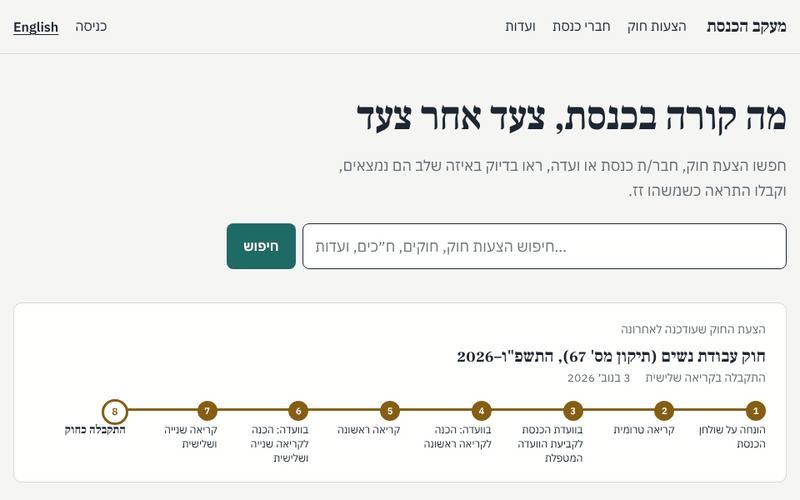
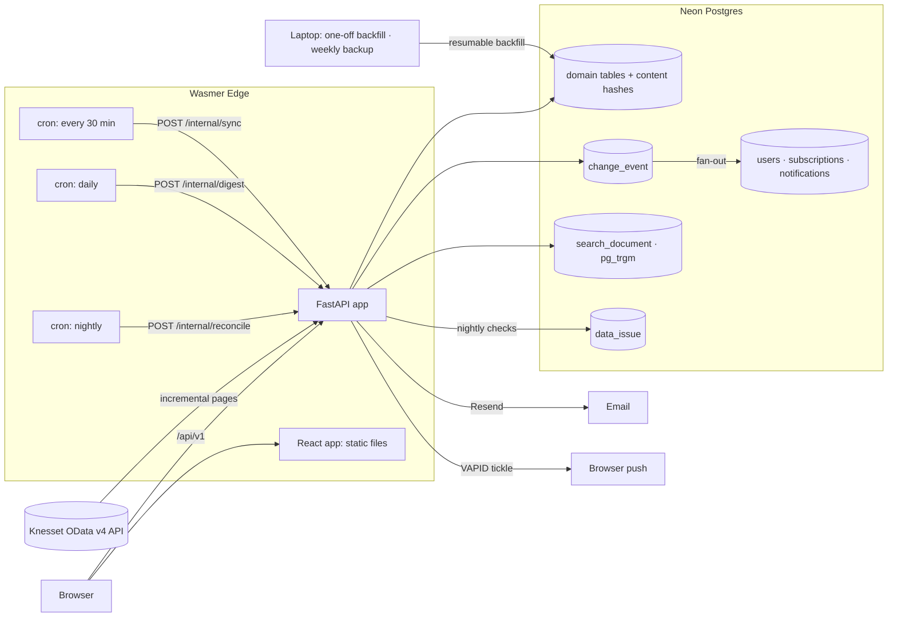

# Knesset Tracker · מעקב הכנסת

A bilingual (Hebrew/English) tracker built on the Knesset's official open data. Follow a bill,
an MK, a committee or a keyword, and get an email or browser notification when something
changes. Every fact links to its official source.

**Live:** _not deployed yet: see [Deploying](#deploying)_ · **API:** `/docs` · **Status:** `/en/status`



<sub>Recorded on a local mirror of the real data (November 2026).</sub>

> Lives in a subfolder of this repository for now. To move it to its own repository with its
> history: `git subtree split --prefix knesset-tracker -b knesset-tracker`, then push that branch.

## What it does

- **Bill pages with a timeline.** Each bill shows its current stage in plain language, "what happens
  next", its initiators, committee and documents, and a dated timeline. The Knesset only publishes
  a bill's *current* status, so the timeline is reconstructed from plenum and committee agendas
  and votes.
- **Alerts.** Follow bills, MKs, committees or keywords. Alerts come by email (instant, daily or
  weekly) or browser push. Each one says exactly what changed: "<bill> passed its third reading
  on 6 Jan 2026".
- **MK and committee pages:** factions, roles, bills, parliamentary questions and recorded votes.
  Committees show sessions, agendas and an iCal feed.
- **Hebrew search** that tolerates prefixes, niqqud, final letters, gershayim and typos.
- **A public JSON API** with English field names (`/docs`).
- **Neutral by design.** No scores, rankings or labels. Every MK gets the same layout and sort
  order, missing data is disclosed rather than guessed, and translations are marked.

## Project status

| Phase | State |
| --- | --- |
| 0. Explore the data | Done: [`phase0/DATA_MEMO.md`](phase0/DATA_MEMO.md) |
| 1. Mirror | Code, tests and CI done. **Waiting on:** the Neon and Wasmer setup, the backfill into Neon, and two weeks of unattended syncs |
| 2. Read-only site | Done (local), measured below |
| 3. Search | Done (local), relevance set in CI |
| 4. Accounts and alerts | Done (local), email e2e test in CI. **Waiting on:** two weeks of real use |
| 5. Polish and launch | Done: API docs, data-quality notices, status page, backups, this README, [launch post](docs/launch-post.md). **Waiting on:** deployment, then real subscribers |

## Architecture

Everything runs at ₪0, on Wasmer Edge (Hobby) and Neon Postgres (Free). There are no workers
and no queue: cron jobs call protected HTTP endpoints, and each run does a bounded amount of work.



Only the sync and the backfill talk to the Knesset. Users are served from the mirror, so the site
stays fast and keeps working when the Knesset API is slow or down.

| Component | Choice |
| --- | --- |
| Backend, sync, alerts | Python 3.12, FastAPI, SQLAlchemy 2 (Core), Alembic |
| Database and search | PostgreSQL on Neon, `pg_trgm` trigram indexes |
| Frontend | React, Vite, TypeScript, no UI library (70 KB of gzipped JS); Frank Ruhl Libre and IBM Plex Sans Hebrew, self-hosted. Design rationale: [`docs/design.md`](docs/design.md) |
| Email and push | Resend (idempotent sends); Web Push with VAPID, signed in pure Python |
| CI | GitHub Actions: lint, types, migrations check, 63 backend tests, unit tests, Playwright e2e with Mailpit, Lighthouse gate |

## Measured numbers

Measured on a local Postgres 16 holding the full v1 mirror (Knesset 23 and later, plus
reference data), with the production code. Numbers from the deployed site will replace these.

| Area | Target | Measured | How |
| --- | --- | --- | --- |
| Records mirrored | | 229,444, across 21 entities, 0 quarantined | first backfill (vote results partial) |
| Database size | fits 1 GB free tier | 127 MB (projected ~220 MB with all vote results) | `pg_database_size` |
| Steady-state sync run | short and bounded | 15-18 s, 20 requests | live API, incremental |
| Bill / MK / committee API | p95 < 300 ms | p95 85 / 104 / 78 ms | 8 concurrent clients, random ids |
| Every bill in the 25th Knesset | all pages work | 7,491 / 7,491 | scripted check |
| Search relevance | 30-query set passes | 30/30, MRR 0.978 | `tests/test_search_relevance.py` (CI) |
| Search latency | p95 < 100 ms | p95 72 ms (test), 85 ms (HTTP, 4 concurrent) | same, plus HTTP run |
| Lighthouse (mobile), both locales | 90+ | performance 92-98, accessibility 100, best practices 100, SEO 100 | 12 pages, `npm run lighthouse` (CI gate) |
| Duplicate or lost alerts | none across retries and crashes | none, in fault-injection tests | `tests/test_alerts.py` |
| Data freshness | < 30 min after the API | _measure after deploy_ | `SELECT percentile_cont(.95) WITHIN GROUP (ORDER BY detected_at - source_updated_at) FROM change_event` |
| Instant alert latency | < 5 min after detection | _measure after deploy_ | `notification.sent_at - change_event.detected_at` |

Load test for the deployed site: `k6 run -e BASE_URL=https://... loadtest/k6.js`.

## What I learned about the data

The full memo is in [`phase0/DATA_MEMO.md`](phase0/DATA_MEMO.md), and the live list is at
`/en/data-quality`. The highlights:

1. **Vote records are public, but partial.** About 2M per-MK results exist, but most absent MKs
   have no row at all, so the site says "no recorded vote", never "absent".
2. **There is no bill history, but it can be rebuilt.** `KNS_Bill` only has the current status.
   But every plenum and committee agenda item records the bill's status at that dated session.
   99.1% of current bills get at least one dated step.
3. **The API's quirks became code:**
   - Pages are capped at 100 rows.
   - A server-side timeout comes back as an empty `200 OK`.
   - Filters are limited to 100 nodes.
   - `LastUpdatedDate` cascades from parent records to their children.
   - The service document names entities that return 404.
   - One endpoint answers in camelCase.
4. **Placeholders and impossible values:**
   - 12,363 bills have committee `-1`, meaning "none". The data-quality checks found this; it is
     now NULL.
   - 37,574 of 42,824 parliamentary questions have a Knesset term of 0-9.
   - 199 people are "current" in a 120-seat Knesset.
5. **My own assumptions needed checking too.** The first version of the "stages out of order"
   rule flagged 93 bills. All 93 were government bills, for which the House Committee assigns a
   committee *after* the first reading, not before as for private bills. The rule now leaves out
   stages with no fixed place, and finds none.
6. **Raw payloads don't fit.** The source as JSONB is ~1.7 GB, against Neon's free 1 GB, so the
   pipeline keeps an 8-byte content hash per row instead of staging tables.

## How it works

### Sync pipeline (`backend/app/sync.py`)

One code path does the backfill, the 30-minute sync and the nightly reconciliation.

- **Passes.** For each entity, a pass walks `$filter=LastUpdatedDate gt (mark − 1h)` ordered by
  `(LastUpdatedDate, Id)`. The first pass has no lower bound: that is the backfill.
- **One transaction per page.** Each page commits the domain upserts, the new hashes, the change
  events and the checkpoint (next page URL) together. A crash loses at most one page, and the next
  run resumes from the checkpoint. The high-water mark moves only when the last page commits.
- **Hashing.** The hash leaves out `LastUpdatedDate`, which the API bumps on child rows when a parent
  changes. Unchanged records stop there, so the overlap window costs almost nothing and re-runs are
  idempotent.
- **Change events.** Changed records are diffed against the current domain row. Classifiers turn
  diffs into `bill.new`, `bill.stage_changed`, `committee_session.scheduled`, `mk.faction_changed`,
  `query.answered`, `vote.recorded` and so on. The backfill emits nothing.
- **Time budget.** A run stops starting new pages at `SYNC_TIME_BUDGET_SECONDS` (about 80% of the cron
  timeout) and leaves the checkpoint for the next run.
- **Failing loudly.** If a record is missing an expected field, `SchemaChanged` stops the run before
  anything is written. A single bad value only quarantines that record, with its payload.
  An empty `200 OK` (how this API reports a server-side timeout) is retried, never read as "no rows".
- **Reconciliation.** Every night, small entities are re-read in full to catch deletions and changes
  whose timestamp didn't move. It refuses to delete more than half a table in one go.
- **No foreign keys between Knesset tables.** The source has referential gaps. We mirror it as
  published and report the gaps in the data-quality layer (Phase 5).

Known limit: offset paging over a changing result set can skip a row that moves during a pass.
The overlap window usually catches it; for small entities the nightly reconciliation always does.

### The read-only site

- **Bill pages** show the current stage in plain language, a "what happens next" line, the
  bill's position on the legislative path, and a dated timeline. They also list initiators, the
  official summary, the bill's names at each stage, and its documents. Stage names and the
  "next" lines come from a hand-written table (`backend/app/stages.py`), because the API's own
  status order is empty.
- **Timelines are reconstructed** (`read.bill_timeline`) from plenum agendas (the bill's status at
  each session), committee sessions that discussed it, plenum votes, and the status changes our
  sync detects. Across all 7,491 bills of the 25th Knesset, **99.1% have at least one dated
  step**; the other 67 show "the official data has no dated steps for this bill".
- **MK pages** have the same sections and sort orders for every MK: factions, government roles,
  committee memberships, bills initiated (counted by current stage, not scored), parliamentary
  questions and recorded votes. Votes say "only recorded votes are shown", because the data
  has no row for most absences.
- **Committee pages** show upcoming and past sessions with agenda items linked to bills, plus
  members. Each committee has an iCal feed at `/api/v1/committees/{id}/calendar.ics`.
- **Bilingual:** the URL carries the locale (`/he/...`, `/en/...`), and Hebrew is the default.
  The CSS uses only logical properties, so one stylesheet serves both directions. Hebrew text
  inside English is wrapped in `<bdi>`. Dates are shown in Israel time in both the Gregorian
  and Hebrew calendars. Every English label this project wrote has a dotted underline and a
  "translated by this site" note. The official data has no English names for people, bills or
  committees, so those stay in Hebrew.
- **Sources:** every bill, MK, session, vote and question links to its official record in the
  Knesset's API. Committee sessions also link to their page on the Knesset website, using the URL
  the API itself provides. Other website links are not used yet: the site refuses automated
  checks from here, so the URL patterns are unverified.
- **Public API:** `/api/v1/...` returns paginated JSON with English field names, documented at `/docs`.


### Search

One search box covers bills, laws, MKs, committees and parliamentary questions (63,475 documents),
with filters for type, Knesset term, stage, committee, initiator and date range.

- **No Hebrew stemmer, so normalisation plus trigrams.** `app/hebrew.py` normalises documents and
  queries the same way:
  - it strips niqqud and cantillation;
  - it unifies final letters, so "שלומ" finds "שלום";
  - it drops gershayim and quotes, so תשפ"ו, תשפ״ו and תשפו all match;
  - it adds prefix-stripped variants of each word (ה ו ב ל מ ש כ), so "לחוק" and "והחוק" find "חוק".

  `pg_trgm` GIN indexes handle substring and typo-tolerant matching. No extra service is needed.
- **Always fresh.** `search_document` is rebuilt for the affected rows inside the same transaction
  as each sync page.
- **Ranking:** trigram word-similarity to the title, plus boosts for exact, prefix and substring
  matches. Summary text counts only if the title didn't already match. A law ranks above the
  bills that amend it, and for committees and MKs, whose names repeat across terms, the current
  term comes first.
- **Speed came from measuring.** The first version took ~1 s per query, because an `OR` across
  index conditions made Postgres scan the whole table. Candidates now come from a `UNION` of
  index lookups. Fuzzy matching runs on every query for short names (people, committees, laws,
  with their own partial index). For long titles it runs only as a fallback, when exact matching
  can't fill the page, using strict word similarity at 0.7: 10× fewer rechecks than 0.6, with
  nearly the same matches.
- **Relevance test set** (`tests/test_search_relevance.py`): 30 queries, each with the result a
  user obviously wants. Expected ids were looked up by name in the data, not copied from the
  engine's output. The cases cover exact names, typos, spelling variants (מרב/מירב, אשה/אישה),
  missing geresh, prefixes, niqqud, gershayim, word order and summary-only matches. They run in CI
  against the raw text of all 63k real documents (`tests/fixtures/search_corpus.jsonl.gz`, 1.8 MB),
  re-indexed with the current normaliser. The first run passed 25/30. Three failures were
  ranking problems, which are fixed. Two were wrong expectations: one bill name is shared by three
  identically named bills from different MKs, and a phrase I chose appears in other bills' titles.


### Accounts and alerts

- **Accounts without passwords.** `POST /api/v1/auth/request-link` emails a single-use link valid
  for 20 minutes, and only a SHA-256 of the token is stored. The token travels in the URL fragment
  (`/he/auth/verify#token=...`), so it never reaches server logs. The response is the same
  whether or not the address has an account, and requests are limited to 5 per address per hour.
  The session is a signed, HttpOnly, SameSite=Lax cookie. State-changing calls must send
  `X-Requested-With`, which cross-site forms can't set. Deleting an account removes its follows,
  notifications and devices.
- **Follows:** a bill, an MK, a committee, or a keyword such as "חיילים בודדים". Keywords are
  normalised like search, so prefixes and spelling marks don't matter. Following twice is a no-op.
- **Fan-out** (`app/alerts.py`) runs at the end of every `/internal/sync`, under a Postgres
  advisory lock so cron runs can't overlap, and wakes Neon no extra times. It reads change events
  past a cursor and works out what each event concerns. For example, a new committee session
  concerns its committee; a parliamentary question concerns its MK; a vote concerns its bill.
  Keyword follows are matched against the normalised text. The step writes one notification per
  user, event and channel, and a follow matches only events detected after it was created.
- **Every alert says exactly what changed**, in the user's language (`app/describe.py`):
  "<bill> moved to: Approved in committee for first reading (In committee: preparing for first
  reading, 9 Nov 2026)", "<bill> passed its third reading on 6 Jan 2026", "<committee>: session
  scheduled for 12 Nov 2026 10:00". Hebrew emails are RTL.
- **Delivery:** instant emails go out right after the fan-out. Daily digests are sent every
  morning and weekly ones on Sundays (`/internal/digest`, one cron job). Each email carries an
  RFC 8058 one-click unsubscribe header and link.
- **Web Push without payloads.** Encrypted payloads (RFC 8291) need native crypto libraries that
  may not run on Wasmer's WASIX Python. Each push is an empty, VAPID-signed "tickle" instead,
  signed with the pure-Python `ecdsa` package. The service worker then fetches the latest alert
  from our API with the user's cookie, so alert text never passes through the browser vendor's
  push service. Endpoints the browser has dropped (404 or 410) are deleted.

**Reliability: no duplicate or lost alerts.** Each guarantee has a test (`tests/test_alerts.py`):

| Failure | What happens | Test |
| --- | --- | --- |
| Fan-out runs twice, or its cursor write is lost | Unique `dedupe_key` (channel:user:event): `ON CONFLICT DO NOTHING` | `test_fan_out_is_idempotent_even_if_the_cursor_is_lost` |
| Email provider down | Rows go back to `pending` and are retried on later runs, up to 5 attempts | `test_failed_send_is_retried_and_delivered_once`, `test_gives_up_after_five_attempts` |
| Process dies after the provider accepted the email | Rows stay `sending`. After 10 minutes the batch is retried with the same `batch_id`, the provider's idempotency key, so it is delivered once | `test_crash_after_send_does_not_email_twice` |
| A new follower | Only events after the follow was created | `test_subscriptions_dont_match_older_events` |
| Unsubscribed user | Pending emails are skipped | `test_unsubscribed_users_get_no_email` |

Exactly-once delivery relies on the provider honouring the idempotency key. Resend does; SMTP has
no such mechanism, so with SMTP a crash between send and commit can repeat one email
(at-least-once). Production should use `EMAIL_BACKEND=resend`.

**End-to-end** (`frontend/e2e/alerts.spec.ts`, in CI against a Mailpit service):
1. Request a sign-in link and read it from Mailpit.
2. Sign in, choose instant alerts, and follow a bill that is in committee.
3. Change the bill's status in the fixture data and run the real sync and alert path
   (`scripts/inject_change.py`).
4. Check that the alert email arrives, names the change, links to the bill, and carries the
   one-click unsubscribe header.

### Data quality (`backend/app/quality.py`)

Ten rule-based checks run nightly with the reconciliation. They cover:
- referential gaps;
- impossible dates;
- stages out of order;
- bills stalled far longer than is typical for their stage (beyond that stage's 95th percentile);
- duplicate people;
- damaged names;
- impossible Knesset terms;
- bills with no dated steps.

The checks scan whole tables. Running them 48 times a day would keep Neon awake for little gain,
so they run once a night. Findings go to `data_issue` with first-seen and last-seen dates, and
are marked resolved when they stop matching. Affected bill and MK pages show a notice ("About
this data"), and `/en/data-quality` lists every rule with counts and examples.

### Operations

- **Status page** (`/en/status`): the last successful sync and the source freshness for each
  table, from the sync's own logs.
- **Two layers of alerting.** After each sync, if *any* table hasn't synced successfully for an
  hour, the app emails `OPS_EMAIL` with the stale tables, at most every 6 hours. `GET
  /health/sync` returns 503 under the same rule. A failing table never stops the others from
  syncing, but it is reported. Point a free uptime monitor at it, for the case the app can't report itself: the cron
  not firing at all.
- **Retention:** the nightly job deletes sync-run logs older than 90 days and expired sign-in
  tokens, so logs don't eat the free tier.
- **Email safety:** an https deployment with no `EMAIL_BACKEND` refuses to start sending, instead
  of silently writing alerts and sign-in links to a log. Sign-in emails are capped per address
  (5 an hour) and site-wide (30 an hour), so a script can't drain the daily email quota.
- **Logs and errors:** structured JSON logs. Sentry is optional: set `SENTRY_DSN` and install
  `[sentry]`, which is pure Python.
- **Backups:** only the account tables need them, since everything else can be rebuilt from the
  API. `ops/backup_users.sh` dumps them weekly to your own machine and keeps 8. Never commit the
  dumps or put them in CI artifacts: they contain email addresses.

### Neutrality

The site reports what happened, when, and who was involved:
- no scores, grades or rankings;
- no editorial labels;
- the same layout, fields and sort order for every MK;
- every fact linked to its official record;
- missing data disclosed (empty timelines, data-quality notices);
- translations marked: English labels written by the project have a dotted underline and are
  flagged `en_translated` in the API.

## Running it

```bash
cd backend
python -m venv .venv && . .venv/bin/activate && pip install -e ".[dev]"
export DATABASE_URL=postgresql+psycopg://postgres@localhost/knesset
alembic upgrade head
python -m scripts.backfill                 # resumable; Ctrl-C and re-run any time
python -m scripts.backfill KNS_Bill        # or just some entities
python -m scripts.rebuild_search           # once, after migration 0002 on an existing mirror
INTERNAL_TOKEN=dev uvicorn app.main:app    # then: curl -XPOST -H 'X-Internal-Token: dev' :8000/internal/sync
open http://localhost:8000/en/status       # sync status per table (after npm run build)
TEST_DATABASE_URL=postgresql+psycopg://postgres@localhost/knesset_test pytest

cd ../frontend && npm ci
npm run dev                                # http://localhost:5173/he, proxies /api to :8000
npm test && npm run build                  # the backend serves frontend/dist at /
# end-to-end + Lighthouse against fixture data (what CI runs), with Mailpit for email:
mailpit &                                  # https://mailpit.axllent.org, SMTP :1025, UI :8025
export SECRET_KEY=dev EMAIL_BACKEND=smtp PUBLIC_BASE_URL=http://localhost:8000 COOKIE_SECURE=0
(cd ../backend && DATABASE_URL=... python -m scripts.seed_fixtures)
MAILPIT_URL=http://localhost:8025 npx playwright test && npm run lighthouse
```

The integration tests replay real API responses recorded by `scripts/record_fixtures.py`, through a
fake OData server that pages 3 rows at a time. A synthetic "day 2" on top of them must produce
exactly the expected set of events.

## Deploying

1. Create the Neon project (Free plan, compute pinned to 0.25 CU) and run `alembic upgrade head`.
2. Run the backfill from your machine against the Neon URL, then record `pg_database_size` in the memo.
   (If the backfill ran before migration 0002, run `python -m scripts.rebuild_search` once.)
3. Create the Wasmer app. Check `backend/wasmer.toml` against your existing FastAPI deploy, and use
   `postgresql+pg8000://` on Wasmer, because psycopg's binary build is a native extension.
   Set `DATABASE_URL`, `INTERNAL_TOKEN` and `SYNC_TIME_BUDGET_SECONDS=240` as app secrets.
   For accounts and alerts (Phase 4), also set:
   - `SECRET_KEY`, a long random string;
   - `PUBLIC_BASE_URL`, the site's https URL;
   - `EMAIL_BACKEND=resend`, `RESEND_API_KEY` and `EMAIL_FROM`, on a domain you verify in Resend;
   - `VAPID_PRIVATE_KEY`, `VAPID_PUBLIC_KEY` and `VAPID_SUBJECT`, generated with
     `python -m scripts.vapid_keys`.

   Resend's free tier is limited to 100 emails a day, so digests keep the volume down. Check
   whether Wasmer allows outbound SMTP before choosing Brevo over SMTP instead.
4. In GitHub, add the secrets `NEON_DATABASE_URL`, `INTERNAL_TOKEN` and `WASMER_TOKEN`, then set the
   variable `WASMER_DEPLOY=true`. Pushes to `main` will then run all checks, migrate Neon, copy the
   built frontend into `backend/static`, and deploy with the cron jobs from `backend/app.yaml`.
5. Open a few bill pages in a browser and confirm the Knesset website URL patterns. If they work,
   add website links next to the official-record links.
6. Point an uptime monitor at `https://.../health/sync`, set `OPS_EMAIL`, and schedule
   `ops/backup_users.sh` weekly on your machine.
7. Run `k6 run -e BASE_URL=https://... loadtest/k6.js`, run the freshness and alert-latency
   queries above after a week, and replace the local numbers in [Measured numbers](#measured-numbers).

## Project layout

```
phase0/            data exploration scripts, measured sizes, DATA_MEMO.md
backend/app/       sync.py, entities.py (registry), search.py, hebrew.py, alerts.py, describe.py,
                   account.py, auth.py, quality.py, read.py, api.py, main.py
backend/scripts/   backfill, record_fixtures, seed_fixtures, inject_change, rebuild_search,
                   export_search_corpus, vapid_keys
backend/tests/     63 tests: units, sync on recorded fixtures, alerts with fault injection,
                   accounts, search relevance on the real corpus, data quality
frontend/          React app, Playwright e2e (incl. email via Mailpit), Lighthouse gate
loadtest/k6.js     page-speed targets against the deployed site
ops/               backup of account data
docs/              design plan, demo GIF, launch post, CV entry
```
