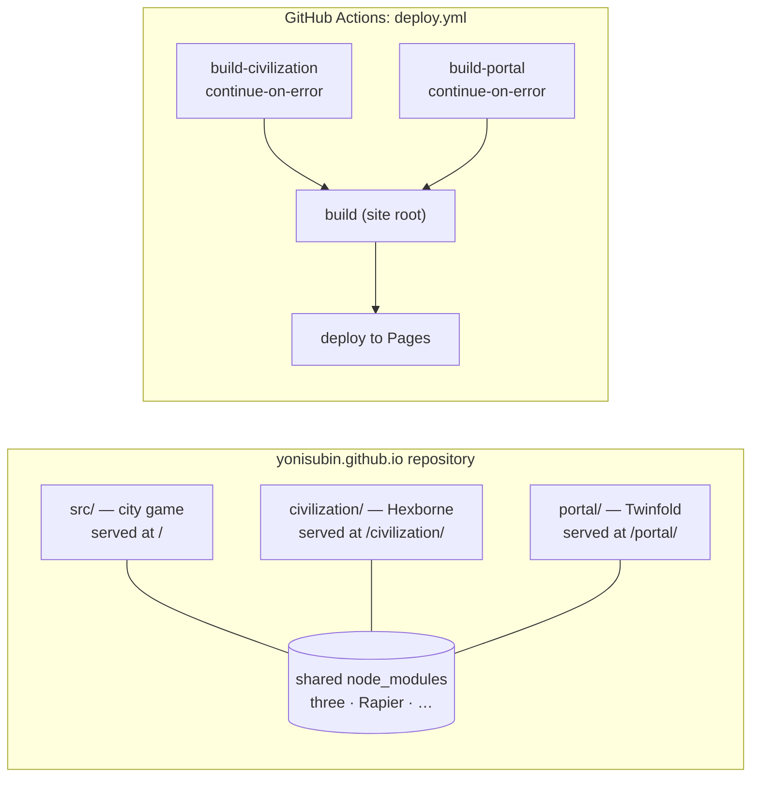
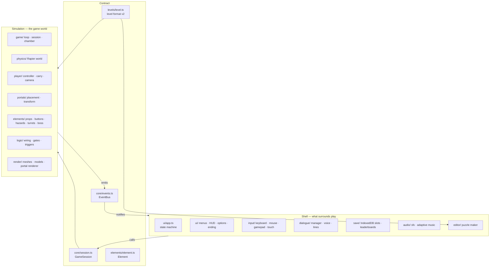
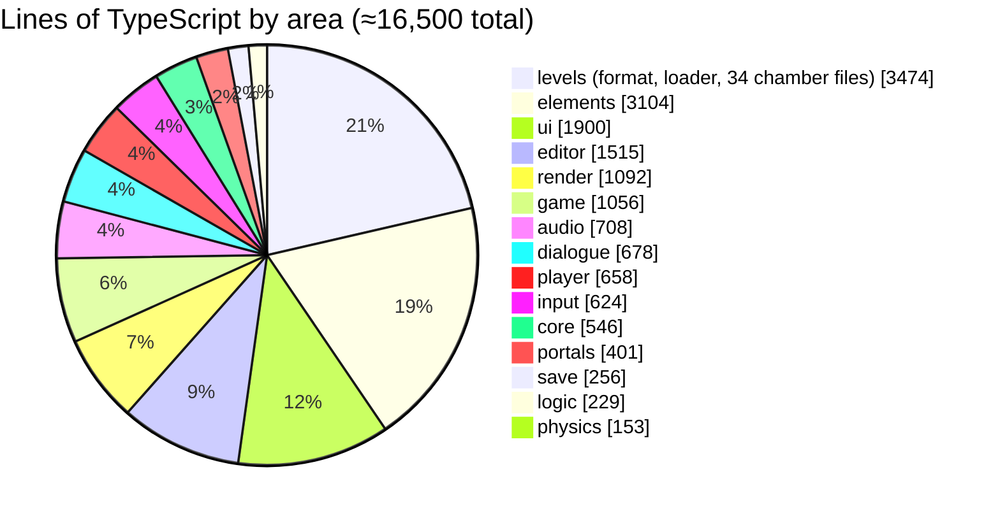
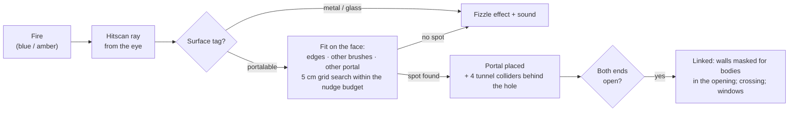
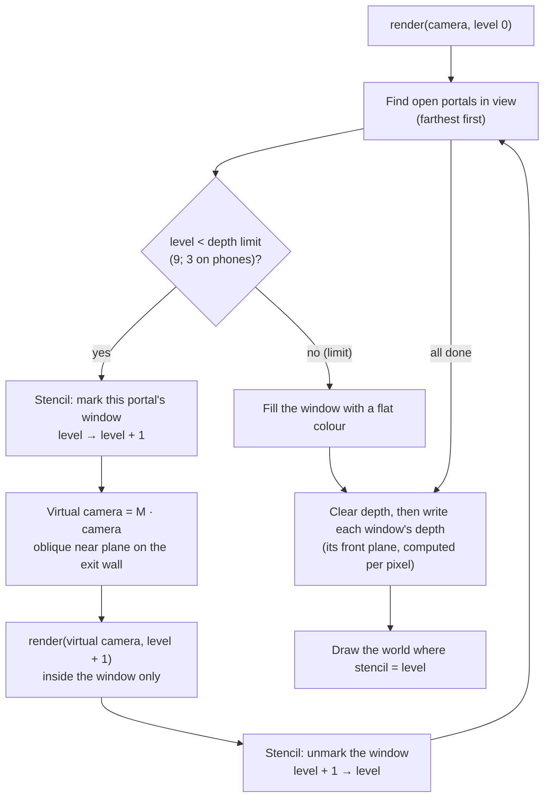
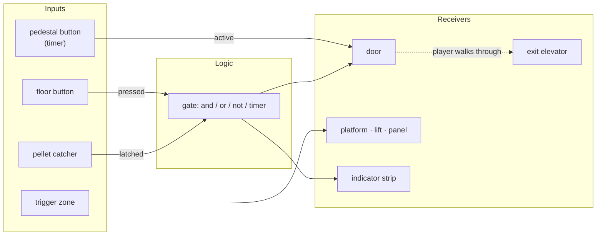
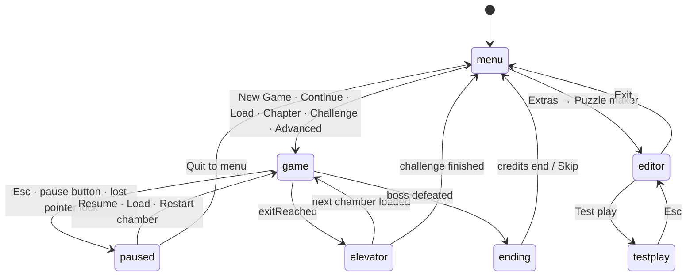
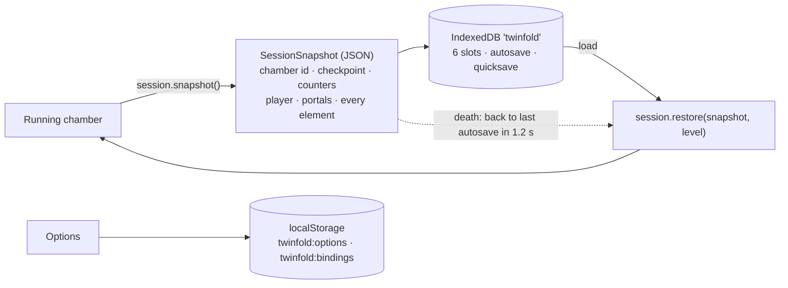
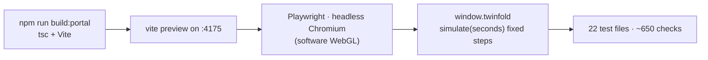

# Twinfold — architecture and system design

A short tour of how Twinfold is laid out and how its parts fit together. For a file-by-file and function-by-function account, see [`ENGINEERING.md`](ENGINEERING.md). The design spec and working rules are in [`../CLAUDE.md`](../CLAUDE.md).

## 1. The game in one paragraph

Twinfold is a first-person physics puzzle game that runs entirely in the browser at <https://yonisubin.github.io/portal/>. The player carries a device that opens two linked openings — blue and amber — on white wall panels. Anything that enters one leaves the other with its speed kept. A campaign of 19 test chambers, two escape levels and a boss arena is narrated by an overseer AI, the Provost. There are also six advanced chambers, challenge modes with medals, a puzzle maker with shareable links, and a touch version for phones. Every texture, model, sound and line of music is generated in code; there are no asset files and no server.

## 2. Where it sits in the repository

The repository hosts three independent games that share one origin and one `node_modules`.



Isolation rules:

- No imports cross between the three `src` trees.
- Storage is namespaced: `localStorage` keys start with `twinfold:` and the IndexedDB database is `twinfold`.
- Twinfold builds in its own job that is allowed to fail, so it can never block the city game or Hexborne from deploying.

## 3. Layered design

The code is split into a **simulation** and a **shell** that meet at a four-file **contract**. The level format underneath is plain JSON.



| Contract file | Purpose |
|---|---|
| `GameSession` | Everything the shell may ask: load a chamber, restart, respawn, snapshot and restore, counters, pause, settings. |
| `EventBus` | Everything the simulation reports: chamber start, exit reached, death, damage, use prompts, footsteps, sound effects, boss beats, idle and out-of-bounds. |
| `Element` | One interface for every test element (inputs, outputs, update, snapshot, dispose), so wiring and saves treat them all alike. |
| Level format v2 | Brushes with a surface tag per face, entities, wires, triggers, checkpoints, dialogue hooks. The editor, loader, share links and chambers all use it. |

The split has three payoffs:

- **Parallel work.** Two workstreams built the halves at the same time without editing each other's files.
- **Testing.** Tests drive the simulation directly through `window.twinfold`, without menus.
- **Reuse.** The editor's test-play, share links and saves all go through the same `GameSession` calls as the campaign.

### Code size by area



## 4. The frame and the fixed step

Physics always runs at a fixed 60 Hz. Rendering runs at the display's rate and interpolates between steps.

```mermaid
sequenceDiagram
  autonumber
  participant RAF as Browser frame
  participant Shell as ui/app.ts
  participant Loop as game/game.ts
  participant Step as game/session.ts → chamber.ts
  participant GPU as render/portalRenderer.ts
  RAF->>Shell: menus · pause key · HUD · dialogue · music
  RAF->>Loop: mouse / stick / touch look → camera yaw & pitch
  loop accumulator ≥ 1/60 s (at most 8 per frame)
    Loop->>Step: fixed step
    Step->>Step: fire / use / restart actions
    Step->>Step: carried prop, elements, Rapier world step
    Step->>Step: player controller + portal crossing
    Step->>Step: health, footsteps, pits, triggers, out-of-bounds, idle, use prompt → events
  end
  Loop->>GPU: eye interpolated between last two steps → recursive portal render
```

- **Determinism.** A fixed step makes the physics repeatable, so `simulate(seconds)` in tests gives the same result as real play.
- **No smear on teleport.** When the player goes through a portal, the previous eye position is moved through the same transform, so one frame never blends the two ends.
- **Frame cap.** The cap (an option) skips display frames only; the step rate never changes.

## 5. The portal system

Portals are the heart of the game, and they touch placement, physics, the player and rendering.



### Going through

- **One transform.** Something entering portal A leaves portal B through `M = T_B · R180(up) · T_A⁻¹`, where T is each portal's frame. It is applied to position, velocity, orientation and spin, so speed is always kept. The 180° turn is what makes "into the front of A" come "out of the front of B".
- **Wall masking.** While a body overlaps an open portal, the wall it sits on stops colliding for that body. Four tunnel colliders around the hole take over, so the body can pass only through the opening.
- **Player trigger.** The player crosses when the **eye** passes the portal plane inside the opening. If the body centre triggered it, the camera would sometimes end up behind the exit wall.
- **Props.** A prop crosses when its centre passes the plane. While straddling it gets a clone collider at the other end, so a half-through cube still collides correctly.
- **Floor exits.** Leaving a floor portal guarantees a minimum upward speed, so you don't fall straight back in.
- **Physics-driven tricks.** The "infinite fall" (floor and ceiling portals, capped at 38 m/s) and the "fling" (fall into a floor portal, fly out of a wall portal) need no special code.

### Drawing the windows



- **Stencil levels.** Each window is a stencil region, and the world seen through it is drawn only inside that region. Each level skips the portal it is looking out of, so recursion costs one extra view per level instead of doubling.
- **Oblique near plane.** The near plane sits on the exit wall, so nothing behind that wall leaks into the view.
- **No flash when walking through.** The window is drawn as the inside of a box that reaches behind the wall, so when the camera's near plane cuts the opening the box still fills the screen. A shader writes the depth of the window's front plane, so the box never hides objects standing in front of the opening.
- **Two three.js pitfalls avoided.** A `Color` scene background makes three clear the stencil on every draw. `gl.clear` silently does nothing while a write mask is off.

## 6. Chambers, elements and wiring

A chamber is one level file. Loading it builds brushes (colliders and meshes), elements and wires, then emits `chamberStart`.



- **Wires.** Each wire runs from `"entity.output"` to `"entity.input"`. Several wires into one input are AND-ed; a `gate` entity provides OR, NOT and timers.
- **Element families:**
  - **Props:** cube, companion cube, sphere, debris.
  - **Inputs:** floor and pedestal buttons, pellet catchers, zones.
  - **Movers:** door, platform, lift, panel, crusher.
  - **Hazards and enemies:** pellets, grills, toxic liquid, pits, turrets, rocket turret.
  - **Information:** indicator strips, info sign, lights, wall writing, commentary nodes.
  - **Story:** records chute, exit zone, the Erasure countdown, boss core and disposal unit.
- **Chamber anatomy.** Entry booth → antechamber with the info sign → test area → exit door gated by wires → exit booth. The exit reports `exitReached` with the counters (portals, steps, time), rides for 3 s, then reports `elevatorDone`, and the shell loads the next chamber.

### Campaign structure

```mermaid
flowchart LR
  subgraph ch1["Orientation Week"]
    c01 --> c02 --> c03 --> c04
  end
  subgraph ch2["Lectures in Falling"]
    c05 --> c06 --> c07 --> c08
  end
  subgraph ch3["Office Hours"]
    c09 --> c10 --> c11 --> c12
  end
  subgraph ch4["Midterms"]
    c13 --> c14 --> c15 --> c16
  end
  subgraph ch5["Commencement"]
    c17 --> c18 --> c19
  end
  subgraph ch6["Expulsion"]
    escape1 --> escape2 --> finale
  end
  c04 --> c05
  c08 --> c09
  c12 --> c13
  c16 --> c17
  c19 --> escape1
  finale --> credits(["ending + credits<br/>unlocks challenges and adv1–adv6"])
```



Each chamber introduces one idea, then combines it with earlier ones:

| Chambers | What they teach |
|---|---|
| 1–3 | No device; then a fixed portal pair; then a blue-only device. |
| 4–10 | Pellets, both ends of the device, moving platforms, momentum, the fling, grills, toxic liquid. |
| 11–17 | Turrets, then combinations of everything so far. |
| 18–19 | The betrayal and the escape. |
| Escape levels, finale | The boss: rockets steered through portals into the Provost's core. |

## 7. The shell

The shell is one state machine (`ui/app.ts`) over the session.



| Subsystem | What it does |
|---|---|
| **Input** (`input/`) | Keyboard, mouse, gamepad and touch all become the same abstract actions (move, jump, crouch, fire blue/amber, use, pause, quicksave). Bindings live only here and can be rebound. Look comes from mouse movement, the right stick or touch drags. |
| **Touch mode** (`ui/device.ts`, `input/touch.ts`) | On when the main pointer is a finger, or forced with `?touch` / `?desktop`. Adds a floating left-thumb joystick, drag-to-look on the right, and buttons for both portals, jump, crouch, use and pause. Skips pointer lock. On first run it lowers recursion to 3, render scale to 0.75 and caps the pixel ratio. |
| **Dialogue** (`dialogue/`) | A priority queue of lines that never overlap, with ducking and always-on subtitles. A synthesised "voice" plays pitch-quantised syllables timed to the text. Lines are triggered by events and by each chamber's dialogue hooks. |
| **Saves** (`save/`) | IndexedDB: 6 slots, an autosave on every `autosave` event, and F5/F9 quicksave and quickload. Campaign progress unlocks challenges and advanced chambers. Local leaderboards are kept per chamber and mode. |
| **Audio** (`audio/`) | Master, music, effects and voice buses. A catalogue of synthesised sound effects keyed by event name, with a fallback blip. Adaptive music: menu, chamber with a tension layer, elevator, credits. |
| **Editor** (`editor/`) | A 0.5 m grid brush editor with face tags, every entity type, wiring, triggers, checkpoints, dialogue hooks and undo/redo. Drafts are saved in IndexedDB. Share links carry the level, deflated and base64url-encoded, in the URL hash; opening one plays it, phones included. |
| **Options** (`ui/options*.ts`) | Video, audio, controls, gameplay and accessibility (5 portal colour palettes, high-contrast hazards, reduce roll, reduce flashing, assist), stored in `twinfold:options` and pushed through `applySettings`. |

## 8. State and persistence

All state that matters is plain JSON, so one path serves saves, quickload, respawning after death and tests.



Snapshot → restore → snapshot is tested to be identical, including a carried cube, a pellet in flight and a running timer.

## 9. Configuration

| File | Holds |
|---|---|
| `core/config.ts` | Every simulation number: movement (4.5 m/s walk, 1.1 m jump, 11.5 m/s² gravity, 38 m/s terminal speed), portal size (1.2 × 2.1 m) and nudge, recursion depth, carry distances, turret cone and damage, hazard timings, visual settings. |
| `core/shellConfig.ts` | Every shell number: dialogue timing, music, HUD, editor grid, option limits, touch-control sizes and phone defaults. |

Nothing tunable is hard-coded in systems, so feel can be adjusted by playtesting without hunting through code.

## 10. Quality and verification



| Test group | Examples |
|---|---|
| Core mechanics | The transform round-trips over 200 random portal pairs; movement numbers; placement and fizzles; infinite fall and fling; no flash while walking through. |
| Simulation | Props through portals at many speeds and angles; carrying; button and gate truth tables; pellets; grills; turret states; save identity. |
| Content | A scripted solution replay for **every** chamber, so the suite fails if a change makes one unsolvable. |
| Shell | Menus, options, saves, dialogue order, editor round trip, share links, challenges, audio, gamepad. |
| Mobile | A phone-sized touch context: joystick speeds, look drags, portal buttons, pause, phone defaults, no sideways overflow. |

Before any change ships, three things must pass:

- `npm run typecheck:portal` and `npm run build:portal`;
- `npm run test:portal`;
- the city game's and Hexborne's own builds, because the three games share the repository.

## 11. Known limits

- A portal can't be shot through another portal.
- A portal on a moving surface always closes.
- The spec's optional lasers, light bridges, gels and co-op are not built.
- Phone performance and the feel of the touch controls have only been tested in simulated phones.
