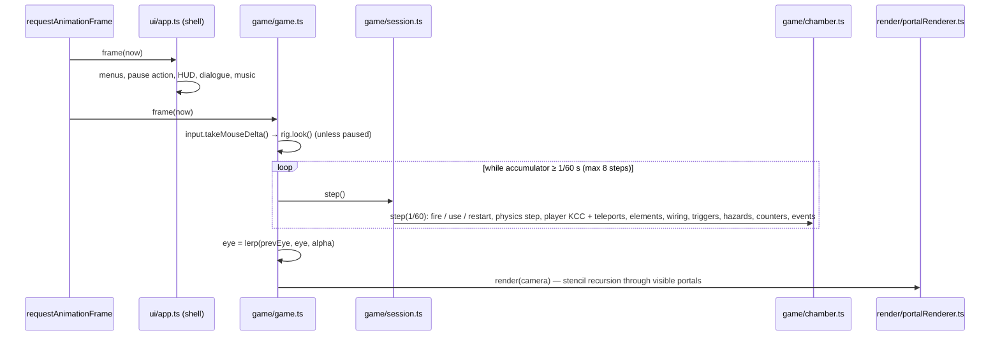
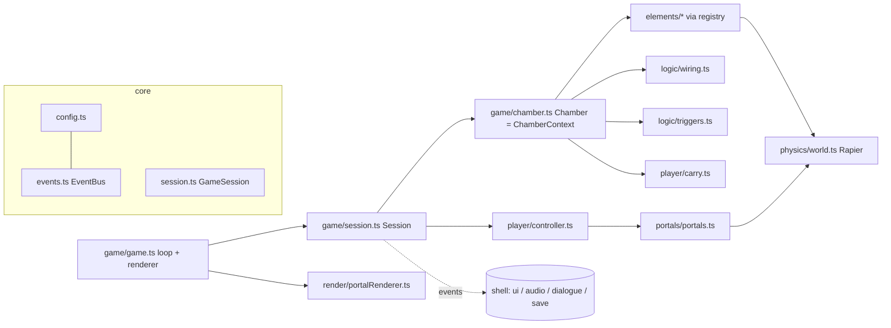
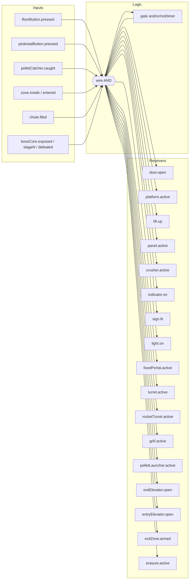
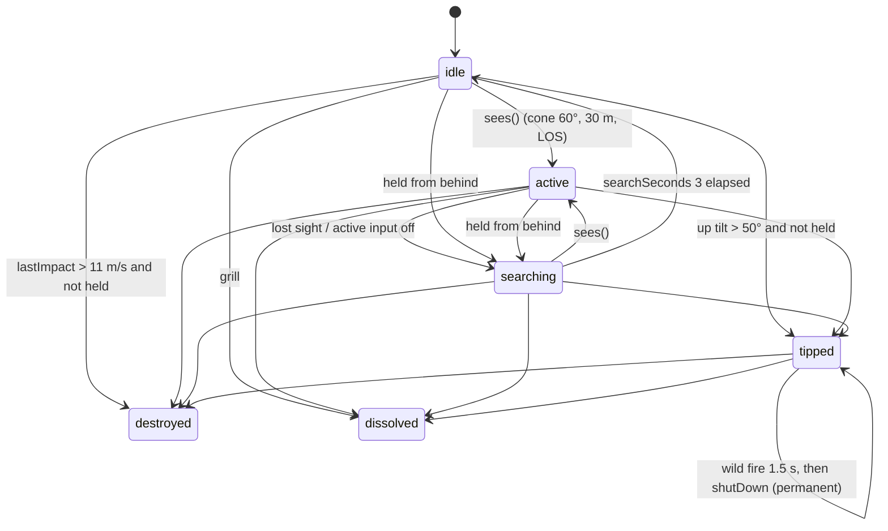
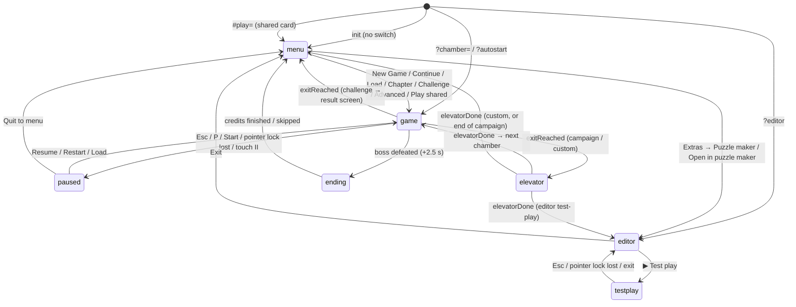

# Twinfold — engineering reference

How Twinfold works and why it is built the way it is: every folder, file, class and function, and the decisions behind them. Twinfold is the third game in this repository: a first-person puzzle game about two linked openings, served at <https://yonisubin.github.io/portal/>. The source lives in `portal/`; the design spec (kept verbatim) and the working rules are in `portal/CLAUDE.md`.

Paths in the overview are relative to `portal/`; Part 1 gives paths relative to `portal/src/`, and Part 2 says at its start which base it uses. `file.ts:123` points at a line. Numbers quoted come from `src/core/config.ts` (simulation) and `src/core/shellConfig.ts` (shell).

## Contents

- **Overview** (this part): what the game is, how the code is split, how a frame runs, the decisions that shape everything else.
- **Part 1 — Simulation**: `core/`, `physics/`, `player/`, `portals/`, `elements/`, `logic/`, `render/`, `game/` and the level data.
- **Part 2 — Shell, content pipeline, tooling**: `main.ts`, `ui/`, `input/`, `dialogue/`, `save/`, `audio/`, `editor/`, the loader and chamber registry, tests, build and deploy.
- **Appendix**: issues noticed while writing this reference.

## What the game is

The player is a silent test subject (Applicant 41, Ida Fenn) carrying a device, the Fold, that opens two linked openings — blue and amber — on white wall panels. Walking, falling or throwing something into one brings it out of the other with its speed kept. Each chamber is a puzzle that ends at an exit elevator. An overseer AI, the Provost of the Hollowmere Kinematics Institute, narrates. The campaign is 19 chambers, two escape levels and a boss arena, plus six advanced chambers, challenge modes and a puzzle maker. Everything — geometry, textures, models, music, voice — is generated in code; there are no asset files.

## Stack

| Layer | Choice | Why |
|---|---|---|
| Language / build | TypeScript (strict) + Vite | Same toolchain as the other two games; one `node_modules` for all three. |
| Rendering | three.js on WebGL 2 with a stencil buffer | Portals are drawn by recursive stencil masking, which needs low-level control over stencil, depth and colour masks per draw. |
| Physics | Rapier (`@dimforge/rapier3d-compat`) | Stable rigid bodies with CCD for flung props, a kinematic character controller, contact hooks for masking walls behind portals. The compat build embeds the WASM, which avoids Vite/WASM loading issues. Already a dependency of the city game. |
| Audio | Web Audio, synthesised | No asset files, nothing to license, original by construction; the overseer's "voice" is synthesised too. |
| Saves | IndexedDB (`twinfold` database) + `localStorage` keys prefixed `twinfold:` | The three games share one origin (`yonisubin.github.io`), so every key is namespaced. |
| Tests | Playwright driving the production build in headless Chromium | The game exposes `window.twinfold` and a fixed-step `simulate(seconds)`, so tests are deterministic regardless of the (slow) headless frame rate. |

No new npm dependencies were added for Twinfold.

## Isolation from the other games

The repository hosts three independent games: the open-world city game at the site root (`src/`), Hexborne at `/civilization/` and Twinfold at `/portal/`. Twinfold:

- has its own `index.html`, `src/`, `tsconfig.json` (extends the root one), `vite.config.ts` (`base: '/portal/'`, dev port 5175, preview 4175), `tests/` and `CLAUDE.md`;
- never imports from `src/` or `civilization/src/` (and nothing imports from it);
- is built in its own `continue-on-error` job in `.github/workflows/deploy.yml`, so a broken Twinfold build can never stop the site root from deploying;
- adds only `*:portal` scripts to the root `package.json`.

## The big split: simulation and shell

The code is divided into two halves that meet at a small **contract**:

```
                 ┌──────────────────────── shell ────────────────────────┐
                 │ main.ts · ui/ (menus, HUD, options, ending, device)    │
                 │ input/ (keyboard, mouse, gamepad, touch) · dialogue/   │
                 │ save/ · audio/ (music, sfx) · editor/ · levels/loader  │
                 └──────────────┬──────────────────────────▲─────────────┘
                   GameSession  │ calls                    │ events (EventBus)
                 (core/session) ▼                          │ (core/events)
                 ┌────────────────────── simulation ──────────────────────┐
                 │ game/ (loop, chamber, session) · physics/ · player/    │
                 │ portals/ · elements/ · logic/ · render/                 │
                 └──────────────────────── level data ────────────────────┘
                                 levels/level.ts (format v2)
```

| Contract file | What it fixes |
|---|---|
| `src/levels/level.ts` | The level format: box brushes with a surface tag per face, entities (`EntityType`), wires, triggers, checkpoints, dialogue hooks, device, info sign, next chamber. Plain JSON, so the editor, loader, share links and saves all use it. |
| `src/core/events.ts` | `EventBus` and the typed `GameEvents` map — the only way the simulation tells the shell anything (chamber start, exit reached, deaths, damage, prompts, footsteps, sfx, boss beats…). |
| `src/core/session.ts` | `GameSession` — the only way the shell asks the simulation anything (load, restart, respawn, snapshot / restore, counters, pause, settings). |
| `src/elements/element.ts` | The `Element` interface every test element implements, so wiring and saves treat all of them alike. |

This split is why two people (or agents) could build the two halves at the same time, and it keeps the simulation testable without menus: tests drive `window.twinfold` directly, and the shell is just another client of `GameSession`.

## How a frame runs



- **Fixed timestep.** Physics always steps at 60 Hz from an accumulator; the camera interpolates the eye between the last two steps. A frame cap skips display frames but never changes the step.
- **Teleports and interpolation.** When the player goes through a portal, the previous eye is moved through the same transform, so interpolation never draws a frame halfway between the two portals.
- **`simulate(seconds)`.** Tests call the same `fixedStep` directly, so results don't depend on how fast the headless browser renders.

## Decisions at a glance

Each is explained in detail in the part that owns it.

| Decision | Why | Where |
|---|---|---|
| Teleport transform `M = T_B · R180(up) · T_A⁻¹` applied to position, velocity, orientation and angular velocity | One rigid transform keeps speed and makes "into the front of A" mean "out of the front of B". | `portals/transform.ts` |
| The player teleports when the **eye** crosses the portal plane | If the body centre triggered it, the camera could end up behind the exit wall for a frame. | `player/controller.ts` |
| Walls behind an open portal are **masked**, and four **tunnel** colliders line the hole | Lets bodies pass through the wall only inside the opening, without cutting holes in level geometry. | `portals/portals.ts`, `physics/world.ts` |
| Props straddling a portal get a **clone** collider on the far side | The spec's "exists in both places", so half-through props still collide correctly. | `elements/prop.ts` |
| Manual step-up instead of Rapier's autostep; no snap-to-ground | Rapier's versions misbehaved next to portal tunnels and box edges. | `player/controller.ts` |
| Portal placement searches a 5 cm grid within the nudge budget | Finds the closest spot that fits on the face, clear of edges, other brushes and the other portal. | `portals/portals.ts` |
| Recursive **stencil** rendering, an **oblique near plane** at the exit, depth 9 then a flat colour | Exact windows through portals, nothing behind the exit wall leaking in, bounded cost (one extra view per level). | `render/portalRenderer.ts` |
| The window is the back faces of a box reaching behind the wall, with depth computed in the shader for the front plane | No near-plane "flash" while walking through, and no occlusion errors in front of the opening. | `render/portalRenderer.ts` |
| No `Color` scene background; masks reset before every clear | three force-clears colour, depth **and** stencil on each `render()` with a Color background, and `gl.clear` obeys write masks. Both bugs wiped the portal passes. | `render/portalRenderer.ts`, `game/game.ts` |
| Every tunable number in two config files | Feel is tuned by playtesting; nothing hides in systems. | `core/config.ts`, `core/shellConfig.ts` |
| Input as abstract actions; bindings only in `input/` | Keyboard, gamepad and touch all feed the same actions; rebinding is one table. | `input/` |
| Touch mode on `pointer: coarse`, no pointer lock, lighter first-run settings | Phones get on-screen controls and fewer portal views per frame; touch laptops keep the mouse. | `ui/device.ts`, `input/touch.ts` |
| Plain-JSON snapshots that round-trip exactly | Saves, quickload and death respawn all use the same path, and tests assert snapshot → restore → snapshot identity. | `game/session.ts`, `save/` |
| A scripted solution replay for every chamber | The test suite fails if a change makes any chamber unsolvable. | `tests/chambersA.test.cjs`, `tests/chambersB.test.cjs` |

## Folder map

```
portal/
  index.html            page shell, all CSS (desktop + touch/responsive rules)
  vite.config.ts        base /portal/, ports 5175 / 4175, outDir dist
  CLAUDE.md             rules, ownership, status, the design spec (verbatim)
  docs/                 this document (more to come)
  tests/                Playwright checks through window.twinfold (harness.cjs, run.mjs, *.test.cjs)
  src/
    main.ts             starts the game and the shell
    core/               config.ts, shellConfig.ts, events.ts, session.ts
    game/               game.ts (renderer + loop), session.ts, chamber.ts, context.ts
    physics/            Rapier world, collider registry, contact hook
    player/             controller.ts, carry.ts, cameraRig.ts
    portals/            transform.ts, portals.ts
    elements/           element.ts + every test element (props, buttons, movers, pellets, hazards, turrets, boss, story…)
    logic/              wiring.ts, gate.ts, triggers.ts
    render/             levelMeshes.ts, models.ts, effects.ts, portalEffects.ts, portalRenderer.ts
    levels/             level.ts (format), loader.ts, testRoom.ts, sandbox.ts, chambers/ (campaign data + registry)
    input/              input.ts, touch.ts
    ui/                 app.ts, menu.ts, options*.ts, shellHud.ts, hud.ts, device.ts, ending.ts, background.ts, logo.ts, dom.ts
    dialogue/           manager.ts, voice.ts, lines*.ts, character.md
    save/               db.ts, saves.ts, leaderboard.ts
    audio/              sound.ts, music.ts, director.ts
    editor/             editor.ts, doc.ts, view.ts, catalog.ts, drafts.ts, share.ts
```

## How it was built

Phases 1–4 of the spec (movement, placement, teleporting, rendering) were built first in a gray-box room (`levels/testRoom.ts`). The contract was then written and two workstreams built the rest in parallel: **simulation** (props, elements, hazards, `GameSession`, chambers 1–10, advanced chambers, visual pass) and **shell** (menus, options, saves, dialogue, music, challenges, editor, chambers 11–19, escape, boss, ending). A touch/mobile layer came last. `portal/CLAUDE.md` keeps the file-ownership table and the status of each phase.

## Part 1 — Simulation

This part covers the simulation side of Twinfold (workstream A, plus B's story elements and chamber content): configuration and contracts, physics, the player, portals, test elements, logic, rendering, the game loop and session, and the level data. All paths are relative to `portal/src/`. Numbers are quoted from `core/config.ts` (`CONFIG`).



---

### `core/`

#### `core/config.ts`

Every tunable number in one `as const` object (`config.ts:4`), plus two derived constants. Systems read `CONFIG.*` instead of literals (architecture rule "numbers live in core/config.ts").

| Group | Key values | Used by |
|---|---|---|
| `physics` | `hz: 60`, `maxStepsPerFrame: 8` | `game.ts` accumulator, `physics/world.ts` timestep |
| `player` | `height 1.83`, `eyeHeight 1.63`, `crouchHeight 0.9`, `crouchEyeFromTop 0.2`, `radius 0.3`, `walkSpeed 4.5`, `crouchSpeedFactor 1/3`, `jumpHeight 1.1`, `gravity 11.5`, `maxFallSpeed 38`, `stepHeight 0.45`, `rideClearance 0.004`, `groundAccel 45`, `airAccel 9`, `airMaxSpeed 4.5`, `stickDeadZone 0.05`, `crouchEyeSpeed 4`, `killY -60` (unused), `skin 0.02`, `maxSlope 50°`, `mass 80` | `player/controller.ts` |
| `camera` | `fov 90`, `near 0.05`, `far 400`, `mouseSensitivity 0.0022` rad/px, `rollRecoverySeconds 0.5`, `reducedRollFactor 0.25`, `maxPitch 89°`, `maxPixelRatio 2`, `touchMaxPixelRatio 1.5` | `cameraRig.ts`, `game.ts` |
| `portal` | `width 1.2`, `height 2.1`, `nudgeMax 1.1`, `range 200`, `tunnelWall 1.0`, `tunnelDepth 2.6`, `surfaceOffset 0.01`, `clipOffset 0.004`, `cornerRadius 0.42`, `recursionDepth 9`, `floorExitMinSpeed 6.6`, `colors {a: 0x2f8cff, b: 0xffa31a}` | `portals.ts`, `controller.ts`, `portalRenderer.ts`, `portalEffects.ts` |
| `props` | `cubeSize 0.65`, `cubeMass 30`, `sphereRadius 0.32`, `sphereMass 25`, `debrisMass 6`, `friction 0.7`, `restitution 0.05`, `sphereRestitution 0.25`, damping `0.05`/`0.4`, `maxSpeed 38`, `floorExitMinSpeed 5`, `killY -60` | `elements/prop.ts` |
| `carry` | `holdDistance 1.2`, `holdDrop 0.3`, `useRange 2.2`, `gain 14`, `maxSpeed 16`, `turnGain 12`, `maxTurn 12`, `dropDistance 1.5`, `releaseMaxSpeed 8` | `player/carry.ts`, `chamber.ts` |
| `health` | `max 100`, `regenDelay 2.5`, `regenRate 30`, `respawnDelay 1.2` | `chamber.ts` |
| `session` | `idleSeconds 20`, `stepLength 1.6`, `pitDepth 8`, `boundsMargin 0.5` | `chamber.ts` |
| `elements` | button `0.75/0.12/travel 0.07/sense 0.35`, `pedestalHeight 1.1`, door `2.4×3×0.2`, `doorTime 0.6`, platform/lift `2.5×0.3×2.5` at `2 m/s`, panel `2×2×0.3` at `1.5`, `fixedPortalPeriod 3`, elevator `r 1.2 h 3`, `entryDoorDelay 0.6`, `rideSeconds 3`, `indicatorWidth 0.14`, `signSize [1.6, 2.4]`, `chamberCount 19`, `gateSeconds 3` | `elements/*`, `logic/gate.ts` |
| `hazards` | pellet `r 0.2`, `speed 7`, `life 10`, `respawn 1.5`; `catcherRadius 0.55`; `grillThickness 0.1`, `grillMaxStep 1.5`; crusher `period 3`, `size [2,3,0.6]`; `breakSpeed 11`; `dissolveSeconds 0.7` | `pellets.ts`, `hazards.ts`, `movers.ts`, `turret.ts` |
| `turret` | `radius 0.3`, `height 1.2`, `mass 35`, `cone 60°` (full), `range 30`, `sweep ±0.35 rad` at `0.8 rad/s`, `windup 0.45`, `burst 6`, `fireRate 12`, `burstPause 0.5`, damage `4–10`, `searchSeconds 3`, `tippedSeconds 1.5`, `tipAngle 50°` | `turret.ts` |
| `rocket` | `speed 6`, `turnRate 0.9`, `straightAfterPortal 1.5`, `radius 0.15`, `blastRadius 2.2`, `damage 60`, `reload 4`, `life 12`, `lockTime 1` | `turret.ts` (`RocketTurret`) |
| `boss` | `stages 3` | `boss.ts` |
| `assist` | `timeScale 0.5`, `flingSpeed 9`, `nudgeMax 1.8` | `session.ts` |
| `visuals` | clean/industrial light rigs, floor specular/shininess, `wearChanceClean 0.35`, `wearChanceIndustrial 0.8`, `wearOffset 0.004`, `propGlow 0.9` | `levelMeshes.ts`, `models.ts`, `buttons.ts` |
| `debug` | `overlay: false` (default only; not read by the simulation) | — |

Exports beyond `CONFIG`:
- `type PortalId = 'a' | 'b'` (`config.ts:286`).
- `JUMP_SPEED = sqrt(2·g·h)` (`config.ts:289`): the take-off speed that reaches exactly `jumpHeight` under `gravity`, about 5.03 m/s.
- `STEP_DT = 1/hz` (`config.ts:290`).

Derived checks worth knowing: `floorExitMinSpeed 6.6` gives v²/2g ≈ 1.89 m of rise, just over the 1.83 m standing height ("lift the feet past the rim"). `nudgeMax 1.1` is just over half the portal height, so a shot at the very foot of a wall can still slide up to a floor-standing portal.

#### `core/events.ts`

The event bus, the only channel from simulation to shell (contract file).

- `interface GameEvents` (`events.ts:5`): the payload map. Simulation-side emitters: `chamberStart`, `exitReached {portals, steps, time}`, `elevatorDone {next}`, `autosave {reason}`, `checkpoint`, `death {cause}` (`turret|pellet|liquid|crusher|pit|rocket|other`), `respawn`, `damage {amount, health}`, `portalPlaced {id, ok}`, `teleport {from, to, speed}`, `output {id, output, value}` (every element output change), `pickup`, `drop`, `fizzled {what: portals|object}`, `trigger {name}`, `idle {seconds}`, `outOfBounds`, `footstep {surface}`, `boss {stage, event}`, `prompt {text}`, `sfx {name, caption?}`.
- `type GameEventName = keyof GameEvents`.
- `class EventBus` (`events.ts:44`): `Map<name, Set<handler>>`. `on()` returns an unsubscribe closure. `emit()` iterates over a copy of the set (`[...set]`), so handlers may unsubscribe (or subscribe) during dispatch without breaking iteration. Synchronous: an emit runs every handler before returning, which is what lets the simulation emit `exitReached` and the shell react in the same step.

#### `core/session.ts`

The `GameSession` contract the shell calls (implemented by `game/session.ts`).

- `Counters {portals, steps, time}` (`session.ts:6`): challenge counters; `time` is simulated seconds, not wall time.
- `SessionSnapshot` (`session.ts:16`): `version: 1`, `chamberId`, `checkpoint`, `counters`, `player {position, velocity, yaw, pitch, crouched, health}`, `portals {a, b}` (opaque `PortalState`), `entities: Record<id, unknown>`. Chamber-wide state rides in `entities['#chamber']` (see `game/chamber.ts`), so the contract didn't need to change.
- `SessionSettings` (`session.ts:28`): fov, mouseSensitivity, invertY, renderScale, recursionDepth, portalColors, reduceRoll, reduceFlashing, highContrastHazards, assist, toggleCrouch, frameCap.
- `GameSession` (`session.ts:45`): `loadChamber`, `current`, `restartChamber`, `respawn`, `snapshot`, `restore`, `counters`, `setPaused`, `applySettings`, `events`.

---

### `physics/`

#### `physics/world.ts`

The Rapier world (one per chamber), static brush colliders, a registry that tags every collider with what it is, and the contact hook that implements wall masking for rigid bodies.

**Exports**

| Symbol | Line | What |
|---|---|---|
| `interface MaskState` | `world.ts:15` | What a prop exposes to the hook: `id`, `maskedSurfaces: Set<colliderHandle>`, `maskedPortals: Set<PortalId>`, `held`. |
| `interface Mover` | `world.ts:25` | `{delta}`: a kinematic solid's displacement in the last step, for riders. |
| `type ColliderInfo` | `world.ts:29` | Discriminated union: `brush {brush, index}`, `tunnel {portal}`, `player`, `prop {prop}`, `clone {prop}`, `solid {owner, tag, box?, mover?}`, `sensor {owner}`. |
| `class Physics` | `world.ts:40` | Owns `world`, `info: Map<handle, ColliderInfo>`, `brushColliders[]`, `level`. |

**`Physics` members**

- `newWorld()` (`world.ts:56`): gravity `(0, −11.5, 0)` (the same `player.gravity`, so props and the player fall alike), `timestep = 1/60`.
- `reset()` (`world.ts:63`): `world.free()` and a fresh world. Chambers never reuse colliders; everything (brushes, element bodies, tunnels, the player capsule) is recreated, which is why `PortalSystem.reset()` and `Player.attach()` exist.
- `loadLevel(level)` (`world.ts:71`): one cuboid collider per brush (centre/half-extents from min/max, friction `props.friction`), registered as `brush` and indexed by brush index. Then `world.step()` once, because Rapier's query pipeline only sees new colliders after a step (scene queries like portal shots would otherwise miss them).
- `step()` (`world.ts:89`): `world.step(this.queue, this.hooks)` then clears the queue. **Why the event queue:** Rapier's JS binding only consults `PhysicsHooks` on its `stepWithEvents` path, i.e. when an `EventQueue` is passed. Without it the contact filter silently never runs and props bounce off the masked wall.
- `register / unregister / removeCollider / removeBody / infoOf / infoOfHandle` (`world.ts:97–123`): registry plumbing; `removeBody` unregisters every collider of the body first.
- `surfaceAt(collider, normal)` (`world.ts:126`): the surface tag where a ray hit. Brush: `faceTag(brush, faceKeyFromNormal(n))`. Solid with a `box()` (a mover part): its current `tag` and its current world AABB as a pseudo-brush, so portals can sit on portalable movers. Solid without a box: `glass` or `metal`. Anything else (props, players): `null` → not portalable.
- `contactAllowed / pairAllowed` (`world.ts:136–152`), the hook. A pair is allowed only if both directions agree. Rules for a `prop` or `clone` collider against the other collider `b`:
  1. prop vs prop/clone: allowed unless it's the same prop (a prop never collides with its own clone).
  2. clone vs brush or tunnel: never (the clone only exists to push the player and other props on the far side; letting it touch walls would fight the real body).
  3. prop vs brush/solid: blocked if that collider handle is in `maskedSurfaces` (the wall the portal sits on becomes a hole).
  4. prop vs tunnel: allowed only for portals in `maskedPortals`. Tunnel colliders always exist in the world; every query and filter ignores them unless the querying body is currently passing through that portal.
  5. prop vs player: blocked while `held` (the carried prop doesn't shove you and you can't stand on it).
  `filterIntersectionPair` always returns true.

Design note: there are no Rapier collision groups at all. Every rule is expressed through the `ColliderInfo` registry, either in this hook (rigid bodies) or in per-query filter closures (the player's KCC, rays). One registry gives one consistent vocabulary ("brush", "tunnel", "clone"...).

---

### `portals/`

#### `portals/transform.ts`

Pure maths for the teleport transform (no scene state; unit-tested in `tests/transform.test.cjs`).

Portal frame convention: origin at the portal centre on the surface; local X = right, Y = up, Z = surface normal (out of the wall, towards the player).

```
M = T_B · R180(Y) · T_A⁻¹
```

Derivation: `T_A⁻¹` expresses a world point in A's local frame. A point in front of A has local z > 0. Entering A means moving towards −z. `R180` about local Y maps (x, y, z) → (−x, y, −z): "in front of A, moving into it" becomes "behind B, moving out of it", and left/right swap, which is what a mirror-free doorway needs (walking into A's front with the opening on your right, you leave B's front with it still on your right). `T_B` puts the result back in world space. M is rigid (rotation + translation, no scale), so speeds are preserved exactly; directions (velocity, view, angular velocity) use only its rotation part `q_B · q_R180 · q_A⁻¹`.

| Export | Line | What |
|---|---|---|
| `interface PortalFrame {position, quaternion}` | `transform.ts:14` | Anything with a frame (portals extend it). |
| `frameMatrix(f)` | `:21` | `compose(position, quaternion, 1)`. |
| `teleportMatrix(from, to)` | `:26` | The world→world `M` above. |
| `teleportRotation(from, to)` | `:33` | Its rotation as a quaternion. |
| `frameNormal(f)` | `:39` | Local +Z in world space. |
| `signedDistance(f, p)` | `:44` | `n · (p − origin)`, positive in front. |
| `toLocal(f, p)` | `:49` | World point → portal-local (x right, y up, z out). |

#### `portals/portals.ts`

The device's two portals: placement by hitscan with surface tags, fit + nudge search, overlap rules and fizzle reasons; exact placement for fixed portals and save restore; the tunnel colliders; closing on moving surfaces; and the overlap test that drives wall masking for everything.

**Types**

- `interface Portal extends PortalFrame` (`portals.ts:10`): `id`, `normal/right/up` (world vectors), `brushIndex` (−1 on an element solid), `surface` (collider handle of the wall, which is what gets masked), `face`, `tunnel: Collider[4]`, `fixed`.
- `interface PortalState {position, quaternion, fixed}` (`:27`): the JSON form in saves.
- `type PlaceFailReason` (`:34`): `nothing | not-portalable | glass | no-room | overlap | blocked | device`.
- `type PlaceResult` (`:36`): `{ok: true, portal}` or `{ok: false, reason, point?, normal?, tag?}`. `point`/`normal` let the view draw a fizzle burst where the shot landed.

**`class PortalSystem`** (`:44`): fields `a`, `b`, `placedCount`, `nudgeMax` (swapped to `assist.nudgeMax 1.8` by the assist setting), and `version`, bumped on every open/move/close so dependents can notice changes.

- `reset()` (`:57`): forget both without touching colliders (used right before `physics.reset()` frees them anyway).
- `clearDevice()` (`:63`): remove non-fixed portals (grills). Returns whether anything closed.
- `removeOnSurface(handle)` (`:76`): close any portal on that collider (spec placement rule 5, "a portal that loses its surface closes"); called by moving solids every step they move.
- `snapshot(id)` (`:87`), `get`, `other`, `linked()` (both exist: things can pass and windows render), `clear`, `remove` (unregisters and removes the 4 tunnel colliders).
- `placeAt(id, position, quaternion, fixed)` (`:97`): open a portal exactly at a frame, with no fit checks. A 0.3 m ray from 5 cm in front of the frame, back into the surface, finds the collider to mask (brush or solid only). Returns null if nothing is there. Used by `FixedPortal` and by save restore. It doesn't increment `placedCount`.
- `fire(id, origin, dir, upHint, exclude)` (`:161`), the device shot:
  1. **Hitscan** up to `range 200` with a filter that accepts brushes, solids and props that aren't held. Tunnels and sensors are ignored (grill fields have no collider at all, so shots pass through them); the shooter's capsule is excluded. Props block the shot and fizzle (`surfaceAt` returns null for them).
  2. If this colour is a fixed portal, fail (`not-portalable`): the device can't move a chamber's fixed end.
  3. Tag rules: `glass` fails with reason `glass`, anything not `portalable` fails `not-portalable`. Moving solids report `metal` while moving (see `movers.ts`), so shots onto a moving panel fizzle.
  4. **Orientation** (`:183–194`): the normal is snapped to the face axis. On walls `up` = world up. On floors and ceilings (|n.y| > 0.99) `up` = the shot direction flattened (so the portal's "up" points along the view, spec rule 2); if you look straight down it falls back to the camera's up vector (`upHint`), then −Z. `right = up × n`; the quaternion comes from the basis (right, up, n).
  5. **Fit + nudge** (`:199–252`). Work in the face's plane with the two in-plane axes `axisIdx`. `ext[i]` is the half-extent of the portal's rotated rectangle along each axis (its AABB, `|right_k|·W/2 + |up_k|·H/2`). If the face is smaller than `2·ext` on either axis, fail early (`no-room`). Blockers: every other brush that pokes through this face's plane (a 1 mm / 5 cm slab either side of the plane) within `max(W,H) + nudgeMax` of the hit, recorded as its 2-D footprint. `fits(c)`: the AABB lies within the face, no blocker footprint overlaps the rotated rectangle (`rectHitsBox`, SAT), and it doesn't overlap the other portal (`overlaps`, SAT). If the hit point doesn't fit, search a **5 cm grid** over `[−nudgeMax, nudgeMax]²` limited to the disc of radius `nudgeMax`, and keep the closest centre that fits. Candidates no closer than the current best are skipped before the (more expensive) fit test. That's at most about 45² ≈ 2,000 candidates (73² with the assist).
  6. Failure reason: `overlap` if the unnudged spot overlaps the other portal, else `blocked` if any blocker exists, else `no-room`.
  7. Success: remove the old portal of this colour, build the new one + tunnel, `placedCount++`, `version++`.
- `rectHitsBox(...)` (`:282`): 2-D separating-axis test between the portal rectangle (axes `right`, `up` projected into the plane) and an axis-aligned blocker box. Four candidate axes (the box's two and the rectangle's two). A gap on any axis (with a 1e-4 tolerance, so touching edges don't count as overlap) means no hit.
- `overlaps(o, c, right, up, n)` (`:298`): the same SAT between two portal rectangles, but only if they're coplanar (normals within `dot ≥ 0.99` and planes within 2 cm). Portals on different walls never "overlap".
- `buildTunnel(p)` (`:310`): four cuboids in the portal frame lining the hole: left/right slabs `tunnelWall 1.0` thick and `H + 2·T` tall, top/bottom slabs, all reaching from the surface `tunnelDepth 2.6` m back into the wall. Registered as `tunnel`. **Why:** masking removes the *whole* wall brush for a body passing through, so without tunnels a player standing in an opening could slide sideways into the (now non-solid) wall. The tunnel replaces exactly the part of the wall around the hole.
- `overlapping(center, halfSeg, radius, reach)` (`:336`): which portals a vertical capsule (or, with `halfSeg = 0`, a sphere) is passing through. Both capsule endpoints go to portal-local space; the capsule's local AABB must overlap the opening rectangle in x/y, and in z reach from `reach + 5 cm` in front (`reach` = how far it may move this step) down to `−tunnelDepth` behind. Only when linked (one open portal is a dead-end surface, not a hole). This one function decides masking for the player, props, pellets and rockets.

Known limitations visible here: a portal must lie inside one brush face, so a wall built from two coplanar brushes has a seam no portal can cross (kits build full-depth panels for this reason). The fit uses the rotated rectangle's AABB against the face, so a diagonal floor portal needs a bigger face than strictly required. Blockers are brushes only, not element solids. Shots never pass through portals (no portal-through-portal placement). Masking removes the single brush under the portal, so anything else behind it (a second brush, a thin tile on a metal slab) stays solid. That's why `kitA.padded()` makes pads full depth (≥ 3 m) and `kitA.Hole.fill` sets panels into walls rather than in front of them.

---

### `player/`

#### `player/controller.ts`

The first-person kinematic character: a capsule driven by Rapier's `KinematicCharacterController` (KCC), with the spec's momentum rules, crouch, manual step-up, riding movers, ground probing, wall masking and eye-based teleporting.

**Exports**: `TeleportEvent {from, to, speed, matrix}` (`controller.ts:24`), `FootSurface` (`:32`), `class Player` (`:34`).

**State**: `position` (capsule centre, the physics truth), `velocity`, `prevEye` (for render interpolation), `grounded`, `crouched`, `eyeOffset` (eye above the centre; it glides), `teleports` (a pass counter; the doc comment calling it "fall height / step counter" is stale), `noclip`, `lastHits/lastDesired/lastMoved` (debug overlay, tests), `toggleCrouch`, `heldHandle`, `groundSurface`, `groundHandle`. Private: `kcc`, `jumpArmed`, `masked: Portal[]`, crouch-toggle latch, `groundMover`, `groundBox`.

**`attach()`** (`:78`): creates a *free* capsule collider (no rigid body; the KCC reads its pose and the controller writes it every step, which makes teleporting a plain assignment) and a KCC with skin `0.02`, up = +Y, max climb slope 50°.
- **Step-up is manual** (`tryStepUp`): Rapier's autostep didn't climb box edges reliably.
- **Snap-to-ground is disabled**: Rapier's snap truncated movement next to portal tunnels, and gravity pressing down every step already keeps the capsule grounded on flat chamber floors.
- `setApplyImpulsesToDynamicBodies(true)` with `characterMass 80`: walking into a cube pushes it.

**Small helpers**: `height` (1.83 or 0.9), `halfSeg = height/2 − radius`, `eye()`, `feetY()`, `spawn(feet, yaw)` (standing, at rest, `prevEye` synced so the first frame doesn't interpolate from elsewhere), `maskedPortals()`, `setView`, `forceCrouch` (save restore).

**`filter`** (`:135`), the KCC/query collision filter: skip `player` and `sensor`; `tunnel` only for currently masked portals; `brush`/`solid` not if it's the surface of a masked portal; `prop` not if it's the held one (you can't stand on what you carry); everything else (including `clone`) collides.

**`setGround(c)`** (`:146`): records the ground collider; if it's a `solid` with a `mover`, remembers `groundMover` and its `box` (for riding); footstep surface: brush top tag → `panel`/`metal`/`glass`, solids → `metal`.

**`step(dt, input)`** (`:170`), one fixed step:

```
prevEye ← eye                       (interpolation start)
rig.update(dt)                      (residual roll easing)
ride: if grounded on a mover → position += mover.delta (prevEye too),
      keep feet ≥ box.top + skin + rideClearance
crouch: hold/toggle; on the ground keep the feet, in the air keep the head;
        uncrouch only if the standing capsule fits; eye glides at 4 m/s
velocity: ground → move horizontal v toward wish·speed by ≤ 45·dt (accel AND friction)
          jump (edge: jumpArmed) → v.y = JUMP_SPEED
          air → add wish·9·dt; speed may grow only up to 4.5; never reduced below its old value
          v.y −= 11.5·dt; |v| ≤ 38
move:  masked ← portals.overlapping(capsule, reach = |desired| + skin)
       KCC computeColliderMovement(desired, EXCLUDE_SENSORS, filter)
       ground contact = hit witness below the bottom hemisphere
       if was grounded and blocked: tryStepUp
       position += moved; ground probe ray if grounded
       zero blocked velocity components
teleport: tryTeleport(eye0, eye1)
```

Details and reasons:
- **Riding movers** (`:175–193`): mover deltas are applied before the move. Rapier's KCC can wedge itself on a kinematic box once the capsule sinks a hair inside its skin (every later move returns zero, so you couldn't walk on a platform). So while riding, the feet are lifted to `box.max.y + skin + rideClearance (0.004)` if they're within `stepHeight` below that. This was the wave-2 fix for walking on moving platforms.
- **Crouch** (`:196–222`): the capsule height changes (`setHalfHeight`). Grounded crouch lowers the centre by `(1.83 − 0.9)/2` (feet stay); airborne crouch raises it (legs pull up, head stays, letting you clear ledges). The eye's world height is preserved across the change and then glides toward the target offset at `crouchEyeSpeed`. The eye is clamped `0.08 m` inside the capsule so it can't poke through a ceiling or miss an opening.
- **Wish vector** (`:225–235`): keys, or the touch stick when its deflection is above `stickDeadZone` (analog: partial deflection walks slower). Rotated by yaw (−Z forward at yaw 0) and normalised only if longer than 1.
- **Momentum rules**: on the ground one rate `groundAccel 45` serves as acceleration and friction (4.5 m/s stops in 0.1 s). In the air the speed before the input (`before`) is a floor: air control can steer and can push up to `airMaxSpeed`, but if you were already faster (a fling) the result is re-lengthened to `before` (`:257`). Air control never brakes. Total speed is capped at `maxFallSpeed 38`, which also caps the infinite fall.
- **Ground detection** (`:285–309`): KCC `computedGrounded()`, plus a contact whose witness point is below `feet − 0.5·radius` (bottom hemisphere) marks the ground collider. Standing still, the skin gap can absorb the tiny gravity step so the KCC may report no contact; a down ray of length `halfSeg + radius + 0.12` from the centre re-establishes the ground (so lifts and footsteps keep working).
- **Blocked velocity** (`:314–321`): landing zeroes `v.y` if negative; hitting a ceiling (moved up less than half the wished amount) zeroes positive `v.y`; horizontal velocity becomes `moved/dt` when the horizontal move was cut (slide along walls).

**`tryStepUp(desired, moved)`** (`:333`): only when grounded and less than 70 % of the wished horizontal move happened. Uses the KCC as a shape caster: (1) cast up by `stepHeight 0.45`, require > 0.225 m of room; (2) from there cast forward `radius + 0.1`, require > 0.8·radius of progress; (3) cast down by the rise + 5 cm, require grounded and a net rise in (0.01, 0.46]; (4) from the lifted start do this tick's horizontal move. Returns `(fwd.x, rise, fwd.z)` and restores the collider pose. The caller subtracts the rise from `eyeOffset`, so the eye stays put and glides up at 4 m/s instead of popping on stairs.

**`tryTeleport(eye0, eye1)`** (`:369`), eye-based crossing:
- For each portal: signed distances of the eye before/after (`s0 > 0 ≥ s1`, i.e. moving from front to behind), the crossing point by linear interpolation `t = s0/(s0−s1)`, inside the opening in local x/y. If both portals qualify, the earlier `t` wins.
- **Why the eye, not the centre:** the camera is what must never end up behind the exit surface (that's what would show the wrong side or a flash). The body is masked through the wall the whole time it overlaps the opening, so it can lag behind the eye. With the centre as the trigger, the eye could already be past the plane, inside the wall on the entry side.
- Apply: `eye' = M·eye1`, `prevEye ← M·prevEye` (interpolation continues on the exit side and never smears across space), `velocity ← R·velocity`, `rig.applyTeleport(R)`, and the body is rebuilt hanging straight down from the new eye (`position = eye' − eyeOffset·Ŷ`, always world-down). `grounded = false`.
- **Floor exit boost** (`:395`): if the exit faces up (`n.y > 0.7`), raise the normal component of velocity to at least `floorExitMinSpeed 6.6`. Without it, walking slowly into a wall portal that leads out of a floor portal leaves you jittering at the rim, falling back in.
- **Wall exit push-out** (`:399–416`): because the body hangs below the eye, after a floor→wall pass part of the capsule can end up behind the exit surface outside the opening (inside solid wall). If the capsule isn't fully inside the opening rectangle and its rear reaches behind `skin`, it's pushed out along the normal (and `prevEye` with it).
- Then `teleports++`, `groundMover = null`, `masked` is recomputed for the exit portal with a 0.1 m reach, and a `TeleportEvent` with `M` is returned (the carry system and `teleport` event use it).

**`fits(center, halfSeg)`** (`:423`): intersection test with a slightly thinner capsule (radius − 1 cm) through the same filter; used to allow standing up.

#### `player/cameraRig.ts`

Yaw/pitch from the mouse plus the residual tilt after a portal, eased upright.

- Fields: `yaw`, `pitch`, `residual` (quaternion), `residualStart`, `residualT`, settings `sensitivity` (rad/px), `invertY`, `reduceRoll`.
- `look(dx, dy)` (`:25`): yaw −= dx·s; pitch clamped to ±89°.
- `upright()` (`:32`): Euler `YXZ(pitch, yaw, 0)`, what movement uses. `orientation()` = `upright · residual`, what the camera uses. `forward()` = −Z of the full orientation (so shots and carry follow what you see, tilt included).
- `applyTeleport(rot)` (`:47`): the new full view `q = rot · orientation()`. Its forward vector gives the new yaw (`atan2(−f.x, −f.z)`) and pitch (`asin f.y`, clamped). When looking straight down/up (|f.y| ≥ 0.999) yaw comes from the camera's up vector (down) instead. The leftover `residualStart = upright⁻¹ · q` (mostly roll, e.g. leaving a ceiling or wall portal sideways) is kept and `residualT` reset.
- `update(dt)` (`:66`): advances `residualT` over `rollRecoverySeconds 0.5` (×0.25 with Reduce camera roll) and slerps residual → identity with smoothstep `t²(3 − 2t)`, so the roll starts and ends gently and never snaps (spec). Runs inside the fixed step.
- `residualAngle()` (tests, overlay) and `reset(yaw)`.

#### `player/carry.ts`

Carrying a prop with a velocity servo (not parenting), so the held object still collides with the world.

- `class Carry` (`:18`): `held`, `holdM` (Matrix4), `yawOffset`, `gap`; constructed with the player and an `onDrop(prop, forced)` callback (the chamber emits `drop`).
- `pickup(prop)` (`:31`): `held`, `prop.held = true` (the contact hook stops it touching the player), `holdM = I`, yaw offset relative to the view, gravity scale 0, `player.heldHandle` (the KCC ignores it), and `prop.onTeleport = t ⇒ holdM ← t.matrix · holdM`.
- `drop(forced)` (`:54`): gravity back on, velocity clamped to `releaseMaxSpeed 8` (no rocket-throws from the servo), callback.
- **`holdM`**, the through-portal rule (header `:6–9`): `holdM` maps the player's side of a portal pair to the prop's side. When the prop passes with M, `holdM ← M · holdM`; when the player passes with M, `holdM ← holdM · M⁻¹` (`onPlayerTeleport`, `:71`). If both have passed (or neither), it's the identity again; `normalise()` snaps near-identity matrices (1e-4) back to exact identity to stop drift.
- `target()` (`:84`): `holdM · (eye + forward·holdDistance 1.2 − Ŷ·holdDrop 0.3)`: the hold point follows the camera's transformed position, so you can carry a cube "through" a portal while standing on the near side.
- `update()` (`:94`), called before the physics step: drop if the body is gone; **forced drop** if the gap exceeds `dropDistance 1.5`; linear velocity = `gap · gain 14`, capped at 16 m/s (reaches the point in a few steps, without springy overshoot). Angular: want = `rot(holdM) · yaw(view + offset)` (upright, yaw locked to the view), `dq = want · q⁻¹` on the short arc, angular velocity = axis · min(angle·12, 12), shortened so one step never overshoots (`|w|·dt ≤ angle`).

---

### `elements/`



#### `elements/element.ts`

The contract interface (`element.ts:5`): `id`, `type`, `entity`, `outputs` (current values), `inputs` (named inputs), `setInput`, `update(dt)` (fixed step), `snapshot()`/`restore()` (plain JSON; restore must reproduce it exactly), `dispose()`.

#### `elements/base.ts`

Shared plumbing.

- `interface Usable {useText(), use()}` + `isUsable` (`:11`): pedestals and commentary nodes (Use key, prompts). `interface Renderable {render(alpha, dt)}` + `isRenderable` (`:21`): per-frame drawing between steps.
- `abstract class BaseElement` (`:29`):
  - `outputs`, `inputs`, `inputValues`, `wired: Set<string>` (filled by `Wiring` with inputs that have at least one wire), owned `objects/bodies/colliders`.
  - `origin()`, `yaw()`, `prop(name, fallback)` (typed access to `entity.props`, null-safe), `vec()`.
  - `input(name, fallback)` (`:73`): the wired value if wired, else the element's default. This is how an unwired door uses `props.open`, an unwired lift follows the player, an unwired turret stays active, and so on.
  - `setOutput(name, v)` (`:77`): no-op if unchanged; otherwise store, emit `output`, and call `ctx.outputChanged(this)` (the wiring).
  - `restoreOutputs` (silent; the wiring is resynced after a restore), `setInput` → `onInput` hook, default `update`, `snapshot` (`{outputs, inputs}`) and `restore`.
  - `add(obj)` adds to the chamber group and tracks it for disposal.
  - `kinematicBox(half, at, tag, mover?)` (`:115`): kinematic-position-based body + cuboid registered as `solid` with a tag and optional mover.
  - `fixedBox(half, at, rot?, sensor?)` (`:125`): static collider registered as `solid` (metal) or `sensor`.
  - `dispose()` (`:135`): remove meshes (`disposeObject`), bodies and colliders (guarded with `contains`, since a world reset may already have freed them).
- `disposeObject(root)` (`:150`): frees geometries, materials and every texture property, skipping anything flagged `userData.shared` (the shared model materials and level textures).

#### `elements/registry.ts`

`TYPES: Record<EntityType, Ctor>` (`:24`) maps every `EntityType` to a class (companionCube → `Cube`; story types → `story.ts`). Unknown types get an `Inert` element, so a chamber from a newer editor still loads. `createElement(ctx, entity)` (`:60`) constructs it and, for `PhysProp`, calls `init()` afterwards. **Why a separate `init()`:** subclass field initialisers (e.g. `Turret.laser = null`) run *after* the base constructor returns; creating the body and model inside the base constructor would have them overwritten.

#### `elements/prop.ts`

Physics props as Rapier dynamic bodies with CCD, including portal crossing, clones and dissolve. Turrets extend it.

**Types**: `PropState {alive, p, q, v, w, respawnIn, extra?}` (`:28`), `PropShape {desc, radius (bounding sphere for the overlap test), model}` (`:38`), `PropTeleport {from, to, matrix}` (`:45`).

**`abstract class PhysProp extends BaseElement implements MaskState, Renderable`** (`:51`):
- `spawnBody(pos, quat)` (`:91`): dynamic body (damping 0.05 / 0.4, CCD on), collider from `makeShape()` with `ActiveHooks.FILTER_CONTACT_PAIRS` (every prop collider opts into the hook), registered as `prop`; the model is added and synced.
- `position/quaternion/velocity` (`:117–133`): read the body; the spawn point while gone.
- **`preStep()`** (`:136`): remember the pre-step centre, pose and velocity (for crossing, interpolation and impact); clamp speed to `props.maxSpeed 38`; `updateMask(speed·dt + 0.05)`.
- **`updateMask(reach)`** (`:151`): `portals.overlapping(centre, 0, boundingRadius, reach)` → `maskedSurfaces` (wall handles for the hook) and `maskedPortals`. **CCD is switched off while masked**, because CCD's swept test would stop the body at the (masked) wall surface: CCD doesn't run through the contact hook the same way, so the hole would be ignored.
- **`postStep()`** (`:163`): respawn countdown while gone; `lastImpact = |v₁ − v₀|` (peak one-step velocity change; turrets break on it); `tryTeleport`; `updateClone`; respawn at start below `props.killY −60`.
- **`tryTeleport(c0, c1)`** (`:180`): same rule as the player but on the **centre** (spec "Crossing detection"): front → behind, crossing inside the opening.
- **`teleportThrough(from, to)`** (`:196`): `M` on position, `R` on orientation (`R·q`), linear and angular velocity; out of a floor portal at least `props.floorExitMinSpeed 5` along the normal; sets the body; moves `prevPos/prevQuat/prevCenter` through `M` too (interpolation and the next crossing test start on the exit side); `removeClone()`, `updateMask(0.1)`, then `onTeleport` (the carry's `holdM`).
- **`updateClone()`** (`:226`): while the centre is within `radius` of a masked portal's plane, the prop straddles it. A **kinematic clone** (same collider shape, registered as `clone`) is kept at `M·pose` on the other side, created the first time and moved with `setNextKinematicTranslation/Rotation` afterwards. **Why:** the half of a cube sticking out of the exit portal must be solid (it should block the player and other props over there), but the real body is on the entry side. The hook keeps the clone off walls and tunnels and off its own prop. Clones are removed when the prop stops straddling, teleports, or switches portal.
- `makeShapeDescOnly()` (`:260`): builds a shape and disposes its model (only the collider description is needed for the clone).
- `render(alpha)` → `syncModel` (`:280`): lerp/slerp from the pre-step pose to the current one (physics owns transforms; meshes only copy).
- `removeBody()` (`:287`), `dissolve()` (`:305`): force-drop if held, a dissolve ghost (`effects.dissolve`), body removed, `alive = false`, optional respawn after `dissolveSeconds + 0.3` if `props.respawn`, `fizzled {object}` event, `dissolve` sfx. `respawnAtStart()` (`:316`).
- `snapshot()/restore()` (`:323–346`): pose and velocities; restore removes the body and spawns a new one with them. Masks and clones are rebuilt on the next step.
- Subclasses: `Cube` (`:356`, cuboid 0.65 m, 30 kg, bounding radius `s/2·√3`; companion design when `type === 'companionCube'`), `Sphere` (`:367`, r 0.32, 25 kg, restitution 0.25), `Debris` (`:378`, `props.kind` chair / monitor / cup / crate from `debrisModel`, 6 kg). `isProp()` (`:389`).

Crossing sequence for one prop per step:

```
preStep: record c0, v0; clamp |v|; mask = overlapping(c0, r, |v|dt+5cm); CCD = (mask empty)
[elements update, physics.step with hook: masked walls ignored, tunnels collide]
postStep: impact = |v1 - v0|; if c0→c1 crosses a portal plane inside the opening → teleportThrough
          else if straddling → clone at M·pose
```

#### `elements/buttons.ts`

- **`FloorButton`** (`:14`), output `pressed`. `props.accepts`: `any` (cubes, companion cubes, spheres, the player), `cube`, `sphere`; the plate colour encodes it. A low static box (r·0.85 half-extent, button height) carries what rests on it; the visual plate sinks `buttonTravel` at 0.5 m/s. **`weighed()`** (`:49`) is a geometric test, not a sensor: any accepted live prop whose centre is within the radius horizontally and whose bottom is between `top − 0.1` and `top + buttonSense 0.35`; for `any`, also the player's feet (radius + 0.15). The sfx `buttonDown`/`buttonUp` fire on change.
- **`PedestalButton`** (`:84`), `Usable`, output `pressed`. `props.seconds`: 0 = toggle; > 0 = on for that long, one `tick` sfx per second of countdown (`nextTick` tracks the next whole second), `timerDone` at the end. Pressing during a countdown does nothing (`useText` returns null then). Its solid column makes it a Use-ray target. Snapshot adds `remaining/nextTick`.

#### `elements/movers.ts`

Kinematic solids that riders follow and portals respect.

- **`SolidPart`** (private, `:17`): one kinematic box with a mesh, `mover.delta`, current `pos/quat` and previous pose for interpolation. Its collider's `ColliderInfo.box` (`:42`) returns the current world AABB (exact for parts at rest at multiples of 90°), so a portal can sit on a portalable part. **`moveTo(p, q?)`** (`:58`): computes `delta`, sets the next kinematic pose (applied by the next physics step), and enforces the moving-surface rules. While moving, `info.tag = 'metal'`, so portal shots fizzle on it, and `portals.removeOnSurface(handle)` closes any portal standing on it (`portalClose` sfx). At rest the tag returns to `restTag`. `place()` sets a pose immediately (restore).
- **`MoverElement`** (`:90`): owns parts; renders by interpolating each.
- **`Door`** (`:110`): two leaves slide apart by `w/2`; `f` goes 0..1 in `doorTime 0.6` s. Input `open` (default `props.open`). Output `open` only when *fully* open. A strip above shows open (cyan) / opening / closed (orange). Snapshot `f`.
- **`Platform`** (`:179`): moves along `props.waypoints` at `speed` (default 2), `loop` cycles, otherwise ping-pong. `advance(dist)` (`:219`) walks segments carrying leftover distance (bounded to 16 segment changes per step). Input `active` (default on). `props.portalable` makes it take portals at rest. Snapshot `seg/dir/t`.
- **`Lift`** (`:265`): a 2-point platform rising `props.height` (default 4). Input `up`; **unwired, it rises while the player stands on it** (`player.groundHandle === part.collider.handle`) and comes back down when they step off. Output `top`. Snapshot `h`.
- **`Panel`** (`:302`): slides by `props.to` and/or turns by `props.rotate` about Y when `active` (default off); `props.tag` default portalable. Output `moved` when fully moved. The rate uses `|to| + |rotate|` as the "distance" (metres and radians mixed into one speed).
- **`Crusher`** (`:344`): slams along `props.travel` (default `[0, −2, 0]`) over `props.period` (default 3 s). The profile (`extent`, `:362`) is smoothstep-shaped: out in 30 % of the period, hold 20 %, back over 40 %, rest 10 %. While moving, an AABB-vs-capsule overlap (3 cm tolerance) kills the player (`crusher`). Input `active`. The header says "anything it touches dies", but only the player is checked; props are just pushed by the kinematic body.

#### `elements/info.ts`

- `drawIcon(g, name, x, y, s, color)` (`:27`): original pictograms (cube, sphere, pellet, liquid, turret, fling, grill, button, portal, platform, crusher, timer, check), shared by signs and indicators.
- **`Indicator`** (`:163`): floor light strip along `props.path` (thin boxes) and an optional `check`/`timer` icon (two canvas textures, lit/unlit). Input `on`; it re-emits it as output `on`, so strips can chain. Colours: lit `0x4dd2ff`, unlit `0xb2622e`.
- **`Sign`** (`:219`): the chamber info sign drawn on a 256×384 canvas from `level.info`: number, `/19` (`chamberCount`), progress bar, title (22 chars), up to 8 icons; industrial palette when `info.theme` is industrial. Input `lit` (default on) dims it.
- **`LightElement`** (`:274`): a point light (`color`, `intensity 8`, `distance 12` defaults). Input `on`.
- **`Decal`** (`:289`): a canvas plane with `props.text` and/or a procedural `image` (`arrow`, `warning`, `scribble` from a fixed-seed Park–Miller stream), `ink`, `size`, `floor` (laid flat).
- **`CommentaryNode`** (`:340`): a spinning wireframe icosahedron with a solid (non-sensor) box so the Use ray hits it. `use()` emits `sfx('commentary', text)` (the shell turns it into subtitles) and latches output `played`.

#### `elements/elevators.ts`

`abstract Booth` (`:15`): an octagonal glass booth (7 static wall boxes, the 8th side is the door), roof collider, and a kinematic metal door that slides up into the roof (`doorF` over `doorTime`). `playerInside()` (`:72`): horizontal distance < 0.75·r and feet within [−0.2, +1] of the booth floor.
- **`EntryElevator`** (`:85`): input `open`, default on after `entryDoorDelay 0.6` s. Snapshot `t`, `door`.
- **`ExitElevator`** (`:108`): door open while input `open` (default on). When the live player is inside: `ride = 0`, output `reached`, `ctx.reachExit()` (freeze counters, `exitReached`), `elevatorStart` sfx. Then the door closes and after `rideSeconds 3` it emits `elevatorDone {chamberId, next: level.next}` once. Snapshot `ride/done/door`.

#### `elements/fixedPortal.ts`

- `portalFrame(normal, upHint?)` (`:15`): portal orientation for a normal (walls: world up; floors/ceilings: `upHint` or −Z, Gram–Schmidt-projected onto the plane).
- **`FixedPortal`** (`:23`): a pre-placed end (`props.which`, default `b`) at the entity position with `props.normal`, optional `props.up`, and an optional `props.cycle` of `[position, normal]` spots visited every `props.period` (default `fixedPortalPeriod 3`): the "flipping exit". It opens on the first update (once the wiring has said whether `active` is on). If the device's portal of that colour is there instead, it's replaced. Input `active` (default on); off closes it. Placement uses `placeAt(..., fixed = true)`, so grills don't erase it and the device can't move it. If `placeAt` finds no surface, it simply retries every step.

#### `elements/pellets.ts`

- `segmentDistance(p, a, b)` (`:21`), `touchesPlayer(ctx, p, r)` (`:28`): sphere vs the player's capsule segment.
- **`flyStep(ctx, pos, vel, r, dt)`** (`:41`): moves a small ball one step; **shared by pellets and rockets**. Order matters:
  1. `masked = portals.overlapping(pos, 0, r, step + r)`.
  2. If linked, find the earliest portal-plane crossing of the centre along this step inside the opening.
  3. Ray-cast `step + r` with a filter mirroring the player's: no player/sensor; tunnels only if masked; masked walls ignored; props, clones and solids hit.
  4. If the crossing comes no later than the hit (`t·step ≤ hitDist`), move the full step and apply `M` to position and `R` to velocity → `{kind: 'portal'}`. Else if hit within the step → advance to contact (minus radius) → `{kind: 'hit', point, normal, collider}`. Else free flight.
  Portals are checked first so a pellet entering an opening isn't bounced by the masked wall around it.
- **`PelletLauncher`** (`:102`): fires one pellet along `props.direction` (or yaw +Z) at `speed 7` from 0.45 m out; the first one after 0.5 s. A pellet: `life` (default 10 s; `pelletExpire`), perfect reflection on hits (`v' = v − 2(v·n)n`, `:177`), catcher check (distance from mouth < `catcherRadius 0.55`), kills the player on contact (`pellet`). After a pop, `pelletRespawn 1.5` s until the next. Once a catcher takes its pellet, `done = true` and the launcher stops for good (rooms become safe). Input `active`. Counters `bounces`, `passes` (tests). Grills have no collider, so pellets fly through them.
- **`PelletCatcher`** (`:226`): a cup facing `props.direction`; `mouth()` 0.1 m out; output `caught` (latched, `pelletCaught` sfx).

#### `elements/hazards.ts`

- **`Grill`** (`:42`): a shader field (`props.size` default 3×3, `props.normal` or yaw) with emitter posts. Input `active`.
  - Player crossing (`:97–109`): the capsule centre in the field's local frame. A pass counts only if the side (sign of local z) changed **and** the straight path from the previous step crossed the plane inside the rectangle (+ player radius margin) **and** the move was shorter than `grillMaxStep 1.5`. The last check stops a portal teleport that happens to change sides from counting as walking through the field (a wave-2 fix). On a pass, the held prop dissolves and `portals.clearDevice()` erases the device's portals (fixed ones stay) → `fizzled {portals}`.
  - Props: any live prop whose centre is within `thickness/2 + 0.5·radius` of the plane inside the rectangle is dissolved, held or not.
  - Snapshot: `side`, `t` (`prevLocal` resets on restore, so the first step after a restore can't fire).
- **`Liquid`** (`:147`): a shader surface; `contains(p)` is a box from the surface down `depth + 50 m`. The player's feet + 5 cm inside → `kill('liquid')`. High-contrast hazards swap the colour to yellow with stripes. Props aren't affected.
- Bottomless pits aren't an element: see `Chamber.afterPlayer`.

#### `elements/turret.ts`

**`Turret extends PhysProp`** (`:45`): a capsule-shaped pod on legs (collider cuboid 0.3×0.6×0.3, 35 kg), forward = local +Z, a lens and a red laser line.



- `frame()` (`:101`): lens position (0.18·h up, just in front) and forward/up.
- `sees()` (`:110`): player alive; target = capsule centre; within `range 30`; inside the half-cone `cos(30°)`; `clearShot` = a ray that ignores the player, tunnels, sensors and its own clone. Props and solids block it, which is why a carried cube works as a shield. Turrets can't see through portals.
- `onPickup(playerPos)` (`:133`), called by `Chamber.use()`: `fromBehind` = the player is behind the turret's forward plane. Held from behind → `searching` every step, no fire. Held from the front, it still sees and fires.
- `update` (`:138`), in order: tip check (not while held) → destruction check → tipped logic (`wildShot` at `fireRate 12` for `tippedSeconds 1.5`, then `shutDown`) → input `active` → held-from-behind → sight → `fireStep` or searching/idle timers.
- `fireStep` (`:194`): `windup 0.45` s, then bursts of `burst 6` at `fireRate 12`/s with `burstPause 0.5`. Each bullet is hitscan: `damageMin + random·(damageMax − damageMin)` (4–10, from the chamber's seeded RNG), a tracer to the eye, `turretShot` sfx.
- `wildShot` (`:217`): ±0.35 spread around forward; hurts only if the closest point of that line to the player's centre is inside the capsule and the line of fire is clear.
- Barks (`:23`): original lines per moment (`spot`, `search`, `idle`, `tipped`, `held`, `dissolved`, `destroyed`), sent as `sfx('turret_<kind>', caption)`; one round-robin `barkIndex` across kinds.
- `render` (`:242`): the laser points at the player when active, sweeps `±0.35` at 0.8 rad/s when idle or searching, and is cast to the first hit (no filter). `disabled()` for tests and HUD.
- Snapshot adds `extra: TurretExtra`.

**`RocketTurret extends BaseElement`** (`:312`): a fixed base with a yaw-only head. `sees()`: a 360° line of sight to the eye (no cone) ignoring player, tunnels and its own solid. Seen for `lockTime 1` s with `reload` done → `fire()`: a cone mesh flying at `speed 6` toward the eye. `flyRocket` (`:380`): unless in its post-portal straight phase, the velocity rotates toward the eye by at most `turnRate 0.9 rad/s · dt` (homing-ish: easy to dodge, easy to redirect). Then `flyStep`. A portal pass sets `straight = straightAfterPortal 1.5` s so a redirected rocket keeps the portal's aim instead of curling back toward you. On a hit, if the collider belongs to an element with `rocketHit()` (the `bossCore`), that's called. It explodes on any hit, on touching the player, or after `life 12`. `explode` (`:406`): burst, `rocketBlast` sfx, damage `60·(1 − max(0, d − 0.5)/2.2/2)` within `blastRadius + playerRadius`. Snapshot carries live rockets (re-meshed on restore). Rockets are drawn at their current position, not interpolated.

#### `elements/boss.ts`

- **`BossCore`** (`:19`): an icosahedron shell with a red eye and a static ball collider registered as a `solid`, so rockets hit it and the `rocketHit` hook resolves through `ColliderInfo.owner`. `rocketHit()` (`:66`): ignored while a part is pending or after defeat; otherwise `hits++`, `boss {hit}`, then `detach()`. `detach()` (`:74`) **spawns a runtime entity** (`ctx.spawn`): a sphere prop `"<core>-part<n>"` flagged `bossPart`; `pending = id`, output `exposed`, `boss {componentDetached}`. `partDisposed(id)` (`:85`): only for the pending part; `stage++`, outputs `stage1..3`, and at `props.stages` (default 3) `defeated` + `boss {defeated}`. Defeated: the shell darkens and sags over 2 s. Restore recreates a pending runtime part if it's missing, so the part's own saved state (applied right after, since entity order is insertion order) lands on it.
- **`Disposal`** (`:117`): a box (`props.size`) that dissolves `bossPart` props whose centre enters it and calls `partDisposed` on their core (`props.core` of the part or of the disposal, else the first core).

#### `elements/story.ts`

Workstream B's story elements.
- `Zone` (`:34`): box around the entity; outputs `inside`, `entered` (latched). Uses the capsule centre.
- `Chute` (`:48`): dissolves the first prop with id `props.accepts` (or type `props.acceptsType`, default `companionCube`) inside its box; latches `filed`, `chuteFiled` sfx, optional `trigger {props.event}`.
- `ExitZone` (`:91`): with input `armed` (default on) and the player inside, `reachExit()`, then `elevatorDone` after `props.delay` (default 3). Used for c18's sinking dais.
- `Erasure` (`:122`): the finale countdown. It reads the linked `bossCore` stage; a new stage restarts the count with `props.seconds[stage]` (default `[120, 100, 80]`; the finale sets 150/120/90). While `active` and the player is alive it counts down: a warning at 15 s (output `warning`, sfx), and at 0 `kill('liquid')` and reset. The canvas board redraws only when the shown second changes; an optional moat plane rises with the fraction elapsed (purely visual). Stops at defeat.

---

### `logic/`

#### `logic/wiring.ts`

`class Wiring` (`:25`). Wires are `"entity.output" → "entity.input"` (`split` on the last dot, `:20`). Construction groups wires by target input (`targets`) and indexes them by source element (`bySource`); wires naming unknown entities are dropped; the target element's `wired` set gets the input name.
- **AND semantics** (`valueOf`, `:51`): a target input is on only while *every* source output into it is on. Anything else (or, not, timers) goes through a `gate` entity. AND as the default matches the common case (several plates opening one door) and keeps the editor's model simple.
- `init()` (`:56`): pushes every target once with `force` (so wired inputs start from their real value, false included).
- `changed(el)` (`:66`): called from `BaseElement.setOutput`; re-evaluates every target the element feeds and calls `setInput` **only when the AND-ed value changes**. Cascades run synchronously (a gate's `setInput` may set its own output, which recurses). A depth counter stops feedback loops after 32 levels.
- `sync()` (`:61`): recompute remembered values without calling `setInput` (after a restore, whose element states already hold their inputs).
- `inputValue("id.input")` (`:82`): tests and debug.

#### `logic/gate.ts`

`class Gate` (`:16`), inputs `in, in1..in4` (only wired ones count), output `out`, `props.op`:
- `and` (default): every wired input on (and at least one wired).
- `or`: any on.
- `not`: `!(all wired inputs on)`, i.e. NAND over several inputs. **Unwired, it's on from the start**: `update()` re-evaluates every step for non-timer ops and fixes the output.
- `timer`: a pulse stretcher. On while the AND of the inputs is on, and for `props.seconds` (default `gateSeconds 3`) after it goes off. `hold` is refreshed while on and counts down in `update`. Snapshot `hold`.

#### `logic/triggers.ts`

`class Triggers` (`:18`) with `inside`, `fired`, `reached` sets. `update(p)` (`:31`) with the capsule centre: entering a trigger box fires `onTrigger` (every entry, or only the first with `once`); entering a checkpoint box the first time fires `onCheckpoint`. `markReached(id)` (starting from a checkpoint), `snapshot()/restore()` (`TriggerState`).

---

### `render/`

#### `render/portalRenderer.ts`

Recursive stencil portal rendering with oblique near planes and a flash-free window.

**Materials** (constructor `:74`): one shared box mesh (`stencilBoxGeometry`, `matrixAutoUpdate` off, never frustum-culled) in a private `passScene`, drawn with:
- `markMat` / `unmarkMat`: no colour, no depth write, **no depth test**, BackSide, stencil `EQUAL ref`, zpass `INCR` / `DECR`.
- `depthMat`: a shader that writes **analytic depth** (below), no colour, depth test + write, stencil `EQUAL`, keep.
- `flatMat`: the same shader with colour on (the fill at the recursion limit).

**`render(camera)`** (`:113`): `autoClear = false`; reset write masks; clear colour + depth + stencil once; stamp stencil state onto every scene material (`collectSceneMaterials`); remember the camera's projection (`baseProj`); `renderLevel(camera, 0, null)`.

**`renderLevel(cam, level, exit)`** (`:127`), the recursion:

```
visible = portals in front of cam, in its frustum, not the one we look out of,
          not entirely behind the exit plane; sorted farthest first
if level < recursionDepth:
   for p in visible:
      drawBox(p, markMat, ref=level)            stencil: level → level+1 inside p's window
      renderLevel(virtualCamera(level+1, cam, p, other(p)), level+1, other(p))
      drawBox(p, unmarkMat, ref=level+1)        stencil: level+1 → level
unmaskBuffers(); clearDepth()
for p in visible: drawBox(p, level<depth ? depthMat : flatMat, ref=level)
                  (portal plane's depth into the window; flat colour = other end's colour × 0.5 at the limit)
setSceneStencil(level); renderer.render(scene, cam)  (only where stencil == level)
```

Why it works: the inner views are drawn first, each confined by the stencil to its window. Afterwards the window's stencil is back to `level`, so the stencil no longer protects it. The **depth pass** protects it instead: the window gets the depth of the portal *plane*, so when this level's scene is drawn, the wall behind the portal fails the depth test (the picture stays), while anything in front of the opening (a cube, the rim) passes and draws over it. Depth is cleared between levels because every level is a different camera. The facing-pair test checks the cost is one extra view per level, since the exit portal is never "visible" from inside itself (`tests/render.test.cjs:70`).

**`visiblePortals(cam, exit)`** (`:151`): skip the exit we are looking out of; cull portals whose front faces away from the camera; cull portals more than one bounding radius behind the exit plane (they would be clipped anyway); frustum-test a bounding sphere against the *unmodified* projection (`baseProj`: the oblique matrix distorts the far plane, so it can't be used for culling). Sorted farthest first so nearer windows overwrite farther ones.

**`virtualCamera(level, cam, from, to)`** (`:169`): one cached `PerspectiveCamera` per level; world matrix = `M · cam.matrixWorld` (the spec's "virtual camera = M · camera"). Then the **oblique near plane** (Lengyel's method, as in three's `Reflector`): the clip plane is the exit surface pushed `clipOffset 0.004` out, transformed to view space as `C = (n, d)`. With projection elements `e`, the corner of the view frustum opposite the plane is `Q = ((sgn Cx + e8)/e0, (sgn Cy + e9)/e5, −1, (1 + e10)/e14)`. Scale `C' = C · 2/(C·Q)` and replace the projection's third row: `e2 = C'x, e6 = C'y, e10 = C'z + 1, e14 = C'w`. The near plane now lies on the exit surface, so nothing between the virtual camera and the exit wall (the room behind the exit, the wall itself) is drawn, while depth precision for the rest of the frustum is kept. **Degenerate case:** when the virtual camera sits (almost) on the exit plane, i.e. while you walk through, `C·Q → 0` and the oblique frustum collapses. So it's applied only when the camera is clearly behind the plane (`camDist < −0.05`); otherwise the ordinary near plane (5 cm) is fine.

**`drawBox(p, cam, mat, ref)`** (`:206`): composes the box at the portal frame; for the shader materials, uploads the portal plane (at `surfaceOffset 0.01` in front of the surface) in view space and the camera projection.

**The near-plane flash and the box** (header `:13–17`, shaders `:24–49`): a flat window quad would be cut by the camera's near plane in the last few centimetres before the eye crosses, briefly showing the wall behind (the "flash"). Instead the window is the **inside of a closed prism** (the rounded opening extruded from `+surfaceOffset` back to `−tunnelDepth`) drawn with back faces only. When the camera's near plane slices through the front, the prism's inner walls still cover the screen. Because those inner faces are physically behind the portal, their raster depth would be too far; the fragment shader computes `gl_FragDepth` as **the depth where this pixel's view ray meets the portal plane** (`p = vView · (−w / (n·vView))`, projected with `uProj`). So the depth pass behaves as if the window were the flat opening and never hides objects in front of it. Rays parallel to or leaving the plane get depth 0. `tests/render.test.cjs` paints the wall red and walks through, checking no red frame appears.

**`unmaskBuffers()`** (`:225`): `gl.clear` obeys the colour/depth write masks, and three's `clear()` doesn't reset them. After a pass with `depthWrite`/`colorWrite` off (the mark materials), a following `clearDepth()` would silently do nothing, so the masks are forced on before every clear.

**`collectSceneMaterials / setSceneStencil`** (`:231`, `:248`): every material in the scene (traversed each frame, so new meshes are picked up) gets `stencilWrite`, `EQUAL`, keep ops; `stencilRef` is set per level before each scene pass. That's how one scene graph serves every recursion level.

Why `scene.background` must not be a `Color` (see `game.ts:72`): three's background pass force-clears colour, depth **and stencil** at the start of every `render()` when the background is a Color, regardless of `autoClear`, which would wipe the stencil marks between passes. The game uses `renderer.setClearColor` instead.

**Possible issue to verify.** The mark pass draws the prism's back faces with no depth test. Seen at an angle, a convex prism's back faces cover its whole silhouette, which extends past the opening. With a 2.6 m deep box, a camera 3 m out and 2 m to the side of a wall portal gets roughly 0.6 m of extra marked area beside the opening. In that strip the inner view is drawn and the depth pass writes the portal-plane depth (1 cm in front of the wall), so the wall there fails the depth test. If that analysis holds, oblique views would show the far side "bleeding" past the rim. The render test only checks head-on views and walking through. Worth a screenshot check at a steep angle; a fix would be to mark with the flat opening (or the front cap) unless the camera is within the box's depth of the plane.

#### `render/portalEffects.ts`

- `openingShape(w, h, r)` (`:12`): rounded rectangle (`cornerRadius 0.42`).
- `stencilBoxGeometry()` (`:28`): the prism above (`ExtrudeGeometry`, depth `tunnelDepth + surfaceOffset`, translated so it spans z ∈ [−2.6, +0.01]). Convex, so exactly one back face covers each pixel of its silhouette and the INCR/DECR counts stay balanced.
- **`PortalVisual`** (`:65`): the animated rim (a ring 8 cm wide, pulse shader, at `surfaceOffset + 0.003`, deliberately in front of the window's analytic depth so it draws over the window) and the closed swirl (shown while not linked). `update(portal, linked, time)`, `setColor` (palettes).
- **`Fizzles`** (`:104`): an expanding fading ring at a failed shot, 0.45 s.

#### `render/effects.ts`

`class Effects` (`:14`): `dissolve(source)` (a cloned ghost with basic translucent materials that drifts up 0.4 m/s, shrinks 30 % and fades over `dissolveSeconds 0.7`), `burst(at, color, radius)` (an expanding sphere over 0.4 s; dimmer with `reduceFlashing`), `tracer(a, b)` (a 0.06 s line), `update(dt)` (ages, disposes finished items), `clear()`, `count`. Purely visual, frame-rate driven (updated in `draw`, not the fixed step).

#### `render/models.ts`

Procedural models and shared materials. `shared()` flags materials/geometries `userData.shared` so chamber disposal leaves them alone. `MAT` (`:28`): cached `metal`, `dark`, `white`, `glass` (transparent, no depth write), `red`. `cubeModel(size, companion)` (`:93`): canvas face textures (pale plate, rim, bolts; the companion carries the original "twin fold" two-ring emblem) with an emissive map so the lamp/emblem glows (`propGlow 0.9`) even in dark industrial rooms. `sphereModel`, `debrisModel(kind)` (`:118`, returns collider half-extents too), `turretModel(radius, height)` (`:158`, returns the lens mesh), `lampMaterial` (unused).

Bug: the turret lens is `MAT.red()`, the **shared** material, and `Turret.render` sets its colour to dark red when the turret is off (`turret.ts:247`). One shut-down turret therefore recolours every turret lens, the rocket turret's eye and the boss eye (last writer wins each frame).

#### `render/levelMeshes.ts`

Brushes → meshes, themes, and the phase-14 visual pass.

- **Themes** (`Theme = 'clean' | 'industrial'`, `themeOf(level, brush)` `:235`): brush override, else `level.info.theme`, else clean. Canvas textures, drawn once per theme and shared (`tex()`, `:180`), from a deterministic LCG (`stream`, `:32`) so every load looks the same: `panelTexture` (2×2 panels per 2 m repeat with seams; industrial adds speckle, grime blotches and streaks), `metalTexture` (tread, rivets; industrial rust), `wearTexture` (a 4×1 atlas: scuffs, streaks, smudges, floor grime band).
- **Materials** (`makeMaterial`, `:192`): `panel`/`metal` Lambert; **floors** (`+y` faces, `kindFor` `:216`) are Phong with a sheen (`cleanFloorSpecular 0x2c3034`, shininess 70; industrial 10), the "glossy floors"; glass translucent without depth write.
- **`buildLevelMeshes(level, {dress})`** (`:239`): one `BoxGeometry` per brush with **world-aligned UVs** (u, v from world coordinates / 2), so panel seams line up across brushes; one material per face from a per-call cache; markers as translucent floor quads. With `dress` (the game; the editor leaves it off because its picking reads the face from the material index):
  - **`mergeGroups`** (`:296`): reorders the index buffer so faces sharing a material are contiguous, one group per material. three issues one draw call per group, so a box drops from 6 calls to 1–2. This and the decals roughly halved draw calls.
  - **`wearDecals`** (`:325`): for brushes ≥ 1.5 m tall, each non-glass side face ≥ 1.6 m long gets a decal with probability `wearChanceClean 0.35` / `wearChanceIndustrial 0.8` from a per-brush hash seed. Low ones (scuff / grime band) sit at the floor, high ones (streak / smudge) higher up, offset `wearOffset 0.004` out. **One `InstancedMesh` per theme** (one draw call); the atlas cell is a per-instance attribute `aCell` injected in `onBeforeCompile` (`vMapUv.x = (u + cell)/4`); polygon offset against z-fighting. Faces aren't checked for being exposed, so decals on buried faces are drawn but hidden.
- `addLights(scene)` (`:391`): named `hemi`, `key`, `fill` lights. `applyAmbience(scene, theme)` (`:404`): sets their intensity/colours from `CONFIG.visuals.clean` / `.industrial` (industrial: hemi 0.75, warm key 0.55, fill 0.2).

---

### `game/`

#### `game/context.ts`

`ChamberContext` (`:22`): what elements see of the chamber: `level`, `physics`, `portals`, `player`, `events`, `group` (meshes), `effects`, `settings` (`RuntimeSettings` `:15`: portal colours, assist, reduceFlashing, highContrastHazards), `elements`; `time()`, `outputChanged`, `hurt`, `kill`, `playerDead`, `heldId`, `forceDrop`, `sfx`, `chamberId`, `reachExit`, `random()` (deterministic per chamber, saved), `spawn(entity)` (runtime elements). `DeathCause` alias.

#### `game/chamber.ts`

One loaded chamber; implements `ChamberContext`.

- `ChamberDeps` (`:26`), `ChamberState` (`:39`): the `#chamber` snapshot (time, health, `sinceDamage` with ∞ encoded as −1 for JSON, RNG state, steps, portals, exit flags, step distance, idle, OOB, triggers, held prop with `holdM` and yaw offset).
- **Constructor** (`:90`): RNG seeded with an FNV-1a hash of the chamber id (`hashString`, `:397`); brush colliders (`physics.loadLevel`), dressed meshes, ambience by theme; bounds box and `killY = lowest brush bottom − pitDepth 8`; player spawn (or a checkpoint's spawn); `Carry`; elements via `createElement`; **one settling `world.step()`** so new colliders are visible to queries; `Wiring` + `init()`; `Triggers` (a trigger named `outOfBounds` also emits `outOfBounds`); `markReached` when starting at a checkpoint.
- Context methods: `hurt` (ignored when dead or exited; `damage` event; death at 0), `kill` (`dead`, `deadTimer = respawnDelay 1.2`, forced drop, prompt cleared, `death {cause}`), `reachExit` (latch, freeze `exitTime`, drop, `exitReached` with final counters), `random()` (`:198`, **mulberry32**: tiny and its whole state is one saved integer, so turret damage and wild shots replay identically after a restore), `spawn()` (replaces an element with the same id), `counters()` (time frozen at exit).
- **`stepWorld(dt)`** (`:223`), before the player moves: `carry.update()` → every prop `preStep()` → every element `update(dt)` → `physics.step()` → every prop `postStep()`.
- **`afterPlayer(dt, before, fallSpeed, tp, active)`** (`:233`), after the player moved: carry follows a player teleport; time (stops at exit); regen after `regenDelay 2.5` s at `30 hp/s`; footsteps (horizontal distance on the ground, teleports excluded, one per `stepLength 1.6` m; counted until exit; `footstep {surface}`); landing sfx above 3 m/s; **bottomless pits** (`feetY < killY` → `kill('pit')`); triggers/checkpoints (capsule centre); **out of bounds**: outside the brushes' bounding box (+0.5 m) horizontally or above, or deep inside any brush (behind the panels) → `outOfBounds` on entry; idle nags every `idleSeconds 20` without activity (`idle {seconds}`); use prompt.
- `useTarget()` (`:285`): a `useRange 2.2` ray from the eye along the view, ignoring tunnels, clones, held props and masked walls (so you can grab a cube through an open portal's wall hole); returns a prop or a `Usable` solid's element. `updatePrompt` (`E  drop` while carrying), `use()` (`:320`): drop, or pick up (a turret records `onPickup` first; `pickup` event), or `use()` a usable.
- `render(alpha, dt)`: every `Renderable`.
- `snapshotState / restoreState` (`:341–383`): restore re-picks-up the held prop and restores `holdM` and the yaw offset exactly.
- `dispose()` (`:386`): drop, dispose elements, remove the group (`disposeObject`), dispose the level materials (textures are shared).

#### `game/session.ts`

`class Session implements GameSession` (`:44`): the loaded chamber and the per-step game logic around the player.

- `SessionView` (`:19`): what `game.ts` provides (fov, render scale, recursion depth, frame cap, palettes, fizzle bursts, synthesised `portalOpen/fizzle/pass/land`). `SessionDeps` (`:32`).
- `loadChamber(level, {checkpoint})` (`:66`): `build`, `chamberStart`, then **autosave** (`chamberStart` or `checkpoint`).
- `build(level, checkpoint)` (`:160`): dispose the old chamber, `portals.reset()`, `physics.reset()`, `player.attach()`, `effects.clear()`, new `Chamber`; its `onCheckpoint` sets the checkpoint, emits `checkpoint` and autosaves.
- `snapshot()` (`:87`): every element's `snapshot()` by id plus `#chamber`, player, portals, counters, then a JSON round-trip (plain data, detached from live objects).
- `apply(s, level)` (`:197`), used by `restore` and `respawn`: **rebuild the chamber from scratch**, then restore element states in insertion order (`#` keys skipped; a boss core recreates its runtime part before that part's entry is applied), portals via `placeAt` (exact frames, `fixed` kept), player crouch/pose/velocity/view, `#chamber` state, health, and finally `wiring.sync()` (element states already hold their inputs; re-pushing would re-trigger logic). Rebuilding instead of patching live objects is what makes snapshot → restore → snapshot round-trip exactly: there's no stale state to forget.
- `restartChamber()` = `loadChamber(level)`. `respawn()` (`:80`): apply the last autosave (else a fresh build) and emit `respawn`.
- `setPaused` (`:122`): clears pressed keys, disables input, frees the pointer. `applySettings` (`:135`): fov clamped 60–120; sensitivity is rad/px if < 0.05, else a multiplier of `0.0022`; render scale 0.25–2; recursion depth ≥ 0; palettes; reduceRoll; reduceFlashing; high contrast; assist (also swaps `portals.nudgeMax` 1.1 → 1.8); toggleCrouch; frame cap.
- `fire(id)` (`:229`): enforces `level.device` (`none` / `a` only → reason `device`); shoots from the eye along the full view (the residual roll included) with the camera's up as `upHint`; counts successes in `chamber.portalCount`; plays open/fizzle and spawns the fizzle burst; `portalPlaced`.
- `timeScale()` (`:254`): with the assist, 0.5 while airborne faster than `flingSpeed 9` m/s after a teleport. `lastTeleport` is only cleared on `build`, so after the first pass in a chamber any fast airborne moment (a long fall) also slows down.
- **`fixedStep()`** (`:261`):

```
paused or no chamber → return
dead → clearPressed; deadTimer -= dt; ≤ 0 → respawn()   (death → standing again in 1.2 s)
consume fireA / fireB / use (activity), restart → restartChamber
chamber.stepWorld(dt)                  carry, props pre, elements, physics.step, props post
(if a step replaced the chamber, stop)
player.step(dt, input) → tp            teleport → lastTeleport, pass sound, `teleport` event
landing sound
chamber.afterPlayer(dt, before, fallSpeed, tp, active)
```

Order rationale: elements set their kinematic targets and the rigid-body world steps first, so the player's KCC moves against this step's world and rides this step's `mover.delta`.

#### `game/game.ts`

`startGame(canvas, hudRoot)` (`:45`) → `GameHandle {input, sound, canvas, session, events, setMaxPixelRatio}`.

- Setup: `RAPIER.init()`; `WebGLRenderer({stencil: true, antialias})`, pixel ratio `min(dpr, maxPixelRatio)·renderScale`, clear colour `0x15181b`; camera (fov 90, near 0.05, far 400); `Physics`, `PortalSystem`, `Input`, `Player`; scene **without a background** (see the renderer); lights; portal visuals, fizzles, effects; `PortalRenderer`; `Hud`; `Sound`; `Session` with the `SessionView` closures. `BUILTIN_LEVELS` (`:38`): `testroom`, `sandbox`, `fixedroom`; `?chamber=<id>` picks one, else the test room. A bounded event log (5,000) feeds tests.
- **Loop** (`frame`, `:153`): frame cap (skip display frames sooner than `1/cap − 2 ms`; physics catches up through the accumulator); `dt` clamped to 0.25 s; mouse look is applied per *display frame* (lowest latency) unless paused; `acc += dt · timeScale()`; at most `maxStepsPerFrame 8` fixed steps, and if the cap is hit the accumulator is dropped (the game slows down instead of entering a death spiral); `draw(acc/STEP_DT, dt)`; debug overlay text.
- `draw(alpha, dt)` (`:142`): camera at `lerp(prevEye, eye, alpha)` (moving `prevEye` through the portal on teleport keeps this from smearing across the room) with the rig's full orientation; portal visuals; element interpolation; effects; `portalRenderer.render`.
- `window.twinfold` (`:205`): `simulate(seconds)` (fixed steps now, independent of frame rate), `fire`, `use`, `aim`, `place`, `hold`, `restart`, `renderNow`, `pixel` (`readPixels`), access to every system.

---

### `levels/`

#### `levels/level.ts`

Level format v2 (contract). Types: `SurfaceTag` (`portalable | metal | glass`), `FaceKey`, `Vec3`, `Brush {min, max, tag, faces?, theme?}`, `Marker`, `EntityType` (the full list with each type's props in comments, `:34`), `Entity {id, type, position, yaw?, props?}`, `Wire {from: "id.output", to: "id.input"}`, `Trigger {id, min, max, event, once?}`, `Checkpoint {id, min, max, spawn}`, `DialogueHook`, `LevelData {version?, id?, name, spawn, brushes, markers?, entities?, wiring?, triggers?, checkpoints?, dialogue?, device?: none|a|both, info?: {number, title, icons, theme}, next?}`. Helpers: `faceTag(b, face)` (`:133`, face override else brush tag) and `faceKeyFromNormal(n)` (`:138`, axis-aligned within 0.99, else null).

#### `levels/testRoom.ts`

`TEST_ROOM` (`:25`), the phase 1–4 gray box (26 × 30 m, ceiling y 10): a 10 m pit with white walls, a 6 m chasm, a metal-fronted ledge with a white top at y 4, a 6 m launch block with a white east face (fling: pit floor → launch face gives about 15 m/s over the chasm), a free-standing glass pane, a metal pillar, a 0.4 m step crate, a metal floor patch at spawn and a green target marker. Infinite fall: pit floor ↔ ceiling. It's the default chamber and what the test harness opens.

#### `levels/sandbox.ts`

- `SANDBOX` (`:23`): one 40 × 30 m hall with one of everything: props (cube, companion, sphere, chair, monitor, cup), three floor buttons (any/cube/sphere), three pedestals (timer 4 s, toggle, rocket enable), and/or/not/timer gates, doors, indicators with icons, a portalable platform, a lift, a sliding panel, a pellet launcher + catcher, a grill, a liquid basin, a bottomless pit, a crusher, two turrets in a low-walled gallery, a rocket turret, a boss core + disposal, entry/exit elevators, a light, a decal, a commentary node, a trigger and a checkpoint. The wiring exercises AND fan-in (`btnAny`+`btnCube` → `gAnd` → `door1`).
- `FIXED_ROOM` (`:131`): `device: 'a'`, a fixed `b` portal cycling between the east and west walls every 3 s.

#### `levels/chambers/kitA.ts`

Workstream A's builders (pure data). `THICK 0.5`, `PORTAL_Y 1.06` (centre height of a floor-standing wall portal). `box/white/metal/glass` brush shorthands. `Hole` (`:32`) with optional `fill` and `panel()` (`:44`): a panel **set into** the wall at full thickness, because a thin slab in front of a metal wall would leave the wall behind an opening solid (masking removes only the brush under the portal). `wallWithHoles` (`:61`): columns, sills and lintels around holes. `shell(opts)` (`:87`): floor, ceiling and four walls (default: white floor, metal ceiling and walls). `doorway(a, y)` (`:105`). `intake(x, z, y)` (`:118`): a 6×7×4 m metal antechamber south of the test area with the entry booth, info sign and light; returns the spawn. `exitBay(x, z, y, open[])` (`:140`): the exit door (open if no inputs, else the AND of `open`) + bay + exit booth + light. `strip()` (indicator), `lamp()`. `padded()` (`:170`): a metal slab with a **full-depth** white pad (≥ 3 m), because a portal's tunnel reaches 2.6 m and the pad must be the brush that gets masked. `liquidAround()` (`:181`): four liquid boxes around a dry rectangle.

#### `levels/chambers/kitB.ts`

Workstream B's builders: `P/M/G` tag shorthands, `box`, `Opening {at, width, height, bottom}`, `wall(axis, …, holes)` (`:48`), `room(x0..z1, opts)` (`:70`, 1 m walls, per-side tags, holes, `skip`, theme), `DOORWAY`, `lobby(zBack, y, theme, x0)` (`:96`, entry booth + sign + light, spawn), `exitHall(x0, zFront, y, theme)` (`:113`, door `exitDoor` wired by the chamber + exit booth), `doorWall`, `strip`, `note` (commentary node), `scrawl` (wall writing decal), `moveBrushes(bs, d, theme)` (`:146`).

#### `levels/chambers/` — chamber files (and `types.ts`, `groupA.ts`, `groupB.ts`)

`types.ts`: `ChallengeMode`, `MedalThresholds` (a result must be at most the value), `ChallengeTable`. `groupA.ts`: `CHAMBERS_A` (c01–c10, adv1–adv6) and `CHALLENGES_A` (medals for c05–c10, set from the solution replays). `groupB.ts`: `CHAMBERS_B` (c11–c19, escape1–2, finale), `CHALLENGES_B` (c11–c17), `CHAPTER_TITLES`.

| Id | Title | Device | Idea / solution in one line | Key elements |
|---|---|---|---|---|
| c01 | Intake | none | Jump to a 0.9 m shelf, carry the cube to the plate (standing on it yourself closes the door as you leave) | cube, floorButton |
| c02 | Standing Fold | none | Fixed blue on the hub; amber flips between three sealed cells every 4 s: fetch cube, place on plate, reach exit | 2 fixedPortal (cycle) |
| c03 | Half a Fold | a | Blue only; amber fixed on a 3.5 m shelf; two trips, the second carrying the cube | fixedPortal, cube, plate |
| c04 | Errand | a | Pellet bounces across; blue on the east panel sends it out of the fixed amber into the receptacle | pelletLauncher/Catcher, fixedPortal |
| c05 | Both Ends | both | Plan amber above the shelf before dropping into the cube pit; blue on a pit wall | cube, plate |
| c06 | Commute | both | Ride a shuttle; fold onto a pillar and take the cube off a passing carrier | 2 platform, lift |
| c07 | Conservation | both | Dive 12 m into blue, rise out of amber onto a 7 m shelf; white ceiling for the infinite fall | lift, pedestal |
| c08 | Launch | both | Fling over a chasm; the launch face is visible only from a catwalk | 2 lift, pedestal |
| c09 | Clearance | both | Cube around a grill: shoot through the field, fold the cube past it | grill, cube, plate |
| c10 | Steeping | both | Pylons with one-aperture faces over toxic liquid; hop island to island with the cube | liquid, cube, plate |
| c11 | Faculty | both | Lift a turret from behind; shield with the cube and blind a bunker slot via its plate | 2 turret, pedestal, door |
| c12 | Custody | both | The plinth unit (companion) through four rooms (NOT-gated cradle, a gap, a plate-held door), filed in the Records Chute | chute, gate, floorButtons |
| c13 | Deadline | both | Pre-open a pair, press an 8 s pedestal, then route a pellet into a receptacle | pedestal (timer), pellet |
| c14 | Momentum | both | Shaft-to-wall fling over correction fluid, then turn a turret to the wall | liquid, turret, pedestal |
| c15 | Office Hours | both | Pellet opens a shutter; cube through a pair; blind a bunker turret with the plate | pellet, door, turret, plate |
| c16 | Midterm Review | both | Timed pedestal (10 s) + fling over a bottomless pit | pedestal, indicator |
| c17 | Finals Week | both | Pellet slides out a white panel; then timed fling past a turret | panel, pellet, turret, pedestal |
| c18 | Commencement | both | Grill + cube, pellet, then the dais (a platform) sinks into the Archive: an `exitZone` ends it | grill, pellet, zone, exitZone, platform |
| c19 | The Archive | both | Portal out of the closing compactor (two crushers) through a rusted hatch into the Stacks | 2 crusher, exitElevator |
| escape1 | The Stacks | both (industrial) | Catwalk gap over the quarry via white patches; come out behind a row of three turrets | liquid, 3 turret, debris |
| escape2 | The Registry | both (industrial) | Records-shaft fling, Marrow's den, cube-shield corridor to a bunker turret's plate | turret, cube, plate |
| finale | The Senate | both | Redirect the rocket turret's homing rockets via an alcove baffle + a shifting west-wall panel into the core; dispose 3 parts while the Erasure counts 150/120/90 s | rocketTurret, bossCore, disposal, erasure, gates, zones, panel |
| adv1 | Both Ends, Steeped | both | c05 with the pit flooded but for one island; single-aperture panel | liquid |
| adv2 | Rush Hour | both | c06 flooded, faster platforms, single-aperture panel | 2 platform, liquid |
| adv3 | Deep End | both | c07 with liquid everywhere but one pad at each end of the dive | lift, pedestal |
| adv4 | No Net | both | c08 with no chasm floor or lift back; a 5 m pier to land on | lift, pedestal |
| adv5 | Return Policy | both | c09 reversed with a liquid trench; fold the cube home through the grill | grill, liquid |
| adv6 | Archipelago | both | c10 with four islands and a final fold onto the exit ledge (ten apertures) | liquid |

---

### Known limitations and notes (from the code)

- No portal placement through portals (the shot ray is a plain world ray); portals don't ride moving surfaces, they close (`removeOnSurface`) and shots fizzle on moving parts.
- A portal must fit inside one brush face (seams block it); only brushes, not element solids, count as blockers; diagonal floor portals use their AABB for the fit.
- Masking removes only the brush under the portal, so walls and pads must be single full-depth brushes (the kits enforce this).
- Turret and rocket-turret line of sight don't pass through portals; rockets and pellets do.
- Props are unaffected by toxic liquid and by crushers (only the player dies); pellets pass grills (no collider).
- `CONFIG.player.killY` and `CONFIG.debug.overlay` are unused by the simulation; pits use `session.pitDepth` below the lowest brush.
- The shared `MAT.red()` lens material is mutated per turret (see `render/models.ts`).
- Rendering: possible over-marking of the stencil window at oblique angles (see `render/portalRenderer.ts`).

## Part 2 — Shell, content pipeline, tooling

This part covers everything that wraps the simulation: the boot path, the app state machine, menus and HUD, input (keyboard, mouse, gamepad, touch), device detection, options, dialogue and the synthesised voice, saves and leaderboards, audio and music, the puzzle maker, the level loader, the chamber registry, and the test / build / deploy setup. All paths are relative to `portal/` unless they start with `.github/` or name the root `package.json`.

### Design overview: how the shell talks to the simulation

The game was built by two parallel workstreams (`CLAUDE.md:115-140`): **A** owns the simulation (`game/`, `physics/`, `player/`, `portals/`, `elements/`, `logic/`, `render/`, `core/config.ts`), **B** owns the shell (`main.ts`, `index.html`, `ui/`, `dialogue/`, `save/`, `audio/`, `editor/`, `input/`, `levels/loader.ts`, `core/shellConfig.ts`). They share only four contract files: `levels/level.ts` (LevelData v2), `core/events.ts` (the `EventBus` + `GameEvents`), `core/session.ts` (`GameSession`) and `elements/element.ts`.

The consequences for the shell, visible throughout this part:

- **Shell → simulation goes only through `GameSession`**: `loadChamber`, `current`, `restartChamber`, `respawn`, `snapshot`, `restore`, `counters`, `setPaused`, `applySettings` (`core/session.ts:45-60`). The shell never touches the player, portals or physics. The one extra entry point is `GameHandle.setMaxPixelRatio` (`game/game.ts:25-35`), used for touch mode.
- **Simulation → shell goes only through bus events**: `chamberStart`, `exitReached`, `elevatorDone`, `autosave`, `checkpoint`, `death`, `damage`, `portalPlaced`, `teleport`, `output`, `pickup`, `drop`, `fizzled`, `trigger`, `idle`, `outOfBounds`, `footstep`, `boss`, `prompt`, `sfx` (`core/events.ts`). The simulation never picks music, never shows a menu, and never decides what the overseer says. It emits facts, and the shell's systems (`audio/director.ts`, `dialogue/manager.ts`, `ui/shellHud.ts`, `ui/app.ts`) subscribe.
- **Two timing domains.** The simulation runs its own fixed 60 Hz accumulator loop inside `game/game.ts`. The shell runs a separate `requestAnimationFrame` loop (`ui/app.ts:161-186`) with a variable, clamped `dt` (≤ 0.25 s) for dialogue, HUD fades, the ending and edge-triggered shell actions. Nothing in the shell steps physics. Dialogue and the ending also expose `advance(seconds)` so tests can drive their clocks without waiting in real time.
- **Every shell number lives in `core/shellConfig.ts`** (`SHELL`), the shell's counterpart of `core/config.ts` (`CONFIG`, workstream A). Below, numbers are quoted from `SHELL` unless marked as `CONFIG`.
- **Storage is namespaced.** Three games share the `yonisubin.github.io` origin, so all localStorage keys start with `twinfold:` (`twinfold:options`, `twinfold:bindings`; `core/shellConfig.ts:61-68`) and the IndexedDB database is `twinfold` (version 1).

---

### Entry point and page

#### `src/main.ts`

The boot path. It awaits `startGame(canvas, hud)` (simulation, `game/game.ts`), builds `App` on `handle.session`, publishes a test/debug hook object, then runs `app.init()` with the URL query and hash (`main.ts:21-47`). If anything throws, it shows "Twinfold failed to start: …" in `#overlay` (`main.ts:49-56`).

- **`window.twinfoldShell`** (`main.ts:27-44`): `{ app, session, Sound, validateLevel, exportLevelJSON, importLevelJSON, encodeLevel, decodeLevel, planUtterance, LINES, medalFor, thresholds, chambers, dbClear, ready }`. This is the shell's counterpart of the simulation's `window.twinfold`. Tests reach pure functions (loader, share codec, voice planner, medal maths) and live objects through it. `ready` turns true only after `app.init()` resolves (saves loaded, first screen open), and the harness waits for it.
- **URL switches** (header comment `main.ts:5-9`, implemented in `App.init`):
  - `?chamber=<id>`: start directly in a registered chamber, without asking for pointer lock.
  - `?autostart`: start in the gray-box **test room** (`app.ts:153`). It falls back to the first campaign chamber only if `testroom` were missing. The header comment in `main.ts` ("straight into the first chamber") and the harness/README text ("`?autostart` for the campaign's first chamber") are out of date.
  - `#play=<data>`: a shared chamber from the puzzle maker.
  - `?editor`: open the puzzle maker, unless the device is too small for it.
  - `?unlockall`: set `devUnlocked`, which opens challenges, advanced chambers and every chapter.
  - `?touch` / `?desktop`: force touch mode on or off (read by `ui/device.ts`).

#### `index.html`

A single static page with four roots (`index.html:869-873`): `<canvas id="game">` (the simulation's WebGL canvas), `<div id="hud">` (the crosshair, the shell HUD and the touch controls are all appended here), `<div id="overlay">` (the menus) and the module script `/src/main.ts`. The menu background canvas `#menuBg`, the editor `#editor` and the ending `#ending` are created by code and appended to `<body>`.

**The CSS approach.** All styling sits in one inline `<style>` block (≈860 lines) with no framework or CSS files.
- Colour tokens are on `:root` (`--ink`, `--dim`, `--bg`, `--panel`, `--line`, `--blue`, `--amber`, `--good`, `--bad`). `html, body` get `overflow: hidden` and a dark background.
- Layering uses fixed z-indices: `#menuBg` 1, `#hud` 2 (`pointer-events: none`, so it never steals input), `#overlay` 5, `#ending` 6, `#editor` 10, editor modals 11. The game canvas sits underneath everything.
- `#overlay` has two looks. As the main menu it is a left-aligned panel with a gradient that fades out to the right, so the 3D background stays visible. With the `.inGame` class (toggled by `Menu.show/render` from `app.inSession`) it becomes a centred panel on a dark scrim.
- `body.highContrast` (high-contrast hazards option) makes the damage vignette pure red.
- The editor is a CSS grid: `170px 1fr 300px` columns and `auto 1fr auto` rows (top bar, tools | viewport | inspector, status bar).
- `#ending` fades in with a `@keyframes endingIn` animation. Its credits roll is moved with `transform: translateY` from JS.
- Viewport units use `100dvh` after a `100vh` fallback, and the viewport meta has `viewport-fit=cover`, so phones with notches and dynamic toolbars size correctly.

**Touch and responsive rules.** Touch styles hang off the `html.touch` class rather than media queries alone (`index.html:375-603`). The decision is made in JS (`ui/device.ts`), so a touchscreen laptop with a fine pointer keeps the desktop layout, and `?touch` can force the phone layout on any device.
- `#touchControls` is the only part of `#hud` with `pointer-events: auto`. It has `touch-action: none`, and user-select, callout and tap highlight are disabled.
- The button cluster is a 2×3 CSS grid with named areas (`'. use' 'fireA fireB' 'crouch jump'`). Button size, gap and pause-button size come from CSS custom properties `--tb`, `--tgap` and `--tpause`, which `TouchControls` sets from `SHELL.touch`. Every edge offset uses `max(Npx, env(safe-area-inset-*))`.
- The fire buttons take the palette colour through `--c` and a `color-mix()` inset glow. The USE button is dim until `.ready`.
- In touch mode, gameplay text moves away from the thumbs: subtitles go to the top, captions to the bottom centre, toasts to the top centre, and the chamber card is narrowed. The subtitle width uses `var(--touchSide, 70px)`. Nothing ever sets `--touchSide`, so the 70 px fallback is what applies.
- Touch menus get `min-height: 44px` tap targets and larger inputs and checkboxes. Screens other than `main` sit on a solid panel so they stay readable over the bright background.
- `@media (max-width: 700px)` (phones in portrait, small landscape): the overlay becomes full width, option rows stack (a range slider moves to its own row), and the bindings table becomes two columns.
- `@media (max-height: 500px)` (short landscape phones): the logo shrinks and `.mainMenu` becomes a two-column grid so every entry fits without scrolling. `mobile.test.cjs` checks that nothing overflows horizontally.

#### `src/core/shellConfig.ts`

`SHELL` is a single `as const` object (`shellConfig.ts:3-136`) holding every tunable number of the shell. Key values:

| Group | Values |
|---|---|
| `storage` | `options: 'twinfold:options'`, `bindings: 'twinfold:bindings'`, `db: 'twinfold'`, `dbVersion: 1` |
| `saves` | `manualSlots: 6` |
| `dialogue` | `syllableSeconds 0.13`, `commaPause 0.18`, `sentencePause 0.34`, `linger 0.6`, `gap 0.35`, `staleAfter 12`, `keepPriority 3`, `interruptPriority 5`, `duck 0.35`, `duckSeconds 0.25`, `basePitch 168` Hz, `scale [0,2,3,5,7,9,10,12]` semitones, `captionSeconds 2.2` |
| `music` | `bpm 84`, `elevatorBpm 112`, `creditsBpm 96`, `lookahead 0.35`, `tick 0.1`, `tensionFade 0.6`, `tensionHold 6`, `roomTone 0.05` |
| `hud` | `vignetteMax 0.75`, `vignetteFade 0.9` |
| `menu` | `spin 0.18` rad/s |
| `editor` | `grid 0.5`, `brushHeight 3`, `undoLimit 200`, `draftDelay 800` ms |
| `challenges` | `leaderboardSize 10` |
| `options` | `fovMin 75`, `fovMax 110`, `renderScaleMin 0.5`, `renderScaleMax 1.5`, `recursionMin 1`, `recursionMax 12` |
| `ending` | `startDelay 2.5`, `firstLineDelay 1.2`, `lineGap 0.6`, `afterLines 1.5`, `creditsSpeed 48` px/s, `minCreditsSeconds 20`, `commentaryPerChar 0.06`, `commentaryMin 4` |
| `touch` | `stickRadius 56`, `stickDeadZone 0.12`, `knobSize 52`, `buttonSize 64`, `buttonGap 12`, `pauseSize 46`, `lookScale 1.6`, `lookSensitivityMin 0.2`, `lookSensitivityMax 3`, `fireVibrateMs 12`, `editorMinWidth 900`, `defaults { recursionDepth 3, renderScale 0.75, frameCap 60 }` |
| `gamepad` | `deadZone 0.18`, `lookPixels 14` |

---

### `ui/` — the app shell, menus, HUD, options, device, ending

#### `src/ui/app.ts`

`App` owns the state machine around the running simulation and wires every shell system to the session. It is the only place that decides what is on screen.

**Exported types**

- `AppState = 'menu' | 'game' | 'paused' | 'elevator' | 'editor' | 'testplay' | 'ending'` (`app.ts:29`).
- `RunMode` (`app.ts:32-35`) describes the current run: `{ kind: 'campaign' }`, `{ kind: 'custom'; source: 'shared' | 'advanced' | 'editor' }` or `{ kind: 'challenge'; chamberId; mode }`. Many decisions branch on it:
  - only campaign runs autosave, record progress, show "saving…" and advance to the next chamber;
  - challenge runs submit a leaderboard result instead of riding the elevator;
  - custom runs return to the menu, or to the editor when the source is `editor`.

**State machine**



`inSession` (`app.ts:93-95`) is true for `paused`, `game`, `elevator` and `testplay`. The menu uses it to choose the in-game overlay style.

**Constructor** (`app.ts:70-91`) builds the shell systems:
- It takes `input` and `sound` from the `GameHandle` (the simulation owns those instances), creates `Music` and `DialogueManager` over the same `Sound`, and creates `ShellHud` and `TouchControls` in `#hud`, `MenuBackground` and `Menu`.
- `dialogue.onSubtitle` is routed to the HUD, except in the `ending` state, where the ending overlay shows the line itself.
- `sound.onUnlock` re-applies the options (the bus volumes need a context to exist) and starts menu music if the player is in the menu or editor.

**`init(params, hash)`** (`app.ts:97-157`):
1. `await saves.init()` loads campaign progress. Reading `?unlockall` sets `devUnlocked`.
2. It connects the bus: `connectAudio`, `dialogue.connect(ev, () => session.current())`, `hud.connect`, then the App's own handlers:
   - `autosave` → `autosave()`;
   - `chamberStart` → log it, and `saves.reach(id)` in a campaign run;
   - `exitReached` → `onExit`;
   - `elevatorDone` → `onElevatorDone`;
   - `boss {event:'defeated'}` → arm `endingIn = SHELL.ending.startDelay`, only in a non-challenge `game` run;
   - `sfx {name:'commentary'}` → show the caption as a "Developer commentary" subtitle for `max(commentaryMin, len × commentaryPerChar)` seconds.
3. `applyOptions()`.
4. Pointer lock handling. On `pointerlockchange`, if the lock was held (`hadLock`) and is now lost while in `game`/`testplay`, it calls `escape()`. That is how a browser Esc, which releases the lock before the page ever sees the key, still pauses the game. A canvas click unlocks audio and re-requests the lock while in play. A one-shot `pointerdown`/`keydown` listener unlocks audio on the first gesture.
5. It starts the shell rAF loop, then picks the first screen by priority: `?chamber=` → `?autostart` → `#play=` → `?editor` (unless `editorBlocked`) → main menu.

**Frame loop** `frame(now)` (`app.ts:161-186`) does, in order:
- `dialogue.update(dt)` and `hud.update(dt)`;
- counts down the commentary subtitle and `endingIn`, and updates the ending when in that state;
- consumes the shell's edge-triggered actions: `pause` → `escape()`, `quicksave` (only in `game`), `quickload` (in `game` or `paused`);
- in a challenge, writes the live HUD line (`⏱ time ◐ openings 👣 steps`);
- finally `touch.update()`. This runs last on purpose, so the on-screen controls hide or show in the same frame as a pause or resume.

**`escape()`** (`app.ts:189-199`) is the single "back" action shared by Esc, P, gamepad Start and the touch II button:

| State | Effect |
|---|---|
| `ending` | `ending.skip()` |
| `game` | `pause()` |
| `testplay` | `backToEditor()` |
| `paused` on the pause screen | `resume()` |
| `paused` on a sub-screen | `menu.back()` |
| `menu` on a sub-screen (not `main`/`quit`) | `menu.back()` |
| `elevator`, `editor` | nothing (the editor has its own Esc handler) |

**Options plumbing**
- `setOption(key, value)` (`app.ts:203-207`) creates a new options object, saves it, then applies it.
- `resetOptions()` returns to `defaultOptionsFor(touchModeFor('auto'))`.
- `applyOptions()` (`app.ts:216-233`) pushes every option to where it acts:
  - `session.applySettings(toSessionSettings(o))`;
  - `sound.setVolumes`;
  - dialogue subtitles and captions;
  - input gamepad and touch-look sensitivity;
  - touch mode;
  - palette colours on the touch buttons, crosshair and menu background;
  - HUD hints and reduce-flashing;
  - a CSS `filter` on the game canvas for brightness and gamma;
  - the `highContrast` class on `body`.
- `applyTouchMode(on)` (private, `app.ts:237-245`):
  - toggles `html.touch`;
  - sets `input.touchMode`, and releases any pointer lock when touch turns on;
  - sets the HUD prompt wording;
  - activates the touch controls;
  - calls `handle.setMaxPixelRatio(on ? CONFIG.camera.touchMaxPixelRatio (1.5) : CONFIG.camera.maxPixelRatio (2))`.

  Because touch mode is re-evaluated on every options change, the "Touch controls" option takes effect immediately.
- `editorBlocked` returns `editorTooSmall(touchMode)`.

**Starting and stopping play**
- `startLevel(level, run, lock=true)` (private, `app.ts:254-270`) is the single path into play:
  1. clears the pending ending, card and challenge HUD;
  2. hides the menu and editor, and stops the background;
  3. clears dialogue;
  4. sets the state (`testplay` for editor runs, otherwise `game`);
  5. unpauses and calls `session.loadChamber(withCommentary(level))`;
  6. unlocks audio and requests pointer lock.
- `newGame()` deletes only the autosave (progress and unlocks are permanent), then starts `firstChamber()`.
- `startCampaignAt`, `startCustom` and `startChallenge` are thin wrappers over `startLevel`.
- `pause()` and `resume()` only work from `game` and `paused` respectively.
- `pause()` calls `session.setPaused(true)` (`game/session.ts:122-129`). That clears pending presses, sets `input.enabled = false`, which releases held keys, and exits pointer lock. Pause is therefore enforced in the input layer, not only by a flag in the simulation.
- `resume()` returns to `testplay` or `game` according to the run, unpauses and re-requests the lock.
- `restartChamber()` calls `session.restartChamber()`.
- `toMainMenu()` (`app.ts:318-335`) is the full reset: dispose any ending, run back to `campaign`, pause the session, clear dialogue and HUD, stop the carry hum and room tone, play `menu` music, start the background, open `main`.

**Chamber end**
- `onExit(chamberId, counters)` (`app.ts:339-362`):
  - **Challenge run:** the result value is openings, steps or time (rounded to 0.1 s). It calls `submitRun`, which falls back to rank −1 and no medal if IndexedDB fails. It then goes to the `menu` state, pauses, and opens the `result` screen with medal and rank.
  - **Any other run:** the state becomes `elevator` and the HUD shows a card with the counters. The title depends on the level:
    - "Graduation" if the level contains an `exitZone` entity (the practical-18 dais, sub-line "Please remain on the dais…");
    - "Area cleared" for the industrial theme;
    - otherwise "Practical complete", with sub-line "Elevator — saving…" in campaign runs.

    Campaign runs also mark the chamber `complete`.
- `onElevatorDone(chamberId, next?)` (`app.ts:364-383`):
  - Ignored unless the state is `elevator`.
  - Custom runs go back to the editor (editor source) or the main menu.
  - Campaign runs take the elevator's `next` if it is registered, else `nextChamber(id)`, and start it.
  - If there is no next chamber, the campaign has ended without the boss path: `finishStory()`, say `milestone.story`, play the `finale` stinger and open the `end` screen.

**Ending** (`app.ts:388-420`)
- `startEnding()` moves to the `ending` state. It pauses the session, which freezes the defeated Senate under the overlay, clears dialogue, prompt, subtitle and card, sets music to `off` plus the `finale` stinger, and creates an `Ending` with three callbacks:
  - `say(id)` → `dialogue.say(id, { priority: 6 })`;
  - `onCredits` → clear dialogue and play `credits` music;
  - `onDone` → `finishEnding()`, which calls `finishStory()` and opens the `end` screen over menu music.
- `withCommentary(level)` (`app.ts:423-426`) removes `commentaryNode` entities unless the developer-commentary option is on. The filtering happens in the shell, so the simulation never has to know the option exists.

**Saves**
- `autosave()` writes the `auto` slot, in campaign runs only.
- `saveTo(key)` and `quicksave()` write the manual or quick slots and show a toast.
- `quickload()` reads the quick slot; with none, it toasts "No quicksave yet". Otherwise it loads, toasts, and says the `quickload` line at priority 1.
- `loadSave(rec)` (`app.ts:470-490`) resolves the level: the registry first, else the copy embedded in the record. It forces `run = campaign`, sets state `game`, calls `session.restore(rec.snapshot, withCommentary(level))`, plays chamber music and requests the lock.
- `currentLevel()` returns `session.current() ?? this.level`. The save needs the level data alongside the snapshot.

**Share links and editor**
- `openShared(data)` decodes the link and opens the `shared` card, with either the level name or the decoder's error message. `playShared()` and `editShared()` act on that decoded level.
- `openEditor(level?)` (`app.ts:519-537`) **lazy-imports** `../editor/editor` on first use. The puzzle maker, and with it OrbitControls and the editor UI, are therefore a separate Vite chunk that players who never open it do not download. It pauses the session, hides the menu, plays menu music and shows the editor.
- `backToEditor()` pauses the session and returns to the `editor` state.

`log: string[]` records shell milestones ("start c01 (campaign)", "autosave", "result portals 2 gold", "credits", "story finished") so tests can assert on what happened.

**Pointer lock and pause flow**

On desktop, play needs pointer lock. `startLevel` and `resume` request it. `Input.requestLock` swallows the rejection some browsers raise when the request comes too soon after an exit or outside a gesture. A canvas click re-requests it if the request failed.

A pause can start two ways:
1. The browser takes Esc itself (it exits lock and the page never sees the key). `pointerlockchange` fires, `hadLock` is true and the state is `game`, so the App calls `escape()` and pauses.
2. P or gamepad Start goes through `pause` presses. Those are allowed while input is disabled, so the same keys also resume.

`setPaused(true)` exits the lock itself. By then the state is already `paused`, so this second lock change does not trigger a second `escape()`.

**Touch mode** skips all of this: `requestLock` returns at once when `input.touchMode` is set, look comes from `addLook`, and the II button presses `pause`.

#### `src/ui/menu.ts`

All menu screens live in `#overlay`. There is no framework. Each screen is rebuilt from scratch whenever it is shown, so it always reads fresh data: saves, progress, leaderboards, options.

- **`ScreenId`** (`menu.ts:14-28`): `main | pause | load | save | chapters | challenges | advanced | extras | credits | options | quit | shared | result | end`.
- **`class Menu`**:
  - `stack: ScreenId[]`. `push()` adds a screen; `open()` replaces the stack and shows the overlay; `back()` pops the stack, or resumes the game when the pause screen is the last one; `show()` and `hide()` toggle the overlay (`hide` clears the stack).
  - `ctx` is per-screen data, for example the shared level's name or error, or a challenge result.
  - `render()` (`menu.ts:101-112`) awaits `build(id)`; some screens read IndexedDB. **If another screen opened meanwhile, the stale result is discarded** (`if (this.screen !== id) return`). It then focuses the primary or first enabled button, which gives keyboard and gamepad players a starting point.
  - The constructor adds ArrowUp/ArrowDown focus cycling through buttons, inputs and selects; Enter and Space work through native button behaviour. Every button click plays `uiClick`.
- Screens:
  - **main**: New Game, Continue (the latest save, disabled when there is none), Load Game, Chapter Select, Challenges and Advanced Chambers (both show 🔒 until `storyFinished` or `devUnlocked`), Extras, Options, Quit.
  - **pause**: Resume, Save, Load, Options, Restart chamber, Quit to menu. The test-play variant (hiding Save/Load and offering "Back to puzzle maker") checks `app.state === 'testplay'`. That condition is never true while the pause screen renders, because `pause()` only runs from `game` and the state is then `paused`; in test-play, Esc goes straight back to the editor. That branch is dead code.
  - **load / save**: save rows show "name — chamber", the date and the play time. Save uses the 6 `MANUAL_SLOTS`.
  - **chapters**: chapter `i` is open if `progress.chapters` includes `i` (or with dev unlock), and starts at the chapter's first chamber. If no chapters existed, it would list every registered chamber, a scaffold from before the campaign existed.
  - **challenges**: for each chamber in `CHALLENGES` that exists, and each of its modes, it shows the gold/silver/bronze thresholds, the best entry and an ordered leaderboard (`data-board`), plus a Start button. Locked until the story is finished.
  - **advanced**: buttons for the `ADVANCED` ids, started as `custom/advanced`. Locked until the story is finished.
  - **extras**: Puzzle maker, which shows an inline "needs a larger screen" note when `editorBlocked`; a developer commentary toggle; Credits.
  - **credits**, **quit**: the quit screen is a title card, because pages cannot close their own tab.
  - **shared**: Play / Open in the puzzle maker (hidden on phones) / Main menu, or the decode error.
  - **result**: medal, rank, Try again, Challenges.
  - **end**: "Curriculum complete".
- `logo()` renders `logoSVG` in the current palette colours.

#### `src/ui/optionsMenu.ts`

The options screen as tabs: Video, Audio, Controls, Gameplay, Accessibility.

- `OptionsHost` (`optionsMenu.ts:17-24`): `options`, `setOption`, `resetOptions`, `input`, `touchMode`. `App` satisfies it structurally.
- `renderOptions(host, onBack)` builds three widget factories, `slider`, `toggle` and `select`. Each writes through `host.setOption` on every `input`/`change` event, so options apply and persist **immediately**; there is no Apply button. Every control carries `data-opt=<key>` for tests. The last open tab is remembered in a module-level `lastTab`.
  - **Video**: FOV 75–110, render scale 0.5–1.5, opening recursion depth 1–12, brightness and gamma 0.5–1.5, frame cap (display rate / 30 / 60 / 120), and a note that resolution, window mode and V-sync belong to the browser.
  - **Audio**: four volume sliders, subtitles, closed captions.
  - **Controls**: Touch controls (Auto / On / Off; it rebuilds the tab because the touch-look slider appears or disappears); touch look sensitivity (touch mode only); mouse sensitivity, invert Y, toggle crouch, gamepad sensitivity (0.2–3); a gamepad mapping note; the bindings table.
  - **Gameplay**: crosshair indicator, hints, Assist.
  - **Accessibility**: palette select with a swatch, high-contrast hazards, reduce roll, reduce flashing.
- `renderBindings(host)` (private): two cells per action, for held actions and then press actions. Clicking a cell calls `input.captureNext(cb)`, so the next key or mouse button is bound instead of acting. Esc cancels the capture unless the action being bound is `pause`. A "Reset keys" button restores the defaults.

#### `src/ui/options.ts`

The options model, its persistence, and how it maps onto the simulation.

- `PaletteId` and **`PALETTES`** (`options.ts:12-18`): `standard` (`CONFIG.portal.colors`), `deuteranopia` (blue/yellow), `protanopia` (sky/gold), `tritanopia` (teal/magenta-red), `monochrome` (white/black-violet). Each pair differs strongly in **lightness** as well as hue, so it stays readable under the colour-vision deficiency it is named for.
- **`Options`** interface (`options.ts:20-53`). Video: `renderScale`, `fov`, `recursionDepth`, `brightness`, `gamma`, `frameCap`. Audio: `master`, `music`, `effects`, `voice`, `subtitles`, `captions`. Controls: `mouseSensitivity`, `invertY`, `toggleCrouch`, `gamepadSensitivity`, `touchControls`, `touchLookSensitivity`. Gameplay: `crosshairIndicator`, `hints`, `assist`. Accessibility: `palette`, `highContrastHazards`, `reduceRoll`, `reduceFlashing`. Extras: `commentary`.
- **`DEFAULT_OPTIONS`**: render scale 1, FOV from `CONFIG.camera.fov` (90), recursion from `CONFIG.portal.recursionDepth` (9), frame cap 0 (display rate), master 0.8 / music 0.6 / effects 0.8 / voice 0.9, subtitles on, captions off, touch `auto`, hints on, everything else off or 1.
- **`sanitizeOptions(raw)`** (`options.ts:87-108`) starts from the defaults and copies only keys whose type matches the default (finite numbers only). It then clamps FOV, render scale and recursion depth to the `SHELL.options` ranges (rounding depth), clamps volumes to 0–1, brightness and gamma to 0.5–1.5, and touch-look sensitivity to 0.2–3. It snaps `frameCap` to 0/30/60/120 and validates `palette` and `touchControls`. Old or hand-edited storage therefore never breaks the game.
- **`defaultOptionsFor(touch)`**: on touch devices, `DEFAULT_OPTIONS` with `SHELL.touch.defaults` on top: recursion 3, render scale 0.75, 60 fps cap. These are the **first-run mobile performance defaults**. They apply only when nothing is stored, or on "Reset to defaults"; stored options always win.
- **`loadOptions()`** reads `twinfold:options`. With nothing stored it returns `defaultOptionsFor(touchModeFor('auto'))`; otherwise it returns `sanitizeOptions(JSON.parse(raw))`. Two small inconsistencies: unparsable JSON falls back to the *desktop* defaults, and sanitizing fills missing keys from the desktop defaults even on touch.
- **`saveOptions(o)`** wraps localStorage in try/catch, because storage can be blocked.
- **`toSessionSettings(o)`** (`options.ts:140-156`) is the part the simulation needs: `fov`, `mouseSensitivity = CONFIG.camera.mouseSensitivity × o.mouseSensitivity` (the option is a multiplier), `invertY`, `renderScale`, `recursionDepth`, `portalColors` from the palette, `reduceRoll`, `reduceFlashing`, `highContrastHazards`, `assist`, `toggleCrouch`, `frameCap`. Toggle crouch, sensitivity and invert are applied by the simulation's player, not by `Input`, so they behave the same on keyboard, gamepad and touch.
- **`cssFilter(o)`**: `brightness(b) contrast(1/gamma)`, or an empty string at 1/1. Gamma is approximated with CSS contrast on the canvas element rather than in the shaders.

#### `src/ui/device.ts`

Decides whether the game runs in touch mode.

- `TouchPref = 'auto' | 'on' | 'off'` and `TOUCH_PREFS`.
- `detectTouch()`: `matchMedia('(pointer: coarse)')`, i.e. whether the **primary** pointer is a finger. A touchscreen laptop reports a fine primary pointer and keeps mouse and keyboard play. That is why the check is not `'ontouchstart' in window` or `maxTouchPoints`.
- `urlTouchOverride(search)`: `?desktop` → false, `?touch` → true, else null.
- `touchModeFor(pref)` applies the precedence: URL override → option `on`/`off` → `auto` = `detectTouch()`.
- `applyTouchClass(on)` toggles `html.touch`.
- `editorTooSmall(touch)` is true when in touch mode and `innerWidth < 900`. Tablets in landscape keep the puzzle maker; phones get a message, and share links still play.

#### `src/ui/shellHud.ts`

The shell's part of the HUD, living in the same `#hud` root as the simulation's crosshair (`ui/hud.ts`).

- `ShellHud` creates `#vignette`, `#prompt`, `#subtitles`, `#captions`, `#challengeHud`, `#chamberCard` and `#toast`.
- `connect(events)`: `prompt` → `setPrompt`; `damage` → `hurt(amount)`; `death` → `hurt(100)`; `chamberStart` → clear the prompt and vignette. It returns an unsubscribe function.
- `setPrompt(text)`: shown only if `hintsEnabled`. In touch mode a leading "E " becomes "USE ", so the prompt names the on-screen button (`shellHud.ts:248-252`).
- `hurt(amount)`: `vignetteLevel = min(max, level + 0.25 + amount/40)`, where `max` is 0.75, halved with reduce-flashing. `update(dt)` fades the level linearly over 0.9 s.
- `showSubtitle({speaker, text} | null)`: a speaker span plus a text node (never `innerHTML` with the text). `caption(text)`: up to 4 lines, each expiring after 2.2 s.
- `setCrosshair(a, b, indicator)` recolours the two SVG arcs created by `ui/hud.ts` (paths[0] is the left/first colour, paths[1] the right) and hides them when the indicator option is off. The shell styles A's crosshair without owning it.
- `setChallenge(text|null)`, `showCard(title, lines, sub)` / `hideCard()`, and `toast(text)` (1.8 s).

#### `src/ui/hud.ts`

The simulation-side minimal HUD (constructed by `game/game.ts`). `Hud` draws an SVG crosshair: a centre dot and two half-rings, left in colour A and right in colour B. `update(placedA, placedB, debugText)` makes a ring thick and opaque when its portal exists and thin at 0.45 opacity when it does not. It also toggles the debug overlay `#debug` (`debugOn` defaults from `CONFIG.debug.overlay`, toggled by the `debug` action in `game.ts`). There is no health bar or ammo by design: damage shows only as the vignette.

#### `src/ui/ending.ts`

The ending and credits after the boss.

- `EndingPhase = 'lines' | 'credits' | 'done'`.
- `ENDING_LINES`: `ending.1` … `ending.7` (in `dialogue/linesB.ts`).
- `CREDITS: [role, name][]`, where an empty role makes a heading row. They are in-world, original credits: the cast, "Made in code", the Institute.
- `class Ending(say, onCredits, onDone)` builds `#ending` with a line paragraph, a hidden credits roll and a "Skip ›" button.
  - `update(dt)`, lines phase: wait `firstLineDelay` (1.2 s). Then for each line, set its text, call `say(id)`, record it in `spoken`, and schedule the next line at `planUtterance(text).duration + lineGap (0.6)`. After the last line, wait `afterLines` (1.5 s) and move to the credits.
  - Credits phase: move the roll up from the bottom at 48 px/s. Finish when the travel exceeds `max(rollHeight + viewport, minCreditsSeconds × speed)`, so the credits stay at least 20 s.
  - `skip()` goes lines → credits → done. `advance(seconds, step=0.05)` drives the clock in tests. `dispose()` removes the DOM.
- Timing caveat: the overlay schedules each line `duration + 0.6 s` after the previous one, but the dialogue manager spaces the voiced lines `duration + linger 0.6 + gap 0.35`. The priority-6 lines do not interrupt one another, because interrupting needs a strictly higher priority than the line playing. The voice therefore drifts about 0.35 s per line behind the overlay text, ≈2.1 s by line 7. Line 7's voice ends close to the moment `onCredits` clears the dialogue, so it can be clipped.

#### `src/ui/background.ts`

`MenuBackground`: the animated 3D main-menu backdrop on its own `#menuBg` canvas, with **its own small `WebGLRenderer`**.
- The scene: a corridor of offset slabs (deterministic, from a Park–Miller LCG with seed 11), fog, and 9 floating rounded-rectangle frames (a `ShapeGeometry` with a hole) alternating colour A and colour B.
- `render(dt)` glides the camera down the corridor, looping every 22 m, and spins each frame at `SHELL.menu.spin × its own factor`. `frameCount` is exposed for tests.
- `start()` / `stop()` run a rAF loop only while the menu is up, so it costs nothing during play. `setColors(a, b)` follows the palette option.
- If WebGL creation fails, the renderer stays null and the CSS gradient shows instead.
- The pixel ratio is capped at 1.5.

#### `src/ui/logo.ts`, `src/ui/dom.ts`

- `logoSVG(a, b, withWord)`: the wordmark as an inline SVG string. Two rotated rounded openings in the palette colours with a white crease, clipped where they overlap, plus "TWINFOLD" and "HOLLOWMERE KINEMATICS INSTITUTE".
- `dom.ts` holds the no-framework DOM helpers used by menus and the editor:
  - `h(tag, attrs, ...children)`: `class` and `text` are special; `true` becomes an empty attribute; `false`/`null`/`undefined` are skipped.
  - `button(label, id, onClick, attrs)`: sets `data-id` (the tests' selectors), stops propagation, and ignores clicks while disabled.
  - `formatTime(s)` → `m:ss.s`; `formatDate(ts)`; `download(name, text, type)` (Blob URL, revoked after 1 s).

---

### `input/` — abstract actions from keyboard, mouse, gamepad and touch

#### `src/input/input.ts`

The only file with key codes. Controllers read abstract actions.

**Exports**
- `HeldAction = forward | back | left | right | jump | crouch`. `PressAction = fireA | fireB | use | restart | debug | pause | quicksave | quickload`. `Action` is their union. `HELD_ACTIONS` and `PRESS_ACTIONS` give the menu order; `ACTION_LABELS` gives the menu labels.
- `Bindings = Record<Action, string[]>`. `DEFAULT_BINDINGS` (`input.ts:41-56`): WASD plus arrows, Space, Left Ctrl / C, Mouse0 = fire blue, Mouse2 = fire amber, E use, R restart, Backquote / F3 debug, Escape / P pause, F5 quicksave, F9 quickload. Codes are `KeyboardEvent.code` values (layout-independent physical keys) or `Mouse0/1/2`.
- `codeLabel(code)`: a readable name ("KeyW" → "W", "Mouse0" → "Left click", arrows → ↑↓←→).
- `loadBindings()` (private): defaults overlaid with `twinfold:bindings`; each stored entry must be an array of strings and is cut to 2 codes.

**`class Input`**
- Held vs edge-triggered.
  - Held actions are a `Set` of keys currently down (`held`) plus a separately rebuilt `padHeld`. `isHeld(a)` checks both, so a gamepad release never cancels a held key. The simulation samples them every fixed step.
  - Press actions go into `pressed`, and `consume(a)` returns true once per press. The simulation consumes `fireA/fireB/use/restart/debug`; the shell consumes `pause/quicksave/quickload`. `clearPressed(except)` drops presses nobody consumed, so an old click cannot fire later. The session calls it on pause and while dead.
- Key handling (`input.ts:130-147`). `keydown` does the following, in order:
  1. A pending `capture` callback takes the key, for rebinding.
  2. Keys typed into inputs, textareas, selects and contenteditable elements are ignored.
  3. Bound codes call `preventDefault` **only while gameplay is enabled**, so Space and arrows keep their normal menu meaning. F5 and F9 are always prevented, so quicksave never reloads the page.
  4. Key repeats are ignored for presses.

  `keyup` releases held actions, and window `blur` clears them.
- The mouse feeds bound actions only while pointer-locked, and `contextmenu` is suppressed on the canvas. `mousemove` accumulates `movementX/Y` while locked.
- **`enabled`** (`input.ts:211-223`) is set by the session: false while paused or in menus. When false, held actions are refused and cleared (including gamepad and stick), look deltas are zeroed, and presses are refused **except `pause` and `quickload`**, which work from menus.
- **Rebinding**:
  - `rebind(action, slot, code)` first removes `code` from every other action, so one key never drives two actions, then rebuilds the `code → actions[]` map and saves.
  - `resetBindings()` restores the defaults.
  - `captureNext(cb)` sends the next key or mouse button to `cb`.
  - `feed(code, down)` simulates a code for tests.
- **Pointer lock**: `requestLock()` is a no-op in touch mode and swallows the browser's promise rejection. `exitLock()`. `locked` follows `pointerlockchange`, and losing the lock clears held keys.
- **Reading look**: `takeMouseDelta()` **first polls the gamepad**, then returns and zeroes the accumulated `dx/dy`. The simulation already calls it once per frame for look, so gamepad polling needs no extra hook into the game loop, and the right stick simply adds "mouse pixels" to the same accumulator.
- **Gamepad** (`input.ts:339-385`, standard mapping):
  - It takes the first connected pad. The dead zone (0.18) is removed and the remainder rescaled to 0–1.
  - The left stick is digitised into forward/back/left/right at ±0.3 (`padHeld`).
  - The right stick adds `sign·v²·14·gamepadSensitivity` pixels per poll. Squaring gives fine aim near the centre. There is no aim assist, by design.
  - A held = jump, B held = crouch.
  - Edge-triggered via `padPrev`: X = use, LB/LT = blue, RB/RT = amber, Start = pause, Back = restart. While disabled only Start registers, so the pad can resume from the pause menu.
- **Touch hooks**:
  - `setStick(x, y)`: an analog move vector clamped to the unit disc, zero while disabled. The player uses it instead of the keys while it is outside its dead zone.
  - `stick()`.
  - `addLook(dx, dy)`: adds pixel deltas × `touchLookSensitivity`, ignored while disabled.
  - `setHeld` / `press`: force actions, used by touch buttons and tests.
- `gamepadSensitivity`, `touchLookSensitivity` and `touchMode` are set by `App.applyOptions`.

#### `src/input/touch.ts`

`TouchControls` are on-screen controls that feed the same `Input`, so the player controller never knows touch is in use (`touch.ts:1-11`).

- **Layout** (constructor `touch.ts:55-108`):
  - `#touchControls` sits inside `#hud` and has `pointer-events: auto`.
  - A floating joystick: `.stickBase` of diameter `2×56`, with a 52 px knob.
  - A button cluster: USE, BLUE, AMBER, CROUCH, JUMP. A separate II pause button sits at the top left.
  - The `#rotateHint` ("Turn your phone sideways…") is dismissed with a tap.
  - The bus `prompt` event lights USE (`.ready`); `chamberStart` clears it.
- **Multi-touch via Pointer Events per `pointerId`**:
  - `down(e)`: a touch on the left half starts the stick, if none is active, and places the base under the thumb (a floating stick). A touch on the right half starts a look drag, if none is active. It then takes pointer capture, wrapped in try/catch because synthetic test events have no active pointer.
  - `move(e)` for the stick pointer: offset ÷ radius, clamped to the unit circle, moves the knob. Speed is rescaled past the dead zone, `k = (m − 0.12)/(1 − 0.12)/m`, so it rises smoothly from 0 at the dead-zone edge to 1 at the rim. It then calls `setStick(x·k, −y·k)`; screen y grows downward, so pushing up means forward.
  - `move(e)` for the look pointer: `addLook(Δx·1.6, Δy·1.6)`. The camera's own sensitivity and invert-Y then apply in the simulation.
  - `up(e)` releases whichever pointer it was.
- **Buttons**:
  - `bindPress` is for fire, use and pause. `pointerdown` stops propagation, so a button never starts a stick or look gesture, then calls `input.press(a)`. The fire buttons vibrate for 12 ms (`navigator.vibrate`).
  - `bindHeld` is for jump and crouch. It keeps `heldBy: pointerId → action` and releases the action only when no other finger still holds it.
- **Visibility**: `update()` runs every shell frame. The controls show only when `active` (touch mode) **and** `input.enabled` (in play, not paused or in menus). Hiding calls `releaseAll()`, which zeroes the stick and releases held buttons, so nothing sticks across a pause. The portrait hint shows only while the controls are visible, the viewport is taller than wide, and the hint has not been dismissed.
- `setActive(on)`, `setColors(a, b)` (the fire button rings follow the palette), `visible`.

---

### `dialogue/` — the overseer's lines, queue and voice

#### `src/dialogue/manager.ts`

`DialogueManager`: every spoken line goes through here.

**Types**
- `Tone = 'helpful' | 'passive' | 'hostile'`.
- `QueuedLine {id, text, speaker, priority, queuedAt, seq}`.
- `PlayedLine {id, text, priority, start, end, interrupted}`, kept in `history` for tests.
- `SubtitleView {speaker, text}`.

**Queue model**
- `say(idOrPool, {priority?, once?})` (`manager.ts:65-75`) resolves an id or a pool to a concrete line id. With `once`, it refuses anything already spoken in this session; milestones use this. It then enqueues with the given priority, else the line's own, else 2. The speaker defaults to `OVERSEER` ("The Provost").
- `sayText(text, priority, speaker, id)` queues arbitrary text, for editor chambers and tests.
- `resolve()` (private): an exact id wins. Otherwise it tries the tone pool `<pool>.<tone>`, then the plain pool. It picks at random but **never the same line twice in a row** for a pool (`lastPick`).
- `enqueue()` (private, `manager.ts:97-107`): if a line is playing and the new line has `priority ≥ interruptPriority (5)` **and** a strictly higher priority, the current line is cut (`finishCurrent(true)` stops the voice nodes) and `freeAt` is reset to now. The new line therefore starts immediately, *after* the old one stopped, and never over it. The queue is sorted by priority (descending), then by arrival sequence.
- `pump()` (private, `manager.ts:120-132`): nothing starts while a line is playing or before `freeAt`, the gap after the previous line. It first **drops stale nags**, i.e. any queued line with priority below `keepPriority (3)` that waited longer than `staleAfter (12 s)`, then takes the head of the queue. It plans the utterance, sets `end = start + duration + linger (0.6 s)`, speaks, **ducks** music and effects to 0.35 over 0.25 s, and shows the subtitle if subtitles are on.
- `finishCurrent(interrupted)` (private): records the line in history, sets `freeAt = now + gap (0.35 s)` and clears the subtitle. It un-ducks only if the queue is empty, so audio does not swell between two queued lines.
- `update(dt)` advances the manager's own clock, finishes the line when `time ≥ end`, and pumps. `advance(seconds, step)` is for tests. `clear()` empties the queue and cuts the current line (used on load, quit and chamber start). `speaking`. `setSubtitles(on)` re-shows the current line when subtitles are turned on mid-line.

**Priorities** (`lines.ts` header): 1 = nag / ambient (droppable), 2 = normal, 3 = important (never dropped), 4 = Bursar and boss beats, 5+ = interrupts. The milestone `milestone.story` and the ending lines use 6.

**The Provost's three-term arc**: `setToneFor(level)` (`manager.ts:163-168`) sets `tone`:
- `hostile` for any `industrial`-themed level;
- `helpful` with no chamber number;
- otherwise by chamber number: ≤ 8 helpful (Orientation), ≤ 18 passive (Midterms), else hostile (Expulsion).

It runs on every `chamberStart`, and the generic pools then pick their tone variant automatically.

**Bus hooks** `connect(events, level)` (`manager.ts:171-215`):
- *Level hooks override pools.* `hooks(event)` collects the line ids from the playing level's `dialogue` array for that event name. If there are any, they all play; otherwise the generic pool plays.
- `chamberStart`: clear the queue, set the tone, then play the `chamberStart` hooks or pool.
- `idle` → the `idle` pool at priority 1. `outOfBounds` → priority 3. `exitReached`. `checkpoint` → priority 1.
- `death` keeps a per-session counter and alternates between a cause-specific quip (`death.<cause>`, e.g. `death.turret`) on odd deaths and the general toned pool on even deaths, so repeats feel less canned. A level's own `death` hook overrides both.
- `fizzled` (portals or object) → `fizzled`, priority 1.
- `trigger {name}` → that level hook only, with no pool fallback. This is how chambers script lines at places.
- `boss {stage, event}` → level hook `boss.<event>.<stage>` at priority 4.
- Milestones, once each: `portalPlaced ok` → `milestone.firstPortal`; `teleport` → `milestone.firstTeleport`, plus `milestone.firstFling` if speed > 12 m/s.
- `sfx {caption}` → closed caption, when captions are on.

#### `src/dialogue/voice.ts`

The Provost's synthesised voice, built from Web Audio oscillators and filters. It is not the browser's text-to-speech: it babbles in time with the subtitle without saying the actual words, "an institutional machine imitating speech".

- `Syllable {start, dur, pitch, f1, f2, consonant}` and `Utterance {syllables, duration}`.
- `FORMANTS` maps each vowel to two formant centre frequencies (a: 780/1240 Hz, e: 520/1880, i: 310/2280, o: 520/900, u: 350/780, y: 320/2050).
- **`planUtterance(text, pitchShift=0)`** (`voice.ts:42-86`) is pure (no audio), so it is deterministic and testable. Its `duration` is also how long the subtitle shows and how the ending paces its lines.
  1. Split the text into sentences, each keeping its own pitch contour. A sentence is a question if it ends with `?`, an exclamation if it ends with `!`.
  2. Tokenise into words and punctuation. Each `, ; : — –` adds `commaPause` (0.18 s).
  3. Split each word into vowel groups (`[^aeiouy]*[aeiouy]+`), one syllable per group. A word with no vowels becomes one syllable. The comment says "digits read as one syllable each", but a number token is one syllable in total.
  4. Pitch is a **scale step**: `3 + (hash % 3) − round(progress × 3)`, where progress is the word index across the sentence, so the pitch drifts down about 3 steps. The last word of a question gets `+3 + syllableIndex`, so it rises; exclamations get +1. The step is clamped into `SHELL.dialogue.scale = [0,2,3,5,7,9,10,12]` and converted with `pitch = 168·2^((scale[step]+shift)/12)`. This is the **pitch quantisation** that gives the sung, vending-machine-hymn quality described in `character.md`. The tests check every pitch lies exactly on the scale.
  5. Duration is `0.13 × (0.75 + jitter ∈ [0, 0.5)) × (1.2 for long groups)`, followed by a 0.03 s breath after each word and `sentencePause` (0.34 s) after each sentence.

  The jitter comes from an FNV-1a hash of the token, so the same text always sounds the same.
- **`class Voice`**. `speak(u)` does nothing unless audio runs and is not muted. For each syllable it builds:
  - a **sawtooth** "glottal" oscillator with a 2 % downward pitch scoop;
  - into **two parallel band-pass formant filters**: f1 with Q 6 at gain 1, f2 with Q 9 at gain 0.6;
  - through an envelope (15 ms attack, hold, release) to the `voice` bus;
  - plus, for a syllable starting with a consonant, a 35 ms high-passed (2.8 kHz) noise burst.

  It counts `stats.syllables/lines` for tests. `stop()` stops every live node, which is how interrupts cut a line.

#### `src/dialogue/lines.ts`

- `Line {text, priority?, speaker?}`, `OVERSEER = 'The Provost'`.
- **Id scheme**: `<pool>.<n>`. The pool is everything before the last dot, so `death.turret.1` is in pool `death.turret` and `chamberStart.passive.2` in `chamberStart.passive`.
- `BASE_LINES` (`lines.ts:21-73`) holds the generic pools with tone variants:
  - `chamberStart` (4 helpful, 3 passive, 2 hostile), `idle` (3/2/1, priority 1), `death` (2/1/1);
  - `death.<cause>` for turret, pellet, liquid, crusher, pit and rocket;
  - `outOfBounds` (one per tone, priority 3), `exitReached` (2/1/1), `checkpoint`, `fizzled`, `quickload`;
  - `milestone.firstPortal`, `milestone.firstTeleport`, `milestone.firstFling`, `milestone.story` (priority 6).
- `LINES = { ...BASE_LINES, ...LINES_A, ...LINES_B }`. `poolIds(pool)` returns the ids whose pool equals `pool`, in declaration order. `hasLine(id)`.

#### `src/dialogue/linesA.ts`, `src/dialogue/linesB.ts`

The per-chamber lines are referenced by the levels' `dialogue` hooks, with ids of the form `<chamber>.<event>.<n>`.

- **`LINES_A`** (workstream A): c01–c10 and adv1–adv6. Typically two `chamberStart` lines, one to three trigger-location lines (e.g. `c01.shelf`, `c06.chasm`, `c08.tower`), sometimes a `death` override, and an `exitReached` line. The tone runs from dry, procedural Orientation humour ("A jump. I have recorded it as a B-minus.") into Midterms comparisons by c09–c10.
- **`LINES_B`** (workstream B): c11–c19, escape1, escape2, finale and the ending. It covers:
  - the turret introduction (c11) and the plinth-unit custody arc (c12 `records`, `filed`);
  - the betrayal and archive reveal (c18 `betrayal`, `dais`);
  - **the Bursar** as a second speaker (`speaker: 'The Bursar'`; `c19.bursar.*` at priority 4, `escape1.office`, `escape2.bursar` at priority 3);
  - Marrow's dens (escape1/2) and finale stage and hit beats (`finale.stage1/2`, `finale.hit0–2`);
  - the seven `ending.*` lines, in which the Provost admits it never graded itself, releases Ida's transcript and stays to keep the records.

#### `src/dialogue/character.md`

The character bible, all original:
- **Setting**: the Hollowmere Kinematics Institute, a research college in a flooded quarry. Practicals are test chambers, applicants are test subjects, transcripts are records. The service areas are "the Stacks".
- **Protagonist**: Applicant 41, **Ida Fenn**. She is silent. Heel-dampers explain the absence of fall damage. The device is "the Fold".
- **Overseer**: **the Provost** (P.R.O.V.O.S.T.), an administration system that appointed itself everything and still writes to "the Endowment", which has not replied in eleven years. It is courteous and procedural, lonely and proud, and turns sour. Its hostility shows as *more* politeness.
- **Arc** in three terms: Orientation (chambers 1–8), Midterms (9–18, with graduation revealed as *archiving*), Expulsion (escape and finale).
- **Motifs**: "your file", letter grades for the wrong things, the Endowment, the cafeteria's lunch that is "after the next practical", numbers, alumni.
- **Rules** of what it never does: no swearing, no borrowed catchphrases, no songs, always "Applicant" or "Ms. Fenn".
- **Supporting cast**: the Bursar, Alumna 17 "Marrow", the plinth unit.
- **Line-id conventions**: the pool table and tone variants.
- **Wave-2 lore**: the Records Chute, the Archive press, correction fluid, the Senate and the Erasure countdown, and the disposed components.

---

### `save/` — IndexedDB, slots, progress, leaderboards

#### `src/save/db.ts`

A tiny promise wrapper around IndexedDB.
- `StoreName = 'saves' | 'progress' | 'drafts' | 'leaderboard'`.
- **Schema**: database `twinfold`, version 1. `onupgradeneeded` creates any missing store, all with `keyPath: 'key'`, so every record carries its own string `key`.
- `open()` memoises the connection promise and resets it on failure, so a later call can retry. It rejects with a clear error when IndexedDB does not exist.
- `dbGet` resolves to null when the key is missing. `dbPut`, `dbDelete` and `dbClear` resolve on transaction `oncomplete`, not on request success, so data is durable before the promise resolves. `dbAll`.
- Every caller in the shell wraps these calls in `.catch(...)`, so a browser with blocked storage still plays; it just cannot save.

#### `src/save/saves.ts`

- **`Progress`**: `{ key: 'campaign', reached[], completed[], chapters: number[] (indices into CHAPTERS; chapter 0 always open), storyFinished }`. `emptyProgress()`.
- `SlotKind = 'auto' | 'quick' | 'manual'`.
- **`SaveRecord`**: `{ key, kind, name, chamberId, chamberName, timestamp, snapshot: SessionSnapshot, level?, progress }`. `level` is stored **only** when the chamber is not in the registry (a puzzle-maker or shared chamber), so registered chambers stay small and pick up level fixes, while custom chambers stay loadable. `progress` is a copy of campaign progress at save time. Nothing reads it back, so it is informational only.
- `AUTO_SLOT = 'auto'`, `QUICK_SLOT = 'quick'`, `manualSlot(i) = 'slot{i+1}'`, `MANUAL_SLOTS` (6).
- **`SaveManager`**:
  - `init()` loads progress, falling back to empty on error. `progress` returns a synchronous cached copy, so menus can render lock states without awaiting. `setProgress()`.
  - `reach(id)` adds the chamber to `reached` and unlocks its chapter (`chapterOf`); unregistered chambers are ignored. `complete(id)`.
  - `finishStory()` sets `storyFinished` and unlocks every chapter; this is what opens challenges and advanced chambers.
  - `resetAutosave()` is New Game: it deletes only the auto slot, and unlocks are permanent.
  - `write(key, kind, snapshot, level, name?)` deep-copies through JSON. `read(key)`. `levelOf(rec)` returns the registry level, else the embedded one, else null. `list()` sorts newest first. `latest()` is what Continue loads. `remove(key)`.

**When the game saves**:
- autosave whenever the simulation emits `autosave` (reason `chamberStart` or `checkpoint`), in campaign runs only;
- quicksave on F5 (in `game`);
- quickload on F9 (in `game` or `paused`);
- manual slots from the pause menu.

#### `src/save/leaderboard.ts`

Local challenge leaderboards.
- `Medal = 'gold' | 'silver' | 'bronze' | null`. `LeaderboardEntry {value, medal, name, date}`. Records are keyed `"<chamberId>:<mode>"` in the `leaderboard` store.
- `thresholds(id, mode)` comes from `CHALLENGES`. `medalFor(value, t)`: **lower is better**; a value at most `gold` earns gold, and so on.
- `leaderboard(id, mode)`.
- `submitRun(id, mode, value, name='You')` appends the run, sorts ascending (ties go to the earlier date), keeps the top 10, writes the board, and returns `{rank, medal, entries}`. Rank is −1 when the run fell off the board.

The boards are per browser, with no server, consistent with the static-hosting constraint. The player name is always "You".

---

### `audio/` — buses, effects catalogue, adaptive music

#### `src/audio/sound.ts`

`Sound` synthesises every sound effect; there are no audio files.

**Routing** (`sound.ts:6-9`):

```
effects → effectsDuck → effects volume ─┐
music   → musicDuck   → music volume   ─┼→ master → destination
voice                 → voice volume   ─┘
```

The voice bus has no duck node; it is the thing everything else ducks under.

- `unlock()` must be called from a user gesture. With a context already present it just `resume()`s. Otherwise it creates the `AudioContext`, the master, bus and duck gains, and a 1-second deterministic white-noise buffer (Park–Miller LCG), then fires `onUnlock`.
- `out(bus)` returns the duck node for effects and music, or the voice bus gain; null while audio is locked.
- `setVolumes` / `applyVolumes()` use `setTargetAtTime(…, 0.02)` to avoid zipper noise. `muted` zeroes the master.
- `duck(on, factor, seconds)` moves both duck gains to `factor` (time constant `seconds/3`). `isDucked`.
- Building blocks: `tone(f0, f1, dur, type, vol, delay, bus)` is a gliding oscillator with an exponential envelope; `burst(dur, freq, q, vol, delay, bus, filterType)` is filtered noise starting at a random offset in the buffer; `loop(build, bus, vol)` (private) is a sustained source with a 0.3 s fade-in and a `stop()` that fades out.
- Direct calls from the simulation (`game.ts`):
  - `portalOpen('a'|'b')`: the A opening rises in pitch and the B opening falls, so the two colours are told apart by ear;
  - `fizzle()`, `pass(speed)`, `land(speed)`;
  - `footstep(surface?)`: a soft thud on panels, a ringing clank on metal, a hard tick on glass.
- **Footstep de-duplication**: once a `footstep` bus event (with a surface) has been seen, `eventFootsteps` is set, and the simulation's bare `footstep()` calls are ignored, so each step sounds once.
- **The sfx catalogue**: `RECIPES` (`sound.ts:307-391`) holds about 70 named effects, grouped as:
  - portals;
  - inputs: buttons, pedestal, timer tick/tock/end, catcher;
  - receivers: doors, platforms, lift, panel, indicator, sign;
  - carrying: `pickup`/`carryStart` start the hum, `drop`/`carryStop` stop it, `carryDeny`, impacts;
  - pellets, hazards (dissolve, grill pass, splash, acid, crusher, alarm, klaxon, explosion);
  - turret chirps and rockets;
  - player (damage, death, respawn, land);
  - progress (checkpoint, elevator chime / move / arrive, exit open, boss hit, component detach, disposal);
  - UI (click, hover, back).

  `sfx(name)` normalises the name (lower case, alphanumerics only, so `door_open`, `door-open` and `DoorOpen` all match `dooropen`). An **unknown name falls back** to a short triangle blip pitched from a hash of the name. The two workstreams therefore never had to agree on the exact effect list: a new event name in the simulation is audible from day one and is counted in `stats.fallback`. `Sound.knows(name)` and `Sound.names()` serve tests.
- `startCarryHum()` / `stopCarryHum()` / `carrying`: a 55 Hz low-passed sawtooth plus a sine at 110.7 Hz, detuned from 110 Hz so the two beat slowly.
- `startRoomTone(level)` / `stopRoomTone()`: low-passed looped noise plus a 50 Hz mains hum.
- `stats` counts sfx, fallbacks, the last name and footsteps per surface, even while audio is locked.

#### `src/audio/music.ts`

The adaptive music is original and synthesised live. A **lookahead scheduler** (`tick()` every 0.1 s via `setInterval`) places sixteenth-note steps up to 0.35 s ahead of `ctx.currentTime`. This is the standard Web Audio pattern: timer jitter never affects rhythm, because notes are scheduled on the audio clock.

- `MusicMode = 'off' | 'menu' | 'chamber' | 'elevator' | 'credits'`. `Stinger = 'checkpoint' | 'complete' | 'death' | 'milestone' | 'finale'`.
- Modes:
  - **menu**: slow triangle pads on the chamber chord progression plus a sparse sine bell line.
  - **chamber**: Dm9 – Bbmaj7 – Gm9 – Asus4, two bars each, at 84 bpm, with pads and a plucked eighth-note arpeggio (`ARP` pattern). On its own `tensionGain`, the tension layer adds a pulsing sawtooth bass on every sixteenth, with a cutoff that steps through the bar, and off-beat hats.
  - **elevator**: a lounge loop at 112 bpm. Gm7 – C9 – Fmaj7 – D7(b9), comping with 5 Hz tremolo, bass, brush hats and a melody from `ELEVATOR_TUNE`.
  - **credits**: a 3/4 waltz at 96 bpm in F with a D-minor lift. Pads, waltz bass, chord dabs, and a celesta-like melody (a sine plus a quiet octave) from `CREDITS_TUNE`.
- `play(mode)` switches modes. The old layer's gain gets a 0.4 s ramp to silence, but it is **disconnected immediately** after scheduling that ramp, so in practice the old mode cuts off rather than fading. It resets the step counter and starts or stops the interval. While audio is locked, `tick()` does nothing but the mode is remembered, so music starts on unlock.
- **Tension**: `setTension(level)` raises the target (it never lowers it) and holds it for `tensionHold` (6 s). Each tick the target drops to 0 once the hold expires, `tension` eases towards it by `min(1, 0.6×0.1)×4 = 0.24` of the gap, and the tension gain is set to `tension × 0.5`, in chamber mode only.
- `stinger(kind)`: a short note sequence over whatever is playing. It is a rising arpeggio for most kinds, while `death` is a falling sawtooth through a lower cutoff.
- `stats {notes, stingers, lastStinger}` exists for tests.

#### `src/audio/director.ts`

`connectAudio(events, sound, music)` decides what plays when. The simulation only emits events and never picks music.

| Event | Audio |
|---|---|
| `sfx {name}` | `sound.sfx(name)` |
| `footstep {surface}` | set `eventFootsteps`, play the surface footstep |
| `pickup` / `drop` | start / stop the carry hum |
| `fizzled` | stop the hum if an object fizzled; play `dissolve` |
| `damage {health}` | tension 1 if health < 50, else 0.7 |
| `death` | stop the hum; `death` stinger |
| `checkpoint` | `checkpoint` stinger |
| `output {value: true}` | tension at least 0.25 (puzzle activity nudges the score) |
| `exitReached` | stop the hum; `complete` stinger; `elevatorChime`; elevator music |
| `chamberStart` | chamber music; room tone at 0.05 |
| `boss` | `finale` stinger on defeat, `milestone` stinger on component disposed; tension 1 |

It returns an unsubscribe function.

---

### `editor/` — the puzzle maker

The puzzle maker is a gray-box chamber editor on a 0.5 m grid. It is loaded lazily by `App.openEditor`. It edits plain `LevelData` (the same contract format the campaign uses), previews it with the game's own brush mesher, validates with the loader, test-plays through the real session, and shares chambers as self-contained links.

#### `src/editor/doc.ts`

The document model: the level, the selection, and undo/redo.

- `Selection` is one of `{brush, index}`, `{entity, id}`, `{trigger, id}`, `{checkpoint, id}`, `{spawn}` or null. `snap(v, g=0.5)` and `snap3(v)` snap to the grid.
- `blankLevel()`: a 16 × 16 m room, 4 m tall, with the spawn at the south and an `exitElevator` at the north. The south wall is metal.
- **`EditorDoc`**:
  - **Undo uses whole-document JSON snapshots.** `change(fn)` pushes `JSON.stringify(level)` onto the undo stack (capped at 200, dropping the oldest), clears redo, applies `fn`, marks the document dirty, repairs the selection and calls `onChange`. `undo()` and `redo()` swap snapshots. For hand-made chambers of a few hundred brushes, snapshotting is simpler and more robust than command objects, and it can never desynchronise.
  - `beginGesture()` captures the state before a drag and returns a commit function that records **one** undo step for the whole drag, and none if nothing changed. Live drags use `applyMove`, which records no history.
  - `fixSelection()` drops a selection that no longer exists, after undo or delete.
  - Operations, each undoable:
    - `addBrush(min, max, tag)` normalises the corners, snaps them and enforces a minimum size of one grid cell;
    - `updateBrush` snaps the new values;
    - `setFaceTag(index, face|null, tag)` sets one face or the base tag, and **drops per-face tags equal to the base**, keeping the data canonical;
    - `removeBrush`;
    - `moveSelection(d)` and `applyMove(l, s, d)` move any kind of selection; a checkpoint moves with its respawn point;
    - `resizeSelection(d)` grows the max corner of a box;
    - `addEntity(type, pos, props?)` gives a unique id `<type><n>` and the catalogue's default props;
    - `updateEntity(id, patch)`: **renaming rewrites every wire end** that referenced the old id;
    - `removeEntity` also removes its wires;
    - `addWire(fromId, toId, out?, in?)` defaults to the first output and input port from the catalogue, and rejects self-wires and duplicates;
    - `removeWire`;
    - `add/update/removeTrigger`: `updateTrigger` accepts an `id` in its patch type but ignores it;
    - `add/update/removeCheckpoint`: a new checkpoint's respawn point is the bottom centre of its box;
    - `setSpawn`;
    - `setInfo(patch)`: an empty value deletes the key; an empty name becomes "Untitled chamber";
    - `deleteSelection`, `duplicateSelection` (offset by 1 m).

#### `src/editor/catalog.ts`

- `EntityInfo {label, group, color, size, outputs, inputs, props}`.
- **`CATALOG: Record<EntityType, EntityInfo>`** covers all 33 entity types. Each entry has a palette group (Props, Inputs, Receivers, Logic, Hazards, Chamber, Flavour), a marker colour and box size, the **port names** the wiring tool offers, and default props. For example, `floorButton` has output `pressed`; `pelletCatcher` has `powered`; `gate` has `out` → `in`; `zone` has `inside`/`entered`; `door` has input `open`; movers have `active`; `exitZone` has `armed`; `erasure` has `warning`/`active`. These names match what the simulation's elements emit and accept. Typing it as `Record<EntityType, …>` makes the compiler reject a missing type.
- `PALETTE_GROUPS`. `typesIn(group)` filters the loader's `ENTITY_TYPES` by group.

#### `src/editor/view.ts`

`EditorView` is the 3D preview, with its own `WebGLRenderer` and canvas.

- Brushes are drawn by A's `render/levelMeshes.buildLevelMeshes` (read-only reuse), so the preview shows the real surface materials. The first `brushes.length` children of its group are assumed to be the brush meshes, in order.
- A 0.5 m `GridHelper` sits on the work plane.
- Entity markers are emissive boxes with canvas-sprite labels. A wire is a quadratic Bézier from the output to the input, coloured from amber at the source to green at the target, drawn without depth test.
- Triggers are translucent violet boxes with an event label; checkpoints are green boxes with a respawn arrow. The spawn arrow shows position and yaw. The selection gets a `BoxHelper` outline.
- `OrbitControls`: the left button is unbound (it belongs to the tools), middle pans, right rotates, the wheel zooms. `ResizeObserver` keeps the canvas sized.
- `rebuild(level, sel, wireFrom)` disposes and recreates everything on every change. The design accepts that because chambers are small. Label sprite textures and materials are **not** added to `disposables`, so each rebuild leaks a few canvas textures.
- With `hideCeilings` on, brushes whose min y is at least 2 m above the work plane are hidden and unpickable.
- **Picking**:
  - `pick(ev, kinds?)` first calls `scene.updateMatrixWorld()`, because freshly rebuilt meshes have no world matrices yet. It raycasts the pickables and returns the nearest hit of an allowed kind, with its point, its rounded world normal, and, for brushes, the **face**, read from the hit's `materialIndex` through `FACE_ORDER = [+x, −x, +y, −y, +z, −z]` (three.js `BoxGeometry` group order).
  - With nothing hit and `ground` allowed, it intersects the work plane.
  - `planePoint(ev, y)` intersects the ray with the horizontal plane y.
- `showGhost(min, max)` draws the drag preview box. `frame(level)` fits the camera to the brushes' bounding box. `setWorkY(y)` moves the work plane and the grid.

#### `src/editor/editor.ts`

`Editor` is the UI: the top bar, tool column, viewport, inspector and status line, plus modal dialogs.

- `Tool = select | brush | paint | entity | wire | trigger | checkpoint | spawn`, on keys 1–8. `EditorHost {testPlay, exit, toast}` is supplied by `App`.
- **Tools** (`pointerDown`, `editor.ts:233-277`):
  - **select** picks an entity, spawn, trigger, checkpoint or brush, and starts a move gesture on the horizontal plane through the hit point. The move snaps to the grid on each step and commits one undo step on release.
  - **brush / trigger / checkpoint** drag a footprint on the work plane. The height is `brushHeight` (3 m) for brushes and 2.5 m for volumes. Drags smaller than one cell are rejected with a toast.
  - **paint** sets the clicked face's tag, or the whole brush with Shift.
  - **entity** places the palette type at the hit point. A click on a wall or ceiling (normal y < 0.5) drops the entity to the work plane instead.
  - **wire** is two clicks: an entity with outputs, then one with inputs. `wireClick` toasts when the second entity lacks ports, and the source label turns yellow while wiring.
  - **spawn** sets the spawn point at the click.
- **Keys** (`onKey`, `editor.ts:346-376`): ignored when hidden, when a modal is open (Esc closes it), or while typing in a field.
  - Ctrl+Z undo, Ctrl+Shift+Z or Ctrl+Y redo, Ctrl+D duplicate, Ctrl+S save draft.
  - Delete / Backspace delete. Esc cancels wiring and deselects. 1–8 pick a tool. F frames the chamber.
  - `[` / `]` move the work plane by 0.5 m.
  - Arrows and PgUp/PgDn move the selection by 0.5 m; with Shift they resize the box.
- **Inspector** (`renderInspector`), by selection:
  - brush: min/max vectors, an all-faces tag, six per-face tags, a theme override, duplicate/delete;
  - entity: id (validated `^[\w-]+$`), position, yaw in degrees, props as a JSON textarea (must parse to an object; errors are shown inline), the port list, and the wires touching this entity;
  - trigger: event, once, min/max, and a hint to add a matching dialogue hook;
  - checkpoint: box and respawn point and yaw;
  - nothing selected: **Level info**, i.e. name, id, device (both / blue only / none), chamber number, sign title and icons, next chamber, spawn, work plane, new-brush height, **dialogue hooks** (event → line ids, with a `<datalist>` of every `LINES` id), and all wires.
- **Status line**: runs `validateLevel` after each change and shows ✗ with the first error and the error count, ⚠ with the first warning, or "✓ Ready to play", next to the current tool tip.
- **Drafts**: each change schedules a save to the `drafts` store 800 ms after the last edit. `lastDraftSave` is exposed so tests can await it. Every new or imported document gets a fresh `draftKey` (`newDraftKey()`), so starting over never overwrites an older draft.
- **File operations**:
  - `exportJSON()` and `exportFile()` produce a normalised, pretty-printed `.twinfold.json`.
  - `importJSON(text)` returns the problem list, empty on success.
  - `testPlay()` validates the level and shows errors in a modal. A valid level is saved as a draft and handed to `host.testPlay`, i.e. `App.startCustom(level, 'editor')`.
  - `shareLink()` / `showShare()` show the URL with a Copy button and its character count.
  - `confirmNew`, `showDrafts` (open/delete), `showImport` (a file picker or pasted text), `showErrors`, `modal`, `closeModal`.

#### `src/editor/drafts.ts`

`Draft {key, name, updated, level}` in the `drafts` store. `newDraftKey()` returns `draft-<time36>-<rand36>`. `saveDraft` (deep copy), `listDrafts` (newest first), `loadDraft`, `deleteDraft`.

#### `src/editor/share.ts`

Share by link.
- `SHARE_PREFIX = '#play='`.
- `encodeLevel(level)`:
  1. **normalise through `parseLevel`**, so an invalid chamber cannot be shared;
  2. `JSON.stringify`;
  3. **deflate** with the native `CompressionStream('deflate')`;
  4. **base64url** without padding, building the binary string in 32 KB chunks to avoid argument-count limits.
- `decodeLevel(data)` reverses this. It reports "The link is damaged" for unpacking or JSON failures, then runs `parseLevel`, so a shared level is **validated exactly like an import**; links are untrusted input.
- `shareUrl(level)` strips any query and hash from the current URL. `sharedData(hash)` extracts the payload.
- Why the hash: GitHub Pages is static, so a chamber has to travel inside the URL itself, and the fragment is never sent to the server. Deflate keeps typical chambers to a few thousand characters. Limitations: there is no length check (very large chambers produce very long URLs), and the hash is read only at startup (no `hashchange` listener).

---

### `levels/` — loader and chamber registry

#### `src/levels/loader.ts`

The shell-side level pipeline. It validates and normalises LevelData v2 from **untrusted** JSON: editor exports, imports and share links.

- `ENTITY_TYPES`: all 33 types. This list is maintained by hand next to the `EntityType` union in `level.ts`, so the two must be kept in step manually.
- `ValidationResult {level | null, errors, warnings}`. `LevelError(errors, warnings)` carries the list in its message.
- **Errors vs repaired warnings.** `validateLevel(input)` never throws. **Errors** make the level unusable (`level: null`). **Warnings** mean the loader fixed something up and kept going:

| Errors | Warnings (and the fix) |
|---|---|
| not an object; `version` other than 2 | missing name → "Untitled chamber" |
| missing / bad `spawn.position` | bad `id` → dropped; bad `spawn.yaw` → 0 |
| no `brushes` / empty brushes | swapped min/max on an axis → swapped back |
| any vector not `[x,y,z]` finite numbers, or beyond ±2000 m (`WORLD_LIMIT`) | unknown brush tag → `portalable`; unknown face key / tag → dropped; face equal to base → removed |
| zero-thickness box | bad brush `theme` → dropped |
| entity: not an object, no id, duplicate id, id not `[\w-]+`, unknown type, bad position | entity `yaw` / `props` invalid → dropped |
| `entities` not an array | bad marker → dropped |
| wire not `{from, to}`, not `id.port`, or naming a missing entity | duplicate wire → dropped |
| trigger: duplicate id, no event, bad box | trigger without id → named `trigger<n>` |
| checkpoint: duplicate id, bad box, missing spawn | bad dialogue hook → dropped; bad `device` → default |
| | spawn inside a brush; no exit elevator ("cannot be finished") |

  Error messages carry their location and a short dump of the offending value, e.g. `entities[3] ("door1").position must be [x, y, z] numbers (got [0,0])`. They appear verbatim in the editor's modal and on the shared-link card. The output keeps only known fields, deep-copies `props`, and omits empty optional arrays, so exports are canonical and stable.
- `parseLevel(input)` throws a `LevelError`. `importLevelJSON(text)` turns JSON syntax errors into a `LevelError`. `exportLevelJSON(level)` normalises before stringifying, so exports are always valid. `exportFileName(level)` returns `<slug>.twinfold.json`.

#### `src/levels/chambers/index.ts`

The chamber registry. The shell (menus, saves, chapter select, challenges) reads chambers only from here.

- `registerChamber(level)` requires an `id`. Registered: `TEST_ROOM`, `SANDBOX`, `FIXED_ROOM`, then `CHAMBERS_A` and `CHAMBERS_B`.
- `CAMPAIGN_IDS`: `c01`…`c19`, `escape1`, `escape2`, `finale` (22 chambers). `ADVANCED_IDS`: `adv1`…`adv6`.
- `CHAPTER_IDS` (six chapters): c01–04, c05–08, c09–12, c13–16, c17–19, and escape1/escape2/finale. Titles come from `CHAPTER_TITLES` in groupB.ts.
- `CAMPAIGN`, `ADVANCED` and `CHAPTERS` are **filtered to ids that are registered**, and empty chapters are dropped. This let the shell ship before the chambers existed: New Game fell back to the test room, and chapter select listed every chamber.
- `Chapter {title, chambers}`. `firstChamber()` returns `CAMPAIGN[0]`, else `testroom`. `getChamber(id)`. `allChambers()`.
- `nextChamber(id)`: the level's own `next` if it is registered, else the next campaign entry, else null (the end).
- `chapterOf(id)` is an index into the filtered `CHAPTERS`. Stored `progress.chapters` indices would shift if a chapter ever became empty.
- `CHALLENGES = {...CHALLENGES_A, ...CHALLENGES_B, testroom: {...}}`. The test room's thresholds (portals 2/4/8, steps 20/40/80, time 20/40/90) exist mainly for tests.

#### `src/levels/chambers/groupA.ts`, `groupB.ts`, `types.ts`

- `types.ts`: `ChallengeMode = 'portals' | 'steps' | 'time'`; `MedalThresholds {gold, silver, bronze}` ("at most"); `ChallengeTable = Record<id, Partial<Record<mode, MedalThresholds>>>`.
- `groupA.ts` (workstream A):
  - `CHAMBERS_A`: c01–c10 and adv1–adv6, one file per chamber, built with `kitA.ts`. The kit provides `box/white/metal/glass`, `shell` (rooms with holes cut in the walls), `doorway`, `intake` / `exitBay` (the standard anatomy: entry booth → antechamber with a sign → test area → gated exit door → exit booth), indicator `strip`, `lamp`, `padded` and `liquidAround`.
  - `CHALLENGES_A` covers c05–c10. Its thresholds were set from the scripted solution replays: gold is a clean run plus a small margin.
- `groupB.ts` (workstream B):
  - `CHAMBERS_B`: c11–c19, escape1, escape2, finale, built with `kitB.ts` (`box`, `wall` with openings, `room`, `DOORWAY`, `lobby`, `exitHall`, `doorWall`, `strip`, `note`, `scrawl` for Marrow's handwriting, `moveBrushes`).
  - `CHALLENGES_B` covers c11–c17. c11's gold for openings is 0: it can be finished without placing any.
  - `CHAPTER_TITLES`: Orientation Week, Lectures in Falling, Office Hours, Midterms, Commencement, Expulsion.
- The two kits use different conventions: A has 0.5 m walls and B has 1 m walls; the booth yaws also differ. Each workstream's chambers stay internally consistent.

---

### Testing and build

#### Test strategy

The tests run the **real production build** in **headless Chromium via Playwright**, with WebGL through ANGLE/**SwiftShader** (`--use-gl=angle --use-angle=swiftshader --enable-unsafe-swiftshader`). Unit-testing the simulation in Node would miss Rapier WASM, three.js and stencil rendering. Headless software rendering is very slow, so tests never wait on real frames for physics: `window.twinfold.simulate(seconds)` runs fixed 60 Hz steps synchronously, and results are frame-rate independent. Shell clocks have the same escape hatch (`dialogue.advance`, `ending.advance`). Audio runs without a click thanks to `--autoplay-policy=no-user-gesture-required`.

Two global hooks drive everything: `window.twinfold` (the simulation: session, input, player, `fire`, `simulate`, `log`, `element(id)`, `gl`, `level`) and `window.twinfoldShell` (above). Tests prefer data attributes as selectors (`data-id`, `data-screen`, `data-opt`, `data-field`, `data-medal`, `data-board`, `data-locked`). Playwright is deliberately not a dependency (`npm install --no-save playwright`), respecting the "ask before adding dependencies" rule. The test files are CommonJS and are not type-checked.

#### `tests/harness.cjs`

- `openGame(options)` launches Chromium with the flags above. The browser context gets a viewport (default 640 × 400) plus optional `hasTouch`, `isMobile` and `deviceScaleFactor` for phones, and an `init` script for seeding localStorage. It forwards page errors and `console.error` into `errors`. It opens `PORTAL_URL + (options.query ?? '?chamber=testroom')` and waits for `twinfold.ready` (120 s) and, unless `shell: false`, `twinfoldShell.ready` (60 s).
- `Checks`: `ok(label, cond, detail)`, `near(label, actual, expected, tol)`, and `finish(errors)`, which adds a "no page errors" check and sets the exit code.
- `run(name, body, options)` opens the game, runs the body, reports a thrown exception as a failed "test ran to the end" check, and always closes the browser.

#### `tests/run.mjs`

`npm run test:portal [filters…]`:
1. Select `*.test.cjs` files whose names contain any filter.
2. Unless `PORTAL_URL` is set, refuse to run if port 4175 is already serving, which would mean a stale preview. Otherwise spawn `vite preview --config portal/vite.config.ts --port 4175 --strictPort` and poll for up to about 30 s.
3. Run each file in its own Node process, so every file gets a clean browser and a clean exit code.
4. Report and exit non-zero on any failure.

It does **not** build: `build:portal` must run first. Pointing `PORTAL_URL` at the dev server tests the unbundled code.

#### Test files

| File | What it verifies | How |
|---|---|---|
| `transform.test.cjs` | teleport transform round trips, rigidity, front→front | 200 random portal pairs through the pure maths |
| `movement.test.cjs` | eye height, 4.5 m/s walk, friction, 1.1 m jump, crouch, 0.4 m step-up, air control | `setHeld` + `simulate` in the test room, reading player state |
| `placement.test.cjs` | tags, fizzles, fit + nudge, re-fire, overlap, floor orientation | `twinfold.fire(which, origin, dir)` at known surfaces |
| `travel.test.cjs` | walking through a pair, infinite fall (38 m/s cap), fling, floor-exit speed, roll recovery | scripted placement + `simulate` |
| `render.test.cjs` | no window for a lone portal, recursion stops exactly at the depth limit, depth setting, culling, no flash of the wall while crossing | render-pass counters per frame |
| `props.test.cjs` | resting, pushing, standing on cubes, props through pairs at many angles and speeds (velocity and angular velocity rotated by M), clones while straddling, carrying | drops at 1/6/15 m/s into floor portals, etc. |
| `elements.test.cjs` | sandbox elements: buttons × gates truth tables, pedestals, platforms, panels, lift, triggers, checkpoints, elevators, fixed portals, device modes | `?chamber=sandbox`, `twinfold.element(id)` |
| `hazards.test.cjs` | pellets, catcher, grills, liquid, pit, crusher, regeneration, respawn in < 2 s | sandbox + `simulate` |
| `turrets.test.cjs` | turret states, bursts, tipping, carrying, grills, rocket turret, rocket → boss core → defeated | sandbox scripts |
| `session.test.cjs` | `GameSession` contract: chamberStart + autosave, no leaked bodies or meshes on reload, snapshot → restore identity and identical futures, counters, pause, settings, idle, out of bounds | direct session calls |
| `menus.test.cjs` | main menu entries, background animates (`frameCount`), Back/Esc, locks, chapter select, keyboard navigation, quit card, New Game, pause/resume/restart, HUD from events, end of story → unlocks | starts at `''` (menu); clicks `[data-id]`, emits bus events (e.g. a synthetic `elevatorDone`) |
| `options.test.cjs` | every tab reaches its real target (camera FOV, depth, pixel ratio, frame cap, CSS filter, bus gains, subtitles, camera rig, player crouch mode, palette → crosshair + session, …), rebinding, persistence across reload, reset, bad stored values | drives `data-opt` inputs "like a user", reloads |
| `saves.test.cjs` | autosave on events, save → load identical snapshot, F5/F9, pause-menu Save, Continue after reload, Load list, progress | keyboard + UI clicks, compares `snapshot()` JSON |
| `dialogue.test.cjs` | queue order, no overlap, ≥ 0.3 s gaps, priority-6 interrupt starts after the cut, stale nags dropped, ducking, voice plan (syllable count, every pitch on the scale, questions rise), bus hooks, level hooks, tone arc, captions, line ids | `sayText` + `advance()`, `planUtterance`, emitting events on the bus |
| `editor.test.cjs` | drawing a brush with the mouse, undo/redo, select, nudge/resize, face tags, entities, wiring, triggers, checkpoints, hooks, rename keeps wires, export → import, loader errors, drafts, test-play and Esc back, share link round trip **in a second browser**, damaged links | `?editor`; mouse events on the canvas plus `app.editor.doc` API; opens a second `openGame({query:'#play=…'})` |
| `challenges.test.cjs` | locked until the story (dev unlock), medal maths, HUD counters, gold/silver/none results, leaderboard order and storage | `devUnlocked`, `twinfold.fire`, emitting `exitReached` |
| `audio.test.cjs` | sfx names and the fallback, footsteps by surface without doubles, carry hum, volumes, music modes, tension, stingers, ducking | emits bus events; reads `Sound.stats` / `Music.stats` and gains |
| `loader.test.cjs` | validation errors, warnings with fix-ups, registry, stable export, `?chamber=sandbox` | `twinfoldShell.validateLevel` on crafted inputs |
| `input.test.cjs` | gamepad (stick move/look, A held, RT edge-triggered once), toggle crouch, menus disable gameplay keys, F5 kept from the browser | **a fake pad**: overrides `navigator.getGamepads`, then calls `takeMouseDelta` / `pollGamepad` |
| `mobile.test.cjs` | touch detection and `?touch`/`?desktop` overrides; first-run touch defaults (depth 3, scale 0.75, 60 fps, pixel ratio 1.5 × 0.75) vs stored options; **no pointer-lock requests**; ≥ 44 px targets; joystick full (4.5 m/s) vs half deflection; look while the stick is held; fire/jump/crouch/use/pause; portrait hint; editor blocked but share links play; no horizontal overflow; desktop unchanged | phone contexts (`hasTouch`, `isMobile`, 844 × 390 / 390 × 844); **synthetic `PointerEvent`s** with `pointerType: 'touch'` and distinct `pointerId`s dispatched on `#touchControls`; `requestPointerLock` wrapped by an init script to count calls |
| `chambersA.test.cjs` | c01–c10 and adv1–6: load with no loader errors or warnings, `next` exists, lines exist, anatomy, < 160 draw calls per view, wear decals, industrial lighting, plus a **scripted solution replay** per chamber reaching `exitReached` with silver or better where medals exist | in-page helpers (`window.__A`) drive held actions, aim, fire, use, carry, `simulate`; `CHAMBERS=` limits the replays, `VERBOSE=1` prints logs |
| `chambersB.test.cjs` | c11–finale: loader-clean, the `next` chain, every hook names a line, chapter titles, medals, commentary nodes only with the option on; **solution replays** (turret shielding, plinth custody, timer + fling, crouched shaft drops, …); the finale's three redirected rockets → `defeated` → ending lines → credits → story finished | `window.R` replay helpers; `app.ending.advance()` to fast-forward the ending |

#### `vite.config.ts`, `tsconfig.json` and root scripts

- `portal/vite.config.ts`: `root` is the `portal/` folder (resolved from `import.meta.url`), `base: '/portal/'` (served at `yonisubin.github.io/portal/`), dev port 5175, preview port 4175, `outDir: 'dist'` with `emptyOutDir`. There is no `package.json` of its own, so it uses the shared root `node_modules` (three, Rapier).
- `portal/tsconfig.json` extends the root config (ES2022, bundler resolution, `strict`, `noUnusedLocals/Parameters`, `isolatedModules`, `noEmit`, `vite/client` types) and includes only `src` and `vite.config.ts`. That keeps the type-check scoped to this game, and imports from the other games' trees are never compiled into it.
- Root `package.json` scripts:

| Script | Command |
|---|---|
| `dev:portal` | `vite --config portal/vite.config.ts` |
| `build:portal` | `tsc --noEmit -p portal && vite build --config portal/vite.config.ts` |
| `preview:portal` | `vite preview --config portal/vite.config.ts` |
| `typecheck:portal` | `tsc --noEmit -p portal` |
| `test:portal` | `node portal/tests/run.mjs` |

#### `build-portal` job in `.github/workflows/deploy.yml`

`build-portal` checks out `main` (no persisted credentials), sets up Node 22, runs `npm ci && npm run build:portal`, and uploads `portal/dist` as the `portal` artifact for one day. It is **`continue-on-error: true`** and runs alongside `build-preview` and `build-civilization`. The main `build` job `needs` all three but runs `if: !cancelled()`, builds the open-world game into `dist/`, and downloads the `portal` artifact into `dist/portal`; that download step is itself `continue-on-error`. Only `deploy` has `pages: write`.

**Why a separate job:** Twinfold is an independent game that shares the origin and the repository. A type error or broken build in `portal/` must never stop the open-world game at the site root from deploying. Isolated in its own job, a failure only means `/portal/` is missing from that deploy. It also keeps each build's npm scripts in a read-only job, away from the publishing permissions. CI only builds Twinfold; the Playwright tests are not run in the workflow.

---

### Known limitations and inconsistencies visible in the code

- `?autostart` opens the **test room** (`app.ts:153`), but the `main.ts` header comment, `tests/harness.cjs` and `tests/README.md` say it opens the campaign's first chamber.
- The pause menu's test-play variant (`menu.ts:185-199`) is unreachable: `pause()` only runs from `game`, and Esc in test-play goes straight back to the editor.
- `Music.play()` disconnects the old layer right after scheduling its 0.4 s fade, so mode changes cut rather than fade.
- Ending overlay vs voice drift: about 0.35 s per line (≈2 s by the 7th), and the last voiced line can be clipped when the credits clear the dialogue.
- `EditorView.rebuild` never disposes label sprite textures and materials, so they leak per edit.
- `EditorDoc.updateTrigger` accepts an `id` in its patch but ignores it.
- The voice comment says digits read as one syllable each; a whole number token is one syllable.
- `loadOptions` falls back to desktop defaults on corrupt JSON even on touch devices.
- `SaveRecord.progress` is written but never read back.
- `--touchSide` in the CSS is never set, so its 70 px fallback is always used.
- `ENTITY_TYPES` (loader) duplicates the `EntityType` union by hand.
- Stored `progress.chapters` are indices into the filtered `CHAPTERS`, so they would shift if a chapter became empty.
- Share links have no length cap and are only read at startup (no `hashchange` handling).
- Leaderboards are local only, and the player name is always "You".
- `resume()` requests pointer lock from the rAF loop. Browsers may refuse that without a gesture, in which case the player clicks the canvas to re-lock.
- CI does not run the test suite.

## Appendix — issues noticed while writing this reference

Reading every file for this document turned up these small bugs and inconsistencies. None blocks play; they are listed so they can be fixed deliberately.

| Area | Issue | Where |
|---|---|---|
| Turrets | `Turret.render` changes the shared red material, so one switched-off turret recolours every turret lens, the rocket turret's eye and the boss eye. | `elements/turret.ts:247` |
| Crusher | The comment says anything it touches dies, but only the player is checked. | `elements/movers.ts` |
| Panels | Panel speed adds metres and radians into one rate. | `elements/movers.ts` |
| Assist | The fling slow-motion assist reads a `lastTeleport` that is never cleared, so ordinary long falls can trigger it too. | `game/` |
| Rockets | The rocket's sensor-hit branch can never run, because the rays exclude sensors. | `elements/turret.ts` |
| Leftovers | `player.killY` and `lampMaterial` are unused; the `teleports` doc comment is stale. | `core/config.ts`, `render/`, `player/controller.ts` |
| `?autostart` | Opens the test room, while `main.ts`, the test harness and the tests README say it opens the first campaign chamber. | `ui/app.ts:153` |
| Pause menu | Its test-play branch can never show. | `ui/menu.ts:185` |
| Music | `Music.play` disconnects the old layer right after starting its fade, so music cuts instead of fading. | `audio/music.ts` |
| Ending | The voice drifts about 0.35 s per line behind the on-screen text (about 2 s by the end), and the last voiced line can be cut off. | `ui/ending.ts` |
| Editor | The preview leaks label textures on every rebuild; `updateTrigger` ignores an id change. | `editor/view.ts`, `editor/doc.ts` |
| Options | Corrupt stored options fall back to desktop defaults even on touch devices. | `ui/options.ts` |
| Saves | `SaveRecord.progress` is written but never read. | `save/saves.ts` |
| CSS | `--touchSide` is used but never set. | `index.html` |
| CI | The deploy workflow builds but doesn't run the tests. | `.github/workflows/deploy.yml` |
